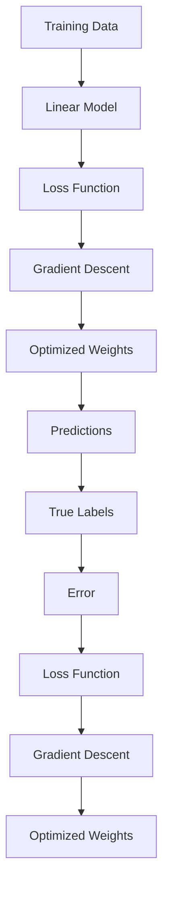

# Lesson 1: Supervised Learning Basics

## 1. First-Principles Intuition & Invariants

Supervised learning stands as a cornerstone of machine learning, fundamentally rooted in the problem of function approximation. At its core, supervised learning aims to construct a mapping from input data to output labels based on a set of labeled training examples. This process is akin to learning a function \( f: X \rightarrow Y \), where \( X \) represents the input space and \( Y \) the output space. The essence of supervised learning lies in the assumption that the relationship between inputs and outputs can be captured by a model that generalizes well beyond the training data.

The problem space of supervised learning is vast, encompassing a wide array of applications such as image classification, speech recognition, and natural language processing. The mathematical underpinnings of supervised learning are deeply intertwined with concepts from statistics and optimization. Central to this domain is the notion of a loss function, which quantifies the discrepancy between the predicted outputs and the true labels. Common loss functions include mean squared error for regression tasks and cross-entropy loss for classification tasks. The goal of training a supervised learning model is to minimize this loss function, thereby improving the model's predictive accuracy.

A critical invariant in supervised learning is the principle of generalization. A model is considered successful if it not only performs well on the training data but also generalizes to unseen data. This principle is often formalized through the bias-variance tradeoff, where a model with high bias may underfit the data, failing to capture the underlying patterns, while a model with high variance may overfit, capturing noise as if it were a true signal. Balancing bias and variance is a central challenge in supervised learning, requiring careful selection of model complexity and regularization techniques.

Another invariant is the importance of data quality and quantity. The performance of a supervised learning model is heavily dependent on the quality and quantity of the training data. High-quality, well-labeled data is essential for training models that can generalize effectively. Additionally, the diversity of the training data plays a crucial role in ensuring that the model can handle a wide range of inputs.

## 2. Core Architecture & Mechanics

The architecture of a supervised learning system is built around the concept of a model, which is typically a mathematical function parameterized by a set of weights. The training process involves iteratively adjusting these weights to minimize the loss function. One of the most widely used algorithms for this purpose is gradient descent, which updates the weights in the direction that reduces the loss function. Variants of gradient descent, such as stochastic gradient descent (SGD) and mini-batch gradient descent, are commonly employed to improve convergence speed and stability.

To illustrate the mechanics of supervised learning, consider a simple linear regression model. In this case, the model is a linear function of the form \( f(x) = wx + b \), where \( w \) is the weight and \( b \) is the bias. The training process involves finding the values of \( w \) and \( b \) that minimize the mean squared error between the predicted outputs and the true labels. This can be visualized as finding the line of best fit in a scatter plot of the data.

In this diagram, the training data is fed into a linear model, which produces predictions. The loss function quantifies the error between the predictions and the true labels, and gradient descent is used to update the weights of the model to minimize this error. This process is repeated iteratively until the model converges to a set of weights that minimize the loss function.

Another key component of supervised learning is the evaluation of model performance. Common evaluation metrics include accuracy, precision, recall, F1-score, and area under the receiver operating characteristic curve (AUC-ROC). These metrics provide insights into the model's ability to make accurate predictions and handle imbalanced datasets. For example, accuracy measures the proportion of correct predictions, while precision and recall provide more detailed insights into the model's performance on positive and negative classes, respectively.

## 3. High-Performance Optimization & Failure Modes

Optimizing the performance of supervised learning models involves several considerations, including concurrency, resource scaling, and boundary edge cases. One of the primary challenges is the computational cost of training large models on large datasets. To address this, parallel and distributed computing techniques are often employed. For example, mini-batch gradient descent can be parallelized across multiple GPUs or nodes in a cluster, allowing for faster convergence and reduced training times.

Another important consideration is the scalability of the model architecture. As the size and complexity of the model increase, the computational and memory requirements also grow. Techniques such as model pruning, quantization, and knowledge distillation can be used to reduce the size and complexity of the model while maintaining its predictive accuracy. These techniques involve removing redundant or less important parts of the model, reducing the precision of the weights, or training a smaller model to mimic the behavior of a larger model, respectively.

Boundary edge cases and failure modes are also critical considerations in supervised learning. One common failure mode is overfitting, where the model captures noise in the training data as if it were a true signal. Regularization techniques such as L1 and L2 regularization can be used to mitigate overfitting by penalizing large weights. Another failure mode is underfitting, where the model is too simple to capture the underlying patterns in the data. In this case, increasing the model complexity or using a more expressive model architecture can help improve performance.

In addition to these technical challenges, there are also ethical and societal considerations in supervised learning. For example, biased training data can lead to biased models that perpetuate and amplify existing social inequalities. It is essential to carefully evaluate the fairness and ethical implications of supervised learning models and take steps to mitigate any potential biases.

Supervised learning is a powerful and versatile approach to machine learning that is grounded in the principles of function approximation and optimization.
