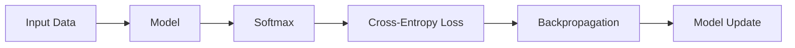
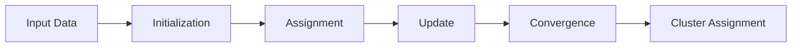
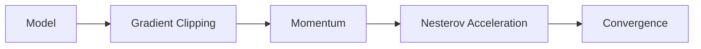

# Lesson 4: Advanced Topics in Supervised and Unsupervised Learning

## 1. First-Principles Intuition & Invariants

In the realm of machine learning, both supervised and unsupervised learning paradigms have evolved significantly over the years. However, their underlying principles and invariants remain rooted in the fundamental concepts of statistical inference and optimization. To grasp the advanced techniques and recent developments in these areas, it's essential to revisit the theoretical foundations and problem spaces of each paradigm.

Supervised learning, as we've discussed earlier, revolves around the concept of minimizing the expected loss between predicted and actual labels. This is typically achieved through the minimization of a loss function, such as mean squared error (MSE) or cross-entropy, with respect to the model's parameters. The invariants of supervised learning include the need for labeled data, the importance of regularization to prevent overfitting, and the reliance on optimization algorithms to converge to a global minimum.

Unsupervised learning, on the other hand, focuses on discovering patterns and relationships within unlabeled data. This is often achieved through clustering, dimensionality reduction, or density estimation techniques. The invariants of unsupervised learning include the need for robust initialization methods, the importance of convergence criteria to avoid local optima, and the reliance on evaluation metrics that capture the essence of the discovered patterns.

## 2. Core Architecture & Mechanics

To delve deeper into the advanced techniques in both supervised and unsupervised learning, let's examine the internal data structures and algorithms used in each paradigm.

### Supervised Learning

One of the key components of supervised learning is the loss function, which measures the difference between predicted and actual labels. A common loss function used in classification tasks is the cross-entropy loss, which can be visualized as follows:

In this diagram, the input data flows through the model, which outputs a probability distribution over the classes. The cross-entropy loss is then computed between the predicted probabilities and the actual labels. The backpropagation algorithm is used to compute the gradients of the loss with respect to the model's parameters, which are then used to update the model.

### Unsupervised Learning

Unsupervised learning often relies on clustering algorithms, such as k-means or hierarchical clustering. These algorithms work by iteratively updating the cluster assignments and centroids until convergence. The key invariant of unsupervised learning is the need for robust initialization methods to ensure that the algorithm converges to a meaningful solution.

In this diagram, the input data is initialized with random cluster assignments. The algorithm then iteratively updates the cluster assignments and centroids until convergence.

## 3. High-Performance Optimization & Failure Modes

As we push the boundaries of machine learning, it's essential to consider the high-performance optimization and failure modes of both supervised and unsupervised learning.

### Supervised Learning

One of the key challenges in supervised learning is the need for efficient optimization algorithms to converge to a global minimum. This can be achieved through the use of techniques such as gradient clipping, momentum, or Nesterov acceleration. However, these techniques can also introduce failure modes, such as oscillations or divergence.

In this diagram, the model is optimized using gradient clipping, momentum, and Nesterov acceleration. The convergence of the algorithm is ensured through the use of a robust convergence criterion.

### Unsupervised Learning

Unsupervised learning often relies on clustering algorithms, which can be sensitive to initialization methods. This can lead to failure modes such as convergence to local optima or divergence.

In this diagram, the input data is initialized with random cluster assignments. The algorithm then iteratively updates the cluster assignments and centroids until convergence.

By understanding the advanced techniques, evaluation metrics, and recent developments in both supervised and unsupervised learning, we can push the boundaries of machine learning and develop more robust and efficient algorithms for real-world applications.
