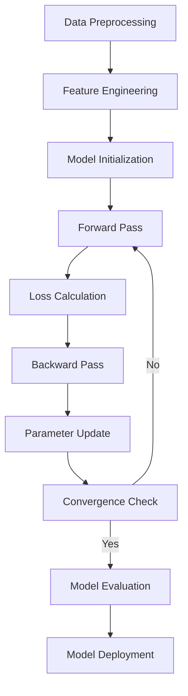

# Lesson 1: Foundations & Mathematical Formulation

## Curriculum Roadmap
This masterclass curriculum is designed to provide a comprehensive understanding of the foundational principles and mathematical underpinnings of loss functions and gradient descent in the context of machine learning. The curriculum is structured to build a deep, intuitive grasp of these concepts, their mathematical formalization, and their practical application in real-world machine learning pipelines. The modules are as follows:

1. **Foundations & Mathematical Formulation**: Establishing the theoretical grounding, problem space formulation, and mathematical invariants of loss functions and gradient descent.
2. **Gradient Descent Variants**: Exploring different flavors of gradient descent, including stochastic, mini-batch, and adaptive methods.
3. **Convex Optimization & Duality**: Delving into the mathematical properties of convex functions and the principles of duality in optimization.
4. **Regularization Techniques**: Understanding the role of regularization in preventing overfitting and improving model generalization.
5. **Advanced Optimization Algorithms**: Investigating advanced optimization techniques such as conjugate gradient, quasi-Newton methods, and second-order optimization.
6. **Practical Implementation & Debugging**: Applying the theoretical knowledge to practical implementations, debugging strategies, and performance tuning.

## 1. First-Principles Intuition & The Problem Space

At the heart of machine learning lies the problem of finding a model that can accurately predict outcomes based on input data. This task is inherently complex due to the vast and often noisy nature of real-world datasets. The challenge is to define a model that not only fits the training data well but also generalizes effectively to unseen data. This is where loss functions and optimization algorithms come into play.

A loss function serves as a quantitative measure of how well a model's predictions match the actual outcomes. It provides a scalar value that represents the discrepancy between the predicted and actual values, allowing us to evaluate the performance of the model. The goal of training a machine learning model is to minimize this loss function, thereby improving the model's accuracy and generalization capabilities.

The choice of loss function is crucial as it directly influences the behavior of the optimization process. Different types of problems require different loss functions. For instance, in regression tasks, the mean squared error (MSE) is commonly used, while in classification tasks, the cross-entropy loss is preferred. The loss function must be carefully selected to align with the specific problem domain and the desired outcome.

Gradient descent is the primary optimization algorithm used to minimize the loss function. It is an iterative method that adjusts the model parameters in the direction that reduces the loss function. The core idea is to take small steps in the direction of the negative gradient of the loss function with respect to the model parameters. This process is repeated until the loss function converges to a minimum, ideally the global minimum.

The effectiveness of gradient descent is contingent upon several factors, including the choice of learning rate, the initialization of model parameters, and the landscape of the loss function. A well-chosen learning rate ensures that the optimization process is neither too slow nor too erratic. Proper initialization helps in avoiding local minima, and understanding the loss function landscape aids in selecting appropriate optimization strategies.

## 2. Mathematical Formalization & Core Invariants

To formalize the concepts introduced in the previous section, we delve into the mathematical formulation of loss functions and gradient descent. We begin by defining a loss function \( L(\theta) \), where \( \theta \) represents the model parameters. The loss function is a scalar-valued function that quantifies the discrepancy between the predicted values \( \hat{y} \) and the actual values \( y \).

### Loss Function Formulation

For a dataset consisting of \( n \) samples, the loss function can be expressed as:

\[
L(\theta) = \frac{1}{n} \sum_{i=1}^{n} \ell(\hat{y}_i, y_i)
\]

where \( \ell(\hat{y}_i, y_i) \) is the loss for a single sample. The choice of \( \ell \) depends on the specific problem. For regression tasks, the mean squared error (MSE) loss is defined as:

\[
\ell(\hat{y}_i, y_i) = (\hat{y}_i - y_i)^2
\]

For binary classification tasks, the cross-entropy loss is given by:

\[
\ell(\hat{y}_i, y_i) = -[y_i \log(\hat{y}_i) + (1 - y_i) \log(1 - \hat{y}_i)]
\]

In the case of multi-class classification, the categorical cross-entropy loss is used:

\[
\ell(\hat{y}_i, y_i) = -\sum_{j=1}^{C} y_{ij} \log(\hat{y}_{ij})
\]

where \( C \) is the number of classes and \( y_{ij} \) is a binary indicator variable that is 1 if the \( i \)-th sample belongs to the \( j \)-th class and 0 otherwise.

### Gradient Descent Algorithm

Gradient descent is an iterative optimization algorithm that seeks to minimize the loss function by updating the model parameters in the direction of the negative gradient. The update rule for gradient descent is given by:

\[
\theta^{(t+1)} = \theta^{(t)} - \alpha \nabla L(\theta^{(t)})
\]

where \( \theta^{(t)} \) represents the model parameters at iteration \( t \), \( \alpha \) is the learning rate, and \( \nabla L(\theta^{(t)}) \) is the gradient of the loss function with respect to the model parameters at iteration \( t \).

The gradient \( \nabla L(\theta^{(t)}) \) is computed as:

\[
\nabla L(\theta^{(t)}) = \frac{1}{n} \sum_{i=1}^{n} \nabla \ell(\hat{y}_i, y_i)
\]

For the mean squared error (MSE) loss, the gradient is:

\[
\nabla \ell(\hat{y}_i, y_i) = 2 (\hat{y}_i - y_i) \nabla \hat{y}_i
\]

For the cross-entropy loss, the gradient is:

\[
\nabla \ell(\hat{y}_i, y_i) = \frac{\hat{y}_i - y_i}{\hat{y}_i (1 - \hat{y}_i)} \nabla \hat{y}_i
\]

### Core Invariants

The mathematical formulation of loss functions and gradient descent is grounded in several core invariants:

1. **Convexity**: A loss function is convex if the line segment between any two points on the function lies above the function itself. Convex loss functions have a unique global minimum, making them easier to optimize.
2. **Differentiability**: The loss function must be differentiable to compute the gradient. Differentiability ensures that the gradient descent algorithm can be applied effectively.
3. **Boundedness**: The loss function should be bounded to prevent the optimization process from diverging. Boundedness ensures that the model parameters remain within a reasonable range.
4. **Non-negativity**: The loss function should be non-negative, with a minimum value of zero indicating perfect predictions.

These invariants provide a solid foundation for the mathematical formulation of loss functions and gradient descent, ensuring that the optimization process is well-defined and converges to a meaningful solution.

## 3. High-Level Pipeline & Architecture Dataflow

To illustrate the high-level pipeline and architecture dataflow of a machine learning model using loss functions and gradient descent, we present a Mermaid diagram. This diagram provides a visual representation of the model pipeline, tensor transformations, and agentic control flow.

### Detailed Pipeline Explanation

1. **Data Preprocessing**: The raw data is preprocessed to handle missing values, normalize features, and encode categorical variables. This step ensures that the data is in a suitable format for training the model.
2. **Feature Engineering**: Relevant features are selected and transformed to improve the model's performance. Feature engineering involves creating new features, selecting the most informative features, and reducing dimensionality.
3. **Model Initialization**: The model parameters are initialized to random values or using specific initialization techniques. Proper initialization is crucial for the convergence of the optimization process.
4. **Forward Pass**: The input data is passed through the model to compute the predicted values. This step involves matrix multiplications, activation functions, and other transformations.
5. **Loss Calculation**: The loss function is applied to compute the discrepancy between the predicted values and the actual values. The loss value provides a quantitative measure of the model's performance.
6. **Backward Pass**: The gradient of the loss function with respect to the model parameters is computed using the chain rule. This step involves backpropagation through the model layers to compute the gradients.
7. **Parameter Update**: The model parameters are updated using the computed gradients and the learning rate. This step adjusts the parameters in the direction that reduces the loss function.
8. **Convergence Check**: The convergence criteria are evaluated to determine whether the optimization process has reached a satisfactory solution. Common convergence criteria include a maximum number of iterations or a minimum change in the loss value.
9. **Model Evaluation**: Once the model has converged, it is evaluated on a validation dataset to assess its performance. This step involves computing metrics such as accuracy, precision, recall, and F1-score.
10. **Model Deployment**: The trained model is deployed to a production environment for making predictions on new data. This step involves integrating the model into the application and ensuring that it performs well in real-world scenarios.

This high-level pipeline provides a comprehensive overview of the machine learning process, highlighting the key steps involved in training a model using loss functions and gradient descent. By understanding the architecture dataflow, we can gain insights into the interactions between different components and the overall flow of the optimization process.

In conclusion, this lesson establishes the foundational principles and mathematical invariants of loss functions and gradient descent. By understanding the problem space, mathematical formulation, and high-level pipeline, we can build a robust and effective machine learning model. The subsequent lessons will delve deeper into advanced optimization techniques and practical implementation strategies, providing a comprehensive understanding of the field.
