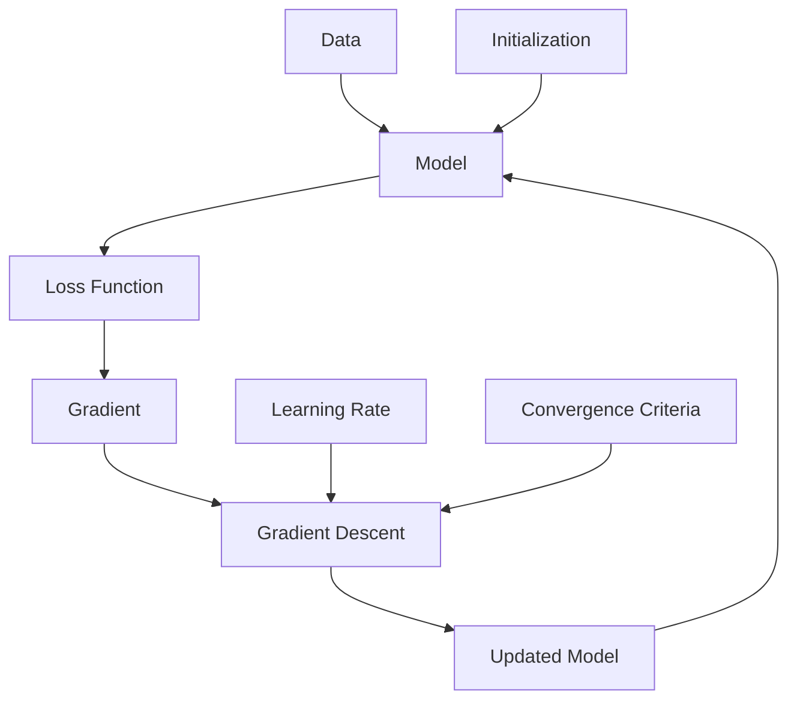

# Lesson 1: Foundations & System Invariants

## Curriculum Roadmap
This masterclass curriculum on "02 Loss Functions And Gradient Descent" is designed to provide a deep, unshakeable theoretical grounding in the foundational principles of machine learning. The curriculum is structured to build a comprehensive understanding of the mathematical and architectural invariants that underpin the operation of machine learning models. The modules are as follows:

- **Module 1: Foundations & System Invariants**
  - First-Principles Mental Model & Problem Space
  - Fundamental System Guarantees & Non-Negotiable Invariants
  - High-Level Process & Component Architecture

- **Module 2: Loss Functions**
  - Common Loss Functions: Mean Squared Error, Cross-Entropy Loss
  - Custom Loss Functions and Derivatives
  - Loss Function Properties: Convexity, Smoothness, and Differentiability

- **Module 3: Gradient Descent**
  - Gradient Descent Variants: Batch, Stochastic, and Mini-Batch
  - Convergence Criteria and Learning Rate Schedules
  - Gradient Descent Optimization Techniques: Momentum, RMSProp, Adam

- **Module 4: Practical Implementation**
  - Implementing Loss Functions and Gradient Descent in Python
  - Debugging and Diagnosing Gradient Descent Issues
  - Case Studies: Real-World Applications of Loss Functions and Gradient Descent

## 1. First-Principles Mental Model & Problem Space

The concept of loss functions and gradient descent is rooted in the fundamental problem of optimization in machine learning. At its core, machine learning is about finding a model that best fits a given dataset, where "best" is defined by a specific criterion. This criterion is encapsulated by the loss function, which quantifies the discrepancy between the predicted outputs of the model and the actual target values. The goal of training a machine learning model is to minimize this loss function, thereby improving the model's predictive accuracy.

The historical context of loss functions and gradient descent is deeply intertwined with the development of calculus and optimization theory. The concept of minimizing a function to find its global minimum has been a central theme in mathematics for centuries. In the context of machine learning, this problem is particularly challenging due to the high dimensionality and non-convex nature of the loss landscapes encountered in practice. The loss function serves as a bridge between the mathematical formulation of the problem and the practical algorithms used to solve it.

Gradient descent, introduced in the 19th century by Cauchy, is a first-order iterative optimization algorithm used to find the minimum of a function. It operates by iteratively adjusting the parameters of the model in the direction of the negative gradient of the loss function. The gradient, being the vector of partial derivatives of the loss function with respect to the model parameters, provides a local direction of steepest descent. By following this direction, gradient descent systematically reduces the value of the loss function, guiding the model towards a configuration that better fits the data.

The choice of loss function and optimization algorithm is crucial for the success of a machine learning model. Different loss functions are suited to different types of problems, such as regression, classification, and clustering. Similarly, different variants of gradient descent offer trade-offs between computational efficiency, convergence speed, and robustness to local minima. Understanding these trade-offs is essential for designing effective machine learning systems.

## 2. Fundamental System Guarantees & Non-Negotiable Invariants

The theoretical guarantees and invariants of loss functions and gradient descent are rooted in the mathematical properties of the loss landscape and the convergence behavior of the optimization algorithm. These guarantees provide a rigorous foundation for the practical application of these concepts in machine learning.

### Loss Function Properties

A loss function is a scalar-valued function that measures the discrepancy between the predicted outputs of a model and the actual target values. The choice of loss function is critical for the success of a machine learning model, as it defines the objective that the model is trying to optimize. The properties of a loss function are as follows:

- **Convexity**: A loss function is convex if its second derivative is non-negative. Convex loss functions have a unique global minimum, making them easier to optimize using gradient descent. However, many loss functions encountered in practice, such as those used in neural networks, are non-convex, which introduces additional challenges in finding the global minimum.

- **Smoothness**: A loss function is smooth if it is differentiable and its gradient is Lipschitz continuous. Smooth loss functions have well-defined gradients, which are essential for the convergence of gradient descent. Smoothness ensures that small changes in the model parameters result in small changes in the loss function, providing a stable optimization landscape.

- **Differentiability**: A loss function is differentiable if its gradient exists at every point in the parameter space. Differentiability is a necessary condition for the application of gradient descent, as it allows the algorithm to compute the direction of steepest descent. Non-differentiable loss functions can be challenging to optimize, as they may have discontinuities or sharp corners that can impede convergence.

### Gradient Descent Convergence

Gradient descent is a first-order optimization algorithm that iteratively adjusts the parameters of a model to minimize the loss function. The convergence behavior of gradient descent is governed by several factors, including the choice of learning rate, the properties of the loss function, and the initialization of the model parameters.

- **Learning Rate**: The learning rate is a hyperparameter that controls the step size of the parameter updates in gradient descent. A learning rate that is too small can result in slow convergence, while a learning rate that is too large can cause the algorithm to overshoot the minimum and diverge. The choice of learning rate is critical for the convergence of gradient descent and is often tuned through experimentation.

- **Convergence Criteria**: The convergence criteria define the conditions under which the gradient descent algorithm terminates. Common convergence criteria include a maximum number of iterations, a minimum change in the loss function, or a minimum change in the model parameters. The choice of convergence criteria is essential for ensuring that the algorithm terminates at a reasonable point and does not continue indefinitely.

- **Initialization**: The initialization of the model parameters can significantly impact the convergence behavior of gradient descent. Poor initialization can lead to convergence to local minima or saddle points, while good initialization can help the algorithm find the global minimum more efficiently. Initialization strategies, such as Xavier or He initialization, are designed to provide a good starting point for the optimization process.

## 3. High-Level Process & Component Architecture

The high-level process and component architecture of loss functions and gradient descent can be represented using a Mermaid diagram, which illustrates the core data and control flow. The diagram below provides a visual representation of the key components and their interactions.

### Data

The data component represents the input dataset used to train the machine learning model. The data is typically preprocessed and split into training, validation, and test sets. The training set is used to update the model parameters, while the validation set is used to tune hyperparameters and prevent overfitting. The test set is used to evaluate the final performance of the model.

### Model

The model component represents the mathematical function used to make predictions. The model parameters are adjusted during training to minimize the loss function. Common types of models include linear regression, logistic regression, decision trees, and neural networks.

### Loss Function

The loss function component quantifies the discrepancy between the predicted outputs of the model and the actual target values. The choice of loss function is critical for the success of the machine learning model, as it defines the objective that the model is trying to optimize. Common loss functions include mean squared error, cross-entropy loss, and hinge loss.

### Gradient

The gradient component represents the vector of partial derivatives of the loss function with respect to the model parameters. The gradient provides a local direction of steepest descent, which is used by gradient descent to update the model parameters.

### Gradient Descent

The gradient descent component represents the optimization algorithm used to minimize the loss function. Gradient descent iteratively adjusts the model parameters in the direction of the negative gradient, systematically reducing the value of the loss function. The convergence behavior of gradient descent is governed by the learning rate, convergence criteria, and initialization of the model parameters.

### Updated Model

The updated model component represents the model parameters after each iteration of gradient descent. The updated model is used to make predictions on new data and is further refined through additional iterations of training.

### Learning Rate

The learning rate component represents the hyperparameter that controls the step size of the parameter updates in gradient descent. The learning rate is a critical factor in the convergence behavior of gradient descent and is often tuned through experimentation.

### Convergence Criteria

The convergence criteria component represents the conditions under which the gradient descent algorithm terminates. Common convergence criteria include a maximum number of iterations, a minimum change in the loss function, or a minimum change in the model parameters. The choice of convergence criteria is essential for ensuring that the algorithm terminates at a reasonable point and does not continue indefinitely.

### Initialization

The initialization component represents the initial values of the model parameters. The initialization of the model parameters can significantly impact the convergence behavior of gradient descent. Poor initialization can lead to convergence to local minima or saddle points, while good initialization can help the algorithm find the global minimum more efficiently. Initialization strategies, such as Xavier or He initialization, are designed to provide a good starting point for the optimization process.

In summary, the high-level process and component architecture of loss functions and gradient descent provide a comprehensive framework for understanding the key components and their interactions. By understanding the first-principles mental model, fundamental system guarantees, and high-level process, senior software engineers, systems programmers, and infrastructure architects can build a deep, unshakeable theoretical grounding in the foundational principles of machine learning.
