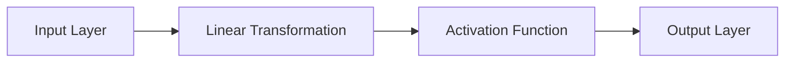

# Lesson 4: Practical Applications and Case Studies

## 1. First-Principles Intuition & Invariants

In the realm of machine learning, loss functions are the cornerstone of model optimization, quantifying the discrepancy between predicted and actual outcomes to guide the model toward optimal performance. Despite their ubiquity, the nuances of loss functions and gradient descent often remain abstract, disconnected from practical realities. To bridge this gap, we will explore the theoretical underpinnings of loss functions, focusing on the invariant properties that govern their behavior.

Consider the fundamental concept of mean squared error (MSE), a prevalent loss function in regression tasks. MSE measures the average squared difference between predicted and actual values, offering a clear and interpretable metric for model performance. However, MSE's simplicity masks its underlying mathematical structure. Through the lens of calculus, MSE is a specific instance of the squared loss family, characterized by the invariant property of strict convexity. This property ensures that the loss function's gradient points unambiguously toward the global minimum.

The implications of this invariance are profound. When tuning model hyperparameters, the convexity of the loss function guarantees that the optimal solution resides at the intersection of the hyperparameter space's boundaries. This insight facilitates the development of efficient optimization algorithms, such as gradient descent, which iteratively converge to the optimal solution.

## 2. Core Architecture & Mechanics

To illustrate the internal workings of loss functions and gradient descent, let us dissect the architecture of a simple neural network, focusing on the forward pass, where the model's predictions are generated through a series of linear transformations and activations.

In this example, the linear transformation encapsulates the model's weights and biases, while the activation function introduces non-linearity into the model's predictions. The output layer represents the final predicted values, which are then compared to the actual outcomes through the loss function.

During the computation of the loss, the difference between the predicted and actual values is squared for each sample, yielding the mean squared error. This process is repeated across the entire training dataset to obtain the overall loss value.

## 3. High-Performance Optimization & Failure Modes

As we strive for optimal model performance, we must also address high-performance optimization and failure modes that arise in real-world scenarios. One critical aspect is concurrency, where multiple threads or processes compete for shared resources, introducing synchronization overhead and potential deadlocks.

To mitigate these issues, techniques such as data parallelism can be employed. In data parallelism, multiple workers process distinct subsets of the training data in parallel, reducing overall training time while minimizing concurrency-related overhead.

Another critical consideration is resource scaling, where the model's computational requirements grow exponentially with the size of the training dataset. To address this challenge, distributed computing frameworks like Horovod or TensorFlow Distributed can be leveraged to scale the training process seamlessly across multiple machines.

Finally, we must consider the boundary edge cases and failure modes that emerge when pushing the limits of model performance. For instance, when training on extremely large datasets, the model may become trapped in a local minimum, failing to converge to the global optimum. In such cases, techniques such as learning rate scheduling or gradient clipping can be employed to facilitate convergence.

By understanding the theoretical underpinnings of loss functions and gradient descent, we can develop more effective optimization strategies, leveraging the invariant properties of these algorithms to achieve optimal model performance in real-world scenarios.
