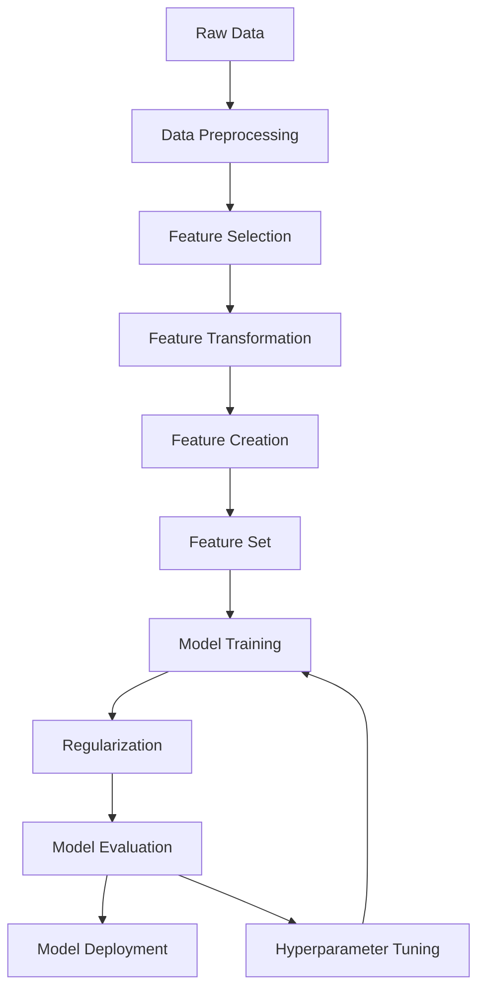

# Lesson 1: Foundations & System Invariants

## Curriculum Roadmap
This masterclass curriculum on Feature Engineering and Regularization is designed to provide a deep, unshakeable theoretical grounding in the core principles and architectural invariants that underpin effective machine learning models. The curriculum is structured to build upon foundational concepts, progressively delving into advanced techniques and practical applications. The modules are as follows:

1. **Foundations & System Invariants**: Establishing the essential principles and guarantees that govern feature engineering and regularization.
2. **Feature Engineering Techniques**: Exploring various methods for creating meaningful features that enhance model performance.
3. **Regularization Methods**: Understanding the mechanisms and implementations of regularization to prevent overfitting.
4. **Advanced Feature Engineering**: Delving into sophisticated techniques for feature extraction and transformation.
5. **Regularization in Practice**: Applying regularization strategies in real-world machine learning scenarios.
6. **Case Studies & Best Practices**: Analyzing real-world examples and best practices for feature engineering and regularization.

## 1. First-Principles Mental Model & Problem Space

Feature engineering and regularization are two critical components of the machine learning pipeline that address fundamental challenges in model development. Feature engineering involves the process of selecting, transforming, and creating new features from raw data to improve the performance of machine learning models. Regularization, on the other hand, is a technique used to prevent overfitting by adding a penalty term to the loss function, thereby constraining the model's complexity.

The necessity of feature engineering arises from the fact that raw data often contains noise, irrelevant information, and non-linear relationships that can hinder model performance. By carefully selecting and transforming features, we can highlight the most informative aspects of the data, making it easier for the model to learn the underlying patterns. Feature engineering is both an art and a science, requiring a deep understanding of the domain and the data itself.

Regularization is essential because machine learning models, particularly those with high capacity, have a tendency to overfit the training data. Overfitting occurs when a model learns not only the underlying patterns but also the noise and idiosyncrasies of the training set, leading to poor generalization on unseen data. Regularization techniques help mitigate this risk by introducing a penalty for overly complex models, encouraging the model to find a balance between fitting the training data and maintaining generalizability.

The problem space of feature engineering and regularization is inherently intertwined with the broader challenges of machine learning, such as data quality, model interpretability, and computational efficiency. Effective feature engineering and regularization not only improve model performance but also enhance the robustness and reliability of the machine learning system.

## 2. Fundamental System Guarantees & Non-Negotiable Invariants

To ensure the effectiveness of feature engineering and regularization, it is crucial to establish a set of fundamental system guarantees and non-negotiable invariants. These guarantees and invariants provide a solid foundation for building reliable and efficient machine learning models.

### Feature Engineering Guarantees

1. **Relevance**: Features should be relevant to the target variable, capturing the most informative aspects of the data.
2. **Independence**: Features should be independent of each other to avoid multicollinearity, which can confuse the model and lead to unstable estimates.
3. **Scalability**: Feature engineering techniques should be scalable to handle large datasets and complex models.
4. **Interpretability**: Features should be interpretable, allowing domain experts to understand the model's decision-making process.

### Regularization Invariants

1. **Penalty Term**: Regularization introduces a penalty term to the loss function, which must be mathematically well-defined and computationally efficient.
2. **Model Complexity**: Regularization should effectively control model complexity, preventing overfitting without underfitting.
3. **Generalization**: Regularization should enhance the model's ability to generalize to unseen data, ensuring robust performance in real-world scenarios.
4. **Hyperparameter Tuning**: Regularization techniques often require hyperparameter tuning, which must be performed systematically to achieve optimal results.

## 3. High-Level Process & Component Architecture

The high-level process of feature engineering and regularization involves several key components and control flows. The following Mermaid diagram illustrates the core data and control flow:

### Data Preprocessing

Data preprocessing is the initial step in the feature engineering pipeline, where raw data is cleaned and prepared for analysis. This step involves handling missing values, removing duplicates, and normalizing or standardizing data to ensure consistency.

### Feature Selection

Feature selection involves identifying the most relevant features that contribute to the target variable. This step helps reduce dimensionality, improve model performance, and enhance interpretability. Common feature selection techniques include filter methods, wrapper methods, and embedded methods.

### Feature Transformation

Feature transformation involves modifying the existing features to improve their suitability for the model. This step can include scaling, encoding categorical variables, and applying mathematical transformations such as logarithmic or polynomial functions.

### Feature Creation

Feature creation involves generating new features from the existing data. This step can include combining multiple features, extracting domain-specific features, and using techniques such as polynomial features or interaction terms.

### Model Training

Model training involves fitting a machine learning model to the feature set. This step involves selecting an appropriate algorithm, defining the loss function, and optimizing the model parameters.

### Regularization

Regularization involves adding a penalty term to the loss function to control model complexity. Common regularization techniques include L1 regularization (Lasso), L2 regularization (Ridge), and Elastic Net regularization.

### Model Evaluation

Model evaluation involves assessing the performance of the regularized model on a validation set. This step involves using metrics such as accuracy, precision, recall, F1-score, and ROC-AUC to evaluate the model's effectiveness.

### Model Deployment

Model deployment involves deploying the regularized model to a production environment. This step involves integrating the model into the existing system, ensuring scalability, and monitoring performance.

### Hyperparameter Tuning

Hyperparameter tuning involves systematically adjusting the hyperparameters of the regularization technique to achieve optimal results. This step involves using techniques such as grid search, random search, and Bayesian optimization.

In summary, feature engineering and regularization are critical components of the machine learning pipeline that address fundamental challenges in model development. By establishing a deep understanding of the underlying principles and guarantees, we can build reliable and efficient machine learning models that generalize well to unseen data.
