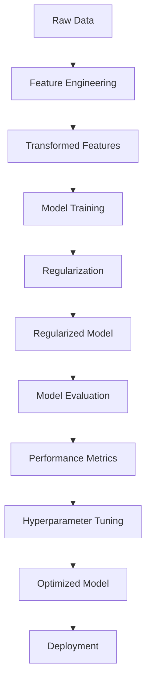

# Lesson 1: Foundations & Mathematical Formulation

## Curriculum Roadmap
This masterclass curriculum on Feature Engineering and Regularization is designed to provide a deep, unshakeable theoretical grounding in the foundational principles and techniques that underpin effective machine learning models. The curriculum is structured to build from first-principles intuition to advanced mathematical formalization, ensuring that senior machine learning engineers, AI researchers, and systems architects gain a comprehensive understanding of the problem space and the invariants that govern successful feature engineering and regularization strategies. The modules are as follows:

1. **Foundations & Mathematical Formulation**: Establishing the core principles and mathematical invariants of feature engineering and regularization.
2. **Feature Engineering Techniques**: Advanced techniques for feature selection, extraction, and transformation.
3. **Regularization Methods**: In-depth exploration of various regularization techniques and their mathematical underpinnings.
4. **Implementation & Optimization**: Practical implementation strategies and optimization techniques for feature engineering and regularization.
5. **Case Studies & Applications**: Real-world case studies and applications demonstrating the impact of feature engineering and regularization.

## 1. First-Principles Intuition & The Problem Space

Feature engineering and regularization are two critical components of the machine learning pipeline that address fundamental limitations and computational trade-offs inherent in the process of building predictive models. At its core, feature engineering involves the transformation of raw data into meaningful features that can improve the performance and interpretability of machine learning models. This process is essential because raw data often contains noise, irrelevant information, and non-linear relationships that can hinder the learning process. By carefully selecting and transforming features, we can enhance the model's ability to generalize from the training data to unseen data.

Regularization, on the other hand, is a technique used to prevent overfitting, which occurs when a model learns the noise in the training data rather than the underlying patterns. Overfitting is a common challenge in machine learning, especially when dealing with complex models and limited data. Regularization introduces a penalty term to the loss function, which discourages the model from fitting the noise in the training data. This penalty term can take various forms, such as L1 or L2 regularization, and it plays a crucial role in balancing the trade-off between bias and variance.

The problem space of feature engineering and regularization is inherently complex and multifaceted. It involves understanding the data domain, identifying relevant features, transforming features to improve model performance, and selecting appropriate regularization techniques to prevent overfitting. The goal is to create a model that is both accurate and generalizable, capable of making reliable predictions on new data. By mastering the principles of feature engineering and regularization, machine learning practitioners can build more robust and effective models that can withstand the challenges of real-world applications.

## 2. Mathematical Formalization & Core Invariants

To establish a rigorous mathematical foundation for feature engineering and regularization, we need to delve into the loss functions, optimization bounds, and non-negotiable guarantees that govern these techniques. Let us begin with the mathematical formulation of feature engineering.

### Feature Engineering

Feature engineering can be formalized as a transformation of the input feature space \( \mathcal{X} \) into a new feature space \( \mathcal{X}' \). This transformation is typically represented by a function \( \phi: \mathcal{X} \rightarrow \mathcal{X}' \). The goal of feature engineering is to find a transformation \( \phi \) that maps the input features to a new space where the underlying patterns in the data are more easily discernible by the learning algorithm.

Mathematically, the transformed feature space \( \mathcal{X}' \) can be expressed as:
\[
\mathcal{X}' = \phi(\mathcal{X})
\]
where \( \phi \) is a function that applies a series of transformations to the input features. These transformations can include scaling, normalization, polynomial expansion, interaction terms, and other domain-specific transformations.

### Regularization

Regularization is formalized as a penalty term added to the loss function to prevent overfitting. The loss function \( L \) is typically composed of two parts: the empirical risk \( R_{\text{emp}} \) and the regularization term \( R_{\text{reg}} \). The empirical risk measures the error of the model on the training data, while the regularization term penalizes the complexity of the model.

The regularized loss function \( L_{\text{reg}} \) can be expressed as:
\[
L_{\text{reg}}(\theta) = R_{\text{emp}}(\theta) + \lambda R_{\text{reg}}(\theta)
\]
where \( \theta \) represents the model parameters, \( \lambda \) is the regularization strength, and \( R_{\text{reg}}(\theta) \) is the regularization term.

There are several common types of regularization techniques, each with its own mathematical formulation:

1. **L1 Regularization (Lasso)**:
   \[
   R_{\text{reg}}(\theta) = \sum_{i=1}^{n} |\theta_i|
   \]
   L1 regularization adds the absolute value of the model parameters to the loss function, which can lead to sparse solutions where some parameters are exactly zero.

2. **L2 Regularization (Ridge)**:
   \[
   R_{\text{reg}}(\theta) = \sum_{i=1}^{n} \theta_i^2
   \]
   L2 regularization adds the squared value of the model parameters to the loss function, which tends to shrink the parameters towards zero but does not set them to zero.

3. **Elastic Net Regularization**:
   \[
   R_{\text{reg}}(\theta) = \alpha \sum_{i=1}^{n} |\theta_i| + (1 - \alpha) \sum_{i=1}^{n} \theta_i^2
   \]
   Elastic Net regularization combines L1 and L2 regularization, allowing for both sparsity and shrinkage.

The regularization strength \( \lambda \) is a hyperparameter that controls the trade-off between fitting the training data and preventing overfitting. A larger value of \( \lambda \) increases the penalty on the model complexity, leading to a simpler model, while a smaller value of \( \lambda \) allows the model to fit the training data more closely.

### Optimization Bounds & Non-Negotiable Guarantees

The optimization of the regularized loss function \( L_{\text{reg}}(\theta) \) is typically performed using gradient-based optimization algorithms such as stochastic gradient descent (SGD) or its variants. The optimization process seeks to find the model parameters \( \theta \) that minimize the regularized loss function:
\[
\theta^* = \arg\min_{\theta} L_{\text{reg}}(\theta)
\]

The optimization bounds and non-negotiable guarantees depend on the specific optimization algorithm and the properties of the loss function. For convex loss functions, gradient-based optimization algorithms can guarantee convergence to the global minimum. However, for non-convex loss functions, such as those encountered in deep learning, the optimization process may converge to local minima or saddle points.

In the context of feature engineering and regularization, the non-negotiable guarantees include:

1. **Bias-Variance Trade-off**: Regularization helps to balance the bias-variance trade-off by controlling the model complexity. A well-regularized model can achieve a good balance between bias and variance, leading to better generalization performance.

2. **Sparsity**: L1 regularization can lead to sparse solutions, where some model parameters are exactly zero. This sparsity can improve the interpretability of the model and reduce the computational cost of making predictions.

3. **Stability**: Regularization can improve the stability of the model by reducing the sensitivity to small changes in the training data. This stability is crucial for building robust models that can withstand the challenges of real-world applications.

## 3. High-Level Pipeline & Architecture Dataflow

To illustrate the high-level pipeline and architecture dataflow of feature engineering and regularization, we can use a Mermaid diagram to represent the model pipeline, tensor transformations, or agentic control flow. The diagram below shows the key steps involved in the feature engineering and regularization process:

In this pipeline:

1. **Raw Data**: The input data is collected and preprocessed to remove noise and handle missing values.
2. **Feature Engineering**: The raw data is transformed into meaningful features using various techniques such as scaling, normalization, and polynomial expansion.
3. **Transformed Features**: The transformed features are used to train the machine learning model.
4. **Model Training**: The model is trained on the transformed features using a suitable learning algorithm.
5. **Regularization**: Regularization techniques are applied to the model to prevent overfitting.
6. **Regularized Model**: The regularized model is evaluated on a validation set to assess its performance.
7. **Model Evaluation**: The performance of the regularized model is evaluated using metrics such as accuracy, precision, recall, and F1-score.
8. **Performance Metrics**: The performance metrics are used to guide the hyperparameter tuning process.
9. **Hyperparameter Tuning**: The hyperparameters of the model, including the regularization strength, are tuned to optimize the performance.
10. **Optimized Model**: The optimized model is deployed to make predictions on new data.
11. **Deployment**: The optimized model is deployed to a production environment where it can be used to make predictions on new data.

By understanding the high-level pipeline and architecture dataflow, machine learning practitioners can gain a deeper understanding of the feature engineering and regularization process and how these techniques can be applied to build effective machine learning models.
