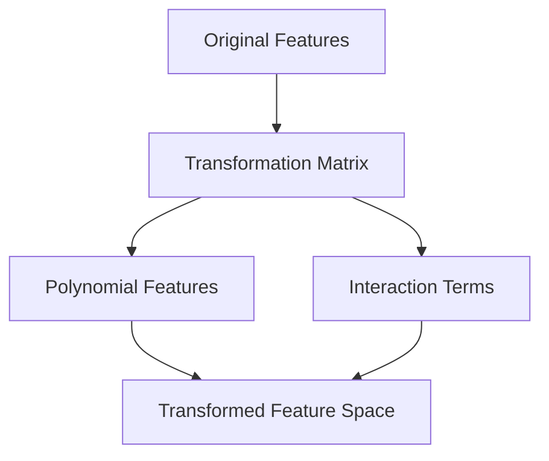

# Lesson 2: Advanced Feature Engineering

## 1. First-Principles Intuition & Invariants

Feature engineering is the process of transforming raw data into meaningful representations that can improve the performance of machine learning models. It is a critical step in the machine learning pipeline, often requiring a deep understanding of both the data and the problem domain. In this lesson, we delve into advanced feature engineering techniques, focusing on polynomial features, interaction terms, and domain-specific feature creation. These techniques aim to capture complex relationships within the data, thereby enhancing model accuracy and generalization.

Polynomial features are derived by raising existing features to higher powers. For instance, if we have a feature \( x \), polynomial features could include \( x^2 \), \( x^3 \), and so on. The rationale behind polynomial features is to model non-linear relationships between the input features and the target variable. However, the inclusion of polynomial features can lead to a significant increase in the dimensionality of the feature space, which can exacerbate the risk of overfitting. To mitigate this, regularization techniques such as L1 (Lasso) and L2 (Ridge) are often employed. These techniques penalize the magnitude of the coefficients, effectively reducing the complexity of the model and improving its generalization capabilities.

Interaction terms capture the combined effect of two or more features. For example, if we have features \( x_1 \) and \( x_2 \), an interaction term could be \( x_1 \times x_2 \). Interaction terms are particularly useful when the relationship between the target variable and the input features is not purely additive but involves some form of interaction. The inclusion of interaction terms can significantly enhance the model's ability to capture complex patterns in the data. However, like polynomial features, interaction terms can also increase the dimensionality of the feature space, necessitating careful consideration of regularization strategies.

Domain-specific feature creation involves the application of domain knowledge to engineer features that are particularly relevant to the problem at hand. This approach leverages the expertise of domain experts to identify and construct features that capture the underlying structure and semantics of the data. Domain-specific features can be highly effective in improving model performance, as they are tailored to the specific characteristics of the problem domain. For instance, in a financial forecasting model, domain-specific features might include economic indicators, market trends, and company-specific metrics. The creation of domain-specific features often requires a deep understanding of the problem domain and the ability to translate domain knowledge into actionable features.

The theoretical grounding of feature engineering is rooted in the principles of statistical learning theory. The goal of feature engineering is to transform the input data into a representation that maximizes the model's ability to learn the underlying patterns and relationships. This involves balancing the complexity of the feature space with the risk of overfitting. Regularization techniques play a crucial role in this balance, as they help to control the complexity of the model and improve its generalization capabilities. The choice of regularization technique and the degree of regularization are critical factors that can significantly impact the performance of the model.

## 2. Core Architecture & Mechanics

To illustrate the mechanics of advanced feature engineering, let us consider a simple example involving polynomial features and interaction terms. Suppose we have a dataset with two features, \( x_1 \) and \( x_2 \), and we want to create polynomial features up to degree 2 and interaction terms. The resulting feature space would include the original features, their squares, and their product:

\[
\begin{aligned}
&\text{Original Features:} & x_1, x_2 \\
&\text{Polynomial Features:} & x_1^2, x_2^2 \\
&\text{Interaction Terms:} & x_1 \times x_2 \\
\end{aligned}
\]

The transformation of the input data into this feature space can be represented as a matrix multiplication. Let \( \mathbf{X} \) be the original feature matrix, and let \( \mathbf{X}_{\text{poly}} \) be the transformed feature matrix. The transformation can be expressed as:

\[
\mathbf{X}_{\text{poly}} = \mathbf{X} \cdot \mathbf{P}
\]

where \( \mathbf{P} \) is a transformation matrix that maps the original features to the polynomial and interaction features. The transformation matrix \( \mathbf{P} \) can be constructed using polynomial basis functions and interaction terms.

To illustrate the construction of the transformation matrix, let us consider a simple example with two features, \( x_1 \) and \( x_2 \). The transformation matrix \( \mathbf{P} \) for polynomial features up to degree 2 and interaction terms would be:

\[
\mathbf{P} = \begin{bmatrix}
1 & x_1 & x_2 & x_1^2 & x_2^2 & x_1 \times x_2 \\
\end{bmatrix}
\]

The first column of \( \mathbf{P} \) represents the intercept term, which is often included in the feature space to account for the bias of the model. The second and third columns represent the original features \( x_1 \) and \( x_2 \). The fourth and fifth columns represent the polynomial features \( x_1^2 \) and \( x_2^2 \). The sixth column represents the interaction term \( x_1 \times x_2 \).

The transformation of the input data into the polynomial and interaction feature space can be visualized using a Mermaid diagram:

In this diagram, the original features are transformed into polynomial and interaction features using a transformation matrix. The resulting transformed feature space includes the original features, their squares, and their product.

## 3. High-Performance Optimization & Failure Modes

The high-performance optimization of feature engineering involves several key considerations. One of the primary challenges is the computational cost of generating polynomial and interaction features, especially for high-dimensional datasets. The number of polynomial and interaction features grows rapidly with the degree of the polynomial and the number of input features. For instance, if we have \( n \) input features and we want to create polynomial features up to degree \( d \), the number of polynomial features is given by the binomial coefficient:

\[
\binom{n+d}{d}
\]

The number of interaction terms is given by the binomial coefficient:

\[
\binom{n}{2}
\]

The computational cost of generating polynomial and interaction features can be mitigated using efficient algorithms and data structures. For instance, polynomial features can be generated using Horner's method, which reduces the number of multiplications required. Interaction terms can be generated using a nested loop structure, which iterates over all pairs of input features.

Another challenge in feature engineering is the risk of overfitting, especially when the feature space is high-dimensional. Overfitting occurs when the model learns the noise in the training data, rather than the underlying patterns and relationships. Regularization techniques such as L1 and L2 can help to mitigate the risk of overfitting by penalizing the magnitude of the coefficients. The choice of regularization technique and the degree of regularization are critical factors that can significantly impact the performance of the model.

The failure modes of feature engineering include the inclusion of irrelevant or redundant features, which can degrade the performance of the model. Irrelevant features do not provide any useful information about the target variable, while redundant features provide redundant information that can confuse the model. The inclusion of irrelevant or redundant features can be mitigated using feature selection techniques, which identify and remove irrelevant or redundant features from the feature space.

In conclusion, advanced feature engineering techniques such as polynomial features, interaction terms, and domain-specific feature creation are powerful tools for improving the performance of machine learning models. These techniques aim to capture complex relationships within the data, thereby enhancing model accuracy and generalization capabilities. However, the high-performance optimization of feature engineering involves several key considerations, including the computational cost of generating polynomial and interaction features, the risk of overfitting, and the inclusion of irrelevant or redundant features. By carefully balancing the complexity of the feature space with the risk of overfitting, and by leveraging domain knowledge to engineer relevant features, we can build machine learning models that are both accurate and generalizable.
