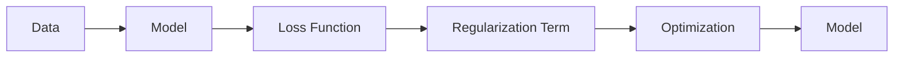

# Lesson 4: Regularization in Practice

Regularization techniques are a crucial aspect of machine learning model development, as they help prevent overfitting and improve model generalizability. In this lesson, we'll delve into the practical application of regularization techniques, exploring their impact on model performance and discussing key considerations for effective implementation.

## 1. First-Principles Intuition & Invariants

Regularization techniques can be viewed as a form of "Occam's Razor" in action, where the goal is to find the simplest model that best explains the data. This is achieved by adding a penalty term to the loss function, which encourages the model to reduce its complexity. The most common regularization techniques are L1 (Lasso) and L2 (Ridge) regularization.

Mathematically, L1 regularization can be represented as:

\[ \hat{\theta} = \arg\min_{\theta} \left( \frac{1}{n} \sum_{i=1}^{n} (y_i - \theta^T x_i)^2 + \lambda \sum_{j=1}^{p} |\theta_j| \right) \]

where $\lambda$ is the regularization parameter, $n$ is the number of samples, $p$ is the number of features, and $\theta_j$ represents the $j^{th}$ coefficient.

L2 regularization, on the other hand, is represented as:

\[ \hat{\theta} = \arg\min_{\theta} \left( \frac{1}{n} \sum_{i=1}^{n} (y_i - \theta^T x_i)^2 + \lambda \sum_{j=1}^{p} \theta_j^2 \right) \]

Both L1 and L2 regularization can be implemented using the following Python code snippet:
```python
import numpy as np
from sklearn.linear_model import Lasso, Ridge

# Generate sample data
X = np.random.rand(100, 10)
y = np.random.rand(100)

# L1 regularization
lasso_model = Lasso(alpha=0.1)
lasso_model.fit(X, y)

# L2 regularization
ridge_model = Ridge(alpha=0.1)
ridge_model.fit(X, y)
```
## 2. Core Architecture & Mechanics

Regularization techniques can be applied to various machine learning models, including linear regression, logistic regression, and neural networks. The core architecture of regularization techniques involves adding a penalty term to the loss function, which encourages the model to reduce its complexity.

Here's a high-level overview of the regularization process using a simple linear regression model:

In this diagram, the regularization term is added to the loss function, which encourages the model to reduce its complexity.

## 3. High-Performance Optimization & Failure Modes

Regularization techniques can have a significant impact on model performance, but they can also introduce new failure modes. For example, over-regularization can lead to underfitting, while under-regularization can lead to overfitting.

To mitigate these failure modes, it's essential to carefully tune the regularization parameter and monitor model performance on a validation set. Here's an example of how to tune the regularization parameter using a grid search:
```python
from sklearn.model_selection import GridSearchCV

# Define the regularization parameter grid
param_grid = {'lasso__alpha': [0.1, 0.5, 1.0]}

# Perform grid search
grid_search = GridSearchCV(lasso_model, param_grid, cv=5)
grid_search.fit(X, y)

# Print the best regularization parameter
print("Best regularization parameter:", grid_search.best_params_)
```
In conclusion, regularization techniques are a crucial aspect of machine learning model development, and their effective implementation requires careful consideration of the regularization parameter and model performance. By following the guidelines outlined in this lesson, you can apply regularization techniques to improve model generalizability and prevent overfitting.
