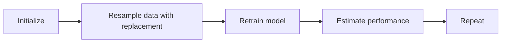
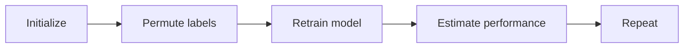

# Lesson 4: Advanced Evaluation Strategies

## 1. First-Principles Intuition & Invariants

When evaluating machine learning models, we often rely on metrics such as accuracy, precision, and recall. However, these metrics can be misleading, especially when dealing with complex datasets or models. To gain a deeper understanding of our models' performance, we need to employ more advanced evaluation strategies. At their core, these strategies are rooted in statistical theory and mathematical rigor.

One fundamental concept is the idea of **bootstrapping**, which involves resampling the training data with replacement to estimate the model's performance. This technique is based on the **bootstrap principle**, which states that the distribution of the sample mean is approximately normal with a mean equal to the population mean and a standard deviation equal to the population standard deviation divided by the square root of the sample size. By applying this principle, we can estimate the variance of our model's performance and gain a better understanding of its reliability.

Another advanced evaluation strategy is the **permutation test**, which involves randomly permuting the labels of the training data and retraining the model. This process is repeated multiple times, and the resulting performance metrics are used to estimate the model's performance under the null hypothesis. The permutation test is particularly useful for evaluating the performance of models that are sensitive to the specific characteristics of the training data.

## 2. Core Architecture & Mechanics

Let's take a closer look at the internal mechanics of bootstrapping and permutation testing. In the case of bootstrapping, we can represent the process as a simple algorithm:

In this diagram, we can see that the bootstrapping process involves resampling the data with replacement, retraining the model, and estimating its performance. This process is repeated multiple times to gain a better understanding of the model's reliability.

For permutation testing, we can represent the process as follows:

In this diagram, we can see that the permutation testing process involves permuting the labels of the training data, retraining the model, and estimating its performance. This process is repeated multiple times to estimate the model's performance under the null hypothesis.

## 3. High-Performance Optimization & Failure Modes

When implementing advanced evaluation strategies, it's essential to consider the performance and scalability of the algorithm. In the case of bootstrapping, we can optimize the process by using a **reservoir sampling** algorithm, which allows us to sample the data without replacement while maintaining the same statistical properties as resampling with replacement.

For permutation testing, we can optimize the process by using a **random permutation** algorithm, which allows us to permute the labels of the training data quickly and efficiently.

In terms of failure modes, we need to consider the possibility of **overfitting**, which occurs when the model is too complex and fits the noise in the training data rather than the underlying patterns. We can mitigate overfitting by using techniques such as **regularization** and **early stopping**.

We also need to consider the possibility of **underfitting**, which occurs when the model is too simple and fails to capture the underlying patterns in the data. We can mitigate underfitting by using techniques such as **feature engineering** and **model selection**.

In conclusion, advanced evaluation strategies such as bootstrapping and permutation testing provide a more rigorous and reliable way to evaluate machine learning models. By understanding the theoretical grounding and internal mechanics of these strategies, we can gain a deeper understanding of our models' performance and make more informed decisions about their deployment.
