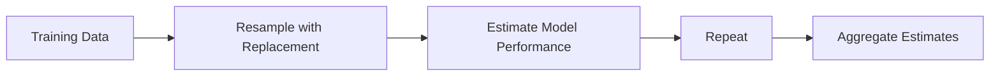
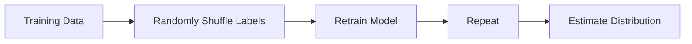
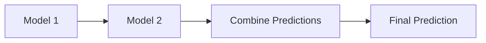

# Lesson 4: Advanced Evaluation Strategies

## First-Principles Intuition & Invariants

In the realm of machine learning, model evaluation is a critical component of the development process. As we strive to create models that generalize well to unseen data, advanced evaluation strategies are essential to ensure robustness and reliability. Central to these strategies is the concept of **bootstrapping**, a technique that estimates model performance variability without relying on external validation sets.

Bootstrapping operates under the assumption that the training data represents the underlying population. By repeatedly resampling this data with replacement, multiple performance estimates are generated, each reflecting unique characteristics. This process quantifies performance variability, offering a more accurate assessment of generalization capabilities.

However, bootstrapping is not without limitations. A significant concern is **overfitting**, where a model becomes overly specialized to the training data, failing to generalize effectively to new data. To mitigate this risk, **permutation tests** can be employed. These tests involve randomly shuffling the training data labels and retraining the model on the shuffled dataset. Repeating this process multiple times provides an estimate of the model's performance distribution under the null hypothesis that the model does not generalize well.

Another advanced evaluation strategy is the use of **ensemble methods**, which combine predictions from multiple models to produce a more accurate and robust final prediction. Ensemble methods leverage the strengths of individual models while mitigating their weaknesses, enhancing overall model performance.

## Core Architecture & Mechanics

Implementing bootstrapping, permutation tests, and ensemble methods requires understanding their underlying architecture and mechanics. Bootstrapping involves repeatedly resampling the training data with replacement to generate multiple performance estimates. This process can be visualized as follows:

In this diagram, the training data is repeatedly resampled with replacement, generating multiple performance estimates. These estimates are then aggregated to produce a final performance estimate.

Permutation tests involve randomly shuffling the training data labels and retraining the model on the shuffled dataset. This process is visualized as:

Here, the labels of the training data are shuffled, and the model is retrained on the shuffled dataset. Repeating this process multiple times generates a performance distribution under the null hypothesis.

Ensemble methods combine predictions from multiple models to produce a final prediction. This can be visualized as:

In this diagram, predictions from multiple models are combined to produce a single, more accurate final prediction.

## High-Performance Optimization & Failure Modes

Implementing these advanced evaluation strategies in high-performance settings necessitates considerations of concurrency, resource scaling, boundary edge cases, and failure mitigations. Techniques such as **data parallelism** can be employed to train multiple models in parallel on different subsets of the training data. Libraries like **Horovod** or **Distributed TensorFlow** facilitate this.

**Resource scaling** involves dynamically adjusting resources based on model performance. Libraries such as **TensorFlow** or **PyTorch** offer built-in support for dynamic resource allocation.

**Boundary edge cases** push models to their limits in terms of performance, accuracy, or robustness. Techniques like **adversarial training**, which trains models on adversarial examples designed to fool the model, address these cases.

Regarding failure modes, **model drift** occurs when a model becomes outdated and fails to generalize to new data. **Online learning**, which continuously updates the model with new data, mitigates this risk.

**Data poisoning** involves intentionally corrupting training data to deceive the model. **Data validation**, which checks the integrity and consistency of training data, helps mitigate this risk.

Advanced evaluation strategies such as bootstrapping, permutation tests, and ensemble methods are indispensable in the machine learning development process. By understanding and implementing these techniques, models can be optimized for high performance while mitigating risks like overfitting, model drift, and data poisoning.
