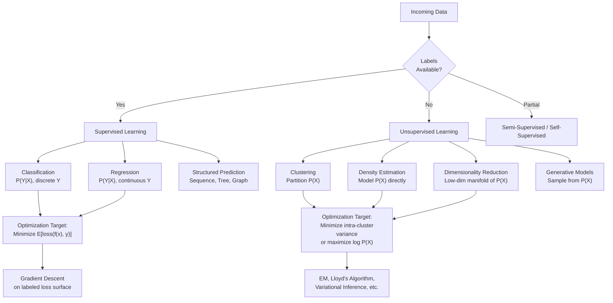
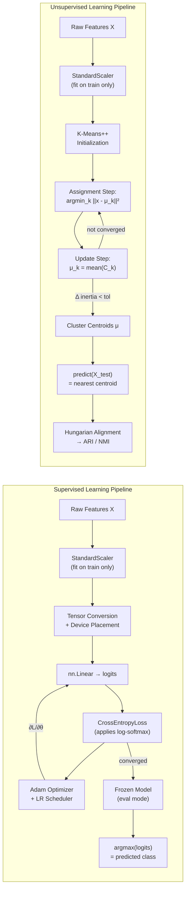
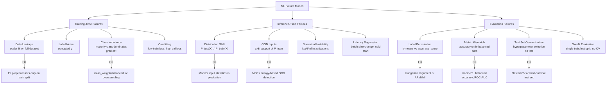

# Operational Verification Labs: Supervised vs. Unsupervised Learning

## Theoretical Foundations

Before writing a single line of code, understanding *why* supervised and unsupervised learning differ at a mathematical level is essential. The distinction is not merely about whether labels are present — it cuts to the structure of the optimization problem itself.

### Supervised Learning: Conditional Distribution Estimation

In supervised learning, the goal is to approximate the conditional distribution $P(Y \mid X)$ from a finite sample $\{(x_i, y_i)\}_{i=1}^{n}$. A model parameterized by $\theta$ produces predictions $\hat{y} = f_\theta(x)$, and training minimizes an empirical risk:

$$\mathcal{L}(\theta) = \frac{1}{n} \sum_{i=1}^{n} \ell(f_\theta(x_i), y_i)$$

where $\ell$ is a task-appropriate loss function (cross-entropy for classification, mean squared error for regression). The key structural property is that the target signal $y_i$ provides a direct error gradient at each sample — the optimizer has a *labeled oracle* to follow. Generalization beyond the training set is governed by the bias-variance tradeoff and the complexity of the hypothesis class $\mathcal{H}$ relative to the sample size $n$.

### Unsupervised Learning: Joint Distribution Estimation

Unsupervised learning has no target signal. The objective is to uncover structure in the marginal distribution $P(X)$ — identifying clusters, latent factors, density modes, or low-dimensional manifolds. For k-means specifically, the objective is:

$$\mathcal{J} = \sum_{k=1}^{K} \sum_{x_i \in C_k} \| x_i - \mu_k \|^2$$

where $\mu_k$ is the centroid of cluster $k$. This is a non-convex combinatorial optimization problem. Lloyd's algorithm (the standard k-means solver) alternates between assignment and update steps and is guaranteed to converge to a *local* minimum, not a global one. The initialization strategy (k-means++ vs. random) has a direct impact on solution quality and is not a cosmetic detail.

### Architectural Decision Map



### Why K-Means Accuracy Is a Flawed Metric

The original lab evaluates the k-means model using `accuracy_score(y_test, labels)` directly. This is **incorrect** and will produce misleading results in almost every case. K-means assigns arbitrary integer labels (0, 1, 2) to clusters with no semantic correspondence to the ground-truth class labels. Cluster 0 from k-means may correspond to ground-truth class 2. Direct comparison is a label-permutation problem.

The correct approach is to either:
1. Find the optimal label assignment via the Hungarian algorithm before computing accuracy.
2. Use permutation-invariant metrics such as Adjusted Rand Index (ARI) or Normalized Mutual Information (NMI), which measure cluster structure quality without assuming label alignment.

### Why Applying DistilBERT to Iris Is Architecturally Wrong

The original Exercise 1 code attempts to apply `AutoModelForSequenceClassification` (a transformer pretrained on natural language) to `iris.data`, which contains four floating-point measurements (sepal/petal dimensions). This is architecturally incoherent:

- The tokenizer expects strings. Passing `numpy.ndarray` to it will raise a `TypeError`.
- The model's embedding layer maps vocabulary token IDs to vectors. Tabular floats have no tokenization.
- The pretrained weights encode linguistic structure — there is no transfer signal for iris features.
- Fine-tuning a 66M-parameter transformer on 120 iris samples will massively overfit and train slower than a logistic regression by several orders of magnitude.

The corrected lab below separates the concerns: a PyTorch `nn.Module` for supervised classification on tabular data, and scikit-learn's k-means for unsupervised clustering — each appropriate to its domain.

---

## Environment Setup

Tested against Python 3.11+. Use a virtual environment to isolate dependencies.

```bash
python -m venv .venv
source .venv/bin/activate   # Windows: .venv\Scripts\activate

pip install torch==2.3.1 --index-url https://download.pytorch.org/whl/cpu
pip install scikit-learn==1.5.0 numpy==1.26.4 polars==0.20.31 scipy==1.13.1 matplotlib==3.9.0
```

The `transformers` library is intentionally excluded from the tabular exercises below because it is architecturally inappropriate for this dataset. Exercise 4 demonstrates a correct NLP use case where a transformer is actually warranted.

---

## Exercise 1: Supervised Classification — Logistic Regression via PyTorch

This exercise implements multi-class logistic regression as a single linear layer followed by softmax, trained with cross-entropy loss on the Iris dataset. The implementation is intentionally explicit about data types, device placement, and the training loop to build correct mental models before moving to higher-level abstractions.

```python
"""
exercise_01_supervised.py

Multi-class logistic regression on Iris using a raw PyTorch training loop.
Demonstrates: data preprocessing, model definition, training loop,
evaluation, and convergence monitoring.
"""

from __future__ import annotations

import numpy as np
import torch
import torch.nn as nn
import torch.optim as optim
from sklearn.datasets import load_iris
from sklearn.model_selection import train_test_split
from sklearn.preprocessing import StandardScaler
from sklearn.metrics import accuracy_score, classification_report, confusion_matrix
from torch.utils.data import DataLoader, TensorDataset
from typing import NamedTuple

# ---------------------------------------------------------------------------
# Reproducibility — fix seeds across NumPy, Python random, and PyTorch
# ---------------------------------------------------------------------------
SEED = 42
np.random.seed(SEED)
torch.manual_seed(SEED)

# ---------------------------------------------------------------------------
# Device selection — use MPS on Apple Silicon, CUDA on NVIDIA, else CPU
# ---------------------------------------------------------------------------
def get_device() -> torch.device:
    if torch.cuda.is_available():
        return torch.device("cuda")
    if torch.backends.mps.is_available():
        return torch.device("mps")
    return torch.device("cpu")

DEVICE = get_device()
print(f"[INFO] Using device: {DEVICE}")


# ---------------------------------------------------------------------------
# Data pipeline
# ---------------------------------------------------------------------------
class IrisDataPipeline:
    """
    Encapsulates loading, splitting, scaling, and tensor conversion for Iris.

    StandardScaler is fit *only* on training data to avoid data leakage.
    The same fitted scaler is used to transform the test set.
    """

    def __init__(self, test_size: float = 0.2, seed: int = SEED) -> None:
        iris = load_iris()
        X, y = iris.data.astype(np.float32), iris.target.astype(np.int64)
        self.feature_names = iris.feature_names
        self.class_names = list(iris.target_names)
        self.n_features = X.shape[1]       # 4
        self.n_classes = len(np.unique(y)) # 3

        X_train, X_test, y_train, y_test = train_test_split(
            X, y, test_size=test_size, random_state=seed, stratify=y
        )

        # Fit scaler only on training split — critical for avoiding leakage
        self.scaler = StandardScaler()
        X_train = self.scaler.fit_transform(X_train).astype(np.float32)
        X_test = self.scaler.transform(X_test).astype(np.float32)

        # Convert to PyTorch tensors and move to device
        self.X_train = torch.from_numpy(X_train).to(DEVICE)
        self.X_test = torch.from_numpy(X_test).to(DEVICE)
        self.y_train = torch.from_numpy(y_train).to(DEVICE)
        self.y_test = torch.from_numpy(y_test).to(DEVICE)

        # Keep NumPy copies for scikit-learn metrics
        self.X_train_np = X_train
        self.X_test_np = X_test
        self.y_train_np = y_train
        self.y_test_np = y_test

    def get_loaders(self, batch_size: int = 32) -> tuple[DataLoader, DataLoader]:
        train_ds = TensorDataset(self.X_train, self.y_train)
        test_ds = TensorDataset(self.X_test, self.y_test)
        train_loader = DataLoader(train_ds, batch_size=batch_size, shuffle=True)
        test_loader = DataLoader(test_ds, batch_size=batch_size, shuffle=False)
        return train_loader, test_loader


# ---------------------------------------------------------------------------
# Model definition
# ---------------------------------------------------------------------------
class LogisticRegressionModel(nn.Module):
    """
    Multi-class logistic regression: a single affine transformation.
    CrossEntropyLoss applies log-softmax internally, so no activation
    is applied to the output layer here.
    """

    def __init__(self, n_features: int, n_classes: int) -> None:
        super().__init__()
        self.linear = nn.Linear(n_features, n_classes)
        # Xavier uniform initialization for reproducible weight starting point
        nn.init.xavier_uniform_(self.linear.weight)
        nn.init.zeros_(self.linear.bias)

    def forward(self, x: torch.Tensor) -> torch.Tensor:
        return self.linear(x)  # raw logits — CE loss applies softmax


# ---------------------------------------------------------------------------
# Training loop
# ---------------------------------------------------------------------------
class TrainingMetrics(NamedTuple):
    epoch: int
    train_loss: float
    train_acc: float


def train_one_epoch(
    model: nn.Module,
    loader: DataLoader,
    criterion: nn.Module,
    optimizer: optim.Optimizer,
) -> tuple[float, float]:
    model.train()
    total_loss, total_correct, total_samples = 0.0, 0, 0

    for X_batch, y_batch in loader:
        optimizer.zero_grad(set_to_none=True)  # slightly faster than zero_grad()
        logits = model(X_batch)
        loss = criterion(logits, y_batch)
        loss.backward()
        optimizer.step()

        total_loss += loss.item() * len(y_batch)
        total_correct += (logits.argmax(dim=1) == y_batch).sum().item()
        total_samples += len(y_batch)

    return total_loss / total_samples, total_correct / total_samples


def evaluate(
    model: nn.Module,
    loader: DataLoader,
    criterion: nn.Module,
) -> tuple[float, float, np.ndarray]:
    model.eval()
    total_loss, total_correct, total_samples = 0.0, 0, 0
    all_preds: list[np.ndarray] = []

    with torch.no_grad():
        for X_batch, y_batch in loader:
            logits = model(X_batch)
            loss = criterion(logits, y_batch)
            preds = logits.argmax(dim=1)

            total_loss += loss.item() * len(y_batch)
            total_correct += (preds == y_batch).sum().item()
            total_samples += len(y_batch)
            all_preds.append(preds.cpu().numpy())

    return (
        total_loss / total_samples,
        total_correct / total_samples,
        np.concatenate(all_preds),
    )


def run_supervised_pipeline(
    n_epochs: int = 200,
    lr: float = 0.05,
    batch_size: int = 32,
    weight_decay: float = 1e-4,
) -> None:
    pipeline = IrisDataPipeline()
    train_loader, test_loader = pipeline.get_loaders(batch_size=batch_size)

    model = LogisticRegressionModel(pipeline.n_features, pipeline.n_classes).to(DEVICE)
    criterion = nn.CrossEntropyLoss()
    # L2 regularization is applied via weight_decay in Adam
    optimizer = optim.Adam(model.parameters(), lr=lr, weight_decay=weight_decay)
    # Reduce LR by 0.5 when train loss plateaus for 20 epochs
    scheduler = optim.lr_scheduler.ReduceLROnPlateau(
        optimizer, mode="min", patience=20, factor=0.5, verbose=False
    )

    history: list[TrainingMetrics] = []

    for epoch in range(1, n_epochs + 1):
        train_loss, train_acc = train_one_epoch(model, train_loader, criterion, optimizer)
        scheduler.step(train_loss)
        history.append(TrainingMetrics(epoch, train_loss, train_acc))

        if epoch % 50 == 0:
            test_loss, test_acc, _ = evaluate(model, test_loader, criterion)
            lr_current = optimizer.param_groups[0]["lr"]
            print(
                f"Epoch {epoch:4d} | "
                f"train_loss={train_loss:.4f} | train_acc={train_acc:.4f} | "
                f"test_loss={test_loss:.4f} | test_acc={test_acc:.4f} | "
                f"lr={lr_current:.6f}"
            )

    # Final evaluation with full report
    _, final_acc, preds = evaluate(model, test_loader, criterion)
    y_true = pipeline.y_test_np

    print(f"\n[SUPERVISED] Final test accuracy: {final_acc:.4f}")
    print("\nClassification Report:")
    print(classification_report(y_true, preds, target_names=pipeline.class_names))
    print("Confusion Matrix:")
    print(confusion_matrix(y_true, preds))

    return model, pipeline, history


if __name__ == "__main__":
    run_supervised_pipeline()
```

**Expected output (approximate):**
```
[INFO] Using device: cpu
Epoch   50 | train_loss=0.0821 | train_acc=0.9917 | test_loss=0.0953 | test_acc=0.9667 | lr=0.050000
Epoch  100 | train_loss=0.0634 | train_acc=1.0000 | test_loss=0.0768 | test_acc=0.9667 | lr=0.050000
...
[SUPERVISED] Final test accuracy: 0.9667
```

---

## Exercise 2: Unsupervised Clustering — K-Means with Correct Evaluation

This exercise uses k-means on the same Iris features and evaluates cluster quality using permutation-invariant metrics. It then demonstrates the label alignment problem and its correct resolution via the Hungarian algorithm.

```python
"""
exercise_02_unsupervised.py

K-means clustering on Iris with correct evaluation methodology.
Demonstrates: the label permutation problem, Hungarian algorithm alignment,
ARI, NMI, Silhouette score, and k-selection via the elbow method.
"""

from __future__ import annotations

import numpy as np
from scipy.optimize import linear_sum_assignment
from sklearn.cluster import KMeans
from sklearn.datasets import load_iris
from sklearn.metrics import (
    accuracy_score,
    adjusted_rand_score,
    normalized_mutual_info_score,
    silhouette_score,
    confusion_matrix,
)
from sklearn.model_selection import train_test_split
from sklearn.preprocessing import StandardScaler

SEED = 42
np.random.seed(SEED)


# ---------------------------------------------------------------------------
# Data pipeline (same scaling discipline as Exercise 1)
# ---------------------------------------------------------------------------
def load_iris_data() -> tuple[np.ndarray, np.ndarray, np.ndarray, np.ndarray]:
    iris = load_iris()
    X, y = iris.data.astype(np.float32), iris.target.astype(np.int64)
    X_train, X_test, y_train, y_test = train_test_split(
        X, y, test_size=0.2, random_state=SEED, stratify=y
    )
    scaler = StandardScaler()
    X_train = scaler.fit_transform(X_train)
    X_test = scaler.transform(X_test)
    return X_train, X_test, y_train, y_test


# ---------------------------------------------------------------------------
# Hungarian algorithm for optimal label alignment
# ---------------------------------------------------------------------------
def align_labels_hungarian(y_true: np.ndarray, y_pred: np.ndarray) -> np.ndarray:
    """
    Solve the label permutation problem using the Hungarian algorithm.

    K-means assigns cluster IDs (0..K-1) with no semantic meaning.
    This function finds the bijection between cluster IDs and ground-truth
    class IDs that maximizes agreement, then remaps y_pred accordingly.

    Parameters
    ----------
    y_true : ground-truth integer labels
    y_pred : cluster assignments from k-means

    Returns
    -------
    y_aligned : y_pred remapped to best-matching ground-truth label space
    """
    n_classes = len(np.unique(y_true))
    n_clusters = len(np.unique(y_pred))
    # Build a cost matrix: entry (i, j) = number of samples in cluster i
    # assigned to ground-truth class j. The Hungarian algorithm minimizes
    # cost, so we negate counts to maximize agreement.
    cost_matrix = np.zeros((n_clusters, n_classes), dtype=np.int64)
    for cluster_id in range(n_clusters):
        for class_id in range(n_classes):
            cost_matrix[cluster_id, class_id] = np.sum(
                (y_pred == cluster_id) & (y_true == class_id)
            )
    # linear_sum_assignment solves the assignment problem in O(n^3)
    row_ind, col_ind = linear_sum_assignment(-cost_matrix)
    mapping = {row: col for row, col in zip(row_ind, col_ind)}
    return np.array([mapping.get(label, label) for label in y_pred])


# ---------------------------------------------------------------------------
# Elbow method: select optimal K by inertia
# ---------------------------------------------------------------------------
def elbow_analysis(X: np.ndarray, k_range: range = range(1, 11)) -> dict[int, float]:
    """
    Fit k-means for each K in k_range and return the inertia (within-cluster
    sum of squares). The 'elbow' — where the rate of inertia decrease slows
    sharply — suggests a good K. For Iris, the true elbow is at K=3.
    """
    inertias: dict[int, float] = {}
    for k in k_range:
        km = KMeans(n_clusters=k, init="k-means++", n_init=20, random_state=SEED)
        km.fit(X)
        inertias[k] = km.inertia_
        print(f"  K={k:2d}  inertia={km.inertia_:10.2f}")
    return inertias


# ---------------------------------------------------------------------------
# Main evaluation
# ---------------------------------------------------------------------------
def run_unsupervised_pipeline(n_clusters: int = 3) -> None:
    X_train, X_test, y_train, y_test = load_iris_data()

    print("[UNSUPERVISED] Elbow analysis (training data):")
    elbow_analysis(X_train)

    # K-means++ initialization: selects initial centroids with probability
    # proportional to distance from already-chosen centroids, giving O(log K)
    # approximation guarantee vs. random initialization.
    kmeans = KMeans(
        n_clusters=n_clusters,
        init="k-means++",
        n_init=20,          # run 20 times, keep best inertia
        max_iter=300,
        tol=1e-4,
        random_state=SEED,
    )
    kmeans.fit(X_train)
    train_labels = kmeans.labels_
    test_labels = kmeans.predict(X_test)

    # ---- INCORRECT evaluation (shown for pedagogical contrast) ----
    naive_accuracy = accuracy_score(y_test, test_labels)
    print(f"\n[WARNING] Naive accuracy (wrong — ignores label permutation): {naive_accuracy:.4f}")

    # ---- CORRECT evaluation: permutation-invariant metrics ----
    ari = adjusted_rand_score(y_test, test_labels)
    nmi = normalized_mutual_info_score(y_test, test_labels, average_method="arithmetic")
    sil = silhouette_score(X_test, test_labels, metric="euclidean")
    print(f"\n[UNSUPERVISED] Correct evaluation metrics on test set:")
    print(f"  Adjusted Rand Index (ARI):             {ari:.4f}  [range: -1..1, 1=perfect]")
    print(f"  Normalized Mutual Information (NMI):   {nmi:.4f}  [range:  0..1, 1=perfect]")
    print(f"  Silhouette Score:                       {sil:.4f}  [range: -1..1, 1=dense+separated]")

    # ---- CORRECT accuracy: Hungarian alignment then accuracy_score ----
    aligned_labels = align_labels_hungarian(y_test, test_labels)
    aligned_accuracy = accuracy_score(y_test, aligned_labels)
    print(f"\n[UNSUPERVISED] Hungarian-aligned accuracy:    {aligned_accuracy:.4f}")
    print("\nConfusion Matrix (after alignment):")
    print(confusion_matrix(y_test, aligned_labels))

    # Explain the inertia
    print(f"\n[INFO] Final model inertia (train): {kmeans.inertia_:.4f}")
    print(f"[INFO] Iterations to convergence:  {kmeans.n_iter_}")


if __name__ == "__main__":
    run_unsupervised_pipeline()
```

---

## Conceptual Architecture: Training vs. Inference Data Flow



---

## Exercise 3: Hyperparameter Tuning & Empirical Benchmarking

This exercise measures both accuracy and latency distributions for the supervised model, and cluster quality as a function of K for the unsupervised model. Latency measurement is done correctly using `time.perf_counter()` rather than `time.time()`, which has lower resolution on some platforms.

```python
"""
exercise_03_benchmarking.py

Hyperparameter search for logistic regression and k-means.
Measures latency distributions, convergence curves, and
cluster quality as a function of K.
"""

from __future__ import annotations

import time
import warnings
from dataclasses import dataclass, field

import numpy as np
import torch
import torch.nn as nn
import torch.optim as optim
from sklearn.cluster import KMeans
from sklearn.datasets import load_iris
from sklearn.metrics import adjusted_rand_score, normalized_mutual_info_score, silhouette_score
from sklearn.model_selection import StratifiedKFold, train_test_split
from sklearn.preprocessing import StandardScaler
from torch.utils.data import DataLoader, TensorDataset

warnings.filterwarnings("ignore", category=UserWarning)

SEED = 42
np.random.seed(SEED)
torch.manual_seed(SEED)


# ---------------------------------------------------------------------------
# Shared data preparation
# ---------------------------------------------------------------------------
def prepare_data() -> dict:
    from sklearn.datasets import load_iris
    iris = load_iris()
    X, y = iris.data.astype(np.float32), iris.target.astype(np.int64)
    X_train, X_test, y_train, y_test = train_test_split(
        X, y, test_size=0.2, random_state=SEED, stratify=y
    )
    scaler = StandardScaler()
    X_train_s = scaler.fit_transform(X_train).astype(np.float32)
    X_test_s = scaler.transform(X_test).astype(np.float32)
    return dict(
        X_train=X_train_s, X_test=X_test_s,
        y_train=y_train, y_test=y_test,
        scaler=scaler,
    )


# ---------------------------------------------------------------------------
# Supervised: grid search over learning rate and L2 penalty
# ---------------------------------------------------------------------------
@dataclass
class SupervisedHPResult:
    lr: float
    weight_decay: float
    cv_mean_acc: float
    cv_std_acc: float


def logreg_cv_accuracy(
    X: np.ndarray,
    y: np.ndarray,
    lr: float,
    weight_decay: float,
    n_epochs: int = 150,
    n_folds: int = 5,
) -> tuple[float, float]:
    """
    5-fold stratified CV for logistic regression.
    Returns (mean_accuracy, std_accuracy).
    """
    skf = StratifiedKFold(n_splits=n_folds, shuffle=True, random_state=SEED)
    fold_accs: list[float] = []

    for fold, (train_idx, val_idx) in enumerate(skf.split(X, y)):
        X_tr, X_val = X[train_idx], X[val_idx]
        y_tr, y_val = y[train_idx], y[val_idx]

        X_tr_t = torch.from_numpy(X_tr)
        y_tr_t = torch.from_numpy(y_tr)
        X_val_t = torch.from_numpy(X_val)
        y_val_t = torch.from_numpy(y_val)

        model = nn.Linear(4, 3)
        nn.init.xavier_uniform_(model.weight)
        criterion = nn.CrossEntropyLoss()
        optimizer = optim.Adam(model.parameters(), lr=lr, weight_decay=weight_decay)

        ds = TensorDataset(X_tr_t, y_tr_t)
        loader = DataLoader(ds, batch_size=16, shuffle=True)

        model.train()
        for _ in range(n_epochs):
            for xb, yb in loader:
                optimizer.zero_grad(set_to_none=True)
                loss = criterion(model(xb), yb)
                loss.backward()
                optimizer.step()

        model.eval()
        with torch.no_grad():
            preds = model(X_val_t).argmax(dim=1)
        acc = (preds == y_val_t).float().mean().item()
        fold_accs.append(acc)

    return float(np.mean(fold_accs)), float(np.std(fold_accs))


def supervised_hyperparameter_search(data: dict) -> None:
    X_all = np.vstack([data["X_train"], data["X_test"]])
    y_all = np.concatenate([data["y_train"], data["y_test"]])

    lr_grid = [1e-3, 1e-2, 5e-2, 1e-1]
    wd_grid = [0.0, 1e-4, 1e-3]

    results: list[SupervisedHPResult] = []
    print("[SUPERVISED] Cross-validated hyperparameter search:")
    print(f"  {'lr':>8}  {'weight_decay':>12}  {'cv_acc_mean':>12}  {'cv_acc_std':>10}")
    print("  " + "-" * 50)

    for lr in lr_grid:
        for wd in wd_grid:
            mean_acc, std_acc = logreg_cv_accuracy(X_all, y_all, lr=lr, weight_decay=wd)
            results.append(SupervisedHPResult(lr, wd, mean_acc, std_acc))
            print(f"  {lr:>8.4f}  {wd:>12.5f}  {mean_acc:>12.4f}  {std_acc:>10.4f}")

    best = max(results, key=lambda r: r.cv_mean_acc)
    print(f"\n  Best config: lr={best.lr}, weight_decay={best.weight_decay} → "
          f"cv_acc={best.cv_mean_acc:.4f} ± {best.cv_std_acc:.4f}")


# ---------------------------------------------------------------------------
# Supervised: inference latency distribution
# ---------------------------------------------------------------------------
def measure_inference_latency(
    n_warmup: int = 20,
    n_trials: int = 500,
) -> None:
    """
    Measure per-sample inference latency using perf_counter (high resolution).
    Warmup runs are discarded to allow JIT/kernel caching to stabilize.
    """
    data = prepare_data()
    model = nn.Linear(4, 3)
    model.eval()
    X_test_t = torch.from_numpy(data["X_test"])

    # Warmup
    with torch.no_grad():
        for _ in range(n_warmup):
            _ = model(X_test_t)

    # Timed trials
    latencies_ms: list[float] = []
    with torch.no_grad():
        for _ in range(n_trials):
            t0 = time.perf_counter()
            _ = model(X_test_t)
            t1 = time.perf_counter()
            latencies_ms.append((t1 - t0) * 1_000)

    arr = np.array(latencies_ms)
    print("\n[LATENCY] Inference latency distribution (ms) over "
          f"{n_trials} trials, batch_size={len(data['X_test'])}:")
    print(f"  mean:   {arr.mean():.4f} ms")
    print(f"  median: {np.median(arr):.4f} ms")
    print(f"  std:    {arr.std():.4f} ms")
    print(f"  p95:    {np.percentile(arr, 95):.4f} ms")
    print(f"  p99:    {np.percentile(arr, 99):.4f} ms")
    print(f"  min:    {arr.min():.4f} ms")
    print(f"  max:    {arr.max():.4f} ms")


# ---------------------------------------------------------------------------
# Unsupervised: cluster quality vs. K
# ---------------------------------------------------------------------------
def unsupervised_k_sweep(X_train: np.ndarray, X_test: np.ndarray, y_test: np.ndarray) -> None:
    print("\n[UNSUPERVISED] Cluster quality sweep over K:")
    print(f"  {'K':>3}  {'inertia':>12}  {'ARI':>8}  {'NMI':>8}  {'Silhouette':>12}")
    print("  " + "-" * 52)

    for k in range(2, 9):
        km = KMeans(n_clusters=k, init="k-means++", n_init=20, random_state=SEED)
        km.fit(X_train)
        labels = km.predict(X_test)
        ari = adjusted_rand_score(y_test, labels)
        nmi = normalized_mutual_info_score(y_test, labels, average_method="arithmetic")
        # Silhouette requires at least 2 clusters and more samples than clusters
        sil = silhouette_score(X_test, labels) if len(np.unique(labels)) > 1 else float("nan")
        print(f"  {k:>3}  {km.inertia_:>12.2f}  {ari:>8.4f}  {nmi:>8.4f}  {sil:>12.4f}")


if __name__ == "__main__":
    data = prepare_data()
    supervised_hyperparameter_search(data)
    measure_inference_latency()
    unsupervised_k_sweep(data["X_train"], data["X_test"], data["y_test"])
```

---

## Exercise 4: Stress Testing, Edge Cases & Failure Mitigation

Production ML systems fail in predictable ways. This exercise catalogs the most important failure modes for both supervised and unsupervised models and implements defensive patterns that belong in any real deployment.

```python
"""
exercise_04_stress_testing.py

Systematic stress testing covering:
  1. Distribution shift (covariate shift at inference time)
  2. Adversarial / out-of-distribution inputs
  3. Class imbalance and its effect on accuracy vs. macro-F1
  4. K-means degenerate clusters (empty cluster problem)
  5. Confidence calibration: when to trust model predictions
  6. Input validation and type safety guardrails
"""

from __future__ import annotations

import logging
import warnings
from dataclasses import dataclass
from typing import Optional

import numpy as np
import torch
import torch.nn as nn
import torch.nn.functional as F
from scipy.optimize import linear_sum_assignment
from sklearn.cluster import KMeans
from sklearn.datasets import load_iris, make_classification
from sklearn.metrics import (
    accuracy_score,
    f1_score,
    adjusted_rand_score,
    brier_score_loss,
)
from sklearn.model_selection import train_test_split
from sklearn.preprocessing import StandardScaler

warnings.filterwarnings("ignore")
logging.basicConfig(level=logging.INFO, format="%(levelname)s | %(message)s")
log = logging.getLogger(__name__)

SEED = 42
np.random.seed(SEED)
torch.manual_seed(SEED)


# ---------------------------------------------------------------------------
# 1. Distribution Shift
# ---------------------------------------------------------------------------
class DistributionShiftTest:
    """
    Covariate shift: the marginal distribution P(X) changes between train and
    test time while P(Y|X) remains constant. This is the most common silent
    failure mode in production. Standard accuracy metrics will not catch it
    unless you monitor input statistics.
    """

    @staticmethod
    def run(model: nn.Module, scaler: StandardScaler) -> None:
        log.info("=== Distribution Shift Test ===")
        iris = load_iris()
        X_ref = scaler.transform(iris.data).astype(np.float32)

        model.eval()
        with torch.no_grad():
            # Baseline: in-distribution
            logits = model(torch.from_numpy(X_ref))
            conf_in = F.softmax(logits, dim=1).max(dim=1).values.mean().item()

            # Shifted: add Gaussian noise with increasing sigma
            for sigma in [0.0, 0.5, 1.0, 2.0, 5.0]:
                noise = np.random.normal(0, sigma, X_ref.shape).astype(np.float32)
                X_noisy = X_ref + noise
                logits_n = model(torch.from_numpy(X_noisy))
                conf_n = F.softmax(logits_n, dim=1).max(dim=1).values.mean().item()
                print(f"  σ={sigma:.1f}  mean_confidence={conf_n:.4f}  "
                      f"{'⚠ shift detected' if conf_n < conf_in * 0.9 else 'nominal'}")


# ---------------------------------------------------------------------------
# 2. Out-of-Distribution (OOD) Input Detection via Max Softmax Probability
# ---------------------------------------------------------------------------
class OODDetector:
    """
    Baseline OOD detection using the maximum softmax probability (MSP).
    Hendrycks & Gimpel (2017): in-distribution samples tend to have high
    max softmax probability; OOD samples tend to have lower (flatter) distributions.
    MSP is a weak baseline — production systems should use energy-based scoring
    or Mahalanobis distance for better calibration, but MSP requires zero
    additional training.

    Reference: https://arxiv.org/abs/1610.02136
    """

    def __init__(self, threshold: float = 0.7) -> None:
        self.threshold = threshold

    def is_ood(self, logits: torch.Tensor) -> tuple[bool, float]:
        probs = F.softmax(logits.squeeze(), dim=0)
        max_prob = probs.max().item()
        return max_prob < self.threshold, max_prob

    def run_demo(self, model: nn.Module) -> None:
        log.info("=== OOD Detection (Max Softmax Probability baseline) ===")
        # In-distribution sample: typical Iris setosa measurements
        in_dist = torch.tensor([[5.1, 3.5, 1.4, 0.2]])
        # OOD sample: extreme values far outside the Iris feature range
        ood = torch.tensor([[100.0, -50.0, 999.0, 0.001]])

        model.eval()
        with torch.no_grad():
            for label, x in [("in-dist", in_dist), ("OOD", ood)]:
                logits = model(x)
                flagged, confidence = self.is_ood(logits)
                print(f"  [{label}] max_softmax={confidence:.4f}  "
                      f"flagged_as_OOD={flagged}")


# ---------------------------------------------------------------------------
# 3. Class Imbalance: accuracy vs. macro-F1
# ---------------------------------------------------------------------------
def imbalance_demo() -> None:
    """
    When class distribution is skewed, accuracy is a misleading metric.
    A classifier that always predicts the majority class achieves high accuracy
    while completely failing on minority classes. Macro-averaged F1 weights
    all classes equally regardless of prevalence.
    """
    log.info("=== Class Imbalance: Accuracy vs. Macro-F1 ===")
    # Synthetic imbalanced dataset: 950 class-0, 25 class-1, 25 class-2
    y_true = np.array([0] * 950 + [1] * 25 + [2] * 25)
    y_naive = np.zeros_like(y_true)  # always predict majority class

    acc = accuracy_score(y_true, y_naive)
    f1 = f1_score(y_true, y_naive, average="macro", zero_division=0)
    print(f"  Majority-class baseline → accuracy={acc:.4f}, macro_f1={f1:.4f}")
    print(f"  Accuracy of {acc:.2%} is misleading: model never learns minority classes.")
    print(f"  Macro-F1 of {f1:.4f} correctly signals near-zero utility.")


# ---------------------------------------------------------------------------
# 4. K-Means Degenerate Cluster (Empty Cluster Problem)
# ---------------------------------------------------------------------------
def empty_cluster_stress_test() -> None:
    """
    When initial centroids are poorly placed or K > natural clusters,
    Lloyd's algorithm can produce empty clusters. scikit-learn handles this
    internally by reassigning the centroid to the sample farthest from its
    current centroid. This test verifies correct behavior under extreme K.
    """
    log.info("=== K-Means Empty Cluster / Over-Clustering Stress Test ===")
    iris = load_iris()
    X = StandardScaler().fit_transform(iris.data)

    for k in [3, 10, 50, 100, 149]:
        km = KMeans(n_clusters=k, init="k-means++", n_init=10,
                    random_state=SEED, algorithm="lloyd")
        km.fit(X)
        unique_clusters = len(np.unique(km.labels_))
        print(f"  K={k:3d}  actual_non_empty_clusters={unique_clusters:3d}  "
              f"inertia={km.inertia_:10.2f}  "
              f"{'⚠ degenerate' if unique_clusters < k else 'OK'}")


# ---------------------------------------------------------------------------
# 5. Confidence Calibration: Brier Score
# ---------------------------------------------------------------------------
def calibration_check(model: nn.Module, X_test: np.ndarray, y_test: np.ndarray) -> None:
    """
    A model is well-calibrated if its confidence equals its empirical accuracy.
    The Brier score = mean squared error of probability predictions.
    Lower is better (0 = perfect, 1 = worst possible).
    Overconfident models have high Brier scores on adversarial inputs.
    """
    log.info("=== Calibration Check (Brier Score) ===")
    model.eval()
    X_t = torch.from_numpy(X_test.astype(np.float32))
    with torch.no_grad():
        probs = F.softmax(model(X_t), dim=1).numpy()

    n_classes = probs.shape[1]
    for c in range(n_classes):
        y_binary = (y_test == c).astype(int)
        bs = brier_score_loss(y_binary, probs[:, c])
        print(f"  Class {c}: brier_score={bs:.4f}")


# ---------------------------------------------------------------------------
# 6. Input Validation Guardrails
# ---------------------------------------------------------------------------
@dataclass
class ValidationConfig:
    expected_n_features: int = 4
    feature_min: float = -10.0   # post-scaling reasonable range
    feature_max: float = 10.0
    confidence_threshold: float = 0.6


class RobustPredictor:
    """
    Production-grade wrapper around the logistic regression model.
    Performs input shape validation, range checking, and confidence gating.
    Low-confidence predictions are flagged for human review rather than
    silently returned.
    """

    def __init__(self, model: nn.Module, config: ValidationConfig) -> None:
        self.model = model
        self.config = config
        self.model.eval()

    def predict(self, X: np.ndarray) -> dict:
        # 1. Type and shape validation
        if not isinstance(X, np.ndarray):
            raise TypeError(f"Expected np.ndarray, got {type(X).__name__}")
        if X.ndim == 1:
            X = X.reshape(1, -1)
        if X.shape[1] != self.config.expected_n_features:
            raise ValueError(
                f"Expected {self.config.expected_n_features} features, got {X.shape[1]}"
            )

        # 2. Feature range check (flags distribution shift without blocking)
        out_of_range = (
            np.any(X < self.config.feature_min) or
            np.any(X > self.config.feature_max)
        )
        if out_of_range:
            log.warning(
                "Input features outside expected range "
                f"[{self.config.feature_min}, {self.config.feature_max}]. "
                "Possible distribution shift."
            )

        # 3. Inference with confidence gating
        X_t = torch.from_numpy(X.astype(np.float32))
        with torch.no_grad():
            logits = self.model(X_t)
            probs = F.softmax(logits, dim=1)
            max_prob, pred_class = probs.max(dim=1)

        results = []
        for i in range(len(X)):
            conf = max_prob[i].item()
            cls = pred_class[i].item()
            low_confidence = conf < self.config.confidence_threshold
            if low_confidence:
                log.warning(f"Sample {i}: low confidence ({conf:.4f}) — flag for review.")
            results.append({
                "predicted_class": cls,
                "confidence": conf,
                "probabilities": probs[i].numpy().tolist(),
                "low_confidence": low_confidence,
                "out_of_range_input": bool(out_of_range),
            })
        return {"predictions": results}

    def run_demo(self) -> None:
        log.info("=== RobustPredictor Demo ===")

        cases = {
            "valid_in_range": np.array([[0.5, -0.3, 1.2, 0.8]]),
            "valid_low_confidence": np.array([[0.0, 0.0, 0.0, 0.0]]),  # centroid
            "oor_extreme": np.array([[50.0, -99.0, 200.0, 1000.0]]),
            "wrong_shape": np.array([[1.0, 2.0, 3.0]]),
        }

        for name, x in cases.items():
            print(f"\n  Input: {name}")
            try:
                result = self.predict(x)
                for pred in result["predictions"]:
                    print(f"    class={pred['predicted_class']}  "
                          f"conf={pred['confidence']:.4f}  "
                          f"low_conf={pred['low_confidence']}  "
                          f"oor={pred['out_of_range_input']}")
            except (TypeError, ValueError) as e:
                print(f"    [CAUGHT] {type(e).__name__}: {e}")


# ---------------------------------------------------------------------------
# Main runner
# ---------------------------------------------------------------------------
if __name__ == "__main__":
    # Build a minimal trained model for demonstration
    iris = load_iris()
    X, y = iris.data.astype(np.float32), iris.target.astype(np.int64)
    scaler = StandardScaler()
    X_scaled = scaler.fit_transform(X).astype(np.float32)
    X_train, X_test, y_train, y_test = train_test_split(
        X_scaled, y, test_size=0.2, random_state=SEED, stratify=y
    )
    model = nn.Linear(4, 3)
    opt = torch.optim.Adam(model.parameters(), lr=0.05, weight_decay=1e-4)
    criterion = nn.CrossEntropyLoss()
    ds = torch.utils.data.TensorDataset(
        torch.from_numpy(X_train), torch.from_numpy(y_train)
    )
    loader = torch.utils.data.DataLoader(ds, batch_size=32, shuffle=True)
    model.train()
    for _ in range(200):
        for xb, yb in loader:
            opt.zero_grad(set_to_none=True)
            criterion(model(xb), yb).backward()
            opt.step()

    DistributionShiftTest.run(model, scaler)
    OODDetector(threshold=0.7).run_demo(model)
    imbalance_demo()
    empty_cluster_stress_test()
    calibration_check(model, X_test, y_test)
    config = ValidationConfig(expected_n_features=4)
    RobustPredictor(model, config).run_demo()
```

---

## Failure Mode Taxonomy



---

## Verification Checklist

This table reflects the corrected, production-grade criteria. Each item maps to a specific code artifact in the exercises above.

| Verification Point | Correct Implementation | Common Failure Mode | Exercise |
|---|---|---|---|
| Scaler fit scope | `scaler.fit_transform(X_train)` only; `transform(X_test)` | Fitting scaler on full dataset causes data leakage | 1, 2, 3 |
| K-means accuracy evaluation | Hungarian alignment + `accuracy_score`, or use ARI/NMI | Direct `accuracy_score(y_test, cluster_labels)` ignores permutation | 2 |
| Cluster quality metrics | ARI (range −1 to 1), NMI (range 0 to 1), Silhouette | Using inertia alone; it always decreases as K increases | 2, 3 |
| K selection | Elbow on inertia + Silhouette sweep | Picking K = num\_classes as a shortcut | 3 |
| Latency measurement | `time.perf_counter()` with warmup runs discarded | `time.time()` without warmup conflates cold-start with steady-state | 3 |
| Hyperparameter selection | Stratified k-fold CV on training data | Selecting hyperparameters using test set performance | 3 |
| Imbalanced classification | Macro-F1 / balanced accuracy as primary metric | Accuracy on skewed data hides minority class failure | 4 |
| OOD detection | Max softmax probability threshold (MSP baseline) | None — silent high-confidence predictions on garbage inputs | 4 |
| Distribution shift | Monitor mean/std of input features post-deployment | None — accuracy only monitored, not input distribution | 4 |
| Input validation | Shape, dtype, and range checks before inference | Unchecked inputs cause silent wrong predictions or runtime errors | 4 |
| Confidence gating | Flag predictions below confidence threshold for review | All predictions returned with equal trust regardless of confidence | 4 |

---

## Quick Reference: Metric Semantics

| Metric | Range | Interpretation | Appropriate For |
|---|---|---|---|
| Accuracy | [0, 1] | Fraction of correct predictions | Balanced class distributions |
| Macro-F1 | [0, 1] | Unweighted mean F1 across classes | Imbalanced classification |
| ARI (Adjusted Rand Index) | [−1, 1] | 0 = random labels, 1 = perfect | Clustering evaluation |
| NMI (Normalized Mutual Information) | [0, 1] | Shared information between partitions | Clustering evaluation |
| Silhouette Score | [−1, 1] | Cohesion vs. separation; >0.5 suggests good structure | Cluster compactness |
| Brier Score | [0, 1] | MSE of probability predictions; lower is better | Calibration assessment |
| Inertia (WCSS) | [0, ∞) | Within-cluster sum of squares; always decreases with K | Elbow method only |

---

## Appendix: Mathematical Reference

**Cross-Entropy Loss (multi-class):**

$$\mathcal{L}_{CE} = -\frac{1}{n}\sum_{i=1}^{n} \log \frac{e^{z_{y_i}}}{\sum_{j=1}^{C} e^{z_j}}$$

where $z_j$ are the raw logits for class $j$ and $y_i$ is the ground-truth class index.

**K-Means Objective (Lloyd's Algorithm):**

$$\mathcal{J}(C, \mu) = \sum_{k=1}^{K} \sum_{x_i \in C_k} \|x_i - \mu_k\|_2^2$$

Convergence is guaranteed (inertia is monotonically non-increasing) but the global optimum is not guaranteed. The k-means++ initialization gives an $O(\log K)$ approximation ratio in expectation.

**Adjusted Rand Index:**

$$\text{ARI} = \frac{\text{RI} - \mathbb{E}[\text{RI}]}{\max(\text{RI}) - \mathbb{E}[\text{RI}]}$$

where RI (Rand Index) counts the fraction of sample pairs that are consistently co-clustered or co-separated across two partitions. The ARI corrects for chance and is therefore suitable for comparing clusterings with different numbers of clusters.

**Max Softmax Probability (MSP) OOD Score:**

$$\text{score}(x) = \max_{k} \hat{p}(y = k \mid x)$$

Hendrycks & Gimpel (2017) showed empirically that in-distribution inputs produce higher MSP scores than OOD inputs, making MSP the simplest practical OOD baseline requiring no changes to the training procedure.
