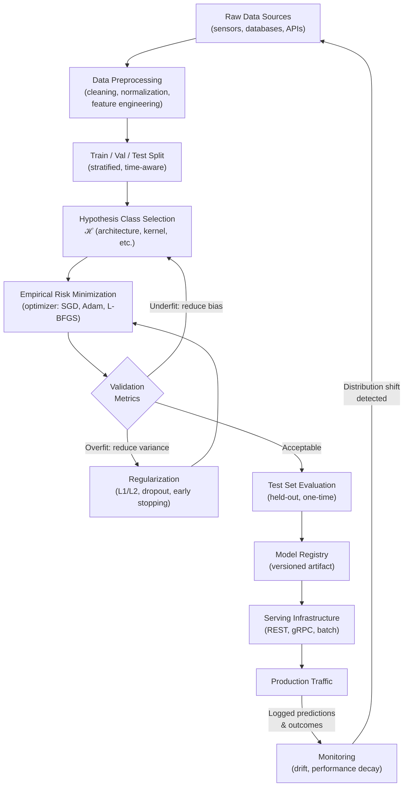

# Lesson 1: Foundations & Mathematical Formulation

## Curriculum Roadmap

This lesson establishes the theoretical bedrock of machine learning from first principles. We develop the full mathematical formalism — probability theory, statistical learning theory, linear algebra, and optimization — and show precisely why each component is necessary. We examine the generalization problem, the bias-variance decomposition, and the structural constraints that separate learnable from unlearnable problems. By the end, you will understand not just *what* machine learning does, but *why* its core machinery is constructed the way it is.

---

## 1. What Machine Learning Actually Is: A First-Principles Account

The conventional description — "algorithms that learn from data" — is true but uninformative. A more precise account begins with the observation that most real-world functions of interest are either analytically intractable or entirely unknown. We cannot write a closed-form function that maps a 224×224 RGB image to the label "cat." We do not know the exact transfer function mapping a patient's biomarkers to their five-year survival probability. What we *do* have is a finite sample of input-output pairs drawn from some underlying, unknown joint distribution P(X, Y).

Machine learning is the discipline of using that finite sample to construct an approximation *f̂* to the true function *f*\* such that *f̂* generalizes — that is, it performs well on new examples drawn from the same distribution P(X, Y), not just on the training sample. This is the central problem. Everything else — neural architectures, gradient descent, regularization, attention mechanisms — is engineering in service of solving it.

The existence and tightness of generalization guarantees are established by **statistical learning theory**, primarily through the frameworks of PAC (Probably Approximately Correct) learning introduced by Valiant (1984) and VC (Vapnik–Chervonenkis) theory developed by Vapnik and Chervonenkis throughout the 1970s–90s. These frameworks answer the question: given a hypothesis class ℋ of possible models, how many training examples are sufficient to guarantee that the best hypothesis in ℋ found by training is also approximately optimal on the true distribution?

### The Hypothesis Class and the Realizability Assumption

Formally, let the input space be 𝒳 ⊆ ℝᵈ and the output space be 𝒴. A **hypothesis** is a function h: 𝒳 → 𝒴. A **hypothesis class** ℋ is a set of such functions — for example, all linear classifiers in ℝᵈ, or all feedforward networks with a fixed architecture. The learning algorithm A receives a training set S = {(x₁, y₁), ..., (xₙ, yₙ)} drawn i.i.d. from P(X, Y) and returns a hypothesis h_S ∈ ℋ.

The **true risk** (generalization error) of a hypothesis h is:

```text
R(h) = E_{(x,y)~P} [ L(h(x), y) ]
```

where L is a loss function. Because P is unknown, R(h) cannot be computed directly. What can be computed is the **empirical risk**:

```text
R̂(h) = (1/n) * Σᵢ L(h(xᵢ), yᵢ)
```

**Empirical Risk Minimization (ERM)** selects h_S = argmin_{h ∈ ℋ} R̂(h). The fundamental question is: when does minimizing R̂ lead to small R? The answer depends on the complexity of ℋ and the size of the training set n.

---

## 2. Statistical Learning Theory: Why Generalization Is Possible

### The Uniform Convergence Bound

The key theorem that justifies ERM states that if ℋ is not too complex and n is large enough, then with high probability, empirical risk is uniformly close to true risk *for all h ∈ ℋ simultaneously*. The standard finite-class bound is:

```text
P[ sup_{h ∈ ℋ} |R(h) - R̂(h)| > ε ] ≤ 2|ℋ| · exp(-2nε²)
```

This follows from the union bound combined with Hoeffding's inequality applied to each h independently. For this bound to be non-trivial, |ℋ| must be finite, which is unrealistic. For infinite hypothesis classes (like linear classifiers), the relevant complexity measure is the **VC dimension**.

### VC Dimension

The VC dimension VC(ℋ) is the size of the largest finite set of points that ℋ can **shatter** — i.e., correctly classify in all 2ⁿ possible binary labelings. For the class of halfspaces in ℝᵈ (linear classifiers), VC(ℋ) = d + 1. For feedforward ReLU networks, the VC dimension scales with the number of parameters and depth.

The VC generalization bound states that with probability at least 1 - δ:

```text
R(h_S) ≤ R̂(h_S) + O( sqrt( (VC(ℋ) · log(n/VC(ℋ)) + log(1/δ)) / n ) )
```

This tells us something fundamental: the generalization gap shrinks as n grows and as VC(ℋ) decreases. This is the theoretical basis for regularization — by restricting the effective complexity of the hypothesis class, we tighten the generalization bound even when n is fixed.

### The No Free Lunch Theorem

A critical invariant established by Wolpert (1996) is the **No Free Lunch (NFL) theorem**: for any learning algorithm A, there exists a distribution P such that A performs no better than random guessing. More formally, when averaged over all possible target functions uniformly, every algorithm has the same expected error. This means that inductive bias — assumptions baked into the hypothesis class — is not optional. It is a prerequisite for learning. A linear model assumes the target is well-approximated by a linear function. A convolutional network assumes spatial locality and translational equivariance. These assumptions must match the problem structure for learning to succeed.

---

## 3. The Mathematical Infrastructure

### 3.1 Probability Theory

Machine learning operates on data generated by unknown stochastic processes. The language of probability is therefore not decorative — it is the native language of the entire framework.

A **probability space** is a triple (Ω, 𝒻, P) where Ω is a sample space, 𝒻 is a σ-algebra of events, and P: 𝒻 → [0,1] is a probability measure satisfying Kolmogorov's axioms. For ML purposes, we work almost exclusively with **random variables** X: Ω → ℝᵈ and their induced distributions.

**Probability Density and Mass Functions.** For a continuous random variable X with PDF p(x), the probability of X falling in region A is ∫_A p(x) dx. For discrete variables, the PMF satisfies Σ_x P(X=x) = 1. Many ML models are parametric density estimators: they learn p_θ(x) or p_θ(y|x).

**Bayes' Theorem** is the cornerstone of probabilistic inference:

```text
P(θ | D) = P(D | θ) · P(θ) / P(D)
```

where P(D | θ) is the likelihood, P(θ) is the prior, P(D) = ∫ P(D|θ)P(θ)dθ is the marginal likelihood (evidence), and P(θ|D) is the posterior. Maximum Likelihood Estimation (MLE) discards the prior and maximizes P(D|θ) directly. Maximum A Posteriori (MAP) estimation maximizes the posterior P(θ|D), which is equivalent to MLE with regularization derived from the prior.

**Key distributions in ML:**

| Distribution | Parameterization | Primary Use |
|---|---|---|
| Gaussian N(μ, σ²) | mean μ, variance σ² | Continuous data, noise models, priors |
| Bernoulli Ber(p) | success probability p | Binary classification likelihoods |
| Categorical Cat(π) | probability vector π | Multi-class likelihoods, latent variables |
| Dirichlet Dir(α) | concentration α | Prior over categorical distributions |
| Laplace Lap(μ, b) | location μ, scale b | L1-regularization prior, robust models |

**Information-theoretic quantities** underpin many loss functions. The **entropy** H(P) = -Σ_x P(x) log P(x) measures the irreducible uncertainty in a distribution. The **KL divergence** (Kullback–Leibler) measures the information lost when approximating P with Q:

```text
KL(P || Q) = Σ_x P(x) · log( P(x) / Q(x) )
```

KL divergence is non-negative (by Gibbs' inequality), asymmetric, and zero iff P = Q. The **cross-entropy** H(P, Q) = H(P) + KL(P||Q) is what most classification losses minimize in practice. When P is the empirical label distribution (a one-hot vector), minimizing cross-entropy is identical to maximizing the log-likelihood under model Q.

### 3.2 Linear Algebra

Linear algebra is the computational substrate of modern ML. Data lives in high-dimensional vector spaces; model parameters are organized as matrices and tensors; the operations of inference and training are predominantly matrix multiplications and decompositions.

**Vectors and inner products.** A data point x ∈ ℝᵈ is a column vector. The inner product ⟨x, w⟩ = xᵀw = Σᵢ xᵢwᵢ is the fundamental computation in a linear model, measuring the alignment between the input and the weight vector.

**Matrix decompositions** expose the geometric structure of linear maps:

**Eigendecomposition**: For a symmetric matrix A = QΛQᵀ where Q is orthogonal and Λ = diag(λ₁,...,λᵈ). The eigenvectors in Q define the principal axes; eigenvalues give the scaling along each axis. This is the foundation of PCA.

**Singular Value Decomposition (SVD)**: For any matrix A ∈ ℝᵐˣⁿ, A = UΣVᵀ where U ∈ ℝᵐˣᵐ and V ∈ ℝⁿˣⁿ are orthogonal, and Σ contains non-negative singular values σ₁ ≥ σ₂ ≥ ... ≥ 0. SVD reveals the intrinsic rank of a data matrix, is used in truncated approximations (σᵢ → 0 for i > k gives the best rank-k approximation in Frobenius norm by the Eckart–Young theorem), and underpins matrix factorization methods for collaborative filtering.

**Norms** quantify the magnitude of vectors and matrices and appear directly in regularization terms. The Lp norm is ||x||_p = (Σᵢ |xᵢ|ᵖ)^(1/p). The L2 norm (Euclidean) penalizes large weights uniformly (ridge regression). The L1 norm induces sparsity because its subdifferential at zero allows weight components to be exactly zeroed by the optimizer (LASSO). The nuclear norm ||A||_* = Σᵢ σᵢ(A) is the matrix analog of L1, promoting low-rank solutions.

**The Gram matrix** K ∈ ℝⁿˣⁿ with entries Kᵢⱼ = ⟨xᵢ, xⱼ⟩ is a central object in kernel methods. It encodes all pairwise similarities in the training set and is the only structure a kernel method requires to perform inference. Positive semi-definiteness (K ≽ 0) is both required and guaranteed by any valid kernel function (Mercer's theorem).

### 3.3 Calculus and Optimization

Learning is an optimization problem: find the parameter vector θ* ∈ ℝᵖ that minimizes the objective function ℒ(θ) = R̂(h_θ) + λΩ(θ), where Ω is a regularizer.

**The gradient ∇_θ ℒ(θ) ∈ ℝᵖ** is the vector of partial derivatives ∂ℒ/∂θᵢ. It points in the direction of steepest ascent of ℒ in parameter space. Gradient descent moves in the opposite direction:

```text
θ_{t+1} = θ_t - η · ∇_θ ℒ(θ_t)
```

where η > 0 is the learning rate (step size). This is a first-order method: it uses only gradient information.

**The Hessian H = ∇²_θ ℒ(θ) ∈ ℝᵖˣᵖ** contains second-order curvature information. At a local minimum, H ≽ 0. Newton's method uses H to correct the gradient step:

```text
θ_{t+1} = θ_t - H⁻¹ · ∇_θ ℒ(θ_t)
```

Newton's method is scale-invariant and converges quadratically near a minimum, but computing and inverting H is O(p³) — catastrophically expensive for modern neural networks with p ~ 10⁸–10¹². Quasi-Newton methods (L-BFGS) approximate H⁻¹ using rank-2 updates from gradient history, requiring O(p · m) memory where m is the history window (typically 5–20).

**Stochastic Gradient Descent (SGD)** approximates the full-batch gradient using a mini-batch B ⊂ {1,...,n}:

```text
∇_θ ℒ(θ) ≈ (1/|B|) · Σ_{i ∈ B} ∇_θ L(h_θ(xᵢ), yᵢ)
```

This introduces noise into the optimization trajectory, which is paradoxically beneficial: the noise acts as an implicit regularizer, helping escape sharp local minima and converge to flatter minima that generalize better (Keskar et al., 2017). The optimal batch size and learning rate are coupled — a linear scaling rule (Goyal et al., 2017) states that if batch size is multiplied by k, the learning rate should also be multiplied by k to maintain training dynamics.

**Automatic differentiation (autodiff)** is not symbolic differentiation and not numerical finite differences. It is the exact computation of derivatives through the **chain rule**, applied systematically to the computational graph of the program. In **reverse-mode autodiff** (backpropagation), a forward pass computes the function value while recording intermediate activations; a backward pass propagates gradient information from the output back through the graph using stored activations. The cost of a backward pass is O(1) times the cost of the forward pass in memory and time — a remarkable fact that makes training deep networks computationally feasible.

---

## 4. The Bias-Variance-Noise Decomposition

For squared error loss, the generalization error of any estimator decomposes exactly as:

```text
E[(y - f̂(x))²] = Bias²[f̂(x)] + Var[f̂(x)] + σ²_noise
```

where:
- **Bias²[f̂(x)]** = (E[f̂(x)] - f*(x))² measures the systematic error from using an overly constrained hypothesis class. A linear model fitting a quadratic target has high bias.
- **Var[f̂(x)]** = E[(f̂(x) - E[f̂(x)])²] measures sensitivity to fluctuations in the training set. A high-degree polynomial fitted to n points has high variance.
- **σ²_noise** is the irreducible variance of the target y around f*(x) — the floor on achievable error.

These three terms cannot all be minimized simultaneously using a fixed model complexity. This is the **bias-variance tradeoff**. Increasing model complexity (more parameters, more expressive architecture) decreases bias but increases variance. Regularization, early stopping, dropout, and ensembling are all mechanisms for controlling this tradeoff.

The classical view held that test error follows a U-shaped curve as model complexity increases — falling as bias decreases, then rising as variance dominates. Modern deep learning has revealed a **double descent** phenomenon (Belkin et al., 2019): beyond the interpolation threshold (where the model exactly fits the training set), test error can decrease again as the model is overparameterized further. This occurs because massively overparameterized networks, trained with SGD, find solutions in a minimum-norm interpolating regime that generalizes surprisingly well — a behavior captured by the implicit regularization properties of gradient descent rather than classical complexity measures.

---

## 5. Loss Functions: Structure and Derivation from First Principles

Loss functions are not chosen arbitrarily. They are derived from probabilistic models of the data-generating process, specifically as the negative log-likelihood (NLL) under a distributional assumption about y | x.

**Mean Squared Error (MSE)** for regression assumes y | x ~ N(f_θ(x), σ²):

```text
-log P(y|x,θ) = (y - f_θ(x))² / (2σ²) + const
```

Minimizing NLL is identical to minimizing MSE. The Gaussian noise assumption is what makes MSE optimal — it is a maximum likelihood estimator under that model.

**Binary Cross-Entropy** for classification assumes y | x ~ Bernoulli(σ(f_θ(x))), where σ is the sigmoid function:

```text
-log P(y|x,θ) = -[ y · log σ(f_θ(x)) + (1-y) · log(1 - σ(f_θ(x))) ]
```

**Categorical Cross-Entropy (Softmax Loss)** for K-class classification assumes y | x ~ Categorical(softmax(f_θ(x))):

```text
-log P(y=k|x,θ) = -log [ exp(f_θ(x)_k) / Σⱼ exp(f_θ(x)_j) ]
```

**Hinge Loss** for Support Vector Machines does not arise from a probabilistic model but from a geometric margin maximization criterion:

```text
L(y, f(x)) = max(0, 1 - y · f(x)),   y ∈ {-1, +1}
```

**Huber Loss** combines the quadratic behavior of MSE for small errors with the linear behavior of MAE for large errors, providing robustness to outliers:

```text
L_δ(y, ŷ) = { (1/2)(y - ŷ)²          if |y - ŷ| ≤ δ
             { δ · (|y - ŷ| - δ/2)    otherwise
```

The choice of δ is a hyperparameter that controls the transition point between the two regimes.

---

## 6. The Three Learning Paradigms

The taxonomy of learning paradigms reflects structural differences in what information is available during training.

**Supervised learning** provides paired examples {(xᵢ, yᵢ)}ⁿᵢ₌₁ where yᵢ is a human-specified label or measured output. The objective is to learn P(y|x) or a point estimate f(x) ≈ E[y|x]. This paradigm requires labeled data, which is expensive to obtain at scale.

**Unsupervised learning** provides only inputs {xᵢ}ⁿᵢ₌₁. The objective is to learn the structure of P(x) — its modes, manifold structure, latent factors, or generative process. Clustering algorithms (k-means, GMMs) find discrete structure; autoencoders and VAEs learn low-dimensional manifolds; density estimators (normalizing flows, diffusion models) learn to sample from P(x).

**Reinforcement learning** provides neither labeled data nor static inputs. An **agent** interacts with an **environment** by taking actions a_t ∈ 𝒜, observing states s_t ∈ 𝒮, and receiving scalar rewards r_t. The objective is to learn a **policy** π(a|s) that maximizes the expected cumulative discounted return G_t = Σ_{k=0}^{∞} γᵏ r_{t+k}, where γ ∈ [0,1) is a discount factor. RL is structurally distinct because the data distribution is non-stationary — it depends on the policy being learned — breaking the i.i.d. assumption of supervised and unsupervised learning.

---

## 7. High-Level Architecture and Data Flow

The following diagram captures the full ML pipeline from raw data through production serving, including the feedback loop that makes deployed systems adaptive.



The critical architectural invariant here is the **train/test separation**: the test set must never influence any decision — including architecture selection, hyperparameter tuning, or feature engineering — made during training. Violating this produces **data leakage**, which inflates reported performance and produces models that fail silently in production. Hyperparameter tuning must use a separate **validation set** (or cross-validation on the training set), not the test set.

---

## 8. The Optimization Landscape

Understanding why neural network optimization works requires examining the structure of the loss surface ℒ(θ) in parameter space ℝᵖ.

For convex functions (linear models, logistic regression with L2 regularization), the loss surface has a single global minimum. Any gradient-based method with a sufficiently small learning rate is guaranteed to converge to it.

For non-convex functions (deep networks), the loss surface has exponentially many local minima. However, empirical and theoretical evidence shows that most local minima of overparameterized networks are **approximately equivalent in quality** (Choromanska et al., 2015; Goodfellow et al., 2015), and the dominant failure mode is not local minima but **saddle points** — points where the gradient is zero but the Hessian has both positive and negative eigenvalues. First-order methods escape saddle points via gradient noise.

**Gradient flow** provides a continuous-time idealization: dθ/dt = -∇ℒ(θ). The discrete gradient descent update is an Euler integration of this ODE. The learning rate η is the step size; stability requires η < 2/λ_max(H) where λ_max(H) is the largest eigenvalue of the Hessian (the **sharpness** of the loss landscape). **Learning rate warmup** in modern training schedules reflects the fact that early in training the landscape is poorly conditioned, and large steps are destabilizing; as training progresses and the model settles into a smoother region, larger steps become safe.

---

## 9. Production-Grade Implementation

The following Python implementation demonstrates the core mathematical machinery from scratch — probability distributions, loss functions, gradient computation, and a complete training loop — using NumPy for transparency and PyTorch for production-grade automatic differentiation.

```python
"""
foundations_ml.py

A rigorous, production-aware implementation of core ML foundations:
  - Probability distributions and information-theoretic measures
  - Loss functions derived from first principles (MLE)
  - Manual and autodiff gradient computation
  - A complete mini-batch SGD training loop with learning rate scheduling
  - Numerical stability techniques throughout
"""

from __future__ import annotations

import math
from dataclasses import dataclass, field
from typing import Callable, Sequence

import numpy as np
import torch
import torch.nn as nn
import torch.optim as optim
from torch import Tensor


# ---------------------------------------------------------------------------
# 1. Information Theory (NumPy, numerical stability via log-sum-exp)
# ---------------------------------------------------------------------------

def entropy(p: np.ndarray, eps: float = 1e-12) -> float:
    """
    Shannon entropy H(P) = -sum_x P(x) log P(x).

    Uses eps-clipping to avoid log(0); valid for probability vectors.
    """
    p = np.asarray(p, dtype=np.float64)
    assert np.all(p >= 0), "Probabilities must be non-negative."
    p = p / p.sum()  # Normalize to handle near-probability inputs
    return float(-np.sum(p * np.log(np.maximum(p, eps))))


def kl_divergence(p: np.ndarray, q: np.ndarray, eps: float = 1e-12) -> float:
    """
    KL(P || Q) = sum_x P(x) log(P(x) / Q(x)).

    Non-symmetric: KL(P||Q) != KL(Q||P) in general.
    Returns inf if Q assigns zero probability where P does not.
    """
    p = np.asarray(p, dtype=np.float64)
    q = np.asarray(q, dtype=np.float64)
    p = p / p.sum()
    q = q / q.sum()
    # Where p == 0, the term contributes 0 regardless of q (0 * log(0) = 0).
    mask = p > eps
    return float(np.sum(p[mask] * np.log(p[mask] / np.maximum(q[mask], eps))))


def cross_entropy(p: np.ndarray, q: np.ndarray, eps: float = 1e-12) -> float:
    """
    H(P, Q) = H(P) + KL(P||Q) = -sum_x P(x) log Q(x).

    When P is a one-hot distribution, this reduces to -log Q(y_true),
    which is the standard categorical cross-entropy loss.
    """
    p = np.asarray(p, dtype=np.float64)
    q = np.asarray(q, dtype=np.float64)
    p = p / p.sum()
    q = q / q.sum()
    return float(-np.sum(p * np.log(np.maximum(q, eps))))


# ---------------------------------------------------------------------------
# 2. Loss Functions (NumPy, vectorized over batch dimension)
# ---------------------------------------------------------------------------

def mse_loss(y_pred: np.ndarray, y_true: np.ndarray) -> float:
    """Mean Squared Error. MLE estimator under Gaussian noise assumption."""
    return float(np.mean((y_pred - y_true) ** 2))


def binary_cross_entropy(logits: np.ndarray, y_true: np.ndarray) -> float:
    """
    Binary cross-entropy from logits (numerically stable).

    Uses the identity: log(sigmoid(x)) = -softplus(-x) = -log(1 + exp(-x))
    to avoid computing sigmoid then taking log, which loses precision.
    BCEWithLogits: L = max(logit, 0) - logit*y + log(1 + exp(-|logit|))
    """
    logits = np.asarray(logits, dtype=np.float64)
    y_true = np.asarray(y_true, dtype=np.float64)
    # Numerically stable formulation (Tensorflow / PyTorch convention)
    loss = np.maximum(logits, 0) - logits * y_true + np.log1p(np.exp(-np.abs(logits)))
    return float(np.mean(loss))


def huber_loss(y_pred: np.ndarray, y_true: np.ndarray, delta: float = 1.0) -> float:
    """
    Huber loss: quadratic for |e| <= delta, linear otherwise.
    Robust to outliers unlike MSE; differentiable everywhere unlike MAE.
    """
    e = np.abs(y_pred - y_true)
    quadratic = 0.5 * e ** 2
    linear = delta * (e - 0.5 * delta)
    return float(np.mean(np.where(e <= delta, quadratic, linear)))


def huber_loss_gradient(y_pred: np.ndarray, y_true: np.ndarray, delta: float = 1.0) -> np.ndarray:
    """Analytic gradient of Huber loss with respect to y_pred."""
    e = y_pred - y_true
    grad = np.where(np.abs(e) <= delta, e, delta * np.sign(e))
    return grad / len(y_pred)


# ---------------------------------------------------------------------------
# 3. Manual Gradient Verification (finite differences)
# ---------------------------------------------------------------------------

def numerical_gradient(
    f: Callable[[np.ndarray], float],
    x: np.ndarray,
    eps: float = 1e-5,
) -> np.ndarray:
    """
    Central-difference numerical gradient approximation.
    Used to verify analytic gradients during development.

    Error is O(eps²) vs O(eps) for forward differences.
    """
    grad = np.zeros_like(x, dtype=np.float64)
    it = np.nditer(x, flags=["multi_index"])
    while not it.finished:
        idx = it.multi_index
        orig = x[idx]
        x[idx] = orig + eps
        f_plus = f(x)
        x[idx] = orig - eps
        f_minus = f(x)
        x[idx] = orig
        grad[idx] = (f_plus - f_minus) / (2.0 * eps)
        it.iternext()
    return grad


# ---------------------------------------------------------------------------
# 4. Linear Model with PyTorch Autodiff + Full Training Loop
# ---------------------------------------------------------------------------

@dataclass
class TrainingConfig:
    """Hyperparameter container. Treat as immutable after construction."""
    n_features: int
    learning_rate: float = 1e-3
    weight_decay: float = 1e-4       # L2 regularization coefficient
    batch_size: int = 64
    max_epochs: int = 100
    patience: int = 10               # Early stopping patience
    lr_decay_factor: float = 0.5
    lr_decay_patience: int = 5
    seed: int = 42


class LinearRegressor(nn.Module):
    """
    Linear model: y = Xw + b.
    
    Equivalent to solving the normal equations (XᵀX)w = Xᵀy when trained to
    convergence with MSE loss and no regularization, but gradient descent
    allows online/mini-batch training and L2 regularization (ridge regression).
    """

    def __init__(self, n_features: int) -> None:
        super().__init__()
        # Kaiming uniform initialization; appropriate for linear layers
        self.linear = nn.Linear(n_features, 1)

    def forward(self, x: Tensor) -> Tensor:
        return self.linear(x).squeeze(-1)


def train(
    model: nn.Module,
    X_train: np.ndarray,
    y_train: np.ndarray,
    X_val: np.ndarray,
    y_val: np.ndarray,
    config: TrainingConfig,
) -> dict[str, list[float]]:
    """
    Full mini-batch SGD training loop with:
      - L2 weight decay (ridge regression)
      - ReduceLROnPlateau learning rate scheduling
      - Early stopping on validation loss
    
    Returns history dict with 'train_loss' and 'val_loss' per epoch.
    """
    torch.manual_seed(config.seed)
    rng = np.random.default_rng(config.seed)

    X_tr = torch.from_numpy(X_train).float()
    y_tr = torch.from_numpy(y_train).float()
    X_v = torch.from_numpy(X_val).float()
    y_v = torch.from_numpy(y_val).float()

    optimizer = optim.SGD(
        model.parameters(),
        lr=config.learning_rate,
        weight_decay=config.weight_decay,
        momentum=0.9,
        nesterov=True,  # Nesterov momentum: lookahead gradient evaluation
    )
    scheduler = optim.lr_scheduler.ReduceLROnPlateau(
        optimizer,
        mode="min",
        factor=config.lr_decay_factor,
        patience=config.lr_decay_patience,
        verbose=False,
    )
    criterion = nn.MSELoss()

    history: dict[str, list[float]] = {"train_loss": [], "val_loss": []}
    best_val_loss = math.inf
    epochs_without_improvement = 0

    n = len(X_tr)
    n_batches = math.ceil(n / config.batch_size)

    for epoch in range(config.max_epochs):
        model.train()
        # Shuffle indices each epoch for stochastic behavior
        indices = rng.permutation(n)
        epoch_loss = 0.0

        for batch_idx in range(n_batches):
            start = batch_idx * config.batch_size
            end = min(start + config.batch_size, n)
            batch_idx_arr = indices[start:end]

            x_batch = X_tr[batch_idx_arr]
            y_batch = y_tr[batch_idx_arr]

            optimizer.zero_grad()          # Clear accumulated gradients
            y_pred = model(x_batch)
            loss = criterion(y_pred, y_batch)
            loss.backward()               # Reverse-mode autodiff
            
            # Gradient clipping: prevents exploding gradients; norm threshold
            # of 1.0 is standard for recurrent models, 5.0 for feedforward.
            nn.utils.clip_grad_norm_(model.parameters(), max_norm=5.0)
            optimizer.step()
            epoch_loss += loss.item() * len(batch_idx_arr)

        train_loss = epoch_loss / n

        model.eval()
        with torch.no_grad():
            val_pred = model(X_v)
            val_loss = criterion(val_pred, y_v).item()

        history["train_loss"].append(train_loss)
        history["val_loss"].append(val_loss)
        scheduler.step(val_loss)

        # Early stopping
        if val_loss < best_val_loss - 1e-6:
            best_val_loss = val_loss
            epochs_without_improvement = 0
            # In production: torch.save(model.state_dict(), "best_model.pt")
        else:
            epochs_without_improvement += 1

        if epochs_without_improvement >= config.patience:
            print(f"Early stopping at epoch {epoch+1}. "
                  f"Best val loss: {best_val_loss:.6f}")
            break

    return history


# ---------------------------------------------------------------------------
# 5. Bias-Variance Decomposition via Monte Carlo Simulation
# ---------------------------------------------------------------------------

def bias_variance_decomposition(
    model_factory: Callable[[], nn.Module],
    X_pool: np.ndarray,
    y_pool_fn: Callable[[np.ndarray], np.ndarray],
    n_trials: int = 100,
    n_train: int = 50,
    noise_std: float = 0.3,
    seed: int = 0,
) -> dict[str, float]:
    """
    Empirical bias-variance decomposition via Monte Carlo:
    
    For each trial, draw a fresh training set, train a model, and
    record predictions on a fixed test point. Then:
      - Bias²  = (mean_prediction - true_f)²
      - Variance = var(predictions)
      - Noise  = σ²_noise (known, since we control the DGP)
    """
    rng = np.random.default_rng(seed)
    x_test = X_pool[[len(X_pool) // 2]]  # Fixed test point
    y_true = y_pool_fn(x_test).item()

    predictions = []
    for _ in range(n_trials):
        idx = rng.choice(len(X_pool), size=n_train, replace=False)
        X_tr = X_pool[idx]
        y_tr = y_pool_fn(X_tr) + rng.normal(0, noise_std, size=n_train)

        config = TrainingConfig(n_features=X_pool.shape[1], max_epochs=200,
                                learning_rate=1e-2, weight_decay=0.0,
                                patience=200)
        model = model_factory()
        # Use a minimal validation set (not for early stopping here)
        train(model, X_tr, y_tr, x_test, np.array([y_true]), config)

        model.eval()
        with torch.no_grad():
            pred = model(torch.from_numpy(x_test).float()).item()
        predictions.append(pred)

    preds = np.array(predictions)
    mean_pred = preds.mean()
    bias_sq = (mean_pred - y_true) ** 2
    variance = preds.var()
    noise = noise_std ** 2

    return {
        "bias_squared": bias_sq,
        "variance": variance,
        "noise": noise,
        "expected_error": bias_sq + variance + noise,
    }


# ---------------------------------------------------------------------------
# 6. Demonstration
# ---------------------------------------------------------------------------

if __name__ == "__main__":
    rng = np.random.default_rng(42)

    # --- Information theory ---
    p = np.array([0.4, 0.3, 0.2, 0.1])
    q = np.array([0.25, 0.25, 0.25, 0.25])  # Uniform
    print(f"H(P)       = {entropy(p):.4f} nats")
    print(f"H(Q)       = {entropy(q):.4f} nats  (max entropy for 4 outcomes)")
    print(f"KL(P||Q)   = {kl_divergence(p, q):.4f} nats")
    print(f"H(P, Q)    = {cross_entropy(p, q):.4f} nats")
    print()

    # --- Loss function values and gradient check ---
    y_true_reg = rng.standard_normal(100)
    y_pred_reg = y_true_reg + 0.1 * rng.standard_normal(100)
    print(f"MSE loss   = {mse_loss(y_pred_reg, y_true_reg):.6f}")
    print(f"Huber loss = {huber_loss(y_pred_reg, y_true_reg):.6f}  (delta=1.0)")

    # Gradient check for Huber loss
    y_p = rng.standard_normal(10)
    y_t = rng.standard_normal(10)
    analytic_grad = huber_loss_gradient(y_p, y_t)
    numerical_grad = numerical_gradient(
        lambda yp: huber_loss(yp, y_t), y_p.copy()
    )
    max_rel_err = np.max(np.abs(analytic_grad - numerical_grad) /
                         (np.abs(numerical_grad) + 1e-8))
    print(f"Huber grad check (max rel error): {max_rel_err:.2e}  "
          f"({'PASS' if max_rel_err < 1e-4 else 'FAIL'})")
    print()

    # --- Linear regression training ---
    n_samples, n_features = 1000, 20
    w_true = rng.standard_normal(n_features)
    X = rng.standard_normal((n_samples, n_features))
    y = X @ w_true + 0.5 * rng.standard_normal(n_samples)

    split = int(0.8 * n_samples)
    X_train, y_train = X[:split], y[:split]
    X_val, y_val = X[split:], y[split:]

    config = TrainingConfig(n_features=n_features, learning_rate=1e-2,
                            weight_decay=1e-3, batch_size=64, max_epochs=300,
                            patience=15)
    model = LinearRegressor(n_features)
    history = train(model, X_train, y_train, X_val, y_val, config)

    print(f"Final train MSE: {history['train_loss'][-1]:.6f}")
    print(f"Final val MSE:   {history['val_loss'][-1]:.6f}")
```

---

## 10. Connecting Theory to Practice: Common Failure Modes

**Data leakage** is the most common source of optimistic evaluation in ML pipelines. It occurs when information from the test set influences training — including through feature normalization (computing mean/std on the full dataset before splitting), imputation (using test-set statistics), or temporal leakage (using future data to predict the past). The fix is to fit all preprocessing transformers exclusively on training data and apply them as stateless transforms to validation and test sets.

**Label imbalance** breaks the assumptions underlying standard loss functions. With 99% negative examples, a classifier that always predicts negative achieves 99% accuracy but zero recall on the minority class. Corrections include class-weighted loss functions, oversampling (SMOTE), undersampling, or reformulating via precision-recall metrics rather than accuracy.

**Distribution shift** between training and deployment is the dominant cause of model degradation in production. Covariate shift (P(X) changes, P(Y|X) stable), label shift (P(Y) changes), and concept drift (P(Y|X) changes) require different detection and correction strategies. Covariate shift can be corrected via importance weighting; concept drift requires retraining or online learning.

**Gradient pathologies** in deep networks include vanishing gradients (gradients decay exponentially with depth, stalling learning in early layers) and exploding gradients (gradients grow exponentially, destabilizing training). Mitigation strategies include careful weight initialization (Xavier/Glorot for tanh; He/Kaiming for ReLU), batch normalization, residual connections, and gradient clipping. The root cause in both cases is the multiplicative chaining of Jacobians through layers: if each layer's Jacobian has spectral radius < 1, gradients vanish; > 1, they explode.

---

## 11. Exercises

**Exercise 1 — PAC Bound Analysis.** Given a binary hypothesis class with VC dimension d = 50 and desired guarantees ε = 0.05 and δ = 0.01, derive a sufficient sample size n using the VC generalization bound. Discuss how this n compares to what practitioners actually use for neural networks (where VC dimension is proportional to parameters), and explain why modern deep networks can generalize despite having VC dimension far exceeding their training set size.

**Exercise 2 — Bias-Variance Tradeoff via Polynomial Regression.** Generate 50 noisy observations from f*(x) = sin(2πx) + ε, ε ~ N(0, 0.1²), on [0, 1]. Fit polynomial regression models of degree k ∈ {1, 3, 7, 15} using MSE loss. For each degree, use 200 independent trials: plot the decomposed bias², variance, and noise terms as a function of k. Verify that bias² + variance + noise ≈ mean test MSE across trials.

**Exercise 3 — Gradient Check.** Implement the softmax cross-entropy loss in NumPy:
```text
L(logits, y_true) = -log( exp(logits[y_true]) / sum_j exp(logits[j]) )
```
Implement its analytic gradient with respect to `logits`, then verify correctness using central-difference numerical gradients (Exercise: why is central-difference preferred over forward-difference for gradient checking?).

**Exercise 4 — MLE as ERM.** Show algebraically that maximizing the log-likelihood of n i.i.d. observations from a Gaussian with unknown mean μ is equivalent to minimizing MSE. Then show that placing a Gaussian prior N(0, λ⁻¹) on μ and maximizing the log-posterior is equivalent to minimizing MSE with L2 regularization coefficient λ. Identify the form of Ω(θ) in each case.

**Exercise 5 — Learning Rate Sensitivity.** Using the linear regression training loop above, sweep learning rates η ∈ {1e-4, 1e-3, 1e-2, 1e-1, 1.0} with no momentum and no scheduling. For each η, record whether training converges, diverges, or oscillates. Relate your observations to the stability condition η < 2/λ_max(H), where H is the Hessian of the MSE loss (which equals (2/n)XᵀX for linear regression).

---

## Summary

Machine learning is a formal framework for constructing function approximators from finite data, governed by statistical learning theory. The generalization problem — ensuring performance on unseen data — is the central challenge, and its solution requires three aligned components: a hypothesis class with appropriate inductive bias for the problem, a loss function derived from a principled probabilistic model of the data, and an optimization procedure that finds a minimum of the empirical risk while controlling effective model complexity through regularization. The bias-variance-noise decomposition quantifies the fundamental tradeoffs in this alignment. Every architectural and algorithmic choice in ML — from activation functions to learning rate schedules to data augmentation — is ultimately a mechanism for navigating these tradeoffs more effectively.
