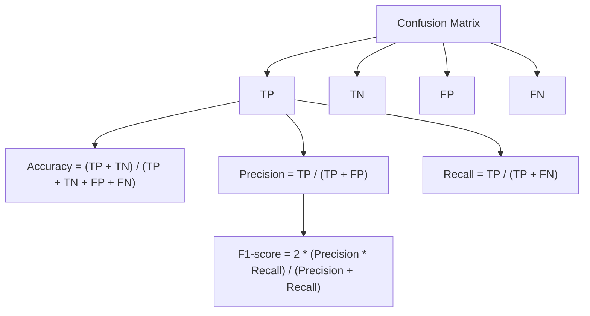

# Lesson 1: Model Evaluation Metrics

## 1. First-Principles Intuition & Invariants

In the realm of machine learning, the evaluation of models is a critical step that determines the effectiveness and reliability of a predictive system. The choice of evaluation metrics is not merely a technical decision but a strategic one that aligns with business objectives and the problem domain. Understanding the nuances of these metrics is essential for any senior software engineer, systems programmer, or domain architect tasked with deploying machine learning models in production environments.

At the heart of model evaluation lies the concept of performance metrics, which quantify the accuracy and robustness of a model's predictions. These metrics are derived from the confusion matrix, a fundamental data structure that summarizes the outcomes of a classification model's predictions against the actual ground truth. The confusion matrix is a 2x2 table for binary classification problems, with entries representing true positives (TP), true negatives (TN), false positives (FP), and false negatives (FN). Each of these entries provides a critical piece of information about the model's performance.

True Positives (TP) are the number of instances correctly predicted as positive. True Negatives (TN) are the number of instances correctly predicted as negative. False Positives (FP) are the number of instances incorrectly predicted as positive, representing a Type I error. False Negatives (FN) are the number of instances incorrectly predicted as negative, representing a Type II error.

From these basic components, a variety of performance metrics can be derived, each offering a unique perspective on the model's strengths and weaknesses. The most commonly used metrics include accuracy, precision, recall, F1-score, and ROC-AUC. Each of these metrics is grounded in the principles of probability and statistics, and their interpretation requires a deep understanding of the underlying data distribution and the specific problem being addressed.

Accuracy is the simplest and most intuitive metric, representing the proportion of correct predictions out of the total number of predictions made. Mathematically, accuracy is defined as:

Accuracy = (TP + TN) / (TP + TN + FP + FN)

While accuracy is a useful metric for balanced datasets, it can be misleading when dealing with imbalanced datasets where one class significantly outweighs the other. In such cases, a model that predicts the majority class for all instances can achieve high accuracy without providing meaningful insights into the model's ability to predict the minority class.

Precision focuses on the proportion of true positive predictions among all positive predictions made by the model. It is defined as:

Precision = TP / (TP + FP)

Precision is particularly important in scenarios where false positives are costly or undesirable, such as in medical diagnosis or fraud detection. A high precision score indicates that the model is effective at minimizing false positives, thereby reducing the risk of false alarms.

Recall, also known as sensitivity or true positive rate, measures the proportion of true positive predictions among all actual positive instances. It is defined as:

Recall = TP / (TP + FN)

Recall is crucial in applications where false negatives are more costly than false positives, such as in disease screening or spam detection. A high recall score indicates that the model is effective at identifying all relevant instances, thereby minimizing the risk of missing true positives.

The F1-score is the harmonic mean of precision and recall, providing a balanced measure of a model's performance. It is defined as:

F1-score = 2 * (Precision * Recall) / (Precision + Recall)

The F1-score is particularly useful in scenarios where both precision and recall are important, as it provides a single metric that reflects the trade-off between the two. The harmonic mean ensures that a model must perform well on both precision and recall to achieve a high F1-score, making it a robust metric for imbalanced datasets.

Finally, the Receiver Operating Characteristic (ROC) curve and the Area Under the ROC Curve (AUC) provide a comprehensive evaluation of a model's performance across different classification thresholds. The ROC curve plots the true positive rate against the false positive rate at various threshold settings, while the AUC provides a single scalar value representing the overall performance of the model. The AUC ranges from 0 to 1, with a value of 0.5 indicating random guessing and a value of 1 indicating perfect classification. Mathematically, the AUC is defined as:

AUC = integral from 0 to 1 of TPR(FPR) dFPR

where TPR is the true positive rate and FPR is the false positive rate. The AUC is particularly useful for comparing the performance of different models, as it provides a single metric that captures the model's ability to distinguish between positive and negative instances across all possible thresholds.

The evaluation of machine learning models is a multifaceted process that requires a deep understanding of the underlying data distribution and the specific problem domain. The choice of evaluation metrics is a critical step that aligns with business objectives and provides meaningful insights into the model's performance. By grounding these metrics in the principles of probability and statistics, we can develop a robust framework for evaluating and optimizing machine learning models in production environments.

## 2. Core Architecture & Mechanics

To gain a deeper understanding of the mechanics of model evaluation metrics, it is essential to dissect the internal data structures and algorithms that underpin their computation. The confusion matrix, as mentioned earlier, is the fundamental data structure that summarizes the outcomes of a classification model's predictions against the actual ground truth. The confusion matrix is a 2x2 table for binary classification problems, with entries representing true positives (TP), true negatives (TN), false positives (FP), and false negatives (FN).

The computation of accuracy, precision, recall, and F1-score can be visualized using a simple Mermaid diagram:

