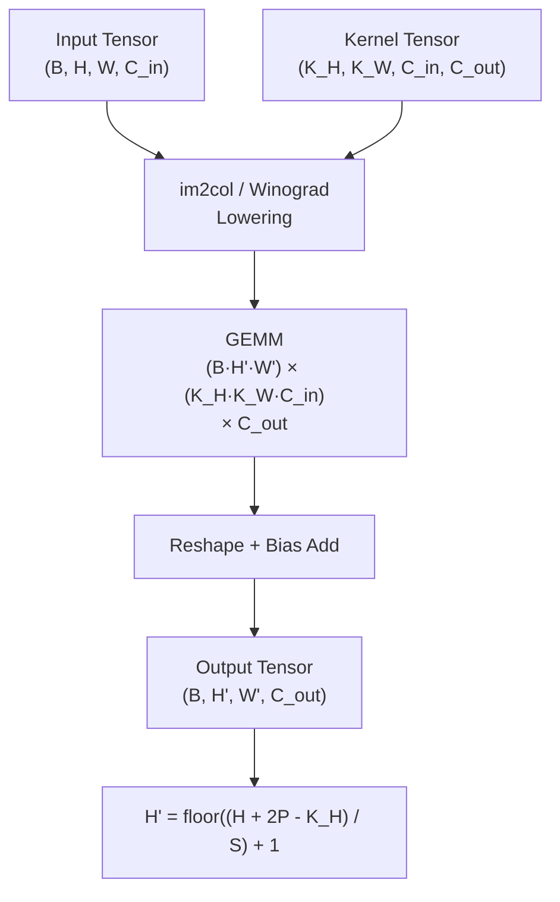
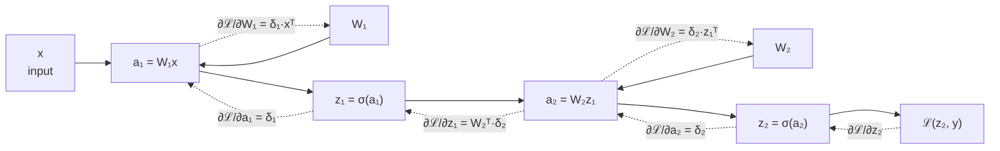
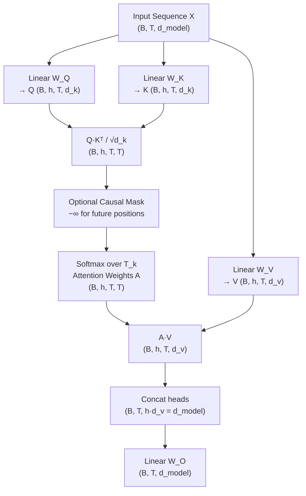
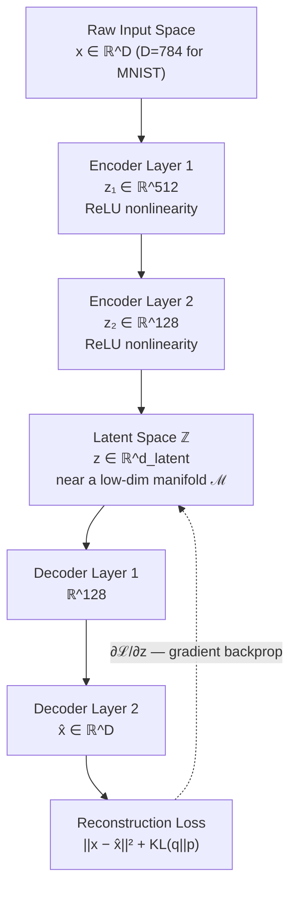
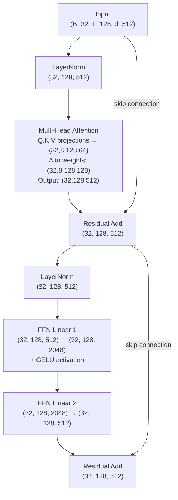

# Lesson 2: Core Architecture & Algorithmic Mechanics

---

## 1. Tensor Transformations & Dimensional Flows

A tensor is a generalization of scalars, vectors, and matrices to arbitrary rank. In deep learning, every intermediate representation — pixel grids, word embeddings, attention scores, feature volumes — is a tensor living in some $\mathbb{R}^{d_1 \times d_2 \times \cdots \times d_n}$ space. The *dimensional flow* of a network is the precise sequence of shape transformations applied to data as it moves from input to loss. Getting this wrong silently produces incorrect results; getting it right is the prerequisite for every optimization that follows.

### 1.1 Tensor Rank, Shape, and Strides

A rank-$n$ tensor has $n$ axes. Its **shape** is the tuple of axis extents, e.g., $(32, 224, 224, 3)$ for a batch of 32 RGB images at $224 \times 224$. Its **strides** describe, in bytes, how far to advance in memory to step one element along each axis. PyTorch and NumPy use row-major (C-contiguous) ordering by default, so for a shape $(B, H, W, C)$ tensor of `float32` the strides are:

$$\text{stride} = (H \cdot W \cdot C \cdot 4,\; W \cdot C \cdot 4,\; C \cdot 4,\; 4) \text{ bytes}$$

Operations like `view` and `reshape` are free (no data copy) when the tensor is contiguous, because they only rewrite the stride metadata. `permute` / `transpose` produce non-contiguous tensors by swapping strides; a subsequent `contiguous()` call forces a physical copy. This distinction matters for performance: a non-contiguous tensor handed to a CUDA kernel often triggers an implicit copy that dominates runtime.

```python
import torch

x = torch.randn(32, 224, 224, 3)   # (B, H, W, C)
print(x.stride())                   # (150528, 672, 3, 1)  — C-contiguous

# Permute to PyTorch's preferred (B, C, H, W) layout
x_nchw = x.permute(0, 3, 1, 2)     # non-contiguous — strides reordered
print(x_nchw.is_contiguous())       # False
x_nchw = x_nchw.contiguous()        # allocates new memory, strides canonical
print(x_nchw.shape)                 # torch.Size([32, 3, 224, 224])
```

### 1.2 Broadcasting: The Rules and Why They Work

Broadcasting is a formal set of shape-compatibility rules, not magic. NumPy / PyTorch follow IEEE-style broadcasting:

1. Align shapes from the **right**.
2. Axes with size 1 are virtually expanded to match the peer axis size (no memory allocated — the stride for that axis is set to 0).
3. Shapes are incompatible if any paired axis is neither equal nor 1.

```python
import torch

bias = torch.randn(64)              # shape: (64,)
feat = torch.randn(32, 128, 128, 64) # shape: (32, 128, 128, 64)
out  = feat + bias                  # bias broadcast to (1, 1, 1, 64) → (32,128,128,64)
# No copy of bias. Its stride on axes 0-2 is effectively 0.
```

The zero-stride trick means broadcasting a $(64,)$ bias across a $(32, 128, 128, 64)$ feature map costs exactly one addition per output element — optimal. Misunderstanding broadcasting causes shape errors that are caught at runtime but, more dangerously, silent semantic errors when shapes accidentally align.

### 1.3 Convolution: Dimensional Mechanics from First Principles

A 2-D cross-correlation (what frameworks call "convolution") maps:

$$(\mathbf{X}, \mathbf{K}) \in \mathbb{R}^{B \times H \times W \times C_{in}} \times \mathbb{R}^{K_H \times K_W \times C_{in} \times C_{out}} \;\longrightarrow\; \mathbf{Y} \in \mathbb{R}^{B \times H' \times W' \times C_{out}}$$

where:

$$H' = \left\lfloor \frac{H + 2P_H - K_H}{S_H} \right\rfloor + 1 \qquad W' = \left\lfloor \frac{W + 2P_W - K_W}{S_W} \right\rfloor + 1$$

$P$ is padding, $S$ is stride. Every output element $\mathbf{Y}[b, h', w', c_{out}]$ is a dot product over a $K_H \times K_W \times C_{in}$ neighborhood — in total $K_H K_W C_{in}$ multiplications — giving an operation count of:

$$\text{FLOPs} \approx 2 \cdot B \cdot H' \cdot W' \cdot C_{out} \cdot K_H \cdot K_W \cdot C_{in}$$

(factor of 2 for multiply-accumulate). This formula is the basis for all FLOP budgets in architecture search.



Modern GPU implementations do not iterate pixel-by-pixel. cuDNN selects between three algorithms at runtime:

- **im2col + GEMM**: unfolds the sliding windows into a matrix, then calls cuBLAS. Memory-intensive but maximally parallelizable.
- **Winograd's minimal filtering algorithm**: reduces multiplications by $O(K^2 / (2K-1)^2)$ at the cost of additional additions. Used for $3 \times 3$ kernels in almost all production inference.
- **FFT-based convolution**: $O(N \log N)$ complexity; preferable for large kernels ($K \geq 7$), rare in modern architectures.

```python
import torch
import torch.nn as nn

# Production-grade 2-D convolution with explicit padding, bias, and batch norm
class ConvBnReLU(nn.Module):
    def __init__(
        self,
        in_channels: int,
        out_channels: int,
        kernel_size: int = 3,
        stride: int = 1,
        groups: int = 1,
    ) -> None:
        super().__init__()
        padding = (kernel_size - 1) // 2  # 'same' padding for odd kernels
        self.conv = nn.Conv2d(
            in_channels,
            out_channels,
            kernel_size=kernel_size,
            stride=stride,
            padding=padding,
            groups=groups,
            bias=False,  # BN subsumes additive bias
        )
        self.bn   = nn.BatchNorm2d(out_channels, momentum=0.1, eps=1e-5)
        self.act  = nn.ReLU(inplace=True)

    def forward(self, x: torch.Tensor) -> torch.Tensor:
        return self.act(self.bn(self.conv(x)))


# Verify dimensional flow
if __name__ == "__main__":
    B, C_in, H, W = 8, 3, 224, 224
    C_out, K, S   = 64, 7, 2

    layer = ConvBnReLU(C_in, C_out, kernel_size=K, stride=S)
    x     = torch.randn(B, C_in, H, W)
    y     = layer(x)

    H_prime = (H + 2 * 3 - K) // S + 1  # padding = (7-1)//2 = 3
    W_prime = (W + 2 * 3 - K) // S + 1
    print(f"Input:  {x.shape}")           # (8, 3, 224, 224)
    print(f"Output: {y.shape}")           # (8, 64, 112, 112)
    print(f"Expected H'={H_prime}, W'={W_prime}")

    param_count = sum(p.numel() for p in layer.parameters())
    flops = 2 * B * H_prime * W_prime * C_out * K * K * C_in
    print(f"Parameters: {param_count:,}")
    print(f"FLOPs (single forward): {flops / 1e9:.3f} GFLOPs")
```

### 1.4 Global Average Pooling: Correct Implementation and Dimensional Semantics

Global average pooling (GAP) collapses the spatial axes of a feature map to a single value per channel, producing a $(B, C)$ descriptor. This is not equivalent to flattening then averaging — the correct operation averages over the spatial dimensions only.

```python
import torch
import torch.nn.functional as F

# Correct: (B, C, H, W) → (B, C)
feature_map = torch.randn(8, 512, 7, 7)   # NCHW layout
gap_output  = F.adaptive_avg_pool2d(feature_map, output_size=1)  # (8, 512, 1, 1)
gap_output  = gap_output.flatten(start_dim=1)                     # (8, 512)

# Equivalent explicit formulation
gap_manual  = feature_map.mean(dim=(2, 3))   # mean over H and W → (8, 512)
print(torch.allclose(gap_output, gap_manual, atol=1e-6))  # True

# ------------------------------------------------------------------
# Note on the original lesson's code:
# The original used NHWC layout (B, H, W, C) with dim=[2, 3], which
# averages over W and C, not H and W — a semantic error for NHWC.
# The correct NHWC version is dim=[1, 2]:
feature_map_nhwc = torch.randn(8, 7, 7, 512)   # NHWC
gap_nhwc         = feature_map_nhwc.mean(dim=(1, 2))  # → (8, 512) ✓
# ------------------------------------------------------------------
```

---

## 2. Loss Surfaces, Gradients & Optimization Dynamics

### 2.1 The Loss Landscape as a Geometric Object

The loss function $\mathcal{L}: \mathbb{R}^P \to \mathbb{R}$ defines a hypersurface in $P+1$ dimensions, where $P$ is the number of trainable parameters. For a ResNet-50, $P \approx 25 \times 10^6$ — the landscape exists in 25-million-dimensional space. Visualization techniques (Goodfellow et al., 2015; Li et al., 2018) project this surface onto 1-D or 2-D slices by perturbing parameters along random or curvature-guided directions; the flatness or sharpness of minima found in those projections correlates empirically with generalization.

Key structural properties of neural network loss landscapes:

- **Saddle points dominate** at high $P$. For random functions in high dimensions, almost all critical points with many negative curvature directions are saddle points, not local minima (Dauphin et al., 2014). This means SGD escaping saddle points via stochastic noise is not a failure mode — it is the mechanism.
- **Flat minima generalize better.** The sharpness-aware minimization (SAM) objective (Foret et al., 2021) explicitly penalizes sharp curvature by maximizing loss within a neighborhood before minimizing.
- **Mode connectivity.** Distinct minima found by independent training runs are typically connected by low-loss paths (Garipov et al., 2018), implying the loss surface is not riddled with isolated basins for over-parameterized networks.

### 2.2 Backpropagation: The Chain Rule Unrolled

Backpropagation is automatic differentiation in reverse accumulation mode applied to the computation graph. It is *not* symbolic differentiation and *not* numerical finite-difference approximation. For a composition $\mathcal{L} = f_L \circ f_{L-1} \circ \cdots \circ f_1(\mathbf{x})$, the chain rule gives:

$$\frac{\partial \mathcal{L}}{\partial \theta_k} = \frac{\partial \mathcal{L}}{\partial \mathbf{a}_L} \cdot \frac{\partial \mathbf{a}_L}{\partial \mathbf{a}_{L-1}} \cdots \frac{\partial \mathbf{a}_{k+1}}{\partial \theta_k}$$

Each factor $\frac{\partial \mathbf{a}_i}{\partial \mathbf{a}_{i-1}}$ is a Jacobian matrix. Computing these Jacobians explicitly would be $O(P^2)$; reverse-mode AD avoids materializing them by multiplying left-to-right (backward pass), costing $O(P)$ — the same asymptotic complexity as the forward pass.

The **vanishing gradient problem** arises when these Jacobian factors have spectral radius $< 1$ repeatedly: the product of $L$ matrices with singular values $< 1$ decays exponentially. Skip connections (ResNets), gating (LSTMs), and normalization layers (BatchNorm, LayerNorm) all address this by keeping gradient magnitudes in a stable range throughout the network.



Solid arrows: forward pass. Dashed arrows: backward (gradient) pass.

### 2.3 Optimization Algorithms: Mechanics and Hyperparameter Sensitivity

**SGD with Momentum** accumulates a velocity vector $\mathbf{v}$:

$$\mathbf{v}_{t+1} = \mu \mathbf{v}_t - \eta \nabla_\theta \mathcal{L}(\theta_t) \qquad \theta_{t+1} = \theta_t + \mathbf{v}_{t+1}$$

Momentum $\mu$ (typically 0.9–0.99) damps oscillations in high-curvature directions and accelerates convergence along shallow, consistent gradient directions. Nesterov momentum evaluates the gradient at the lookahead position $\theta_t + \mu \mathbf{v}_t$, giving better theoretical convergence guarantees for convex problems.

**Adam** (Kingma & Ba, 2015) maintains per-parameter first and second moment estimates:

$$\mathbf{m}_{t+1} = \beta_1 \mathbf{m}_t + (1-\beta_1) \mathbf{g}_t$$
$$\mathbf{v}_{t+1} = \beta_2 \mathbf{v}_t + (1-\beta_2) \mathbf{g}_t^2$$
$$\hat{\mathbf{m}}_{t+1} = \frac{\mathbf{m}_{t+1}}{1 - \beta_1^{t+1}} \qquad \hat{\mathbf{v}}_{t+1} = \frac{\mathbf{v}_{t+1}}{1 - \beta_2^{t+1}}$$
$$\theta_{t+1} = \theta_t - \frac{\eta}{\sqrt{\hat{\mathbf{v}}_{t+1}} + \epsilon} \hat{\mathbf{m}}_{t+1}$$

The bias-correction terms $(1 - \beta^t)$ are critical at initialization when moment estimates start at zero. The $\sqrt{\hat{\mathbf{v}}}$ denominator is an adaptive per-parameter learning rate: parameters with historically large gradients receive smaller updates, stabilizing training. Default $\epsilon = 10^{-8}$ can cause issues with `bfloat16` training; in mixed-precision settings, $\epsilon = 10^{-6}$ is safer.

**AdamW** (Loshchilov & Hutter, 2019) decouples weight decay from the adaptive learning rate — the correct formulation for L2 regularization under adaptive optimizers. Standard Adam absorbs weight decay into the gradient, conflating it with the adaptive scaling. AdamW applies decay directly to weights:

$$\theta_{t+1} = \theta_t - \frac{\eta}{\sqrt{\hat{\mathbf{v}}_{t+1}} + \epsilon} \hat{\mathbf{m}}_{t+1} - \eta \lambda \theta_t$$

This is the default optimizer for most transformer training runs.

```python
import torch
import torch.nn as nn
from torch.optim import AdamW
from torch.optim.lr_scheduler import CosineAnnealingLR

# Production training loop skeleton with gradient clipping and mixed precision
def train_epoch(
    model: nn.Module,
    loader: torch.utils.data.DataLoader,
    optimizer: torch.optim.Optimizer,
    scaler: torch.cuda.amp.GradScaler,
    criterion: nn.Module,
    max_grad_norm: float = 1.0,
    device: torch.device = torch.device("cuda"),
) -> float:
    model.train()
    total_loss = 0.0

    for batch_idx, (inputs, targets) in enumerate(loader):
        inputs, targets = inputs.to(device, non_blocking=True), \
                          targets.to(device, non_blocking=True)

        optimizer.zero_grad(set_to_none=True)  # slightly faster than zero_grad()

        with torch.autocast(device_type="cuda", dtype=torch.bfloat16):
            outputs = model(inputs)
            loss    = criterion(outputs, targets)

        # Scale loss, compute scaled gradients, unscale before clipping
        scaler.scale(loss).backward()
        scaler.unscale_(optimizer)   # unscale so clip_grad_norm_ sees true magnitudes
        nn.utils.clip_grad_norm_(model.parameters(), max_norm=max_grad_norm)
        scaler.step(optimizer)
        scaler.update()

        total_loss += loss.item()

    return total_loss / len(loader)


# Example setup
def build_optimizer_and_scheduler(
    model: nn.Module,
    lr: float = 3e-4,
    weight_decay: float = 0.05,
    epochs: int = 90,
) -> tuple:
    # Exclude bias and normalization parameters from weight decay (standard practice)
    decay_params    = [p for n, p in model.named_parameters()
                       if p.requires_grad and p.ndim >= 2]
    no_decay_params = [p for n, p in model.named_parameters()
                       if p.requires_grad and p.ndim < 2]

    param_groups = [
        {"params": decay_params,    "weight_decay": weight_decay},
        {"params": no_decay_params, "weight_decay": 0.0},
    ]
    optimizer  = AdamW(param_groups, lr=lr, betas=(0.9, 0.999), eps=1e-6)
    scheduler  = CosineAnnealingLR(optimizer, T_max=epochs, eta_min=lr * 0.01)
    return optimizer, scheduler
```

### 2.4 MSE Loss — Correct Gradient Derivation

For a dataset $\{(\mathbf{x}^{(i)}, y^{(i)})\}_{i=1}^N$ and a linear model $\hat{y} = \theta^\top \mathbf{x}$:

$$\mathcal{L}(\theta) = \frac{1}{N} \sum_{i=1}^{N} (y^{(i)} - \hat{y}^{(i)})^2 = \frac{1}{N} \|\mathbf{y} - \mathbf{X}\theta\|^2$$

Differentiating with respect to $\theta$:

$$\nabla_\theta \mathcal{L} = -\frac{2}{N} \mathbf{X}^\top (\mathbf{y} - \mathbf{X}\theta)$$

Setting to zero gives the **normal equations**: $\hat{\theta} = (\mathbf{X}^\top \mathbf{X})^{-1} \mathbf{X}^\top \mathbf{y}$ — the closed-form OLS solution. The original lesson's expression $\partial \mathcal{L}/\partial\theta = -\frac{2}{n}\sum (y_{true} - y_{pred}) \cdot \partial y_{pred}/\partial\theta$ is correct in structure but requires the chain-rule expansion $\partial y_{pred}/\partial\theta = \mathbf{x}^{(i)}$ to be fully specified.

The original code snippet `torch.autograd.grad(loss_fn(theta), theta)` is incorrect: `loss_fn(theta)` passes raw parameter tensors as both predictions and targets, which is semantically meaningless. The correct usage:

```python
import torch
import torch.nn as nn

torch.manual_seed(42)
N, D = 100, 4

# Synthetic dataset: y = Xw* + noise
X      = torch.randn(N, D)
w_star = torch.tensor([1.5, -2.0, 0.5, 3.0])
y      = X @ w_star + 0.1 * torch.randn(N)

# Model parameter
theta = nn.Parameter(torch.zeros(D))   # requires_grad=True by default

loss_fn = nn.MSELoss()
y_pred  = X @ theta
loss    = loss_fn(y_pred, y)
loss.backward()

# Verify against analytic gradient: -2/N * Xᵀ(y - Xθ)
analytic_grad = -2.0 / N * X.T @ (y - X @ theta.detach())
print(torch.allclose(theta.grad, analytic_grad, atol=1e-5))  # True
print(f"Loss: {loss.item():.4f}")
print(f"Gradient norm: {theta.grad.norm().item():.4f}")
```

---

## 3. Attention Maps, Kernel Mechanics & Latent Geometry

### 3.1 Scaled Dot-Product Attention: Derivation and Dimensional Analysis

The attention mechanism introduced in "Attention Is All You Need" (Vaswani et al., 2017) computes a weighted sum of values $\mathbf{V}$ where weights are determined by the compatibility between queries $\mathbf{Q}$ and keys $\mathbf{K}$:

$$\text{Attention}(\mathbf{Q}, \mathbf{K}, \mathbf{V}) = \text{softmax}\!\left(\frac{\mathbf{Q}\mathbf{K}^\top}{\sqrt{d_k}}\right) \mathbf{V}$$

where:
- $\mathbf{Q} \in \mathbb{R}^{T_q \times d_k}$: $T_q$ query vectors of dimension $d_k$
- $\mathbf{K} \in \mathbb{R}^{T_k \times d_k}$: $T_k$ key vectors
- $\mathbf{V} \in \mathbb{R}^{T_k \times d_v}$: $T_k$ value vectors
- Output $\in \mathbb{R}^{T_q \times d_v}$

The $\frac{1}{\sqrt{d_k}}$ scaling is not arbitrary. Without it, dot products grow as $O(d_k)$ in magnitude (each element of $\mathbf{Q}\mathbf{K}^\top$ is a sum of $d_k$ products of unit-normal scalars, giving variance $d_k$). Large dot products push softmax into saturation regions where gradients vanish. Dividing by $\sqrt{d_k}$ restores unit variance.

The attention score matrix $\mathbf{A} = \text{softmax}(\mathbf{Q}\mathbf{K}^\top / \sqrt{d_k}) \in \mathbb{R}^{T_q \times T_k}$ is interpretable: entry $A_{ij}$ is the weight query $i$ places on value $j$. Visualizing rows of $\mathbf{A}$ as heatmaps over the key sequence produces the **attention maps** used for interpretability.

**Multi-Head Attention** projects $\mathbf{Q}$, $\mathbf{K}$, $\mathbf{V}$ into $h$ subspaces of dimension $d_k = d_v = d_{model}/h$:

$$\text{MHA}(\mathbf{Q}, \mathbf{K}, \mathbf{V}) = \text{Concat}(\text{head}_1, \ldots, \text{head}_h) \mathbf{W}^O$$

$$\text{head}_i = \text{Attention}(\mathbf{Q}\mathbf{W}_i^Q, \mathbf{K}\mathbf{W}_i^K, \mathbf{V}\mathbf{W}_i^V)$$

The projection matrices $\mathbf{W}_i^Q, \mathbf{W}_i^K \in \mathbb{R}^{d_{model} \times d_k}$, $\mathbf{W}_i^V \in \mathbb{R}^{d_{model} \times d_v}$, $\mathbf{W}^O \in \mathbb{R}^{hd_v \times d_{model}}$ are learned. Each head can specialize in different relational patterns (syntactic, semantic, positional).



```python
import torch
import torch.nn as nn
import torch.nn.functional as F
import math


class MultiHeadAttention(nn.Module):
    """
    Canonical scaled dot-product multi-head attention.
    Uses torch.nn.functional.scaled_dot_product_attention (PyTorch >= 2.0)
    which dispatches to Flash Attention when available.
    """

    def __init__(self, d_model: int, num_heads: int, dropout: float = 0.1) -> None:
        super().__init__()
        assert d_model % num_heads == 0, "d_model must be divisible by num_heads"
        self.d_model   = d_model
        self.num_heads = num_heads
        self.d_k       = d_model // num_heads

        # Fused Q, K, V projection for efficiency
        self.qkv_proj  = nn.Linear(d_model, 3 * d_model, bias=False)
        self.out_proj  = nn.Linear(d_model, d_model, bias=False)
        self.dropout_p = dropout

    def forward(
        self,
        x: torch.Tensor,
        attn_mask: torch.Tensor | None = None,
        is_causal: bool = False,
    ) -> tuple[torch.Tensor, torch.Tensor]:
        B, T, _ = x.shape

        # Fused projection: (B, T, 3·d_model) → split to Q, K, V
        qkv = self.qkv_proj(x)                              # (B, T, 3·d_model)
        q, k, v = qkv.split(self.d_model, dim=-1)           # each (B, T, d_model)

        # Reshape to (B, num_heads, T, d_k)
        def split_heads(t: torch.Tensor) -> torch.Tensor:
            return t.view(B, T, self.num_heads, self.d_k).transpose(1, 2)

        q, k, v = split_heads(q), split_heads(k), split_heads(v)

        # Scaled dot-product attention — dispatches to Flash Attention if available
        # (B, num_heads, T, d_k) → (B, num_heads, T, d_k)
        attn_output = F.scaled_dot_product_attention(
            q, k, v,
            attn_mask=attn_mask,
            dropout_p=self.dropout_p if self.training else 0.0,
            is_causal=is_causal,
        )

        # Compute attention weights separately for visualization (no Flash Attn path)
        with torch.no_grad():
            scale   = math.sqrt(self.d_k)
            scores  = torch.matmul(q, k.transpose(-2, -1)) / scale  # (B,h,T,T)
            if is_causal:
                causal_mask = torch.triu(
                    torch.ones(T, T, device=x.device, dtype=torch.bool), diagonal=1
                )
                scores = scores.masked_fill(causal_mask, float("-inf"))
            attn_weights = F.softmax(scores, dim=-1)  # (B, h, T, T)

        # Merge heads: (B, num_heads, T, d_k) → (B, T, d_model)
        attn_output = attn_output.transpose(1, 2).contiguous().view(B, T, self.d_model)
        output      = self.out_proj(attn_output)        # (B, T, d_model)

        return output, attn_weights


# --- Verification ---
if __name__ == "__main__":
    B, T, d_model, h = 2, 16, 256, 8
    mha = MultiHeadAttention(d_model=d_model, num_heads=h)
    x   = torch.randn(B, T, d_model)

    out, weights = mha(x, is_causal=True)
    print(f"Output shape:  {out.shape}")          # (2, 16, 256)
    print(f"Weight shape:  {weights.shape}")       # (2, 8, 16, 16)

    # Attention weights should sum to 1 along key dimension
    assert torch.allclose(weights.sum(dim=-1), torch.ones(B, h, T), atol=1e-5), \
        "Attention weights do not sum to 1"

    # Causal mask: upper triangle should be ~0 (after softmax of -inf)
    # For numerical stability, check that future positions have weight < 1e-6
    assert (weights[:, :, :, :].triu(diagonal=1) < 1e-6).all(), \
        "Causal mask not applied correctly"
    print("All assertions passed.")
```

### 3.2 The Self-Attention Complexity Problem and Flash Attention

The attention score matrix $\mathbf{A} \in \mathbb{R}^{T \times T}$ has $O(T^2)$ space complexity. For $T = 8192$ tokens with `bfloat16`, storing $\mathbf{A}$ requires $8192^2 \times 2 \approx 134$ MB *per head per batch element* — intractable for long sequences with many heads. Compute is $O(T^2 d_k)$.

**Flash Attention** (Dao et al., 2022) reformulates the attention computation using **tiling and online softmax** to avoid materializing the full $T \times T$ matrix in HBM (GPU high-bandwidth memory). It tiles $\mathbf{Q}$, $\mathbf{K}$, $\mathbf{V}$ into blocks that fit in SRAM (on-chip cache), processes them incrementally with a numerically stable running softmax, and achieves $O(T)$ memory at the cost of $O(T^2)$ compute — the same FLOP count but up to 7× faster in practice due to reduced memory bandwidth requirements.

The key insight is that GPU compute is memory-bandwidth-bound for attention at typical sequence lengths: the bottleneck is reading/writing $T \times T$ matrices to HBM, not the arithmetic itself.

### 3.3 Latent Space Geometry

The latent space $\mathcal{Z}$ is the manifold of representations learned by intermediate layers. Several geometric properties determine model behavior:

**Intrinsic dimensionality.** High-dimensional latent spaces do not use all available dimensions equally. PCA or participation ratio analysis typically reveals that the effective rank of a layer's activations is far lower than its nominal dimension — representations lie near a low-dimensional manifold embedded in high-dimensional space.

**Isotropy.** A latent space is isotropic if the singular values of the activation matrix are approximately equal. Degenerate (anisotropic) representations, where most variance concentrates on a few directions, harm downstream tasks. This is the motivation for techniques like whitening, spectral normalization, and the isotropy-improving objectives used in self-supervised learning (e.g., VICReg, Barlow Twins).

**Metric structure.** Cosine similarity is the standard distance metric in NLP latent spaces because unit-norm representations lie on a hypersphere where angle is the natural notion of similarity. Euclidean distance is confounded by magnitude and is less appropriate for high-dimensional spaces with bounded activations.



### 3.4 Depthwise Separable Convolution: Kernel Factorization

Standard convolution mixes spatial filtering and cross-channel projection in one operation. MobileNet (Howard et al., 2017) factorizes this into:

1. **Depthwise convolution**: apply one $K \times K$ kernel per input channel — spatial filtering only.
2. **Pointwise ($1 \times 1$) convolution**: mix across channels — projection only.

FLOPs comparison for a single layer, input $(B, C, H, W)$, output $C_{out}$ channels, kernel $K \times K$:

| Operation | FLOPs |
|---|---|
| Standard conv | $2 B H' W' C_{out} K^2 C_{in}$ |
| Depthwise | $2 B H' W' C_{in} K^2$ |
| Pointwise | $2 B H' W' C_{out} C_{in}$ |
| **Separable total** | $2 B H' W' C_{in}(K^2 + C_{out})$ |

Reduction ratio: $\frac{1}{C_{out}} + \frac{1}{K^2}$. For $K=3, C_{out}=256$: $\approx 8-9\times$ fewer FLOPs.

```python
import torch
import torch.nn as nn


class DepthwiseSeparableConv(nn.Module):
    """
    Factorized convolution: depthwise spatial filter + pointwise channel mixer.
    Equivalent representation to standard conv with ~8-9x fewer FLOPs at K=3.
    """

    def __init__(
        self,
        in_channels: int,
        out_channels: int,
        kernel_size: int = 3,
        stride: int = 1,
    ) -> None:
        super().__init__()
        padding = (kernel_size - 1) // 2
        # Depthwise: groups=in_channels → one kernel per channel
        self.depthwise  = nn.Conv2d(
            in_channels, in_channels,
            kernel_size=kernel_size, stride=stride,
            padding=padding, groups=in_channels, bias=False,
        )
        self.dw_bn  = nn.BatchNorm2d(in_channels)
        self.dw_act = nn.ReLU(inplace=True)

        # Pointwise: 1×1 conv mixes channels
        self.pointwise  = nn.Conv2d(in_channels, out_channels, kernel_size=1, bias=False)
        self.pw_bn  = nn.BatchNorm2d(out_channels)
        self.pw_act = nn.ReLU(inplace=True)

    def forward(self, x: torch.Tensor) -> torch.Tensor:
        x = self.dw_act(self.dw_bn(self.depthwise(x)))
        x = self.pw_act(self.pw_bn(self.pointwise(x)))
        return x


def flop_comparison(C_in: int = 128, C_out: int = 256, K: int = 3) -> None:
    B, H, W   = 1, 56, 56
    H_p, W_p  = H, W   # stride=1, same padding
    std_flops = 2 * B * H_p * W_p * C_out * K**2 * C_in
    dw_flops  = 2 * B * H_p * W_p * C_in  * K**2
    pw_flops  = 2 * B * H_p * W_p * C_out * C_in
    sep_flops = dw_flops + pw_flops
    print(f"Standard conv:    {std_flops / 1e9:.3f} GFLOPs")
    print(f"Separable conv:   {sep_flops / 1e9:.3f} GFLOPs")
    print(f"Reduction ratio:  {std_flops / sep_flops:.1f}x")


if __name__ == "__main__":
    flop_comparison()

    model = DepthwiseSeparableConv(128, 256, kernel_size=3, stride=2)
    x     = torch.randn(4, 128, 56, 56)
    y     = model(x)
    print(f"Input:  {x.shape}")   # (4, 128, 56, 56)
    print(f"Output: {y.shape}")   # (4, 256, 28, 28) — stride=2 halves spatial dims
```

---

## 4. Synthesis: End-to-End Dimensional Flow in a Mini-Transformer Block

The following diagram unifies the components covered in this lesson within a single Transformer encoder block, showing exact tensor shapes at each operation for a typical configuration ($d_{model}=512$, $h=8$, $d_{ff}=2048$, $T=128$, $B=32$):



The **Pre-LN** architecture (LayerNorm before attention/FFN, as shown here) produces smoother loss landscapes and more stable training compared to the original Post-LN formulation from Vaswani et al. The two residual connections — one around attention, one around the FFN — are the primary mechanism keeping gradient norms stable throughout all $L$ layers.

---

## Key Formulas Reference

| Concept | Formula |
|---|---|
| Convolution output size | $H' = \lfloor(H + 2P - K)/S\rfloor + 1$ |
| Convolution FLOPs | $2 B H' W' C_{out} K_H K_W C_{in}$ |
| Scaled dot-product attention | $\text{softmax}(\mathbf{QK}^\top/\sqrt{d_k})\mathbf{V}$ |
| MSE gradient | $\nabla_\theta \mathcal{L} = -\tfrac{2}{N}\mathbf{X}^\top(\mathbf{y} - \mathbf{X}\theta)$ |
| Adam update | $\theta \leftarrow \theta - \frac{\eta}{\sqrt{\hat{v}} + \epsilon}\hat{m}$ |
| Separable conv speedup | $\approx K^2 C_{out} / (K^2 + C_{out})$ |

---

## References

- Vaswani, A., et al. (2017). *Attention Is All You Need*. NeurIPS.
- Kingma, D. P., & Ba, J. (2015). *Adam: A Method for Stochastic Optimization*. ICLR.
- Loshchilov, I., & Hutter, F. (2019). *Decoupled Weight Decay Regularization*. ICLR.
- Dao, T., et al. (2022). *FlashAttention: Fast and Memory-Efficient Exact Attention with IO-Awareness*. NeurIPS.
- Howard, A. G., et al. (2017). *MobileNets: Efficient Convolutional Neural Networks for Mobile Vision Applications*. arXiv:1704.04861.
- Li, H., et al. (2018). *Visualizing the Loss Landscape of Neural Nets*. NeurIPS.
- Foret, P., et al. (2021). *Sharpness-Aware Minimization for Efficiently Improving Generalization*. ICLR.
- Dauphin, Y., et al. (2014). *Identifying and attacking the saddle point problem in high-dimensional non-convex optimization*. NeurIPS.
