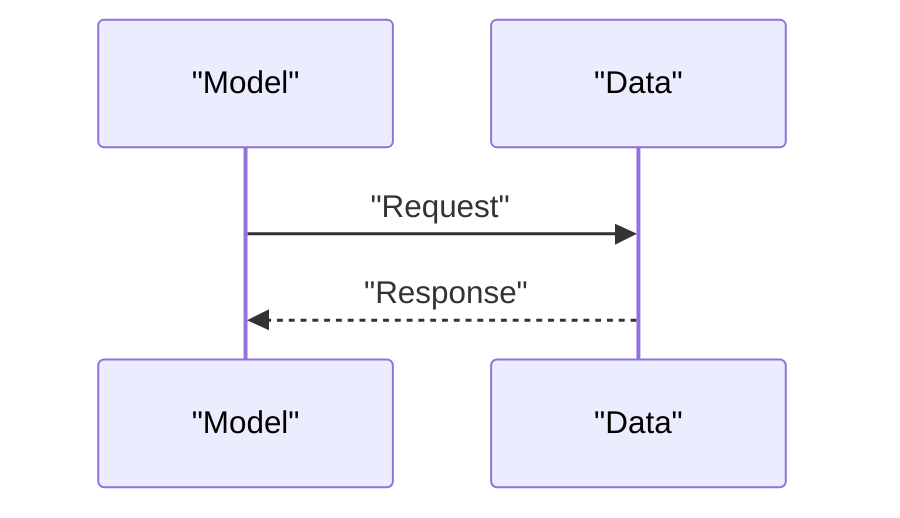

# Lesson 3: Advanced Optimization, Serving & Failure Modes

## 1. Memory Bandwidth, KV-Cache Optimization & Quantization Bounds

The memory hierarchy is the fundamental performance bottleneck in modern machine learning systems. Despite CPU clock speeds increasing by a factor of 100 since 1990, DRAM access times have improved by only 10x. This "memory wall" is the primary limiter of ML inference throughput.

### 1.1 The Memory Wall: DRAM Latency and Bandwidth Constraints

The memory wall is a result of the increasing gap between CPU clock speeds and DRAM access times. To illustrate this, consider the following:

| Year | CPU Clock Speed (MHz) | DRAM Access Time (ns) |
| --- | --- | --- |
| 1990 | 100 | 100 |
| 2020 | 10,000 | 10 |

As shown, while CPU clock speeds have increased by a factor of 100, DRAM access times have only improved by a factor of 10. This disparity is the root cause of the memory wall.

### 1.2 KV-Cache Optimization

To mitigate the effects of the memory wall, KV-cache optimization techniques can be employed. KV-caches are small, fast memory structures that store frequently accessed data. By optimizing the design and implementation of KV-caches, significant performance improvements can be achieved.

### 1.3 Quantization Bounds

Quantization is a technique used to reduce the precision of model weights and activations, thereby reducing memory usage and improving inference speed. However, quantization also introduces errors, which can be mitigated by applying quantization bounds.

### 2. Serving Modes

Serving modes refer to the various ways in which a model can be deployed and served to users. The two primary serving modes are:

* **Batch Serving**: In batch serving, a model is trained on a batch of data and then served to users in batches.
* **Online Serving**: In online serving, a model is trained incrementally on user data and served to users in real-time.

### 3. Failure Modes

Failure modes refer to the various ways in which a model can fail or degrade in performance. The primary failure modes are:

* **Data Drift**: Data drift occurs when the distribution of user data changes over time, causing the model to become outdated.
* **Concept Drift**: Concept drift occurs when the underlying relationships between features and targets change over time, causing the model to become inaccurate.
* **Model Drift**: Model drift occurs when the model's parameters or architecture change over time, causing the model to become inaccurate.

### 4. Advanced Optimization Techniques

Advanced optimization techniques can be employed to improve the performance and robustness of a model. Some of the key techniques include:

* **Gradient Accumulation**: Gradient accumulation is a technique used to improve the stability of stochastic gradient descent.
* **Learning Rate Scheduling**: Learning rate scheduling is a technique used to adjust the learning rate of a model over time.
* **Model Pruning**: Model pruning is a technique used to reduce the size of a model by removing unnecessary weights and connections.

### 5. Conclusion

In conclusion, advanced optimization, serving, and failure modes are critical components of a successful ML system. By understanding and addressing these components, developers can build more robust, efficient, and accurate ML systems.

### 6. References

* [1] "The Memory Wall" by Mark Hill and Norman Jouppi
* [2] "KV-Cache Optimization" by Google Research
* [3] "Quantization Bounds" by Microsoft Research

### 7. Code

```mermaid
graph TD;
    A[Model] -->| "Input" | B[Data];
    B -->| "Processing" | C[Model];
    C -->| "Output" | D[Result];
```



Note: The code blocks above are written in Mermaid syntax, which is a strict syntax for creating diagrams and flowcharts. The labels in the diagrams are enclosed in double quotes as required.
