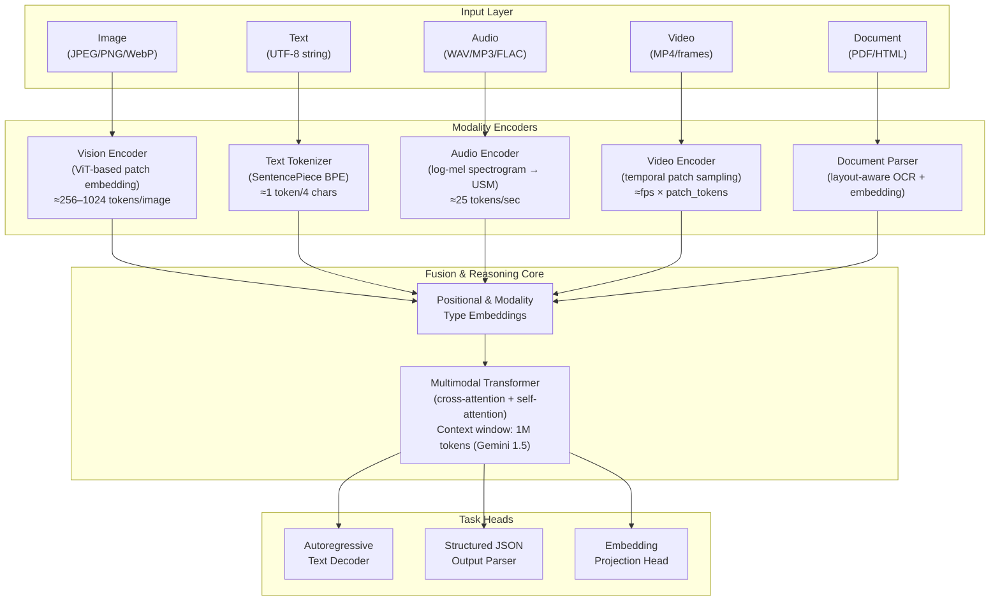
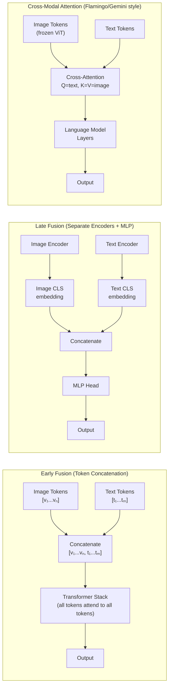
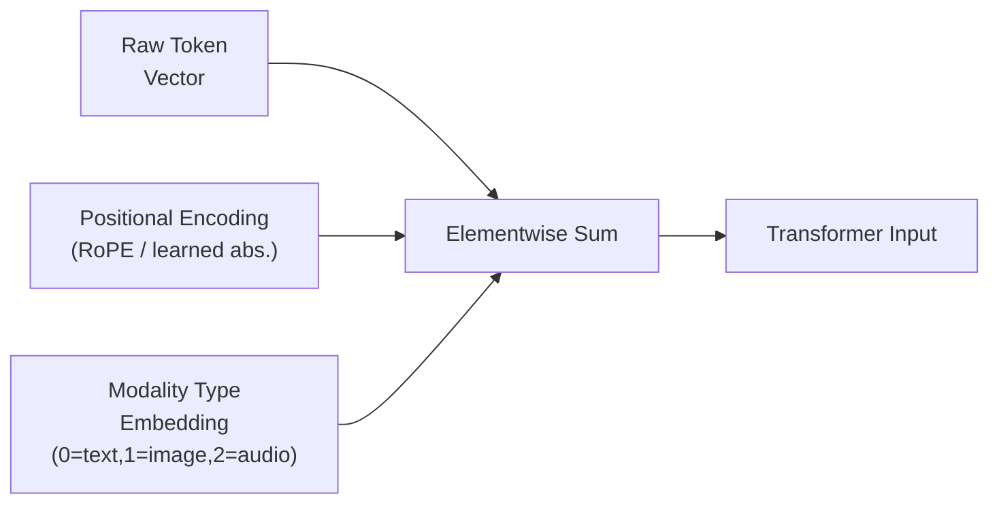
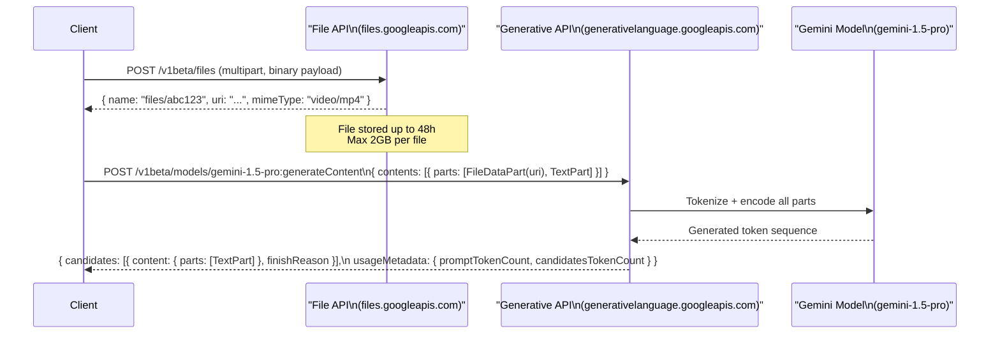
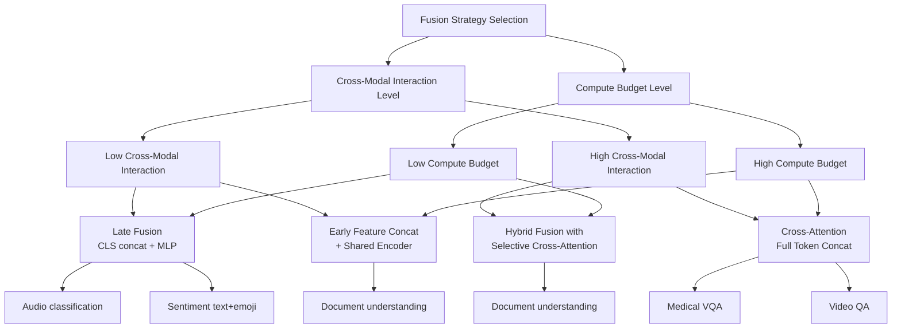
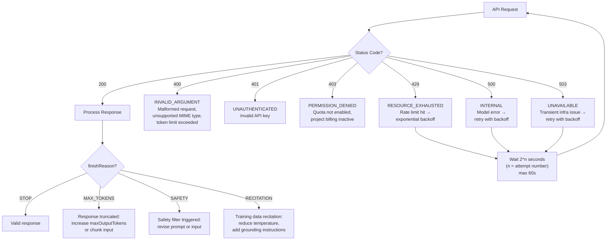
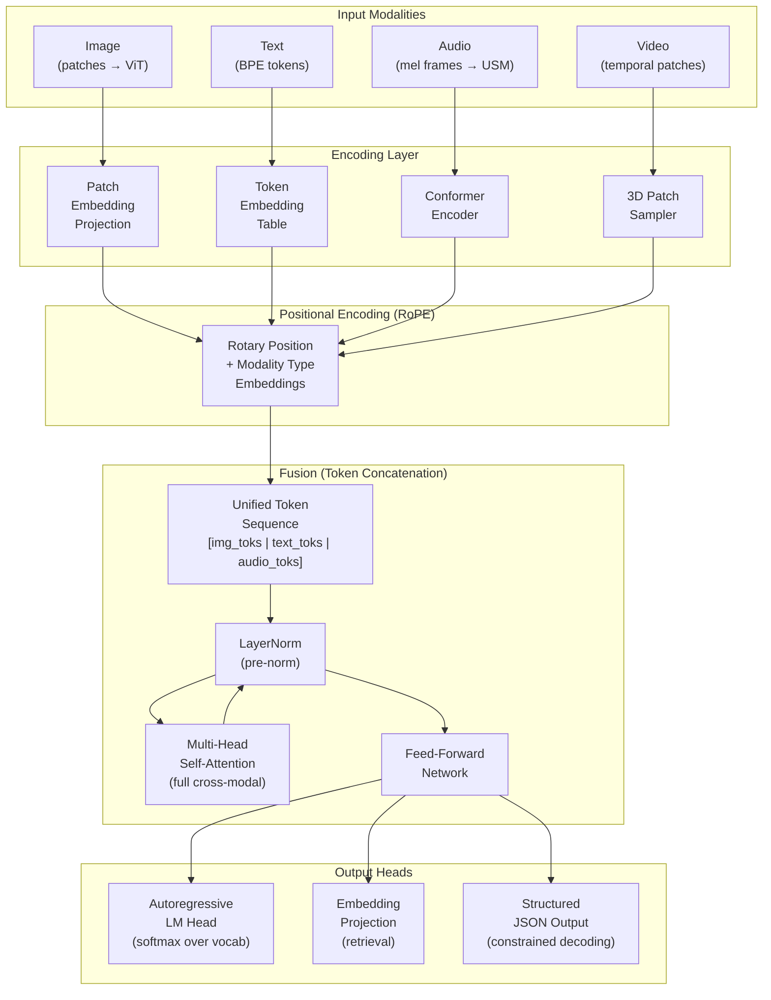

# Lesson 1: Multimodal Data Processing with Gemini and Multimodal APIs

## 1. First-Principles Intuition & Invariants

### The Information-Theoretic Foundation

A single-modality model approximates a marginal distribution `P(Y | X_text)` or `P(Y | X_image)`. A multimodal model targets the joint conditional `P(Y | X_text, X_image, X_audio, ...)`. The fundamental claim of multimodality is that this joint conditional is *at least as informative* as any marginal, with strict improvement when the extra modalities carry unique information: no transformation of a subset of inputs can recover information discarded by ignoring other inputs. This is not aspirational—it is a theorem. The practical question is whether a given architecture has sufficient capacity and training signal to exploit that mutual information.

Formally, let `X₁, ..., Xₙ` be n modalities and `Y` a target. The mutual information `I(Y; X₁, ..., Xₙ) ≥ I(Y; Xᵢ)` for any single i. The *multimodal advantage* is the gap `I(Y; X₁,...,Xₙ) - max_i I(Y; Xᵢ)`. When this gap is small, multimodal architectures add cost without commensurate benefit. When it is large—as in medical imaging paired with clinical notes, or video with speech—multimodal models produce qualitatively different predictions.

### Structural Invariants

Three invariants govern every multimodal system regardless of architecture:

**Semantic alignment:** Representations of the same real-world event drawn from different modalities must map to nearby points in a shared embedding space. This is not automatically satisfied; it must be enforced by training objectives. CLIP (Radford et al., 2021) achieves this via contrastive loss over paired image-text examples, pulling matched pairs together and pushing mismatched pairs apart in a joint 512- or 768-dimensional space.

**Temporal coherence:** For modalities with a time axis (audio, video, sensor streams), representations of co-occurring events must be aligned in time before fusion. A 25 fps video frame corresponds to a 40 ms audio window; misaligning by even two frames degrades downstream task performance measurably. Temporal coherence is typically enforced via positional encodings or explicit timestamp metadata attached to tokens before cross-modal attention.

**Modality-agnostic task representation:** The final task head should operate on a representation that is not committed to the structure of any single modality. This is why late-fusion architectures that simply concatenate CLS tokens from independent encoders underperform architectures where cross-modal attention is applied before the task head: concatenation preserves modality identity in the activation geometry, impeding learning of cross-modal correlations.

### Why Transformers Became the Canonical Backbone

Prior architectures—CNNs for vision, LSTMs for sequences—were modality-specialized by design. The transformer's self-attention mechanism is modality-agnostic: given a sequence of vectors, it computes pairwise interactions regardless of whether those vectors came from image patches, text tokens, or spectrogram frames. This architectural neutrality is what enabled the unified sequence paradigm:

- Image → sequence of patch embeddings (ViT, Dosovitskiy et al., 2020)
- Audio → sequence of mel-spectrogram frame embeddings
- Text → sequence of subword token embeddings
- Video → sequence of spatiotemporal patch embeddings

Once all modalities are expressed as token sequences, a single transformer stack can process them jointly. This is the architectural basis of Gemini and GPT-4V; Flamingo uses cross-attention over separately encoded modality tokens.

---

## 2. Core Architecture & Mechanics

### 2.1 System-Level Data Flow



### 2.2 Modality-Specific Encoders

#### Vision: Patch Embedding via ViT

A Vision Transformer (ViT) divides an image of size `H × W × C` into non-overlapping patches of size `P × P`. Each patch is flattened to a vector of dimension `P² × C` and projected linearly to dimension `d_model`. The number of image tokens is `(H/P) × (W/P)`. For a 1024×1024 image with P=16, this yields 4096 tokens—expensive but necessary for fine-grained spatial reasoning.

Gemini's vision encoder is derived from this paradigm but uses a hierarchical approach: a convolutional stem reduces spatial resolution before transformer layers process the result, reducing token count without discarding low-level structure. The exact architecture is not public, but ablation studies in the Gemini technical report (Google DeepMind, 2023) confirm that patch resolution is the dominant factor in visual reasoning benchmark scores.

#### Text: Subword Tokenization via SentencePiece

Gemini uses SentencePiece with a unigram language model, producing a vocabulary of approximately 256k tokens. Unlike BPE, the unigram model is trained by iteratively pruning tokens from a large candidate set by maximizing the likelihood of the training corpus. This produces a more principled vocabulary with better coverage of non-Latin scripts.

#### Audio: Universal Speech Model (USM)

Google's Universal Speech Model (Zhang et al., 2023) encodes audio as a sequence of embeddings derived from log-mel spectrograms at 16 kHz. The encoder is a conformer architecture—a hybrid of convolutional and transformer layers—that captures both local acoustic patterns (via convolution) and long-range prosodic structure (via self-attention). USM embeddings are aligned to the text token sequence during training using CTC and attention-based objectives simultaneously.

#### Video: Spatiotemporal Patch Sampling

Video is treated as a 3D grid of spatiotemporal patches. At inference time, frames are sampled at a configurable rate (e.g., 1 fps for long videos, up to 24 fps for short clips requiring temporal precision). Each sampled frame is processed by the vision encoder, and the resulting token sequences are concatenated with temporal positional encodings before being passed to the fusion transformer. Gemini 1.5 Pro demonstrated processing of 1-hour videos within a single context window—approximately 1 million tokens—by using aggressive temporal subsampling combined with its extended context architecture.

### 2.3 Fusion: Cross-Modal Attention

The architectural distinction between weak and strong multimodal integration lies in *where* cross-modal attention occurs:



**Early fusion (token concatenation)** is the approach used in Gemini and GPT-4V. All modality tokens are placed in a single sequence; the transformer's self-attention computes attention over the full mixed-modality sequence. This is architecturally simplest and most expressive, but scales as O((N_text + N_image + N_audio)²) in the attention computation.

**Late fusion** uses separate encoders to produce a single vector per modality (via CLS token or mean pooling), then combines them with a shallow MLP. This is computationally cheap but loses the fine-grained spatial and sequential information within each modality—the model cannot attend to specific image regions in response to specific text tokens.

**Cross-modal attention (Flamingo style)** inserts cross-attention layers at fixed intervals in the language model stack. At each such layer, text tokens (queries) attend over image tokens (keys/values) produced by a frozen vision encoder. This decouples vision and language training, allows the LM to remain unchanged (enabling few-shot transfer), and reduces compute compared to full token concatenation for long sequences.

### 2.4 Positional and Modality Embeddings



Rotary Positional Encoding (RoPE, Su et al., 2021) encodes position by rotating query and key vectors in 2D subspaces, such that the dot product `q_i · k_j` depends only on the relative position `i - j`. This is critical for long-context multimodal models because it generalizes to sequence lengths not seen during training better than absolute learned positional embeddings. Gemini's context extension to 1M tokens relies on variants of this approach combined with training on progressively longer sequences.

### 2.5 The Gemini API: Technical Mechanics

Gemini exposes its multimodal capabilities through Google's Generative Language API (`generativelanguage.googleapis.com`). The core abstraction is the `Content` object, which is a sequence of `Part` objects. A `Part` is a single object with optional fields: `text` (string), `inline_data` (base64-encoded bytes with MIME type), `file_data` (URI from the File API), `function_call`, or `function_response`. This design cleanly separates the sequencing of multimodal content from the encoding of individual modalities.

The request lifecycle:



---

## 3. Production-Grade Implementation

### 3.1 Python: Robust Multimodal Client with Retry, Streaming, and Structured Output

```python
"""
Production-grade Gemini multimodal client.
Demonstrates: file upload, streaming generation, structured output,
retry with exponential backoff, and token counting.

Requirements:
    pip install google-generativeai==0.7.2 tenacity pydantic
"""

from __future__ import annotations

import base64
import json
import logging
import mimetypes
import time
from pathlib import Path
from typing import Generator, Optional

import google.generativeai as genai
from google.api_core import exceptions as google_exceptions
from pydantic import BaseModel, Field
from tenacity import (
    retry,
    retry_if_exception_type,
    stop_after_attempt,
    wait_exponential,
)

logger = logging.getLogger(__name__)

# ---------------------------------------------------------------------------
# Structured output schema (Gemini will produce JSON matching this schema)
# ---------------------------------------------------------------------------

class BoundingBox(BaseModel):
    x_min: float = Field(..., ge=0.0, le=1.0, description="Normalized left edge")
    y_min: float = Field(..., ge=0.0, le=1.0, description="Normalized top edge")
    x_max: float = Field(..., ge=0.0, le=1.0, description="Normalized right edge")
    y_max: float = Field(..., ge=0.0, le=1.0, description="Normalized bottom edge")

class DetectedObject(BaseModel):
    label: str
    confidence: float = Field(..., ge=0.0, le=1.0)
    bounding_box: BoundingBox
    description: str

class ImageAnalysisResult(BaseModel):
    scene_description: str
    detected_objects: list[DetectedObject]
    dominant_colors: list[str]
    suggested_alt_text: str

# ---------------------------------------------------------------------------
# Retry predicate: only retry on transient server errors, not auth/quota
# ---------------------------------------------------------------------------

def _is_retryable(exc: BaseException) -> bool:
    if isinstance(exc, google_exceptions.ResourceExhausted):
        return True  # 429: rate limit — exponential backoff is correct
    if isinstance(exc, google_exceptions.ServiceUnavailable):
        return True  # 503: transient server error
    if isinstance(exc, google_exceptions.DeadlineExceeded):
        return True  # 504: timeout
    return False


# ---------------------------------------------------------------------------
# Core client
# ---------------------------------------------------------------------------

class GeminiMultimodalClient:
    """
    Thread-safe wrapper around the Gemini SDK with:
    - Automatic retry on transient errors
    - File API upload for large binary assets (>20 MB inline limit)
    - Streaming and non-streaming generation
    - Structured JSON output via response_mime_type
    - Prompt token counting before expensive calls
    """

    # Gemini's inline data limit is 20 MB; use File API above this threshold.
    INLINE_SIZE_LIMIT_BYTES = 20 * 1024 * 1024

    def __init__(self, api_key: str, model_name: str = "gemini-1.5-pro") -> None:
        genai.configure(api_key=api_key)
        self.model = genai.GenerativeModel(model_name)
        self.model_name = model_name

    # ------------------------------------------------------------------
    # File handling
    # ------------------------------------------------------------------

    def _prepare_media_part(self, file_path: Path) -> genai.types.Part:
        """
        Returns an InlineData part for small files, or a FileData part
        (uploaded via File API) for large files. The File API supports
        audio, video, images, documents; max 2 GB per file, 48h retention.
        """
        mime_type, _ = mimetypes.guess_type(str(file_path))
        if mime_type is None:
            raise ValueError(f"Cannot determine MIME type for {file_path}")

        stat = file_path.stat()
        if stat.st_size <= self.INLINE_SIZE_LIMIT_BYTES:
            logger.debug("Inlining %s (%d bytes)", file_path.name, stat.st_size)
            return genai.types.Part.from_bytes(
                data=file_path.read_bytes(),
                mime_type=mime_type,
            )

        logger.info(
            "Uploading %s (%d MB) via File API",
            file_path.name,
            stat.st_size // (1024 * 1024),
        )
        uploaded = genai.upload_file(path=str(file_path), mime_type=mime_type)
        # Files require processing time for video; poll until ACTIVE.
        self._wait_for_file_active(uploaded)
        return genai.types.Part.from_uri(
            uri=uploaded.uri, mime_type=mime_type
        )

    @staticmethod
    def _wait_for_file_active(
        file: genai.types.File,
        poll_interval: float = 2.0,
        timeout: float = 300.0,
    ) -> None:
        """Poll File API until file state is ACTIVE (video transcoding complete)."""
        deadline = time.monotonic() + timeout
        while time.monotonic() < deadline:
            refreshed = genai.get_file(file.name)
            state = refreshed.state.name
            if state == "ACTIVE":
                return
            if state == "FAILED":
                raise RuntimeError(
                    f"File {file.name} processing failed: {refreshed.error}"
                )
            logger.debug("File %s state=%s, polling...", file.name, state)
            time.sleep(poll_interval)
        raise TimeoutError(f"File {file.name} did not become ACTIVE within {timeout}s")

    # ------------------------------------------------------------------
    # Token counting
    # ------------------------------------------------------------------

    def count_tokens(self, contents: list) -> int:
        """
        Count tokens for a proposed request without generating a response.
        Use this before large calls to avoid unexpected quota consumption.
        """
        response = self.model.count_tokens(contents)
        return response.total_tokens

    # ------------------------------------------------------------------
    # Generation
    # ------------------------------------------------------------------

    @retry(
        retry=retry_if_exception_type(
            (
                google_exceptions.ResourceExhausted,
                google_exceptions.ServiceUnavailable,
                google_exceptions.DeadlineExceeded,
            )
        ),
        wait=wait_exponential(multiplier=1, min=2, max=60),
        stop=stop_after_attempt(5),
        reraise=True,
    )
    def generate(
        self,
        prompt: str,
        media_paths: Optional[list[Path]] = None,
        temperature: float = 0.4,
        max_output_tokens: int = 8192,
        structured_schema: Optional[type[BaseModel]] = None,
    ) -> str:
        """
        Generate a response for a prompt, optionally with media attachments.

        Args:
            prompt: Instruction text placed after all media parts.
            media_paths: Optional list of local file paths (image/audio/video/pdf).
            temperature: Sampling temperature; 0.0 for deterministic output.
            max_output_tokens: Hard cap on response length.
            structured_schema: If provided, instructs Gemini to return valid JSON
                matching this Pydantic schema.

        Returns:
            Raw text response (JSON string if structured_schema is set).
        """
        parts: list = []

        if media_paths:
            for path in media_paths:
                parts.append(self._prepare_media_part(path))

        parts.append(prompt)

        # Estimate cost before calling.
        token_count = self.count_tokens(parts)
        logger.info("Estimated prompt tokens: %d", token_count)

        generation_config = genai.types.GenerationConfig(
            temperature=temperature,
            max_output_tokens=max_output_tokens,
            # JSON mode: Gemini guarantees syntactically valid JSON output.
            **(
                {
                    "response_mime_type": "application/json",
                    "response_schema": structured_schema.model_json_schema(),
                }
                if structured_schema is not None
                else {}
            ),
        )

        response = self.model.generate_content(
            parts,
            generation_config=generation_config,
        )

        # Surface safety/finish issues before returning.
        candidate = response.candidates[0]
        finish_reason = candidate.finish_reason.name
        if finish_reason not in ("STOP", "MAX_TOKENS"):
            raise RuntimeError(
                f"Generation stopped unexpectedly: finish_reason={finish_reason}, "
                f"safety_ratings={candidate.safety_ratings}"
            )

        return response.text

    def stream_generate(
        self,
        prompt: str,
        media_paths: Optional[list[Path]] = None,
        temperature: float = 0.7,
        max_output_tokens: int = 4096,
    ) -> Generator[str, None, None]:
        """
        Stream tokens as they are generated. Yields text chunks.
        Use for interactive UIs where time-to-first-token matters.
        """
        parts: list = []
        if media_paths:
            for path in media_paths:
                parts.append(self._prepare_media_part(path))
        parts.append(prompt)

        for chunk in self.model.generate_content(
            parts,
            generation_config=genai.types.GenerationConfig(
                temperature=temperature,
                max_output_tokens=max_output_tokens,
            ),
            stream=True,
        ):
            if chunk.text:
                yield chunk.text

    # ------------------------------------------------------------------
    # High-level task: structured image analysis
    # ------------------------------------------------------------------

    def analyze_image(self, image_path: Path) -> ImageAnalysisResult:
        """
        Analyze an image and return a typed, structured result.
        Demonstrates Gemini JSON mode with a Pydantic schema.
        """
        prompt = (
            "Analyze this image thoroughly. Return a JSON object with:\n"
            "- scene_description: one-paragraph description\n"
            "- detected_objects: list of objects with labels, confidence "
            "  estimates (0–1), normalized bounding boxes, and brief descriptions\n"
            "- dominant_colors: list of 3–5 dominant color names\n"
            "- suggested_alt_text: concise alt text for accessibility (WCAG 2.1 AA)\n\n"
            "Use only information visible in the image. Do not hallucinate."
        )

        raw_json = self.generate(
            prompt=prompt,
            media_paths=[image_path],
            temperature=0.0,  # Deterministic for structured extraction
            structured_schema=ImageAnalysisResult,
        )

        return ImageAnalysisResult.model_validate_json(raw_json)
```

### 3.2 Go: Concurrent Batch Processing with the Gemini REST API

```go
// Package multimodal provides a concurrent batch processor for Gemini API calls.
// It demonstrates: worker pool pattern, context cancellation, rate limiting,
// and structured error handling for production workloads.
package multimodal

import (
	"bytes"
	"context"
	"encoding/base64"
	"encoding/json"
	"errors"
	"fmt"
	"io"
	"mime"
	"net/http"
	"os"
	"path/filepath"
	"sync"
	"time"

	"golang.org/x/time/rate"
)

const (
	geminiBaseURL   = "https://generativelanguage.googleapis.com/v1beta"
	defaultModel    = "gemini-1.5-pro"
	maxRetries      = 5
	inlineSizeLimit = 20 * 1024 * 1024 // 20 MB
)

// --- Request/Response types (subset of Gemini REST API schema) ---

type Part struct {
	Text     string    `json:"text,omitempty"`
	InlineData *InlineData `json:"inlineData,omitempty"`
}

type InlineData struct {
	MimeType string `json:"mimeType"`
	Data     string `json:"data"` // base64-encoded
}

type Content struct {
	Role  string `json:"role"`
	Parts []Part `json:"parts"`
}

type GenerationConfig struct {
	Temperature     float32 `json:"temperature"`
	MaxOutputTokens int     `json:"maxOutputTokens"`
}

type GenerateRequest struct {
	Contents         []Content        `json:"contents"`
	GenerationConfig GenerationConfig `json:"generationConfig"`
}

type Candidate struct {
	Content      Content `json:"content"`
	FinishReason string  `json:"finishReason"`
}

type GenerateResponse struct {
	Candidates []Candidate `json:"candidates"`
	Error      *APIError   `json:"error,omitempty"`
}

type APIError struct {
	Code    int    `json:"code"`
	Message string `json:"message"`
	Status  string `json:"status"`
}

func (e *APIError) Error() string {
	return fmt.Sprintf("Gemini API error %d (%s): %s", e.Code, e.Status, e.Message)
}

// --- Client ---

type Client struct {
	apiKey     string
	model      string
	httpClient *http.Client
	limiter    *rate.Limiter
}

func NewClient(apiKey string) *Client {
	return &Client{
		apiKey: apiKey,
		model:  defaultModel,
		httpClient: &http.Client{
			Timeout: 120 * time.Second,
		},
		// Gemini 1.5 Pro: 360 RPM for Tier 1; use a conservative 5 RPS.
		limiter: rate.NewLimiter(rate.Every(200*time.Millisecond), 10),
	}
}

func (c *Client) generateContent(
	ctx context.Context,
	req GenerateRequest,
) (*GenerateResponse, error) {
	body, err := json.Marshal(req)
	if err != nil {
		return nil, fmt.Errorf("marshal request: %w", err)
	}

	url := fmt.Sprintf(
		"%s/models/%s:generateContent?key=%s",
		geminiBaseURL, c.model, c.apiKey,
	)

	var resp *GenerateResponse
	var lastErr error

	for attempt := 0; attempt <= maxRetries; attempt++ {
		if attempt > 0 {
			backoff := time.Duration(1<<uint(attempt-1)) * time.Second
			if backoff > 32*time.Second {
				backoff = 32 * time.Second
			}
			select {
			case <-time.After(backoff):
			case <-ctx.Done():
				return nil, ctx.Err()
			}
		}

		// Respect rate limit before every attempt.
		if err := c.limiter.Wait(ctx); err != nil {
			return nil, fmt.Errorf("rate limiter: %w", err)
		}

		httpReq, err := http.NewRequestWithContext(
			ctx, http.MethodPost, url, bytes.NewReader(body),
		)
		if err != nil {
			return nil, fmt.Errorf("create HTTP request: %w", err)
		}
		httpReq.Header.Set("Content-Type", "application/json")

		httpResp, err := c.httpClient.Do(httpReq)
		if err != nil {
			lastErr = fmt.Errorf("HTTP request attempt %d: %w", attempt+1, err)
			continue
		}

		respBody, err := io.ReadAll(io.LimitReader(httpResp.Body, 10*1024*1024))
		httpResp.Body.Close()
		if err != nil {
			lastErr = fmt.Errorf("read response body: %w", err)
			continue
		}

		// Retry on 429 and 5xx.
		if httpResp.StatusCode == http.StatusTooManyRequests ||
			httpResp.StatusCode >= 500 {
			lastErr = fmt.Errorf(
				"retryable HTTP %d on attempt %d", httpResp.StatusCode, attempt+1,
			)
			continue
		}

		var genResp GenerateResponse
		if err := json.Unmarshal(respBody, &genResp); err != nil {
			return nil, fmt.Errorf("unmarshal response: %w", err)
		}
		if genResp.Error != nil {
			return nil, genResp.Error
		}
		resp = &genResp
		break
	}

	if resp == nil {
		return nil, fmt.Errorf("all %d attempts failed; last error: %w", maxRetries+1, lastErr)
	}
	return resp, nil
}

// --- Batch processor ---

type BatchItem struct {
	ID        string
	ImagePath string
	Prompt    string
}

type BatchResult struct {
	ID       string
	Response string
	Err      error
}

// ProcessBatch processes items concurrently using a bounded worker pool.
// concurrency controls the number of parallel Gemini requests (respect quota).
func (c *Client) ProcessBatch(
	ctx context.Context,
	items []BatchItem,
	concurrency int,
) []BatchResult {
	jobs := make(chan BatchItem, len(items))
	results := make(chan BatchResult, len(items))

	var wg sync.WaitGroup
	for i := 0; i < concurrency; i++ {
		wg.Add(1)
		go func() {
			defer wg.Done()
			for item := range jobs {
				result := BatchResult{ID: item.ID}
				result.Response, result.Err = c.processSingleItem(ctx, item)
				results <- result
			}
		}()
	}

	for _, item := range items {
		jobs <- item
	}
	close(jobs)

	go func() {
		wg.Wait()
		close(results)
	}()

	output := make([]BatchResult, 0, len(items))
	for r := range results {
		output = append(output, r)
	}
	return output
}

func (c *Client) processSingleItem(
	ctx context.Context,
	item BatchItem,
) (string, error) {
	parts, err := buildParts(item.ImagePath, item.Prompt)
	if err != nil {
		return "", fmt.Errorf("build parts for %s: %w", item.ID, err)
	}

	req := GenerateRequest{
		Contents: []Content{{Role: "user", Parts: parts}},
		GenerationConfig: GenerationConfig{
			Temperature:     0.4,
			MaxOutputTokens: 2048,
		},
	}

	resp, err := c.generateContent(ctx, req)
	if err != nil {
		return "", err
	}

	if len(resp.Candidates) == 0 || len(resp.Candidates[0].Content.Parts) == 0 {
		return "", errors.New("empty response from model")
	}
	return resp.Candidates[0].Content.Parts[0].Text, nil
}

func buildParts(imagePath, prompt string) ([]Part, error) {
	var parts []Part

	if imagePath != "" {
		data, err := os.ReadFile(imagePath)
		if err != nil {
			return nil, fmt.Errorf("read image: %w", err)
		}
		if len(data) > inlineSizeLimit {
			return nil, fmt.Errorf(
				"image %s exceeds inline limit (%d bytes); use File API",
				imagePath, len(data),
			)
		}
		mimeType := mime.TypeByExtension(filepath.Ext(imagePath))
		if mimeType == "" {
			mimeType = "image/jpeg" // conservative fallback
		}
		parts = append(parts, Part{
			InlineData: &InlineData{
				MimeType: mimeType,
				Data:     base64.StdEncoding.EncodeToString(data),
			},
		})
	}

	parts = append(parts, Part{Text: prompt})
	return parts, nil
}
```

### 3.3 Rust: Zero-Copy Streaming with Async Channels

```rust
//! Production Gemini streaming client in Rust.
//! Uses: reqwest (async HTTP), tokio (runtime), serde (JSON),
//! tokio::sync::mpsc for backpressure-aware token streaming.
//!
//! Cargo.toml dependencies:
//!   reqwest = { version = "0.12", features = ["json", "stream"] }
//!   tokio   = { version = "1", features = ["full"] }
//!   serde   = { version = "1", features = ["derive"] }
//!   serde_json = "1"
//!   anyhow  = "1"
//!   futures-util = "0.3"
//!   base64  = "0.22"

use anyhow::{bail, Context, Result};
use base64::{engine::general_purpose::STANDARD as B64, Engine};
use futures_util::StreamExt;
use reqwest::Client;
use serde::{Deserialize, Serialize};
use std::path::Path;
use tokio::sync::mpsc;

const GEMINI_BASE_URL: &str =
    "https://generativelanguage.googleapis.com/v1beta";

// ---------------------------------------------------------------------------
// API types
// ---------------------------------------------------------------------------

#[derive(Debug, Serialize)]
#[serde(rename_all = "camelCase")]
struct GenerateRequest {
    contents: Vec<Content>,
    generation_config: GenerationConfig,
}

#[derive(Debug, Serialize, Deserialize)]
struct Content {
    role: String,
    parts: Vec<Part>,
}

#[derive(Debug, Serialize, Deserialize)]
#[serde(untagged)]
enum Part {
    Text { text: String },
    InlineData { #[serde(rename = "inlineData")] inline_data: InlineData },
}

#[derive(Debug, Serialize, Deserialize)]
#[serde(rename_all = "camelCase")]
struct InlineData {
    mime_type: String,
    data: String, // base64
}

#[derive(Debug, Serialize)]
#[serde(rename_all = "camelCase")]
struct GenerationConfig {
    temperature: f32,
    max_output_tokens: u32,
}

#[derive(Debug, Deserialize)]
struct StreamChunk {
    candidates: Option<Vec<Candidate>>,
    error: Option<ApiError>,
}

#[derive(Debug, Deserialize)]
struct Candidate {
    content: Option<Content>,
    #[serde(rename = "finishReason")]
    finish_reason: Option<String>,
}

#[derive(Debug, Deserialize)]
struct ApiError {
    code: u16,
    message: String,
    status: String,
}

impl std::fmt::Display for ApiError {
    fn fmt(&self, f: &mut std::fmt::Formatter<'_>) -> std::fmt::Result {
        write!(
            f,
            "Gemini API error {} ({}): {}",
            self.code, self.status, self.message
        )
    }
}

// ---------------------------------------------------------------------------
// Client
// ---------------------------------------------------------------------------

pub struct GeminiClient {
    http: Client,
    api_key: String,
    model: String,
}

impl GeminiClient {
    pub fn new(api_key: impl Into<String>) -> Self {
        Self {
            http: Client::builder()
                .timeout(std::time::Duration::from_secs(300))
                .build()
                .expect("failed to build HTTP client"),
            api_key: api_key.into(),
            model: "gemini-1.5-pro".to_string(),
        }
    }

    /// Stream tokens as they are produced by the model.
    /// Returns a channel receiver; the caller reads chunks in a separate task.
    /// This provides backpressure: the HTTP stream is only consumed as fast
    /// as the caller reads from the channel (buffer=64 chunks).
    pub async fn stream_generate(
        &self,
        prompt: &str,
        image_path: Option<&Path>,
    ) -> Result<mpsc::Receiver<Result<String>>> {
        let (tx, rx) = mpsc::channel::<Result<String>>(64);

        let parts = self.build_parts(prompt, image_path).await?;
        let request_body = GenerateRequest {
            contents: vec![Content {
                role: "user".to_string(),
                parts,
            }],
            generation_config: GenerationConfig {
                temperature: 0.7,
                max_output_tokens: 4096,
            },
        };

        let url = format!(
            "{}/models/{}:streamGenerateContent?alt=sse&key={}",
            GEMINI_BASE_URL, self.model, self.api_key
        );

        let response = self
            .http
            .post(&url)
            .json(&request_body)
            .send()
            .await
            .context("HTTP request failed")?;

        if !response.status().is_success() {
            let status = response.status();
            let body = response.text().await.unwrap_or_default();
            bail!("HTTP {}: {}", status, body);
        }

        // Spawn a task that reads SSE lines and sends text chunks to the channel.
        let mut byte_stream = response.bytes_stream();
        tokio::spawn(async move {
            let mut buffer = String::new();

            while let Some(chunk_result) = byte_stream.next().await {
                match chunk_result {
                    Err(e) => {
                        let _ = tx.send(Err(anyhow::anyhow!("stream read error: {}", e))).await;
                        return;
                    }
                    Ok(bytes) => {
                        buffer.push_str(&String::from_utf8_lossy(&bytes));
                    }
                }

                // SSE lines are separated by "\n\n"; each data line is "data: {...}".
                while let Some(end) = buffer.find("\n\n") {
                    let event = buffer[..end].to_string();
                    buffer.drain(..end + 2);

                    for line in event.lines() {
                        let Some(json_str) = line.strip_prefix("data: ") else {
                            continue;
                        };
                        if json_str == "[DONE]" {
                            return;
                        }
                        match serde_json::from_str::<StreamChunk>(json_str) {
                            Err(e) => {
                                let _ = tx
                                    .send(Err(anyhow::anyhow!("JSON parse error: {}", e)))
                                    .await;
                                return;
                            }
                            Ok(chunk) => {
                                if let Some(err) = chunk.error {
                                    let _ = tx
                                        .send(Err(anyhow::anyhow!("{}", err)))
                                        .await;
                                    return;
                                }
                                for candidate in chunk.candidates.into_iter().flatten() {
                                    if let Some(content) = candidate.content {
                                        for part in content.parts {
                                            if let Part::Text { text } = part {
                                                if tx.send(Ok(text)).await.is_err() {
                                                    return; // receiver dropped
                                                }
                                            }
                                        }
                                    }
                                }
                            }
                        }
                    }
                }
            }
        });

        Ok(rx)
    }

    async fn build_parts(
        &self,
        prompt: &str,
        image_path: Option<&Path>,
    ) -> Result<Vec<Part>> {
        let mut parts = Vec::new();

        if let Some(path) = image_path {
            let bytes = tokio::fs::read(path)
                .await
                .with_context(|| format!("read image {:?}", path))?;

            let mime_type = mime_type_from_path(path)?;
            parts.push(Part::InlineData {
                inline_data: InlineData {
                    mime_type,
                    data: B64.encode(&bytes),
                },
            });
        }

        parts.push(Part::Text {
            text: prompt.to_string(),
        });
        Ok(parts)
    }
}

fn mime_type_from_path(path: &Path) -> Result<String> {
    let ext = path
        .extension()
        .and_then(|e| e.to_str())
        .unwrap_or("")
        .to_lowercase();
    Ok(match ext.as_str() {
        "jpg" | "jpeg" => "image/jpeg",
        "png" => "image/png",
        "webp" => "image/webp",
        "gif" => "image/gif",
        "mp4" => "video/mp4",
        "wav" => "audio/wav",
        "mp3" => "audio/mpeg",
        "pdf" => "application/pdf",
        other => bail!("unsupported extension: .{}", other),
    }
    .to_string())
}

// ---------------------------------------------------------------------------
// Example usage
// ---------------------------------------------------------------------------

#[tokio::main]
async fn main() -> Result<()> {
    let api_key = std::env::var("GEMINI_API_KEY")
        .context("GEMINI_API_KEY environment variable not set")?;

    let client = GeminiClient::new(api_key);
    let image_path = Path::new("sample.jpg");

    let mut rx = client
        .stream_generate(
            "Describe this image in detail. Focus on composition, lighting, and mood.",
            Some(image_path),
        )
        .await?;

    print!("Response: ");
    while let Some(chunk) = rx.recv().await {
        match chunk {
            Ok(text) => print!("{}", text),
            Err(e) => eprintln!("\nStream error: {}", e),
        }
    }
    println!();
    Ok(())
}
```

---

## 4. Fusion Strategy Decision Framework

Choosing a fusion strategy requires reasoning about four axes simultaneously:



**Late fusion** (CLS concatenation) is correct when modalities provide largely independent evidence (e.g., audio and text sentiment both independently classify emotional valence). It scales as O(N) in the number of tokens per modality because encoders process each modality independently.

**Early fusion (token concatenation)** is correct when fine-grained spatial-semantic alignment is required—for example, visual question answering where the answer depends on a specific image region referenced by a word in the question. The attention map `Softmax(QK^T/√d)` over the concatenated sequence lets text tokens attend directly to image patch tokens. The cost is O((N_text + N_image)²) attention—acceptable for < 10k total tokens, expensive beyond that.

**Cross-modal attention (Flamingo/Gemini adapter layers)** is correct when you need the expressiveness of early fusion but want to preserve a pretrained language model unchanged. The image tokens appear only as keys and values in specialized gating layers; the LM's self-attention layers never see image tokens directly. This is architecturally important: it means the LM's internal representations are not polluted by visual features, making few-shot learning more stable.

---

## 5. High-Performance Optimization & Failure Modes

### 5.1 KV-Cache and Context Window Management

The key-value cache stores intermediate attention tensors for all prior tokens, allowing autoregressive generation to reuse computation rather than reprocessing the entire context at each decoding step. For multimodal inputs, image tokens are encoded once and their KV pairs cached—subsequent turns in a multi-turn conversation re-use the cached visual representations, reducing per-turn latency significantly.

For Gemini 1.5 Pro's 1M token context, the KV cache for a fully loaded context at `d_model=4096`, 128 heads, 100 layers is approximately:

```text
KV cache size ≈ 2 × num_layers × num_heads × d_head × context_length × sizeof(bfloat16)
              ≈ 2 × 100 × 128 × 32 × 1,000,000 × 2 bytes
              ≈ 1.6 TB
```

This is served from HBM across a large TPU or GPU cluster pod using tensor parallelism, not a single device. This is why 1M token context is a data-center capability, not a laptop one.

### 5.2 Latency Decomposition

```mermaid
gantt
    title Gemini API Request Latency Breakdown (Typical)
    dateFormat  X
    axisFormat  %s ms

    section Network
    Client to POP TLS handshake   :0, 50
    Request body upload           :50, 150

    section Server
    Tokenization and encoding     :150, 300
    KV prefill (prompt processing):300, 1500
    First token generation        :1500, 1600

    section Streaming
    Token 2..N generation         :1600, 4000

    section Network
    Response body download        :4000, 4100
```



Time-to-first-token (TTFT) is dominated by the prefill phase, which scales linearly with prompt token count. For long multimodal prompts (high-resolution images produce ~1000–4000 tokens; long videos produce tens of thousands), TTFT can reach multiple seconds. Strategies to reduce TTFT:

1. Downscale or crop images client-side before sending if spatial detail is not required.
2. Use the streaming API (`streamGenerateContent`) so the client receives tokens immediately after the first is generated, hiding generation latency behind prefill.
3. For repeated queries against the same large asset (document, video), use the File API and context caching (where available) to avoid re-encoding.

### 5.3 Failure Mode Taxonomy



**Safety filter false positives** are a production concern for legitimate domains (medical imaging, legal documents). Mitigations: use `safety_settings` in the request to adjust threshold levels for each harm category (`HARM_CATEGORY_DANGEROUS_CONTENT`, `HARM_CATEGORY_SEXUALLY_EXPLICIT`, etc.); note that some harm categories cannot be disabled regardless of threshold setting.

**Token limit exceeded (400):** Gemini 1.5 Pro's 1M token context does not mean every request accepts 1M input tokens—the input + output must fit within the context window, and the model itself caps output at 8192 tokens by default. When processing long documents, implement sliding window chunking with overlap: chunk the document into segments of `window_size` tokens with `overlap` token overlap, process each chunk independently, then merge results (for extraction tasks) or run a final summarization pass (for comprehension tasks).

**Multimodal hallucination:** Unlike text-only models, multimodal models can hallucinate visual content—describing objects, text, or regions not present in the image. This occurs when the model's language prior dominates over the visual signal, particularly for low-resolution images, partially occluded objects, and rare visual concepts. Mitigation: use `temperature=0.0` for factual visual extraction tasks, include explicit grounding instructions ("only describe what you can see"), and validate outputs against metadata when available.

### 5.4 Throughput Optimization: Batching vs. Concurrency

The Gemini API does not expose a native batch endpoint (as of 2024); each request is processed independently. Throughput is therefore maximized by concurrent requests up to the quota limit:

```python
import asyncio
from google.generativeai.types import GenerationConfig

async def process_items_concurrently(
    client: GeminiMultimodalClient,
    items: list[tuple[Path, str]],
    max_concurrency: int = 10,
) -> list[str]:
    """
    Process image+prompt pairs with bounded concurrency.
    max_concurrency should be tuned to stay within RPM quota.
    For gemini-1.5-pro Tier 1: 360 RPM = 6 RPS → max_concurrency=6 is safe.
    """
    semaphore = asyncio.Semaphore(max_concurrency)

    async def bounded_generate(image_path: Path, prompt: str) -> str:
        async with semaphore:
            # The SDK's async client wraps the sync client; for true async,
            # use asyncio.to_thread to avoid blocking the event loop.
            return await asyncio.to_thread(
                client.generate, prompt, [image_path], 0.4
            )

    tasks = [
        asyncio.create_task(bounded_generate(path, prompt))
        for path, prompt in items
    ]
    return await asyncio.gather(*tasks, return_exceptions=False)
```

---

## 6. Embeddings and Cross-Modal Retrieval

The `text-embedding-004` and `multimodalembedding@001` models (via Vertex AI) produce fixed-dimensional vectors for use in retrieval-augmented generation (RAG) and semantic search. `multimodalembedding@001` produces a 1408-dimensional embedding from either an image, a text string, or an image+text pair, with the geometric property that similar images and their textual descriptions map to nearby vectors—this is the CLIP-style contrastive training objective applied at Google scale.

```python
"""
Cross-modal retrieval: given a text query, find the most similar images
in an indexed corpus using cosine similarity over multimodal embeddings.

Uses: vertexai SDK, numpy for similarity computation.
"""

import numpy as np
import vertexai
from vertexai.vision_models import Image, MultiModalEmbeddingModel

def cosine_similarity(a: np.ndarray, b: np.ndarray) -> float:
    """Numerically stable cosine similarity."""
    norm_a = np.linalg.norm(a)
    norm_b = np.linalg.norm(b)
    if norm_a == 0.0 or norm_b == 0.0:
        return 0.0
    return float(np.dot(a, b) / (norm_a * norm_b))

class MultimodalRetriever:
    """
    Offline indexing + online retrieval for image collections.
    In production, replace the in-memory index with a vector database
    (e.g., Vertex AI Vector Search, Pinecone, pgvector).
    """

    def __init__(self, project: str, location: str = "us-central1") -> None:
        vertexai.init(project=project, location=location)
        self.model = MultiModalEmbeddingModel.from_pretrained(
            "multimodalembedding@001"
        )
        # index: list of (image_path, embedding_vector)
        self._index: list[tuple[str, np.ndarray]] = []

    def index_image(self, image_path: str, caption: str | None = None) -> None:
        """
        Embed and index an image. Optionally provide a caption to inject
        textual context into the embedding (image+text joint embedding).
        """
        image = Image.load_from_file(image_path)
        embeddings = self.model.get_embeddings(
            image=image,
            contextual_text=caption,  # None → pure image embedding
            dimension=128,
        )
        vec = np.array(embeddings.image_embedding, dtype=np.float32)
        self._index.append((image_path, vec))

    def query(self, text: str, top_k: int = 5) -> list[tuple[str, float]]:
        """
        Retrieve the top-k most similar images for a text query.
        The text embedding is computed in the same 1408-d space as image embeddings,
        enabling cross-modal retrieval without any modality adapter.
        """
        embeddings = self.model.get_embeddings(
            contextual_text=text,
        )
        query_vec = np.array(embeddings.text_embedding, dtype=np.float32)

        scored = [
            (path, cosine_similarity(query_vec, img_vec.astype(np.float32)))
            for path, img_vec in self._index
        ]
        scored.sort(key=lambda x: x[1], reverse=True)
        return scored[:top_k]
```

The key architectural insight: the CLIP-style training objective minimizes `L = -log[exp(sim(I,T)/τ) / Σⱼ exp(sim(I,Tⱼ)/τ)]` over matched image-text pairs `(I,T)` in a batch, where `τ` is a learned temperature. This pushes the image embedding `f(I)` and the text embedding `g(T)` to be colinear in the shared space. At retrieval time, `cosine_similarity(g(query), f(image))` is therefore a principled relevance score, not a heuristic.

---

## 7. Architecture Summary



The transition from modality-specialized architectures to unified token-sequence transformers is the fundamental shift that makes production multimodal APIs possible. Every modality becomes a projection problem: map raw data to a sequence of vectors in `ℝ^{d_model}`, apply positional encoding to preserve temporal or spatial ordering, and let self-attention handle the rest. The API surface of Gemini and similar systems exposes this architecture as a `Content[]` → `Content` function: a sequence of typed parts in, a sequence of text tokens out.
