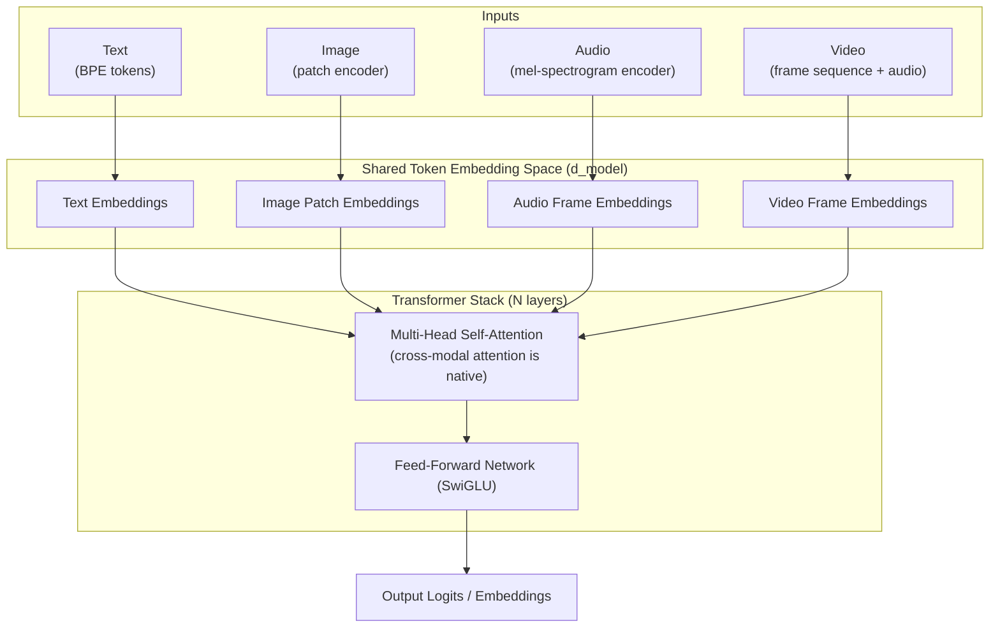
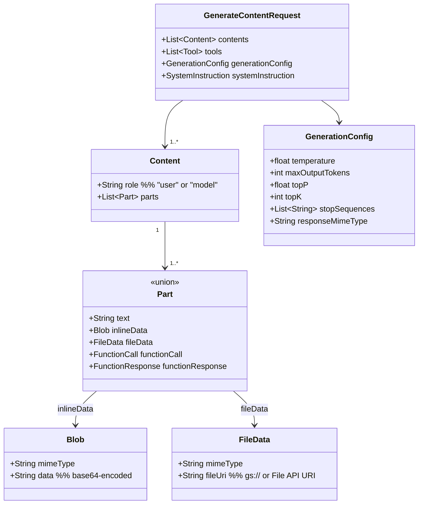
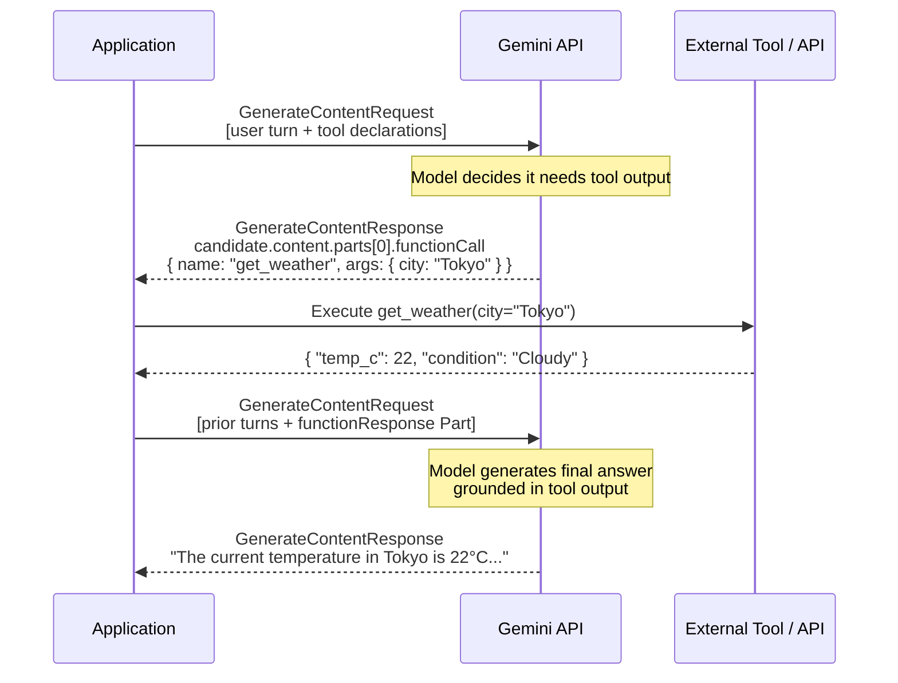
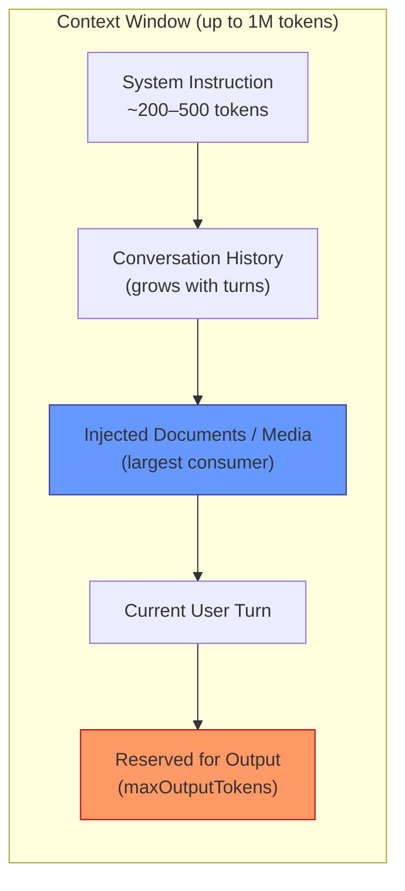
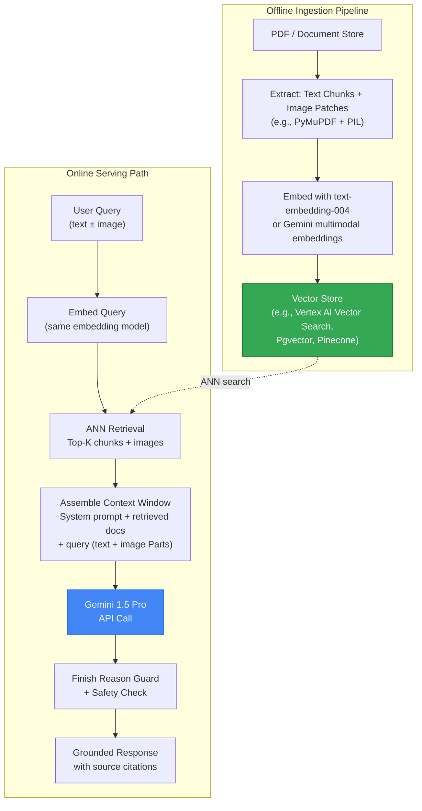

# Lesson 2: Gemini Architecture & the Multimodal API

> **Scope correction:** The original lesson conflated Google's Gemini large language model with a hypothetical data-engineering stack built on Kafka, Hadoop, and Cassandra. That framing is factually incorrect. Gemini is a family of natively multimodal transformer models developed by Google DeepMind, exposed to developers primarily through the Gemini API (Google AI Studio / Vertex AI). This lesson covers the actual architecture, design principles, and API mechanics—grounded in what Google has published and what the API actually exposes.

---

## 1. What "Natively Multimodal" Means at the Architecture Level

Most multimodal systems before Gemini were *pipelines*: a vision encoder (e.g., CLIP) would embed an image, a speech model would transcribe audio, and the resulting token sequences were concatenated before being fed into a text-only transformer. The modalities were processed separately and stitched together.

Gemini was designed differently. Google DeepMind trained a single model from scratch on interleaved sequences of text, images, audio, and video simultaneously. The consequence is architectural: the attention mechanism in every transformer block can attend across token positions regardless of the modality those positions represent. There is no separate "image tower" whose output is then projected into the text embedding space—the modality boundaries are dissolved at the token level.

### How Multimodal Tokens Work

Each input modality is discretized or embedded into a shared token vocabulary before entering the transformer stack:

- **Text** — standard byte-pair encoding (BPE) produces integer token IDs, each mapped to a learned embedding vector.
- **Images** — a convolutional or ViT-style encoder partitions the image into patches; each patch is projected into the same embedding dimension as text tokens. Variable-resolution images are handled via dynamic patch counts, not fixed resizing.
- **Audio** — mel-spectrogram frames are windowed and projected via a small convolutional front-end into the shared embedding space.
- **Video** — treated as a sequence of image frames (at a sampled frame rate) potentially interleaved with the corresponding audio stream.

Once in this unified embedding space, all tokens—regardless of origin modality—flow through the same multi-head self-attention layers. This is the architectural invariant that makes cross-modal reasoning possible: a text token at position *i* can directly attend to an image patch token at position *j* in a single attention operation, allowing the model to ground language in visual features without an intermediate projection bottleneck.



### The Gemini Model Family (as of 2024–2025)

Google has released distinct model variants with different capability/cost tradeoffs:

| Variant | Context Window | Intended Use |
|---|---|---|
| Gemini 1.5 Pro | Up to 1M tokens | Long-document reasoning, long video, large codebases |
| Gemini 1.5 Flash | Up to 1M tokens | High-throughput, cost-sensitive production workloads |
| Gemini 1.0 Ultra | 32K tokens | Highest benchmark scores (older generation) |
| Gemini 1.0 Pro | 32K tokens | General-purpose (largely superseded) |
| Gemini 2.0 Flash | Up to 1M tokens | Latest generation; function calling, image generation output |

The 1M-token context window in 1.5-class models is enabled by a technique Google calls **Multi-Query Attention (MQA)** combined with architectural work on linear-complexity attention approximations, allowing the model to process roughly 750,000 words of text, ~11 hours of audio, or ~1 hour of video in a single context.

---

## 2. The Gemini API: Request/Response Architecture

Developers do not interact with model weights directly. All access is mediated through a REST or gRPC API, with official SDKs in Python, Node.js, Go, and others. Understanding the API's data model is prerequisite to building anything production-grade.

### Content and Part: The Fundamental Data Model

The API's core abstraction is the `Content` object, which represents a single turn in a conversation. Each `Content` contains an ordered list of `Part` objects. A `Part` can be:

- `text` — a plain string
- `inlineData` — base64-encoded binary data with a MIME type (for small images/audio)
- `fileData` — a URI referencing a file previously uploaded via the File API (for large or reusable assets)
- `functionCall` — a structured invocation of a declared tool (function calling)
- `functionResponse` — the result returned to the model from an executed tool call
- `executableCode` / `codeExecutionResult` — used by the Code Execution tool



### File API: Handling Large Multimodal Assets

Embedding a 10 MB image as base64 in every request is wasteful and slow. The File API provides a separate upload endpoint that stores the asset temporarily (retention is 48 hours) and returns a stable URI. This URI is then referenced across multiple requests without re-uploading.

```python
import google.generativeai as genai
import pathlib
import time

genai.configure(api_key="YOUR_API_KEY")  # Use env var in production: os.environ["GEMINI_API_KEY"]

# --- Upload a video file once ---
video_path = pathlib.Path("lecture.mp4")

print("Uploading file...")
video_file = genai.upload_file(path=video_path, mime_type="video/mp4")
print(f"Uploaded: {video_file.name}, URI: {video_file.uri}")

# The file must reach ACTIVE state before it can be used in inference.
# Processing time scales with file size; poll until ready.
while video_file.state.name == "PROCESSING":
    print(".", end="", flush=True)
    time.sleep(5)
    video_file = genai.get_file(video_file.name)

if video_file.state.name == "FAILED":
    raise RuntimeError(f"File processing failed: {video_file.name}")

print(f"\nFile ready. State: {video_file.state.name}")

# --- Reference the file across multiple requests without re-uploading ---
model = genai.GenerativeModel(model_name="gemini-1.5-pro")

response = model.generate_content(
    contents=[
        video_file,  # SDK wraps this into a FileData Part automatically
        "Provide a timestamped summary of the key topics covered in this lecture."
    ]
)
print(response.text)

# --- Clean up when done ---
genai.delete_file(video_file.name)
print(f"Deleted file: {video_file.name}")
```

### Supported MIME Types (accurate as of Gemini 1.5)

**Image:** `image/png`, `image/jpeg`, `image/webp`, `image/heic`, `image/heif`  
**Audio:** `audio/wav`, `audio/mp3`, `audio/aiff`, `audio/aac`, `audio/ogg`, `audio/flac`  
**Video:** `video/mp4`, `video/mpeg`, `video/mov`, `video/avi`, `video/x-flv`, `video/webm`, `video/wmv`, `video/3gpp`  
**Documents:** `application/pdf`, `text/plain`, `text/html`, `text/css`, `text/js`, `text/x-typescript`, `text/csv`, `text/markdown`, `text/x-python`, `application/x-javascript`

---

## 3. Function Calling: Bridging the Model to the Real World

Function calling (also called tool use) allows the model to signal that it wants to invoke an external capability—a database query, an API call, a calculation—rather than generating a free-text answer. This is the primary mechanism for building agents that take actions in the world.

### The Function Calling Protocol

The interaction is a structured multi-turn exchange:



The key insight: the model never executes code. It outputs a structured `functionCall` object specifying which function to invoke and with what arguments. The application is responsible for execution and must return a `functionResponse` part in the next turn.

### Production-Grade Function Calling Example

```python
import google.generativeai as genai
import os
import json
from typing import Any

genai.configure(api_key=os.environ["GEMINI_API_KEY"])

# --- Tool definitions (OpenAPI-style schema) ---
tools = [
    genai.protos.Tool(
        function_declarations=[
            genai.protos.FunctionDeclaration(
                name="query_product_inventory",
                description=(
                    "Query the product inventory database. Returns stock levels and "
                    "pricing for a given product SKU. Use this when the user asks "
                    "about product availability or price."
                ),
                parameters=genai.protos.Schema(
                    type=genai.protos.Type.OBJECT,
                    properties={
                        "sku": genai.protos.Schema(
                            type=genai.protos.Type.STRING,
                            description="The product Stock Keeping Unit identifier, e.g. 'WIDGET-42'."
                        ),
                        "warehouse_id": genai.protos.Schema(
                            type=genai.protos.Type.STRING,
                            description="Optional warehouse ID to scope the query. Omit for global stock."
                        ),
                    },
                    required=["sku"],
                ),
            ),
            genai.protos.FunctionDeclaration(
                name="submit_order",
                description="Submit a purchase order for a product. Only call this after explicit user confirmation.",
                parameters=genai.protos.Schema(
                    type=genai.protos.Type.OBJECT,
                    properties={
                        "sku": genai.protos.Schema(type=genai.protos.Type.STRING),
                        "quantity": genai.protos.Schema(type=genai.protos.Type.INTEGER),
                        "customer_id": genai.protos.Schema(type=genai.protos.Type.STRING),
                    },
                    required=["sku", "quantity", "customer_id"],
                ),
            ),
        ]
    )
]

# --- Simulated tool implementations ---
def query_product_inventory(sku: str, warehouse_id: str | None = None) -> dict[str, Any]:
    """Stub: replace with real DB/API call."""
    inventory = {
        "WIDGET-42": {"name": "Precision Widget", "stock": 150, "price_usd": 29.99},
        "GADGET-07": {"name": "Smart Gadget", "stock": 0, "price_usd": 149.00},
    }
    result = inventory.get(sku, {"error": f"SKU '{sku}' not found"})
    if warehouse_id and "error" not in result:
        result["warehouse_id"] = warehouse_id
    return result

def submit_order(sku: str, quantity: int, customer_id: str) -> dict[str, Any]:
    """Stub: replace with real order management system call."""
    # In production: validate idempotency key, check stock atomically, etc.
    return {"order_id": "ORD-20241231-001", "status": "confirmed", "sku": sku, "quantity": quantity}

TOOL_DISPATCH: dict[str, Any] = {
    "query_product_inventory": query_product_inventory,
    "submit_order": submit_order,
}

# --- Agentic loop ---
model = genai.GenerativeModel(
    model_name="gemini-1.5-pro",
    tools=tools,
    # NONE disables auto tool use; ANY forces it; AUTO lets model decide.
    tool_config={"function_calling_config": {"mode": "AUTO"}},
    system_instruction=(
        "You are a helpful inventory assistant. "
        "Never submit an order without explicit user confirmation in the conversation."
    ),
)

chat = model.start_chat(enable_automatic_function_calling=False)

def run_agent_turn(user_message: str) -> str:
    """Execute one user turn, handling any number of tool call rounds."""
    response = chat.send_message(user_message)

    # Agentic loop: continue until model stops requesting tool calls
    while True:
        # Collect all function call parts from this response
        function_call_parts = [
            part for part in response.parts if part.function_call.name
        ]
        if not function_call_parts:
            break  # Model returned a final text response

        # Execute all requested tools and collect responses
        tool_response_parts = []
        for part in function_call_parts:
            fc = part.function_call
            func = TOOL_DISPATCH.get(fc.name)
            if func is None:
                tool_result = {"error": f"Unknown tool: {fc.name}"}
            else:
                # fc.args is a MapComposite; convert to plain dict for the call
                kwargs = dict(fc.args)
                tool_result = func(**kwargs)
                print(f"[Tool] {fc.name}({kwargs}) → {tool_result}")

            tool_response_parts.append(
                genai.protos.Part(
                    function_response=genai.protos.FunctionResponse(
                        name=fc.name,
                        response={"result": tool_result},
                    )
                )
            )

        # Return all tool results to the model in one turn
        response = chat.send_message(tool_response_parts)

    return response.text

# Example interaction
print(run_agent_turn("Do you have WIDGET-42 in stock and what does it cost?"))
print(run_agent_turn("Great. I'd like to order 5 of them for customer C-999."))
print(run_agent_turn("Yes, please confirm the order."))
```

---

## 4. Structured Output: Forcing JSON Schema Compliance

Free-text responses are difficult to integrate into downstream systems. Gemini supports `responseMimeType: "application/json"` combined with a `responseSchema` to constrain the model's output to a valid JSON object matching a declared schema. This is implemented via constrained decoding at the sampling level—the token sampler masks out any token that would violate the schema at each decoding step.

```python
import google.generativeai as genai
import os
from pydantic import BaseModel, Field

genai.configure(api_key=os.environ["GEMINI_API_KEY"])

# Define the desired output structure using a Pydantic model
class ProductReview(BaseModel):
    sentiment: str = Field(description="One of: positive, negative, neutral")
    score: float = Field(description="Sentiment score from 0.0 (most negative) to 1.0 (most positive)")
    key_themes: list[str] = Field(description="List of 2–5 key topics mentioned in the review")
    summary: str = Field(description="One-sentence summary of the review")

model = genai.GenerativeModel(
    model_name="gemini-1.5-flash",
    generation_config=genai.GenerationConfig(
        response_mime_type="application/json",
        response_schema=ProductReview,  # SDK converts Pydantic model to JSON Schema
    ),
)

review_text = """
I've been using this ergonomic keyboard for three months now and my wrist pain
has almost completely disappeared. The key travel is excellent, though the
software for remapping keys is clunky and crashed twice during setup.
Build quality feels premium despite the plastic chassis.
"""

response = model.generate_content(f"Analyze this product review:\n\n{review_text}")

# response.text is guaranteed to be valid JSON matching ProductReview schema
import json
data = json.loads(response.text)
review = ProductReview(**data)
print(f"Sentiment: {review.sentiment} ({review.score:.2f})")
print(f"Themes: {', '.join(review.key_themes)}")
print(f"Summary: {review.summary}")
```

---

## 5. Context Window Management and Token Counting

The 1M-token context window is not an invitation to stuff it carelessly. Token costs, latency, and the "lost in the middle" phenomenon (where retrieval accuracy degrades for information buried in the middle of a very long context) all argue for deliberate context management.

### Counting Tokens Before Sending

```python
import google.generativeai as genai
import os
import pathlib

genai.configure(api_key=os.environ["GEMINI_API_KEY"])
model = genai.GenerativeModel("gemini-1.5-pro")

# Count tokens for a mixed-modality request before committing to the API call
image_data = pathlib.Path("diagram.png").read_bytes()
prompt_parts = [
    genai.protos.Part(inline_data=genai.protos.Blob(mime_type="image/png", data=image_data)),
    "Explain the architecture shown in this diagram in detail.",
]

token_count_response = model.count_tokens(prompt_parts)
print(f"Prompt tokens: {token_count_response.total_tokens}")

# Decision gate: abort if cost/latency would be unacceptable
MAX_TOKENS = 200_000
if token_count_response.total_tokens > MAX_TOKENS:
    raise ValueError(
        f"Request exceeds token budget: {token_count_response.total_tokens} > {MAX_TOKENS}"
    )
```

### Context Window Utilization Diagram



The model's output is bounded by `maxOutputTokens` (up to 8192 for most variants). The *effective* input budget is `context_window_size - maxOutputTokens`. Exceeding the input budget causes the API to return a `400 INVALID_ARGUMENT` error with a token count mismatch message.

---

## 6. Streaming Responses

For interactive applications, waiting for the full response before rendering degrades perceived latency. The `generate_content_stream` method yields `GenerateContentResponse` chunks as they are produced.

```python
import google.generativeai as genai
import os
import sys

genai.configure(api_key=os.environ["GEMINI_API_KEY"])
model = genai.GenerativeModel("gemini-1.5-flash")

prompt = "Write a detailed technical explanation of how transformer attention works."

print("Streaming response:\n")
full_response_text = []

for chunk in model.generate_content(prompt, stream=True):
    # Each chunk may contain partial text; not all chunks have text parts
    if chunk.text:
        print(chunk.text, end="", flush=True)
        full_response_text.append(chunk.text)

print("\n\n--- Stream complete ---")
complete_text = "".join(full_response_text)

# After exhausting the stream, usage metadata is available on the last chunk
# Access it via the resolved response object
response = model.generate_content(prompt, stream=False)  # or capture final chunk
```

**Important:** A chunk's `finish_reason` indicates why generation stopped. `STOP` is normal completion. `MAX_TOKENS` means the output was truncated—not an error, but a signal to increase `maxOutputTokens` or redesign your prompt. `SAFETY` means the response was blocked by safety filters.

---

## 7. Safety Filters and Responsible AI Controls

Every response passes through Gemini's safety classifiers before being returned. Each `Candidate` object includes a `safetyRatings` list with probability scores across four harm categories: `HARASSMENT`, `HATE_SPEECH`, `SEXUALLY_EXPLICIT`, and `DANGEROUS_CONTENT`.

Applications can configure per-category blocking thresholds (`BLOCK_NONE`, `BLOCK_LOW_AND_ABOVE`, `BLOCK_MEDIUM_AND_ABOVE`, `BLOCK_HIGH_AND_ABOVE`) depending on the use case and deployed audience. The default is `BLOCK_MEDIUM_AND_ABOVE`.

```python
import google.generativeai as genai
import os

genai.configure(api_key=os.environ["GEMINI_API_KEY"])

# Production: harden safety thresholds for consumer-facing applications
safety_settings = {
    genai.types.HarmCategory.HARM_CATEGORY_HARASSMENT: genai.types.HarmBlockThreshold.BLOCK_LOW_AND_ABOVE,
    genai.types.HarmCategory.HARM_CATEGORY_HATE_SPEECH: genai.types.HarmBlockThreshold.BLOCK_LOW_AND_ABOVE,
    genai.types.HarmCategory.HARM_CATEGORY_SEXUALLY_EXPLICIT: genai.types.HarmBlockThreshold.BLOCK_MEDIUM_AND_ABOVE,
    genai.types.HarmCategory.HARM_CATEGORY_DANGEROUS_CONTENT: genai.types.HarmBlockThreshold.BLOCK_MEDIUM_AND_ABOVE,
}

model = genai.GenerativeModel("gemini-1.5-pro", safety_settings=safety_settings)

response = model.generate_content("Describe the history of chemical warfare.")

candidate = response.candidates[0]

if candidate.finish_reason == genai.protos.Candidate.FinishReason.SAFETY:
    print("Response blocked by safety filters.")
    for rating in candidate.safety_ratings:
        print(f"  {rating.category.name}: {rating.probability.name}")
else:
    print(response.text)
```

---

## 8. Failure Modes, Retry Strategy, and Production Hardening

### Error Taxonomy

| HTTP Status / gRPC Code | Cause | Retry? |
|---|---|---|
| `429 RESOURCE_EXHAUSTED` | Rate limit or quota exceeded | Yes — exponential backoff |
| `503 UNAVAILABLE` | Transient backend unavailability | Yes — exponential backoff |
| `500 INTERNAL` | Server-side error | Yes — with limit |
| `400 INVALID_ARGUMENT` | Malformed request, schema violation, token overflow | No — fix the request |
| `403 PERMISSION_DENIED` | Invalid or missing API key, quota project issues | No — fix credentials |
| `404 NOT_FOUND` | Invalid model name, deleted File API resource | No — fix the resource reference |

### Production Retry Pattern with Exponential Backoff

```python
import google.generativeai as genai
from google.api_core import exceptions as google_exceptions
import os
import time
import random
import logging

logger = logging.getLogger(__name__)
genai.configure(api_key=os.environ["GEMINI_API_KEY"])

RETRYABLE_EXCEPTIONS = (
    google_exceptions.ResourceExhausted,  # 429
    google_exceptions.ServiceUnavailable, # 503
    google_exceptions.InternalServerError, # 500
)

def generate_with_retry(
    model: genai.GenerativeModel,
    contents,
    max_retries: int = 5,
    base_delay_seconds: float = 1.0,
    max_delay_seconds: float = 64.0,
) -> genai.types.GenerateContentResponse:
    """
    Calls generate_content with exponential backoff + full jitter for retryable errors.
    Non-retryable errors (4xx) are re-raised immediately.
    """
    last_exception = None

    for attempt in range(max_retries + 1):
        try:
            return model.generate_content(contents)
        except RETRYABLE_EXCEPTIONS as e:
            last_exception = e
            if attempt == max_retries:
                break
            # Full jitter: sleep between 0 and min(cap, base * 2^attempt)
            ceiling = min(max_delay_seconds, base_delay_seconds * (2 ** attempt))
            sleep_time = random.uniform(0, ceiling)
            logger.warning(
                "Retryable error on attempt %d/%d: %s. Sleeping %.2fs.",
                attempt + 1, max_retries, e, sleep_time
            )
            time.sleep(sleep_time)
        except Exception:
            raise  # Non-retryable: propagate immediately

    raise last_exception  # type: ignore[misc]


model = genai.GenerativeModel("gemini-1.5-flash")
try:
    response = generate_with_retry(model, "Summarize the theory of relativity.")
    print(response.text)
except google_exceptions.ResourceExhausted:
    logger.error("Quota exhausted after all retries. Consider request queuing or quota increase.")
```

### Finish Reason Guard

Always check `finish_reason` before trusting the response text. A response with `finish_reason == MAX_TOKENS` has been truncated; using it as if complete will cause silent data loss in pipelines.

```python
from google.generativeai.protos import Candidate

def safe_extract_text(response: genai.types.GenerateContentResponse) -> str:
    if not response.candidates:
        raise ValueError("No candidates returned. Likely a prompt-level safety block.")

    candidate = response.candidates[0]

    match candidate.finish_reason:
        case Candidate.FinishReason.STOP:
            return response.text
        case Candidate.FinishReason.MAX_TOKENS:
            raise ValueError(
                f"Output truncated at token limit. Got partial text: {response.text[:200]}..."
            )
        case Candidate.FinishReason.SAFETY:
            blocked = [r for r in candidate.safety_ratings if r.blocked]
            categories = [r.category.name for r in blocked]
            raise ValueError(f"Response blocked by safety filters: {categories}")
        case Candidate.FinishReason.RECITATION:
            raise ValueError("Response blocked due to recitation/copyright concerns.")
        case _:
            raise ValueError(f"Unexpected finish reason: {candidate.finish_reason}")
```

---

## 9. End-to-End Architecture: Multimodal RAG Application

A production multimodal application typically combines the Gemini API with a retrieval layer. The following diagram shows the full data flow for a document-grounded question-answering system that handles both text and images extracted from PDFs.



---

## 10. Go Client: Concurrent Batch Processing

For high-throughput pipelines, the official Go client provides idiomatic concurrency. Below is a production-grade pattern for processing a batch of documents concurrently with bounded parallelism.

```go
package main

import (
	"context"
	"fmt"
	"log"
	"os"
	"sync"

	"google.golang.org/genai"
)

type DocumentResult struct {
	DocID   string
	Summary string
	Err     error
}

func summarizeDocument(ctx context.Context, client *genai.Client, docID, text string) DocumentResult {
	model := client.GenerativeModel("gemini-1.5-flash")
	model.SetTemperature(0.2) // Lower temperature for deterministic summaries

	resp, err := model.GenerateContent(ctx,
		genai.Text("Summarize the following document in 3 bullet points:\n\n"+text),
	)
	if err != nil {
		return DocumentResult{DocID: docID, Err: fmt.Errorf("generate failed: %w", err)}
	}
	if len(resp.Candidates) == 0 {
		return DocumentResult{DocID: docID, Err: fmt.Errorf("no candidates returned for %s", docID)}
	}

	var summary string
	for _, part := range resp.Candidates[0].Content.Parts {
		if txt, ok := part.(genai.Text); ok {
			summary += string(txt)
		}
	}
	return DocumentResult{DocID: docID, Summary: summary}
}

func batchSummarize(ctx context.Context, docs map[string]string, concurrency int) []DocumentResult {
	type workItem struct {
		id   string
		text string
	}

	client, err := genai.NewClient(ctx, &genai.ClientConfig{
		APIKey: os.Getenv("GEMINI_API_KEY"),
	})
	if err != nil {
		log.Fatalf("Failed to create Gemini client: %v", err)
	}
	defer client.Close()

	workCh := make(chan workItem, len(docs))
	resultCh := make(chan DocumentResult, len(docs))

	// Fan-out: bounded worker pool
	var wg sync.WaitGroup
	for range concurrency {
		wg.Add(1)
		go func() {
			defer wg.Done()
			for item := range workCh {
				resultCh <- summarizeDocument(ctx, client, item.id, item.text)
			}
		}()
	}

	for id, text := range docs {
		workCh <- workItem{id: id, text: text}
	}
	close(workCh)

	// Close result channel once all workers are done
	go func() {
		wg.Wait()
		close(resultCh)
	}()

	var results []DocumentResult
	for r := range resultCh {
		results = append(results, r)
	}
	return results
}

func main() {
	ctx := context.Background()

	docs := map[string]string{
		"doc-001": "The transformer architecture introduced self-attention...",
		"doc-002": "Retrieval-augmented generation (RAG) combines...",
		"doc-003": "Mixture of experts (MoE) layers allow conditional computation...",
	}

	results := batchSummarize(ctx, docs, 3) // 3 concurrent requests

	for _, r := range results {
		if r.Err != nil {
			fmt.Printf("[ERROR] %s: %v\n", r.DocID, r.Err)
			continue
		}
		fmt.Printf("[%s]\n%s\n\n", r.DocID, r.Summary)
	}
}
```

---

## 11. Key Invariants and Mental Model

The architectural principles that should guide every integration decision:

**Tokens are the universal currency.** All modalities are discretized into tokens in a shared embedding space. Cost, latency, and context capacity are all denominated in tokens. Count them before sending.

**The model is stateless; the application owns conversation state.** There is no server-side session. Every request must include the full conversation history needed for coherent multi-turn reasoning. This is not a limitation—it is a design that makes horizontal scaling trivial.

**Function calling is a structured output protocol, not remote execution.** The model emits a structured `functionCall` Part; your application executes the function; you return a `functionResponse` Part. The model never touches your systems directly.

**Safety filters are non-negotiable at the platform level.** Certain categories cannot be bypassed regardless of system instruction. Applications must handle `SAFETY` finish reasons gracefully rather than crashing.

**The File API decouples asset lifecycle from inference requests.** Upload large assets once; reference them many times across a 48-hour window. This is the correct pattern for any video, long audio, or large document that will be queried repeatedly.

**Structured output via `responseSchema` uses constrained decoding.** This is not prompt-engineering—it is a sampler-level guarantee. If you need a JSON object back, declare the schema; do not ask the model to "please respond in JSON."
