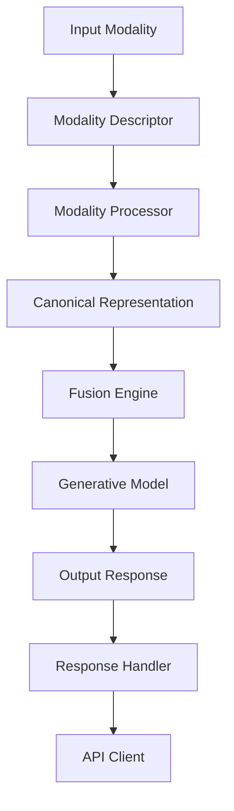

# Lesson 3: API Design for Multimodal Systems

## 1. First-Principles Intuition & Invariants

In the modern landscape of artificial intelligence, the convergence of vision, language, and interaction has given rise to systems that process and synthesize multimodal data—images, text, audio, and video—into coherent, context-aware outputs. The design of APIs for such systems is not merely a matter of exposing endpoints; it is a foundational exercise in modeling the interaction between heterogeneous data streams, ensuring semantic consistency, and enabling composability across domains. At its core, multimodal API design must be grounded in a first-principles understanding of how data flows through systems, how modalities interact, and how the abstraction layer between raw inputs and intelligent outputs must remain both expressive and predictable.

The fundamental invariant of multimodal systems is that each modality must be treated as a distinct yet interdependent channel of information. A multimodal API must not only accept inputs from multiple sources but must also define a consistent schema for how these inputs are interpreted, transformed, and integrated. This schema must be robust enough to handle the inherent variability of modalities—e.g., a 1080p image may be represented as a 3D tensor of RGB values, while a 10-second audio clip may be a 1D array of floating-point samples. Yet, both must be capable of being processed by a shared transformer-based model, which requires a unified representation that abstracts away the physical form of the input.

The design of such APIs must also respect the principle of **modality independence**. This means that the API should not force a user to understand the internal representation of one modality to interact with another. For example, a user should be able to submit a document containing both text and embedded images without needing to know that the system internally converts images into latent embeddings or that text is tokenized using a BPE algorithm. The API must abstract these complexities into a clean, declarative interface that allows for composition and extension.

Another critical invariant is **semantic alignment**. In multimodal systems, the meaning of one modality often depends on the context provided by another. For instance, a visual description of a scene may be ambiguous without textual context, and conversely, a textual query may be better understood when grounded in visual data. The API must therefore support mechanisms for cross-modal attention, where the system can dynamically weigh the relevance of different modalities during processing. This requires a design that allows for explicit and implicit modal relationships, such as through metadata, context fields, or even dynamic schema inference.

Finally, the API must be **resilient to failure modes** inherent in multimodal processing. A single modality may fail to load, be corrupted, or be misinterpreted due to domain-specific nuances. The API must gracefully handle such failures, either by providing fallbacks, returning partial results, or signaling errors in a structured way. This resilience is not just a feature—it is a requirement for building systems that can be trusted in production environments.

## 2. Core Architecture & Mechanics

The architecture of a multimodal API is best understood as a **dataflow pipeline** that orchestrates the ingestion, transformation, and integration of multiple modalities. At the highest level, the system can be modeled as a state machine with distinct phases: input validation, modality-specific preprocessing, cross-modal fusion, and output generation. Each phase is governed by a set of invariants that ensure correctness and consistency.

At the core of this architecture lies the **Modality Descriptor**, a data structure that encapsulates the metadata and processing requirements of each input. This descriptor is typically defined as a JSON schema that includes fields such as `modality_type`, `encoding_format`, `source_uri`, `processing_options`, and `metadata`. For example, an image input might be described as:

```json
{
  "modality_type": "image",
  "encoding_format": "jpeg",
  "source_uri": "https://example.com/image.jpg",
  "processing_options": {
    "resize": {
      "width": 224,
      "height": 224
    }
  },
  "metadata": {
    "captured_at": "2025-04-05T10:00:00Z",
    "camera_id": "cam_001"
  }
}
```

This descriptor is then passed through a **Modality Processor**, a component responsible for validating and transforming the raw input into a canonical internal representation. The processor ensures that all inputs conform to expected formats and that any necessary preprocessing (e.g., resizing, normalization, tokenization) is applied. This stage is critical for maintaining consistency across modalities, especially when dealing with real-time or streaming inputs.

Once all modalities are processed, they are fed into a **Cross-Modal Fusion Engine**, which integrates the representations into a unified context. This engine is typically implemented using attention mechanisms, where each modality is projected into a shared latent space. The fusion process is governed by a **Fusion Policy**, which defines how modalities interact. For example, a policy might specify that visual inputs should be weighted more heavily in a scene understanding task, or that audio inputs should be processed in parallel with text to enable speech-to-text transcription.

The final stage is **Output Generation**, where the fused representation is passed to a generative model (e.g., a transformer-based decoder) to produce a response. The API must expose this stage through a structured interface that allows for both synchronous and asynchronous execution. For instance, a synchronous call might return a complete response immediately, while an asynchronous call might return a job ID and a callback endpoint for later retrieval.

To visualize this architecture, consider the following Mermaid diagram:



This pipeline ensures that each modality is handled independently, yet integrated coherently. The modality processors are designed to be pluggable, allowing for easy extension to new modalities such as LiDAR or haptic data. The fusion engine is abstracted to support various architectures, from simple concatenation to complex attention-based mechanisms.

## 3. High-Performance Optimization & Failure Modes

High-performance multimodal APIs must be engineered to handle the computational intensity of processing multiple data streams in real time. This requires careful attention to resource allocation, concurrency, and error handling. The key to performance lies in **asynchronous processing**, **batching**, and **caching** strategies that reduce latency and maximize throughput.

Asynchronous processing is essential for handling long-running tasks such as image recognition or audio transcription. The API should support a **job queue** model, where clients submit requests and receive a job ID. The system can then process these jobs in the background, returning results via webhooks or polling endpoints. This approach decouples the client from the processing time, enabling the API to scale across multiple concurrent requests.

Batching is another critical optimization. When multiple requests are submitted with similar modalities, the system can group them together and process them in parallel. For example, if several users submit images for classification, the system can batch these requests and process them using a single forward pass through a shared model. This reduces the overhead of model loading and memory allocation, leading to significant performance gains.

Caching plays a vital role in reducing redundant computations. For instance, if a user submits the same image multiple times, the system should cache the preprocessed representation and reuse it. Similarly, if a model has already computed a latent representation for a given text, that representation can be cached and reused for subsequent multimodal tasks.

However, performance optimizations must not come at the cost of reliability. The API must be resilient to a variety of failure modes, including network timeouts, model unavailability, and corrupted input data. A robust API implements **retry logic**, **fallback strategies**, and **graceful degradation**. For example, if an image fails to load, the system might fall back to a default representation or return an error with a clear message. If a model is temporarily unavailable, the system might queue the request or return a cached result if one exists.

Failure modes also include **modal inconsistency**, where inputs from different modalities do not align semantically. For instance, a user might submit a text query about a specific image, but the image is corrupted or mislabeled. The API must detect such inconsistencies and provide structured feedback to the client, enabling them to correct the input or adjust their expectations.

In summary, a high-performance multimodal API is not just about speed—it is about building a system that can scale under load, recover from errors, and maintain consistency across diverse data types. The design must balance the competing demands of latency, throughput, and correctness, ensuring that the API remains both powerful and reliable in production environments.
