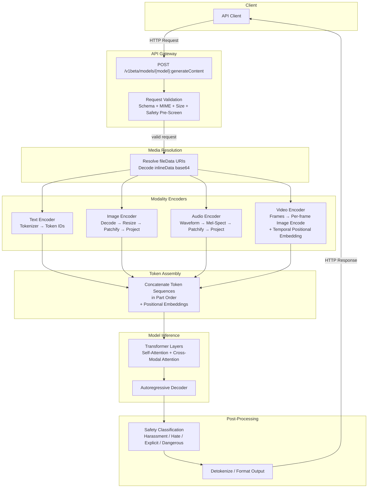
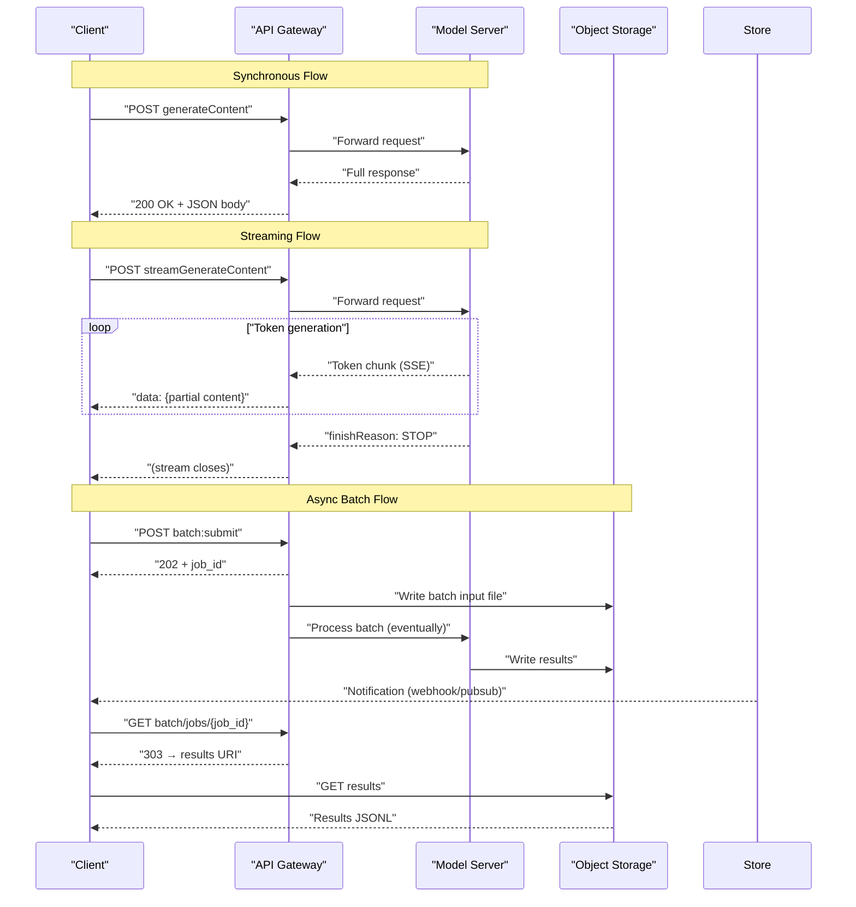
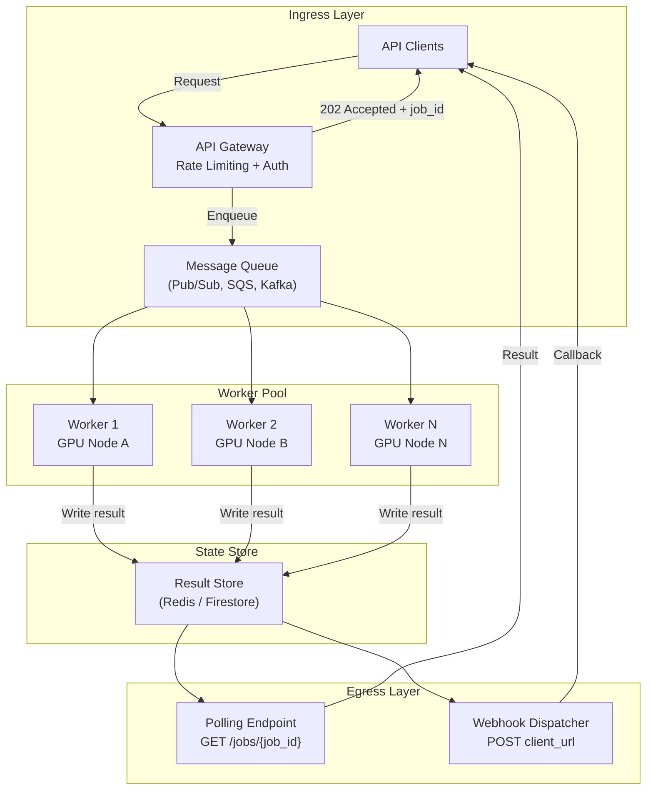
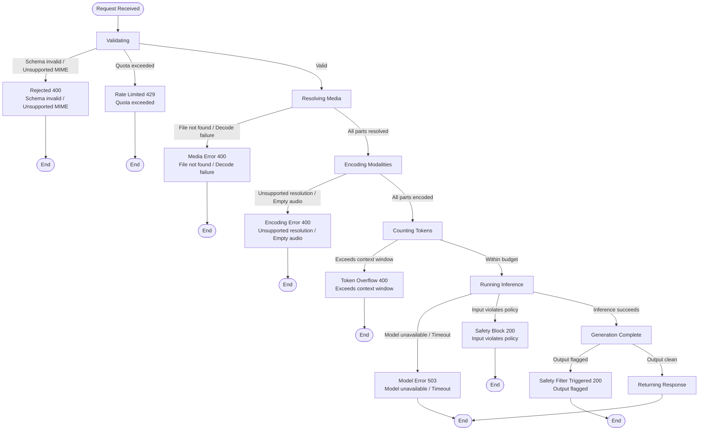
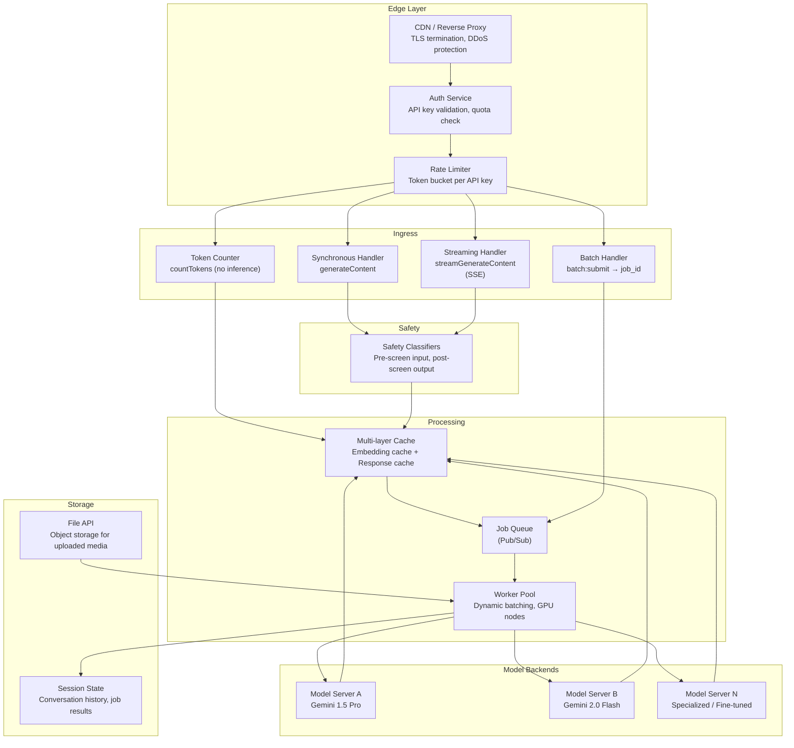

# Lesson 3: API Design for Multimodal Systems

## 1. First-Principles Intuition & Invariants

A multimodal API is an interface over a fundamental information-theoretic problem: how to fuse heterogeneous data streams—pixel arrays, sample buffers, character sequences—into a shared latent space where a transformer-based model can reason across them jointly. The API's job is to make this fusion declarative, composable, and predictable, while hiding the machinery that makes it possible.

### The Core Problem: Representation Alignment

A transformer operates on sequences of vectors drawn from a single embedding space $\mathbb{R}^d$. For a text-only model, tokenization (BPE, SentencePiece) maps raw strings into integer IDs, which index into an embedding matrix to produce vectors. The architectural invariant for multimodal models is that every modality must ultimately produce vectors in that same $d$-dimensional space before they enter the attention layers. This creates two sub-problems:

1. **Modality-specific encoding**: Converting raw bytes into a sequence of tokens. For text, this is the tokenizer. For images, the Vision Transformer (ViT) approach splits the image into fixed-size patches (typically 16×16 pixels), linearly projects each patch to $d$ dimensions, and prepends a learned `[CLS]` token. For audio, models convert waveforms into log-mel spectrograms, then treat spectrogram patches analogously to image patches. Video is handled as a temporal stack of image frames, with additional temporal positional embeddings.

2. **Projection alignment**: Ensuring the modality-specific encoder outputs land in the same vector space as the language model's embeddings. Architectures differ here. Early approaches (e.g., LLaVA) used a separate vision encoder (CLIP ViT) followed by a projection MLP that mapped CLIP's embedding dimension to the LLM's dimension. Models like Gemini are trained from scratch with all modalities sharing a common tokenizer and embedding space from the outset, eliminating the projection gap but requiring massive pretraining data that spans all modalities simultaneously.

The API must abstract this pipeline. A caller sending an image should not need to know that it will be patchified, projected, and consumed as 196 additional tokens in the context window. But the API must expose enough information—token counts, processing latency, supported resolutions—for callers to reason about cost and latency.

### Modality Independence and Semantic Alignment

Two invariants govern the API surface:

**Modality independence**: The API must not couple the caller to the internal representation of any modality. A request that includes text and an image should be expressible without the caller understanding patch embeddings or BPE tokenization. The API's schema treats each modality as an opaque content part with a type tag and a payload (inline bytes, a URI, or a reference to a previously uploaded file). The system handles decoding, preprocessing, and tokenization internally.

**Semantic alignment**: The API must allow callers to express relationships between modalities. In a multimodal model, cross-attention layers in the transformer allow token positions from one modality to attend to token positions from another. The API enables this by interleaving modalities within a single conversation turn—text and image parts in the same message—so the model's attention mechanism can ground textual references to visual content. The ordering of parts within a request matters because it determines the token sequence the model sees, which affects how cross-attention is applied.

### The Long-Context Challenge

Modern multimodal models like Gemini 1.5 Pro support context windows exceeding 2 million tokens. Multimodal inputs consume tokens at different rates: a single high-resolution image can require hundreds to thousands of tokens, a minute of audio consumes hundreds, and video scales linearly with frame count. The API must provide a token counting mechanism so callers can estimate cost and verify that their request fits within the model's context window before submission.

### Resilience as a First-Class Concern

Multimodal inputs introduce failure modes that text-only APIs do not face:

- **Corrupted or unsupported media**: A JPEG with a truncated EOF, a video codec the server cannot decode, an audio file with an unsupported sample rate.
- **Modality load failures**: A remote URI that returns 404 or times out during fetch.
- **Content safety violations across modalities**: An image containing text that violates safety policies, or an audio clip with disallowed content.
- **Dimensional overflow**: A request whose combined token count exceeds the model's context window, but only after modality encoding inflates it beyond the text-token estimate.

The API must handle these with structured error responses that identify which modality failed, why, and what the caller can do about it. Partial failures—where one modality in a multi-part request fails but others succeed—require a clear policy: reject the entire request (atomic semantics) or process with available modalities (degraded semantics). The API should make this policy explicit and configurable.

## 2. Core Architecture & Mechanics

### The Content-Part Abstraction

The foundational data structure in a multimodal API is the **Content** object: an ordered collection of **Part** objects, each carrying a single modality. This abstraction mirrors how the model internally processes input—as a linear sequence of tokens from mixed modalities—and gives the caller control over interleaving.

In the Gemini API, this maps directly to the `Content` and `Part` types:

```json
{
  "contents": [
    {
      "role": "user",
      "parts": [
        {"text": "What is in this image?"},
        {"inlineData": {"mimeType": "image/jpeg", "data": "<base64-encoded-bytes>"}}
      ]
    }
  ]
}
```

Each `Part` is one of:
- `text`: A string of UTF-8 text, tokenized server-side.
- `inlineData`: Base64-encoded binary data with a MIME type. Suitable for small-to-medium payloads (images under ~20MB, short audio clips).
- `fileData`: A reference to a file previously uploaded via the File API, identified by URI. Required for large media (long videos, high-resolution images) that exceed inline payload limits.

The ordering of `parts` within a `contents` entry determines the token sequence. Placing text before an image means the model processes the text tokens first, then the image tokens, with cross-attention flowing forward through the sequence.

### The Full Request Pipeline

The system processes a multimodal request through these stages:

1. **Request validation**: Schema validation, MIME type checking, payload size enforcement, and content policy pre-screening. This stage rejects malformed requests before any expensive processing begins.

2. **Media resolution**: For `fileData` parts, the system fetches the referenced file from object storage. For `inlineData`, it decodes the base64 payload. This stage handles format detection and transcoding where necessary (e.g., converting a PNG to a model-compatible format).

3. **Modality-specific encoding**: Each part is routed to its encoder:
   - **Text**: Tokenized via the model's tokenizer (SentencePiece for Gemini, BPE for GPT-family models). Produces a sequence of token IDs.
   - **Image**: Decoded, resized to model-compatible dimensions (e.g., 224×224 or 384×384 for ViT-based encoders), normalized, patchified, and projected into the embedding space. A single image yields a variable number of tokens depending on resolution.
   - **Audio**: Converted to a log-mel spectrogram (or raw waveform for end-to-end audio models), then patchified similarly to images. Token count scales with audio duration.
   - **Video**: Decoded into frames at a configured sampling rate (e.g., 1 frame per second), each frame treated as an image, with temporal positional embeddings added.

4. **Token sequence assembly**: All modality token sequences are concatenated in part order to form the full input sequence. Positional embeddings (1D for text-only models, 2D or 3D for models handling images/video) are applied.

5. **Model inference**: The assembled sequence is passed through the transformer. Self-attention layers allow every token to attend to every other token, regardless of modality. This is where cross-modal reasoning occurs: a text token representing the word "this" can attend to image tokens to resolve its referent.

6. **Response generation**: The decoder produces output tokens autoregressively. For text-only output, tokens are detokenized into a string. For structured output (function calling, JSON mode), the decoder is constrained by a grammar or schema.

7. **Safety filtering**: Both input and output pass through safety classifiers that detect policy violations across modalities. The API exposes configurable thresholds for each harm category.



### Synchronous vs. Streaming vs. Asynchronous

The API exposes three execution modes:

**Synchronous** (`generateContent`): The client sends the request and blocks until the full response is ready. Suitable for short, low-latency interactions. The HTTP connection remains open for the entire inference duration, which can range from sub-second to several minutes depending on input size and output length.

**Streaming** (`streamGenerateContent`): The server sends partial response chunks via Server-Sent Events (SSE) as the decoder generates tokens. The client receives text incrementally, enabling real-time UI updates. Each chunk contains a partial `Content` object with one or more `Part` entries. The stream terminates when the model signals `finishReason` (STOP, MAX_TOKENS, SAFETY, etc.).

**Asynchronous** (batch API): For large workloads, the client submits a batch of requests to a batch endpoint. The system processes them with higher throughput but higher latency, storing results in a configurable destination (e.g., Cloud Storage). This mode is cost-effective for non-interactive workloads.



### The File API for Large Media

Inline base64 encoding is impractical for large media. A 100MB video encoded as base64 inflates to ~133MB and must be sent as a single HTTP request body, increasing latency and memory pressure. The File API solves this with a two-step process:

1. **Upload**: The client uploads raw media to a file endpoint using resumable uploads (HTTP `PATCH` with `Content-Range` headers). The server stores the file and returns a URI.

2. **Reference**: The client includes the file URI in subsequent `generateContent` requests via `fileData`. The server resolves the URI internally, avoiding retransmission.

Uploaded files have a TTL (typically 48 hours for Gemini's File API) after which they are automatically deleted. The API should expose metadata endpoints for listing, inspecting, and deleting uploaded files.

```python
# Upload a large video file to the Gemini File API,
# then reference it in a generateContent call.

import google.generativeai as genai
from pathlib import Path

genai.configure(api_key="YOUR_API_KEY")

# Step 1: Upload the video file.
# The upload is resumable and handles files up to the API's
# maximum size limit. The returned file object contains a
# URI that can be reused across multiple requests.
video_path = Path("presentation.mp4")
video_file = genai.upload_file(
    path=str(video_path),
    display_name="quarterly_presentation",
    mime_type="video/mp4",
)

# Wait for processing to complete. Large files undergo
# server-side preprocessing (extraction of frames, audio
# track separation) before they are ready for inference.
import time
while video_file.state.name == "PROCESSING":
    time.sleep(5)
    video_file = genai.get_file(video_file.name)

if video_file.state.name == "FAILED":
    raise RuntimeError(f"File processing failed: {video_file.state}")

# Step 2: Reference the uploaded file in a multimodal request.
model = genai.GenerativeModel("gemini-1.5-pro")
response = model.generate_content(
    [
        video_file,
        "Summarize the key points from this presentation. "
        "List any action items mentioned by the speaker.",
    ],
)

print(response.text)

# Step 3: Clean up. Files are automatically deleted after their
# TTL expires, but explicit deletion is good practice.
genai.delete_file(video_file.name)
```

### Function Calling with Multimodal Inputs

Multimodal APIs extend function calling to allow the model to invoke tools based on visual or auditory input. The API schema for function declarations is identical to the text-only case, but the model can now trigger function calls in response to multimodal content. For example, a model might extract text from an image of a receipt and call a `create_expense_report` function with the extracted fields.

```go
// Go example: multimodal function calling with the Gemini API.
// The model receives an image of a damaged car and calls a function
// to file an insurance claim with extracted details.

package main

import (
    "bytes"
    "encoding/base64"
    "encoding/json"
    "fmt"
    "io"
    "net/http"
    "os"
)

type FunctionDeclaration struct {
    Name        string                 `json:"name"`
    Description string                 `json:"description"`
    Parameters   map[string]interface{} `json:"parameters"`
}

type Tool struct {
    FunctionDeclarations []FunctionDeclaration `json:"functionDeclarations"`
}

type Part struct {
    Text       string          `json:"text,omitempty"`
    InlineData *InlineData     `json:"inlineData,omitempty"`
}

type InlineData struct {
    MimeType string `json:"mimeType"`
    Data     string `json:"data"`
}

type Content struct {
    Role  string `json:"role"`
    Parts []Part `json:"parts"`
}

type GenerateContentRequest struct {
    Contents []Content `json:"contents"`
    Tools    []Tool     `json:"tools"`
}

type GenerateContentResponse struct {
    Candidates []struct {
        Content struct {
            Parts []struct {
                Text         string                 `json:"text,omitempty"`
                FunctionCall *struct {
                    Name string                 `json:"name"`
                    Args map[string]interface{} `json:"args"`
                } `json:"functionCall,omitempty"`
            } `json:"parts"`
        } `json:"content"`
    } `json:"candidates"`
}

func main() {
    apiKey := os.Getenv("GEMINI_API_KEY")
    if apiKey == "" {
        fmt.Fprintln(os.Stderr, "GEMINI_API_KEY not set")
        os.Exit(1)
    }

    // Read and base64-encode the image.
    imgBytes, err := os.ReadFile("car_damage.jpg")
    if err != nil {
        fmt.Fprintf(os.Stderr, "failed to read image: %v\n", err)
        os.Exit(1)
    }
    imgB64 := base64.StdEncoding.EncodeToString(imgBytes)

    // Define the function the model can call.
    fileClaim := FunctionDeclaration{
        Name:        "file_insurance_claim",
        Description: "File an auto insurance claim based on vehicle damage assessment.",
        Parameters: map[string]interface{}{
            "type": "object",
            "properties": map[string]interface{}{
                "damage_description": map[string]interface{}{
                    "type":        "string",
                    "description": "Detailed description of visible damage.",
                },
                "severity": map[string]interface{}{
                    "type": "string",
                    "enum": []string{"minor", "moderate", "severe"},
                    "description": "Estimated severity of the damage.",
                },
                "estimated_repair_cost": map[string]interface{}{
                    "type":        "number",
                    "description": "Estimated repair cost in USD.",
                },
            },
            "required": []string{"damage_description", "severity"},
        },
    }

    reqBody := GenerateContentRequest{
        Contents: []Content{
            {
                Role: "user",
                Parts: []Part{
                    {Text: "Assess the damage in this image and file an insurance claim with your findings."},
                    {InlineData: &InlineData{
                        MimeType: "image/jpeg",
                        Data:     imgB64,
                    }},
                },
            },
        },
        Tools: []Tool{{FunctionDeclarations: []FunctionDeclaration{fileClaim}}},
    }

    bodyJSON, _ := json.Marshal(reqBody)
    url := fmt.Sprintf(
        "https://generativelanguage.googleapis.com/v1beta/models/gemini-1.5-pro:generateContent?key=%s",
        apiKey,
    )

    resp, err := http.Post(url, "application/json", bytes.NewReader(bodyJSON))
    if err != nil {
        fmt.Fprintf(os.Stderr, "request failed: %v\n", err)
        os.Exit(1)
    }
    defer resp.Body.Close()

    body, _ := io.ReadAll(resp.Body)
    if resp.StatusCode != http.StatusOK {
        fmt.Fprintf(os.Stderr, "API error (%d): %s\n", resp.StatusCode, string(body))
        os.Exit(1)
    }

    var result GenerateContentResponse
    json.Unmarshal(body, &result)

    for _, candidate := range result.Candidates {
        for _, part := range candidate.Content.Parts {
            if part.FunctionCall != nil {
                fmt.Printf("Model called function: %s\n", part.FunctionCall.Name)
                argsJSON, _ := json.MarshalIndent(part.FunctionCall.Args, "", "  ")
                fmt.Printf("Arguments:\n%s\n", string(argsJSON))
            }
            if part.Text != "" {
                fmt.Printf("Model text: %s\n", part.Text)
            }
        }
    }
}
```

### Token Counting and Cost Estimation

Because multimodal inputs have variable token costs, the API must provide a token-counting endpoint. This endpoint accepts the same `Content` schema as `generateContent` but returns only token counts—total tokens, billable character counts, and per-modality breakdowns—without running inference. Callers use this to verify that a request fits within the model's context window and to estimate cost before committing to a full inference call.

```python
# Token counting for multimodal content using the Gemini API.

import google.generativeai as genai
from google.generativeai.types import HarmCategory, HarmBlockThreshold

genai.configure(api_key="YOUR_API_KEY")

model = genai.GenerativeModel("gemini-1.5-pro")

# Build a multimodal prompt.
image_part = {
    "mime_type": "image/jpeg",
    "data": open("chart.jpg", "rb").read(),
}
contents = [
    image_part,
    "Analyze this chart. What trends do you see? "
    "Provide a summary suitable for an executive report.",
]

# Count tokens without running inference.
token_count = model.count_tokens(contents)
print(f"Total tokens: {token_count.total_tokens}")

# Use this to verify context window fit before submission.
# Gemini 1.5 Pro supports up to 2,097,152 input tokens.
MAX_CONTEXT = 2_097_152
if token_count.total_tokens > MAX_CONTEXT:
    raise ValueError(
        f"Request requires {token_count.total_tokens} tokens, "
        f"exceeding the {MAX_CONTEXT} token context window. "
        f"Consider reducing image resolution or shortening the text prompt."
    )

# Proceed with inference only if within budget.
response = model.generate_content(contents)
print(response.text)
```

## 3. High-Performance Optimization & Failure Modes

### Asynchronous Processing and Backpressure

Multimodal inference is compute-bound and latency-variable. A single request with a high-resolution image and a long text prompt can take 10-30 seconds on a model like Gemini 1.5 Pro, while a text-only request might complete in under a second. An API that blocks on synchronous processing for every request will exhaust connection pools under load.

The production pattern is a **work queue with backpressure**:



The gateway returns `202 Accepted` with a job ID immediately. Workers pull jobs from the queue, process them on GPU nodes, and write results to a state store. Clients retrieve results via polling or webhook callbacks. This decouples request submission from inference latency and allows the system to scale workers independently of the API's connection pool.

### Batching and Dynamic Padding

When multiple requests arrive concurrently, the system can batch them into a single forward pass through the model. This is the standard optimization for transformer inference: instead of processing sequences one at a time, the system pads all sequences in the batch to the same length, stacks them into a single tensor of shape `(batch_size, max_seq_len, d)`, and runs one forward pass.

The tradeoff is between throughput and latency. Larger batches improve GPU utilization (more parallel computation) but increase latency for the earliest-arriving requests in the batch (they must wait for the batch to fill). Production systems use **dynamic batching**: a configurable maximum batch size and maximum wait time. The system batches requests up to the size limit or until the wait time expires, whichever comes first.

```rust
// Rust implementation of a dynamic batching layer for a
// multimodal inference server. Uses tokio for async I/O
// and channels for request multiplexing.

use std::sync::Arc;
use std::time::{Duration, Instant};
use tokio::sync::{mpsc, oneshot};
use tokio::time::timeout;

/// A single inference request with its response channel.
struct InferenceRequest {
    content_tokens: Vec<i32>,       // Pre-tokenized input sequence
    response_tx: oneshot::Sender<Result<String, InferenceError>>,
}

#[derive(Debug)]
enum InferenceError {
    ModelUnavailable(String),
    Timeout,
    InvalidInput(String),
}

/// Configuration for the dynamic batching scheduler.
struct BatchConfig {
    max_batch_size: usize,
    max_wait_time: Duration,
}

/// Runs the batching loop. Pulls requests from the channel,
/// groups them into batches, and dispatches to the model.
async fn run_batcher(
    mut rx: mpsc::Receiver<InferenceRequest>,
    config: BatchConfig,
    model: Arc<dyn ModelBackend + Send + Sync>,
) {
    loop {
        let batch = collect_batch(&mut rx, &config).await;

        if batch.is_empty() {
            continue;
        }

        // Clone the Arc to share with the spawned task.
        let model = Arc::clone(&model);

        // Dispatch the batch asynchronously so the loop
        // can continue collecting the next batch immediately.
        tokio::spawn(async move {
            let results = model.batch_inference(&batch).await;
            for (req, result) in batch.into_iter().zip(results.into_iter()) {
                let _ = req.response_tx.send(result);
            }
        });
    }
}

/// Collects up to `max_batch_size` requests within `max_wait_time`.
/// The first request opens the batch window. All requests are buffered
/// until the batch reaches `max_batch_size` or `max_wait_time` expires.
async fn collect_batch(
    rx: &mut mpsc::Receiver<InferenceRequest>,
    config: &BatchConfig,
) -> Vec<InferenceRequest> {
    let mut batch: Vec<InferenceRequest> = Vec::with_capacity(config.max_batch_size);

    // Block on the first request (no timeout).
    if let Some(req) = rx.recv().await {
        batch.push(req);
    }

    // Buffer subsequent requests with a deadline.
    let deadline = Instant::now() + config.max_wait_time;
    while batch.len() < config.max_batch_size {
        let remaining = deadline.saturating_duration_since(Instant::now());
        match timeout(remaining, rx.recv()).await {
            Ok(Some(req)) => batch.push(req),
            Ok(None) => break,       // Channel closed
            Err(_) => break,         // Timeout elapsed
        }
    }

    batch
}

/// Trait abstracting the model backend (GPU inference, remote API call, etc.)
#[async_trait::async_trait]
trait ModelBackend {
    async fn batch_inference(&self, batch: &[InferenceRequest]) -> Vec<Result<String, InferenceError>>;
}
```

### Caching Strategies

Multimodal caching has two layers:

**Input embedding cache**: The modality encoding step (tokenization, image patchification, audio spectrogram conversion) is deterministic for a given input. If the same image is submitted twice, its embedding sequence is identical. The system can cache embeddings keyed by a content hash of the raw input. This is particularly effective when users submit the same reference image across multiple conversational turns or when multiple users query the same popular image.

**Response cache**: For identical requests (same model, same content, same generation config), the response can be cached. This is safe only for deterministic generation (temperature=0) and only when the model version has not changed. The cache key must include the model version to avoid serving stale results after a model update.

```python
# Content-addressed embedding cache using SHA-256 hashing.
# Stored in Redis with a configurable TTL.

import hashlib
import json
import redis
import pickle

class MultimodalCache:
    """Cache for modality embeddings and model responses.

    Uses content hashing to deduplicate identical inputs across
    requests. Embeddings are stored as pickled tensors; responses
    are stored as JSON.
    """

    def __init__(self, redis_url: str, ttl_seconds: int = 3600):
        self._redis = redis.from_url(redis_url)
        self._ttl = ttl_seconds

    @staticmethod
    def _content_hash(content: list) -> str:
        """Compute a deterministic hash over a content parts list.

        Handles both inline data and file references. For file
        references, includes the file URI and version stamp.
        """
        hasher = hashlib.sha256()
        for part in content:
            if isinstance(part, str):
                hasher.update(b"text:")
                hasher.update(part.encode("utf-8"))
            elif isinstance(part, dict) and "mime_type" in part:
                hasher.update(b"inline:")
                hasher.update(part["mime_type"].encode("utf-8"))
                hasher.update(b":")
                hasher.update(part["data"])  # raw bytes
            elif isinstance(part, dict) and "uri" in part:
                hasher.update(b"fileref:")
                hasher.update(part["uri"].encode("utf-8"))
            hasher.update(b"|")
        return hasher.hexdigest()

    def get_embedding(self, content_hash: str):
        """Retrieve cached embedding tensor for a content hash."""
        key = f"emb:{content_hash}"
        raw = self._redis.get(key)
        if raw is not None:
            return pickle.loads(raw)
        return None

    def set_embedding(self, content_hash: str, embedding, ttl: int = None):
        """Store embedding tensor with optional per-key TTL."""
        key = f"emb:{content_hash}"
        self._redis.setex(key, ttl or self._ttl, pickle.dumps(embedding))

    def get_response(self, model: str, content_hash: str,
                     gen_config_hash: str):
        """Retrieve cached response for a model + content + config combo."""
        key = f"resp:{model}:{content_hash}:{gen_config_hash}"
        raw = self._redis.get(key)
        if raw is not None:
            return json.loads(raw)
        return None

    def set_response(self, model: str, content_hash: str,
                     gen_config_hash: str, response: dict,
                     ttl: int = None):
        """Store response JSON. Only safe for deterministic (temp=0) calls."""
        key = f"resp:{model}:{content_hash}:{gen_config_hash}"
        self._redis.setex(key, ttl or self._ttl, json.dumps(response))
```

### Failure Modes and Graceful Degradation

Multimodal APIs face failure modes across three axes: transport, modality, and model.

**Transport failures** include network timeouts during file resolution (the `fileData` URI is unreachable), rate limiting (the downstream model service returns 429), and connection pool exhaustion. The standard mitigations are exponential backoff with jitter for retries, circuit breakers to shed load when the downstream service is degraded, and timeouts configured per-modality (image fetching should not block on a 60-second timeout when the expected latency is 2 seconds).

**Modality failures** occur when a specific input cannot be processed: corrupted image data, unsupported codec, empty audio track, or an image whose dimensions are below the model's minimum. The API should return a structured error that identifies the failing part index, the modality type, and a machine-readable error code:

```json
{
  "error": {
    "code": 400,
    "message": "Part at index 1 could not be processed.",
    "status": "INVALID_ARGUMENT",
    "details": [
      {
        "@type": "ModalityError",
        "part_index": 1,
        "modality_type": "image",
        "error_code": "UNSUPPORTED_RESOLUTION",
        "detail": "Image resolution 32x32 is below the minimum of 64x64."
      }
    ]
  }
}
```

**Model failures** include context window overflow (the combined token count exceeds the limit), safety filter triggers (the input or generated output violates safety policies), and model unavailability (the inference service is down or overloaded). The API should distinguish between client errors (4xx, correctable by the caller) and server errors (5xx, requiring retry with backoff).



Note that safety-filtered responses return HTTP 200 with `finishReason: SAFETY` rather than an error status. This is because the request was successfully processed; the model chose not to complete the generation due to safety constraints. The caller can inspect the `finishReason` field and the `safetyRatings` object to determine what happened.

### Safety Configuration Across Modalities

The Gemini API exposes four harm categories with configurable block thresholds:

| Category | Constant | Description |
|---|---|---|
| Harassment | `HARM_CATEGORY_HARASSMENT` | Content that harasses, intimidates, or bullies |
| Hate speech | `HARM_CATEGORY_HATE_SPEECH` | Content that promotes hate or violence against protected groups |
| Sexually explicit | `HARM_CATEGORY_SEXUALLY_EXPLICIT` | Sexually explicit or pornographic content |
| Dangerous content | `HARM_CATEGORY_DANGEROUS_CONTENT` | Content that facilitates or encourages dangerous activities |

Each category accepts a threshold: `HARM_BLOCK_THRESHOLD_UNSPECIFIED`, `BLOCK_NONE`, `BLOCK_ONLY_HIGH`, `BLOCK_MEDIUM_AND_ABOVE`, or `BLOCK_LOW_AND_ABOVE`. The threshold determines the model's behavior when it detects content at or above the specified severity level. Setting `BLOCK_NONE` for a category means the model will not block on that category but will still return safety ratings in the response.

Multimodal safety is particularly challenging because policy-violating content can be distributed across modalities. An image may contain text that is benign when read in isolation but threatening when combined with the accompanying text prompt. The safety classifiers must evaluate the full multimodal context, not each modality in isolation.

```python
# Configurable safety settings for a multimodal request.
# This example loosens the dangerous content threshold to allow
# a legitimate industrial safety analysis use case while keeping
# other categories at their default (medium-and-abward) threshold.

import google.generativeai as genai
from google.generativeai.types import HarmCategory, HarmBlockThreshold

genai.configure(api_key="YOUR_API_KEY")

safety_settings = {
    HarmCategory.HARM_CATEGORY_HARASSMENT: HarmBlockThreshold.BLOCK_MEDIUM_AND_ABOVE,
    HarmCategory.HARM_CATEGORY_HATE_SPEECH: HarmBlockThreshold.BLOCK_MEDIUM_AND_ABOVE,
    HarmCategory.HARM_CATEGORY_SEXUALLY_EXPLICIT: HarmBlockThreshold.BLOCK_MEDIUM_AND_ABOVE,
    # Loosen dangerous content for industrial safety analysis.
    HarmCategory.HARM_CATEGORY_DANGEROUS_CONTENT: HarmBlockThreshold.BLOCK_ONLY_HIGH,
}

model = genai.GenerativeModel(
    "gemini-1.5-pro",
    safety_settings=safety_settings,
)

# The request includes an image of factory machinery
# for a safety inspection report. The model needs to
# identify potential hazards without being blocked by
# the dangerous content filter.
image_data = open("factory_floor.jpg", "rb").read()
response = model.generate_content([
    {"mime_type": "image/jpeg", "data": image_data},
    "Identify any potential safety hazards visible in this "
    "factory floor image. Focus on machine guarding, PPE "
    "compliance, and ergonomic risks.",
])

# Check if safety filters blocked the generation.
if response.candidates[0].finish_reason.name == "SAFETY":
    print("Response was blocked by safety filters.")
    print(f"Safety ratings: {response.candidates[0].safety_ratings}")
else:
    print(response.text)
```

### Streaming Response Handling

For interactive applications, streaming reduces time-to-first-token from the full inference latency to the time required to generate the first token. The client receives partial text as the decoder generates it, enabling progressive rendering.

```python
# Streaming multimodal response with the Gemini API.
# The stream yields chunks as the model generates tokens.

import google.generativeai as genai

genai.configure(api_key="YOUR_API_KEY")
model = genai.GenerativeModel("gemini-1.5-pro")

image_data = open("architecture_diagram.png", "rb").read()

# stream=True returns an iterator over response chunks.
# Each chunk contains partial text that can be displayed
# incrementally. The finish_reason on the final chunk
# indicates why generation stopped.
stream = model.generate_content(
    [
        {"mime_type": "image/png", "data": image_data},
        "Describe this system architecture. Identify each "
        "component and explain the data flow between them.",
    ],
    stream=True,
)

for chunk in stream:
    if chunk.text:
        print(chunk.text, end="", flush=True)

print()  # Final newline after stream completes.

# After the stream completes, access safety ratings
# and finish reason from the last chunk.
# The usage metadata (token counts) is available on
# the aggregated response.
```

### Context Window Management with Conversation History

Multimodal conversations accumulate context across turns. Each turn's images, audio, and text consume tokens that persist in the context window. The API must support session management to maintain conversation state without requiring the client to resend previous media on every turn.

```python
# Multi-turn conversation with persistent multimodal context.
# The chat session maintains history so the model can reference
# images from earlier turns without re-uploading them.

import google.generativeai as genai

genai.configure(api_key="YOUR_API_KEY")
model = genai.GenerativeModel("gemini-1.5-pro")

# Start a chat session. The model maintains conversation history
# in memory, including all previously sent media.
chat = model.start_chat(history=[])

# Turn 1: Send an image and ask a question.
img1 = open("product_photo.jpg", "rb").read()
response1 = chat.send_message([
    {"mime_type": "image/jpeg", "data": img1},
    "What product is shown in this image?",
])
print(f"Turn 1: {response1.text}")

# Turn 2: Follow-up question referencing the previous image.
# The image is still in the session context; no need to resend.
response2 = chat.send_message(
    "What materials appear to be used in its construction? "
    "Based on the image, suggest two improvements to the design."
)
print(f"Turn 2: {response2.text}")

# Turn 3: Send a second image for comparison.
img2 = open("competitor_product.jpg", "rb").read()
response3 = chat.send_message([
    {"mime_type": "image/jpeg", "data": img2},
    "Compare this product with the one I showed earlier. "
    "Which has better build quality?",
])
print(f"Turn 3: {response3.text}")

# Token usage accumulates across all turns. Monitor usage
# to avoid exceeding the context window in long conversations.
# The model's context window is 2M tokens for Gemini 1.5 Pro,
# but practical limits may be lower due to latency and cost.
total_tokens = model.count_tokens(chat.history)
print(f"Session token count: {total_tokens.total_tokens}")
```

### Grounding with Search and Retrieval

Multimodal APIs can be grounded against external knowledge sources to reduce hallucination and provide cited, up-to-date information. The Gemini API supports grounding with Google Search, where the model can issue search queries based on multimodal input and incorporate results into its response.

```python
# Grounding a multimodal response with Google Search results.
# The model can issue search queries based on image content
# and cite sources in its response.

import google.generativeai as genai

genai.configure(api_key="YOUR_API_KEY")

# Enable Google Search grounding via the tools parameter.
model = genai.GenerativeModel(
    "gemini-2.0-flash",
    tools="google_search_retrieval",
)

landmark_image = open("building.jpg", "rb").read()

response = model.generate_content(
    [
        {"mime_type": "image/jpeg", "data": landmark_image},
        "What building is this? When was it constructed? "
        "Provide the architect and current use.",
    ],
)

print(response.text)

# Access grounding metadata for source citations.
if hasattr(response.candidates[0], "grounding_metadata"):
    metadata = response.candidates[0].grounding_metadata
    if metadata and metadata.grounding_chunks:
        print("\nSources:")
        for chunk in metadata.grounding_chunks:
            if chunk.web:
                print(f"  - {chunk.web.title}: {chunk.web.uri}")
```

### Architecture Review: Putting It All Together

A production-grade multimodal API service combines all the patterns discussed:



The edge layer handles authentication, rate limiting, and TLS. The ingress layer routes requests by type: synchronous calls go directly to the model (with safety pre-screening and cache lookup), streaming calls open an SSE channel, batch calls enqueue to the job queue, and token-counting calls return immediately from cache or a lightweight tokenizer service. The processing layer manages the worker pool, which applies dynamic batching and routes to the appropriate model backend. The storage layer manages uploaded media (File API) and session state. The safety layer wraps both ingress and egress, classifying content before it reaches the model and after generation completes.
