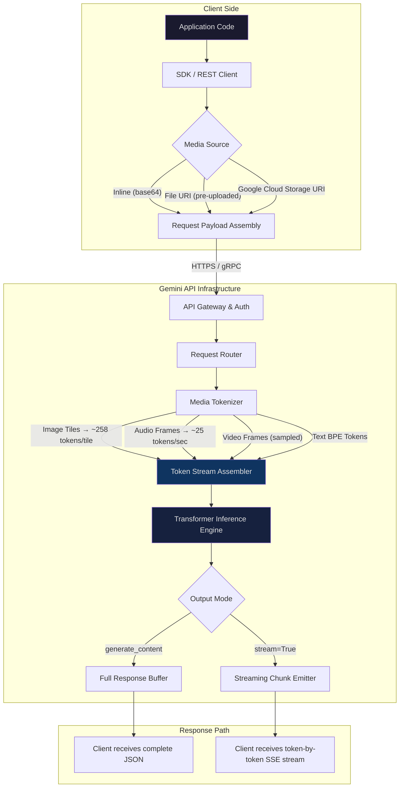
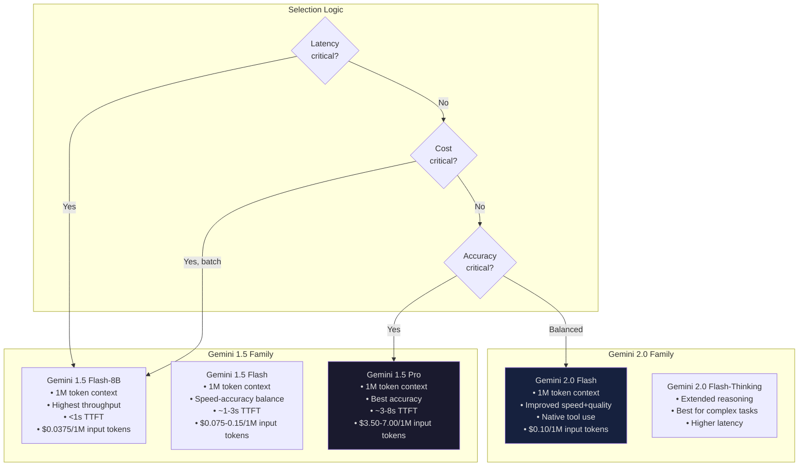
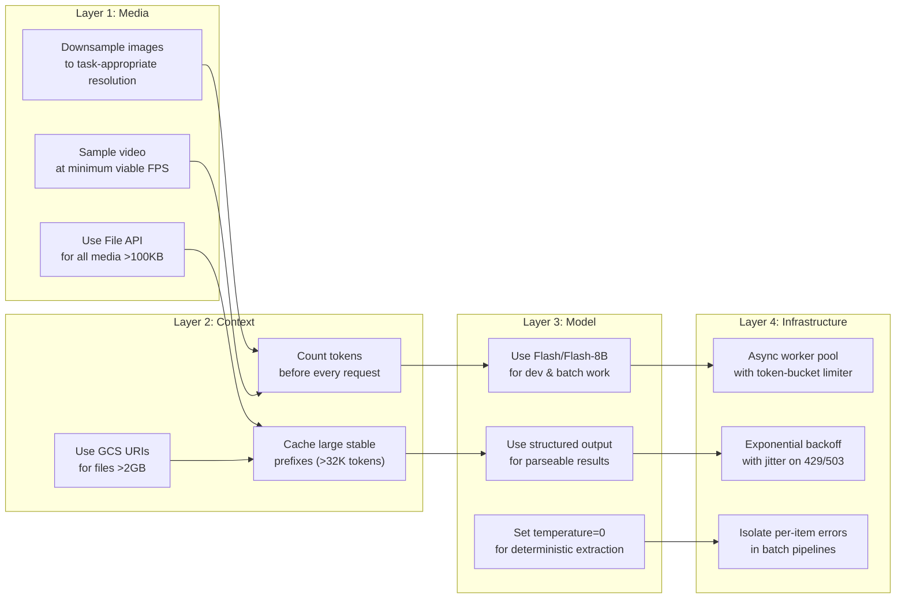

# Lesson 4: Performance Optimization for Gemini and Multimodal APIs

## 1. First-Principles Foundations

Optimizing multimodal AI systems built on APIs like Google Gemini requires understanding the actual architecture you are programming against, not a generic neural network abstraction. Gemini is a natively multimodal model family — meaning it was trained from the ground up on interleaved text, images, audio, video, and code, rather than being a unimodal model with bolted-on adapters. This architectural choice has direct, measurable consequences for how you structure requests, manage context, and control latency.

### The Three Governing Invariants

Every performance decision in a multimodal API system is a trade-off across three fundamental constraints:

**Token Budget (Computational Invariant).** Every modality is tokenized before being fed to the transformer. For Gemini, images are encoded into a fixed number of tokens per tile (roughly 258 tokens per 768×768 tile in Gemini 1.5 and later), audio is segmented at ~25 tokens/second, and video is sampled at a configurable frame rate before tiling. The total token count determines FLOPS consumed per forward pass, billing cost, and the probability of hitting the model's context window limit. As of Gemini 1.5 Pro, the context window is 1,000,000 tokens — but this does not mean you should use it carelessly; prefill cost scales super-linearly with sequence length due to the quadratic attention mechanism.

**Memory Bandwidth (Memory Invariant).** The KV-cache for a long multimodal context is enormous. For a 1M-token context with a large model, the KV-cache can exceed tens of gigabytes of HBM. If you are running inference at the edge or on a constrained serving cluster, this becomes the binding constraint before FLOPS does. The practical implication: minimize unnecessary context re-hydration by using context caching (a first-class API feature in Gemini 1.5+) rather than resending the same large media payload on every turn.

**Network I/O (Communication Invariant).** Multimodal payloads are large. A single 1080p image JPEG is 200–600 KB; a 60-second audio clip at 128 kbps is ~960 KB; a 5-minute video clip is tens to hundreds of megabytes depending on codec. The time to upload this data to the API endpoint often dominates total request latency for first requests. Using the File API (via `google.generativeai` in Python or the equivalent REST endpoint) to upload media once and reference it by URI in subsequent requests eliminates re-upload overhead entirely.

---

## 2. Gemini API Architecture and Multimodal Request Lifecycle

Understanding what actually happens when you send a multimodal request is prerequisite to optimizing it.



### Media Tokenization in Depth

Images are not passed as raw pixels to the attention layers. The image encoding pipeline in Gemini works as follows:

1. The image is resized and divided into a grid of tiles (tile size is model-specific; Gemini 1.5 uses 768×768 tiles).
2. Each tile is encoded by a Vision Encoder (a ViT-style architecture) into a dense embedding.
3. Each embedding is projected and flattened into a fixed sequence of soft tokens that are appended to the main token stream alongside a special `<image_token>` delimiter.
4. A low-resolution thumbnail of the full image is also tokenized and prepended, giving the model global spatial context.

The practical consequence: a 4K image (3840×2160) requires roughly ⌈3840/768⌉ × ⌈2160/768⌉ = 5 × 3 = 15 tiles = ~3,870 tokens. Downscaling a 4K image to 1024×1024 before sending it reduces this to ~258 tokens — a **15× token reduction** with minimal quality loss for most classification and captioning tasks.

---

## 3. Production-Grade Python Client: Request Optimization Patterns

The following example demonstrates the full hierarchy of optimizations: File API usage for reuse, context caching for repeated prompts, streaming for latency-sensitive UX, and proper retry/backoff for reliability.

```python
"""
production_gemini_client.py

Production-grade multimodal client for the Gemini API demonstrating:
  - File API for media reuse (eliminates repeated upload cost)
  - Context caching for large, stable system prompts
  - Streaming generation for time-to-first-token optimization
  - Exponential backoff with jitter for 429/503 handling
  - Token counting before submission to avoid context overflow
"""

from __future__ import annotations

import base64
import logging
import os
import random
import time
from pathlib import Path
from typing import Generator, Optional

import google.generativeai as genai
from google.api_core import exceptions as google_exceptions
from google.generativeai import caching
from google.generativeai.types import GenerationConfig, HarmBlockThreshold, HarmCategory

logging.basicConfig(level=logging.INFO, format="%(asctime)s %(levelname)s %(message)s")
log = logging.getLogger(__name__)

# ---------------------------------------------------------------------------
# Configuration
# ---------------------------------------------------------------------------
genai.configure(api_key=os.environ["GEMINI_API_KEY"])

MODEL_ID = "gemini-1.5-pro-latest"
MAX_RETRIES = 5
BASE_BACKOFF_SECONDS = 1.0
MAX_BACKOFF_SECONDS = 60.0


# ---------------------------------------------------------------------------
# Retry decorator with exponential backoff + full jitter
# ---------------------------------------------------------------------------
def with_retry(func):
    """Decorator: retries on transient API errors with exponential backoff."""
    def wrapper(*args, **kwargs):
        for attempt in range(MAX_RETRIES):
            try:
                return func(*args, **kwargs)
            except google_exceptions.ResourceExhausted as e:
                # 429 Too Many Requests — back off and retry
                wait = min(
                    MAX_BACKOFF_SECONDS,
                    BASE_BACKOFF_SECONDS * (2 ** attempt) + random.uniform(0, 1),
                )
                log.warning("Rate limited (429). Retrying in %.1fs [attempt %d/%d].", wait, attempt + 1, MAX_RETRIES)
                time.sleep(wait)
            except google_exceptions.ServiceUnavailable as e:
                # 503 — transient backend unavailability
                wait = min(MAX_BACKOFF_SECONDS, BASE_BACKOFF_SECONDS * (2 ** attempt))
                log.warning("Service unavailable (503). Retrying in %.1fs.", wait)
                time.sleep(wait)
        raise RuntimeError(f"API call failed after {MAX_RETRIES} retries.")
    return wrapper


# ---------------------------------------------------------------------------
# File API: upload once, reference many times
# ---------------------------------------------------------------------------
def upload_media_file(local_path: Path, display_name: Optional[str] = None) -> genai.protos.File:
    """
    Upload a media file to the Gemini File API.

    The File API stores files for 48 hours. Within that window, any number of
    requests can reference the file by its URI without re-uploading.
    Supported MIME types include image/jpeg, image/png, image/webp, image/heic,
    image/heif, audio/mp3, audio/wav, audio/ogg, video/mp4, video/mpeg,
    video/webm, application/pdf, and text/plain.
    """
    display_name = display_name or local_path.name
    mime_type = _infer_mime_type(local_path)

    log.info("Uploading %s (%s) to File API...", local_path.name, mime_type)
    uploaded_file = genai.upload_file(path=str(local_path), display_name=display_name, mime_type=mime_type)

    # Files require processing before use; poll until state == ACTIVE
    while uploaded_file.state.name == "PROCESSING":
        log.info("File processing... waiting 2s.")
        time.sleep(2)
        uploaded_file = genai.get_file(uploaded_file.name)

    if uploaded_file.state.name == "FAILED":
        raise ValueError(f"File processing failed: {uploaded_file.name}")

    log.info("File ready: %s", uploaded_file.uri)
    return uploaded_file


def _infer_mime_type(path: Path) -> str:
    mime_map = {
        ".jpg": "image/jpeg", ".jpeg": "image/jpeg", ".png": "image/png",
        ".webp": "image/webp", ".heic": "image/heic", ".heif": "image/heif",
        ".mp3": "audio/mp3", ".wav": "audio/wav", ".ogg": "audio/ogg",
        ".mp4": "video/mp4", ".mpeg": "video/mpeg", ".webm": "video/webm",
        ".pdf": "application/pdf", ".txt": "text/plain",
    }
    suffix = path.suffix.lower()
    if suffix not in mime_map:
        raise ValueError(f"Unsupported file extension: {suffix}")
    return mime_map[suffix]


# ---------------------------------------------------------------------------
# Context Caching: amortize large system prompt cost across many requests
# ---------------------------------------------------------------------------
def create_cached_context(
    system_instruction: str,
    static_files: list[genai.protos.File],
    ttl_seconds: int = 3600,
) -> caching.CachedContent:
    """
    Create a cached context for a large, stable system prompt + media.

    Context caching (Gemini 1.5+) pre-computes the KV-cache for a fixed prefix
    and stores it server-side. Subsequent requests that reference the cache pay
    only the incremental token cost, not the full prefix cost.

    Minimum cacheable token count: 32,768 tokens.
    Minimum TTL: 60 seconds. Maximum TTL: 3600 seconds (1 hour) per creation.
    """
    log.info("Creating cached context (TTL=%ds)...", ttl_seconds)
    cached_content = caching.CachedContent.create(
        model=MODEL_ID,
        display_name="production-multimodal-cache",
        system_instruction=system_instruction,
        contents=[genai.protos.Content(parts=[genai.protos.Part(file_data=genai.protos.FileData(
            mime_type=f.mime_type, file_uri=f.uri
        )) for f in static_files])],
        ttl=f"{ttl_seconds}s",
    )
    log.info("Cached context created: %s (token count: %d)", cached_content.name, cached_content.usage_metadata.total_token_count)
    return cached_content


# ---------------------------------------------------------------------------
# Token counting: guard against context overflow before sending
# ---------------------------------------------------------------------------
def count_tokens_for_request(model: genai.GenerativeModel, contents: list) -> int:
    """Count tokens for a request without consuming generation quota."""
    response = model.count_tokens(contents)
    return response.total_tokens


# ---------------------------------------------------------------------------
# Streaming generation: minimize time-to-first-token for interactive UX
# ---------------------------------------------------------------------------
@with_retry
def generate_streaming(
    model: genai.GenerativeModel,
    contents: list,
    generation_config: Optional[GenerationConfig] = None,
) -> Generator[str, None, None]:
    """
    Stream generated text token-by-token.

    Use streaming when the total response length is unpredictable or long, and
    when interactive responsiveness matters. The first chunk typically arrives
    within 1–3 seconds regardless of total response length.
    """
    response_stream = model.generate_content(
        contents,
        generation_config=generation_config,
        stream=True,
    )
    for chunk in response_stream:
        if chunk.candidates and chunk.candidates[0].content.parts:
            yield chunk.text


# ---------------------------------------------------------------------------
# Main demonstration
# ---------------------------------------------------------------------------
def analyze_video_with_caching(
    video_path: Path,
    user_query: str,
    system_prompt: str,
) -> str:
    """
    Full pipeline: upload video → cache system prompt → stream analysis.

    Optimization hierarchy applied:
      1. File API: video uploaded once, reusable for 48h
      2. Context cache: system prompt KV-cache amortized across requests
      3. Token pre-check: abort before sending if budget exceeded
      4. Streaming: low TTFT for interactive display
      5. Retry with backoff: resilient to transient 429/503 errors
    """
    # Step 1: Upload video via File API
    video_file = upload_media_file(video_path)

    # Step 2: Create or retrieve cached context
    cached_ctx = create_cached_context(
        system_instruction=system_prompt,
        static_files=[video_file],
        ttl_seconds=3600,
    )

    # Step 3: Build model from cached context
    model = genai.GenerativeModel.from_cached_content(cached_content=cached_ctx)

    # Step 4: Pre-flight token count check
    request_contents = [{"role": "user", "parts": [user_query]}]
    token_count = count_tokens_for_request(model, request_contents)
    log.info("Request token count: %d", token_count)

    # Gemini 1.5 Pro context window: 1,048,576 tokens
    if token_count > 1_000_000:
        raise ValueError(f"Request exceeds context window: {token_count} tokens.")

    # Step 5: Stream the response
    generation_config = GenerationConfig(
        temperature=0.2,       # low temperature for factual analysis
        top_p=0.9,
        max_output_tokens=4096,
    )

    full_response = []
    for chunk in generate_streaming(model, request_contents, generation_config):
        print(chunk, end="", flush=True)
        full_response.append(chunk)
    print()  # newline after stream completes

    return "".join(full_response)


if __name__ == "__main__":
    video_path = Path("sample_lecture.mp4")
    system_prompt = (
        "You are an expert technical analyst. You have been given a video recording. "
        "Analyze it with precision. Cite specific timestamps when referencing events. "
        "Do not speculate beyond what is visually or audibly present."
    )
    user_query = "Summarize the key technical concepts explained in this lecture, with timestamps."

    result = analyze_video_with_caching(video_path, user_query, system_prompt)
```

---

## 4. Token Economics and Cost Modeling

Before optimizing, you must be able to measure. The Gemini API provides a `countTokens` endpoint that returns exact token counts without consuming generation quota. This is not an approximation — it uses the same tokenizer the inference engine uses.

```python
"""
token_budget_analysis.py

Demonstrates precise token counting across modalities to build a cost model
before submitting expensive requests.
"""

import google.generativeai as genai
from pathlib import Path

genai.configure(api_key=os.environ["GEMINI_API_KEY"])
model = genai.GenerativeModel("gemini-1.5-pro-latest")


def measure_image_token_cost(image_path: Path) -> dict:
    """
    Measure the actual token cost of an image at different resolutions.
    Returns a dict mapping resolution label to token count.
    """
    from PIL import Image  # pip install Pillow
    import io

    results = {}
    img = Image.open(image_path).convert("RGB")
    original_size = img.size

    for label, max_dim in [("original", None), ("1024px", 1024), ("512px", 512), ("256px", 256)]:
        if max_dim:
            scale = max_dim / max(img.size)
            new_size = (int(img.size[0] * scale), int(img.size[1] * scale))
            resized = img.resize(new_size, Image.LANCZOS)
        else:
            resized = img

        # Encode to bytes for API submission
        buf = io.BytesIO()
        resized.save(buf, format="JPEG", quality=85)
        image_bytes = buf.getvalue()

        # Count tokens for this image
        response = model.count_tokens(
            contents=[{
                "role": "user",
                "parts": [
                    {"inline_data": {"mime_type": "image/jpeg", "data": image_bytes}},
                    {"text": "Describe this image."}
                ]
            }]
        )
        results[label] = {
            "resolution": resized.size,
            "token_count": response.total_tokens,
            "size_bytes": len(image_bytes),
        }

    return results


def compute_video_token_estimate(duration_seconds: float, fps: float = 1.0) -> int:
    """
    Estimate video token cost given duration and frame sampling rate.

    Gemini 1.5 samples video at 1 frame per second by default for the File API.
    Each frame is treated as an image (768×768 tile, ~258 tokens per tile at
    standard resolution). Audio is encoded separately at ~25 tokens/second.
    """
    video_frames = int(duration_seconds * fps)
    image_tokens_per_frame = 258  # 1 tile per frame at 768px
    audio_tokens = int(duration_seconds * 25)
    total = video_frames * image_tokens_per_frame + audio_tokens
    return total


if __name__ == "__main__":
    # Example: measure a sample image
    path = Path("sample.jpg")
    if path.exists():
        costs = measure_image_token_cost(path)
        for label, info in costs.items():
            print(f"{label:12s} | {str(info['resolution']):16s} | {info['token_count']:6d} tokens | {info['size_bytes']//1024:5d} KB")

    # Estimate a 10-minute video
    video_tokens = compute_video_token_estimate(600, fps=1.0)
    print(f"\n10-minute video estimate: {video_tokens:,} tokens")
    # At Gemini 1.5 Pro pricing: input tokens cost $3.50/1M for ≤128K, $7.00/1M for >128K
    # 10-min video ≈ 170,500 tokens → ~$1.19 per analysis request (at >128K tier)
```

---

## 5. Architecture Deep-Dive: Context Caching and KV-Cache Mechanics

Context caching is the single highest-leverage optimization available when you have a large, stable prefix (a lengthy system prompt, a reference document, or a static video) that you query repeatedly with different user questions.

```mermaid
sequenceDiagram
    participant App as Application
    participant API as Gemini API Gateway
    participant Cache as KV-Cache Store
    participant Inference as Transformer Engine

    Note over App,Inference: First request — cache MISS, full prefix cost paid

    App->>API: POST /v1beta/cachedContents (system prompt + video)
    API->>Inference: Tokenize + compute KV-cache for prefix
    Inference-->>Cache: Store KV-cache (TTL=3600s)
    Cache-->>API: Return cache_name
    API-->>App: CachedContent { name, token_count, expire_time }

    Note over App,Inference: Subsequent requests — cache HIT, pay only delta tokens

    App->>API: generateContent { cached_content: cache_name, user_query }
    API->>Cache: Fetch KV-cache for cache_name
    Cache-->>API: KV-cache hit (prefix tokens NOT re-computed)
    API->>Inference: Run inference from cached KV state + user_query tokens
    Inference-->>API: Generated tokens
    API-->>App: Response (billed: user_query tokens + output tokens only)

    Note over Cache: Cache expires after TTL; must be renewed
```

The KV-cache stores the key and value matrices for every attention layer computed over the prefix tokens. On a cache hit, the inference engine loads these matrices directly into HBM and begins autoregressive generation from where the prefix ends. This eliminates the entire prefill pass for the cached portion — which for a 1-hour video (≈90,000 tokens) is the difference between a ~30-second prefill and a ~200ms load from cache.

**When context caching pays off.** The minimum cacheable size is 32,768 tokens, and there is a storage cost per token-hour. The break-even analysis is straightforward:

```
cost_without_cache = N_requests × prefix_tokens × input_price_per_token
cost_with_cache    = (1 × prefix_tokens × input_price_per_token)
                   + (N_requests × query_tokens × input_price_per_token)
                   + (prefix_tokens × cache_storage_price_per_token_hour × TTL_hours)

cache_saves_money when: N_requests > break_even_N
```

For Gemini 1.5 Pro at current pricing (input: \$3.50/1M tokens for ≤128K context tier, cache storage: \$1.00/1M token-hours), context caching becomes cost-positive at approximately 2–3 requests per cache lifetime for large (>100K token) prefixes.

---

## 6. Concurrency Architecture for High-Throughput Pipelines

For batch workloads (e.g., analyzing thousands of images or documents), the bottleneck shifts from individual request latency to throughput. The Gemini API enforces per-project rate limits expressed in requests per minute (RPM) and tokens per minute (TPM). As of mid-2025, Gemini 1.5 Pro Tier 1 limits are 1,000 RPM and 4,000,000 TPM.

The correct architecture is a bounded async worker pool with a token-bucket rate limiter, not a naive ThreadPoolExecutor.

```python
"""
async_batch_processor.py

High-throughput multimodal batch processing with:
  - asyncio-based concurrency (non-blocking I/O while awaiting API responses)
  - Token bucket rate limiter to stay within API quota
  - Per-request error isolation (one failure does not abort the batch)
  - Progress tracking with estimated completion time
"""

from __future__ import annotations

import asyncio
import os
import time
from dataclasses import dataclass, field
from pathlib import Path
from typing import Any, Optional

import google.generativeai as genai

genai.configure(api_key=os.environ["GEMINI_API_KEY"])


@dataclass
class TokenBucket:
    """
    Token bucket rate limiter for API quota management.

    Allows bursting up to `capacity` tokens, refilling at `rate` tokens/second.
    Thread-safe via asyncio.Lock.
    """
    capacity: float          # maximum burst size
    rate: float              # tokens added per second
    _tokens: float = field(init=False)
    _last_refill: float = field(init=False)
    _lock: asyncio.Lock = field(init=False)

    def __post_init__(self):
        self._tokens = self.capacity
        self._last_refill = time.monotonic()
        self._lock = asyncio.Lock()

    async def acquire(self, tokens: float = 1.0) -> None:
        """Block until `tokens` tokens are available, then consume them."""
        async with self._lock:
            while True:
                now = time.monotonic()
                elapsed = now - self._last_refill
                self._tokens = min(self.capacity, self._tokens + elapsed * self.rate)
                self._last_refill = now

                if self._tokens >= tokens:
                    self._tokens -= tokens
                    return

                # Sleep until enough tokens have refilled
                deficit = tokens - self._tokens
                sleep_time = deficit / self.rate
                await asyncio.sleep(sleep_time)


@dataclass
class BatchItem:
    id: str
    image_path: Path
    prompt: str
    result: Optional[str] = None
    error: Optional[str] = None
    tokens_used: int = 0


async def process_single_item(
    item: BatchItem,
    model: genai.GenerativeModel,
    rpm_limiter: TokenBucket,
    tpm_limiter: TokenBucket,
) -> BatchItem:
    """Process one batch item with rate limiting and isolated error handling."""
    try:
        # Pre-flight: estimate token cost and acquire TPM quota
        # Rough image estimate: 258 tokens; prompt: ~len(prompt)//4 tokens
        estimated_tokens = 258 + len(item.prompt) // 4 + 512  # +512 for output headroom
        await rpm_limiter.acquire(1.0)
        await tpm_limiter.acquire(estimated_tokens)

        # Read image bytes
        image_bytes = item.image_path.read_bytes()
        mime_type = "image/jpeg" if item.image_path.suffix.lower() in (".jpg", ".jpeg") else "image/png"

        # Build request
        contents = [{
            "role": "user",
            "parts": [
                {"inline_data": {"mime_type": mime_type, "data": image_bytes}},
                {"text": item.prompt},
            ]
        }]

        # Execute (the google-generativeai SDK is synchronous; run in thread executor)
        loop = asyncio.get_running_loop()
        response = await loop.run_in_executor(
            None,
            lambda: model.generate_content(
                contents,
                generation_config=genai.GenerationConfig(temperature=0.1, max_output_tokens=512),
            )
        )

        item.result = response.text
        item.tokens_used = response.usage_metadata.total_token_count

    except Exception as e:
        item.error = str(e)

    return item


async def process_batch(
    items: list[BatchItem],
    max_concurrency: int = 20,
    rpm_limit: float = 900.0,   # stay 10% below hard limit for safety margin
    tpm_limit: float = 3_600_000.0,
) -> list[BatchItem]:
    """
    Process a batch of multimodal items concurrently with quota management.

    max_concurrency controls the number of in-flight requests. Set this based on
    your average response latency: if average latency is 3s and you want 300 RPM
    sustained throughput, you need at least 300/60*3 = 15 concurrent workers.
    """
    model = genai.GenerativeModel("gemini-1.5-flash-latest")  # Flash for batch: lower cost, higher TPM limit
    rpm_limiter = TokenBucket(capacity=rpm_limit / 10, rate=rpm_limit / 60)
    tpm_limiter = TokenBucket(capacity=tpm_limit / 10, rate=tpm_limit / 60)

    semaphore = asyncio.Semaphore(max_concurrency)
    start_time = time.monotonic()

    async def bounded_process(item: BatchItem) -> BatchItem:
        async with semaphore:
            return await process_single_item(item, model, rpm_limiter, tpm_limiter)

    tasks = [bounded_process(item) for item in items]
    results = []
    completed = 0

    for coro in asyncio.as_completed(tasks):
        result = await coro
        results.append(result)
        completed += 1
        elapsed = time.monotonic() - start_time
        rps = completed / elapsed
        remaining = len(items) - completed
        eta = remaining / rps if rps > 0 else float("inf")
        print(f"\r{completed}/{len(items)} | {rps:.1f} req/s | ETA: {eta:.0f}s", end="", flush=True)

    print()
    return results


if __name__ == "__main__":
    # Example: process a directory of images
    image_dir = Path("./images")
    items = [
        BatchItem(
            id=p.stem,
            image_path=p,
            prompt="Extract all text visible in this image. Return JSON: {\"text\": [...]}",
        )
        for p in image_dir.glob("*.jpg")
    ]

    results = asyncio.run(process_batch(items))

    successful = [r for r in results if r.result is not None]
    failed = [r for r in results if r.error is not None]
    total_tokens = sum(r.tokens_used for r in successful)
    print(f"Completed: {len(successful)} | Failed: {len(failed)} | Total tokens: {total_tokens:,}")
```

---

## 7. Failure Modes, Edge Cases, and Mitigations

Multimodal API systems fail in ways that unimodal text systems do not. The following table maps the failure mode to its root cause and the correct mitigation:

| Failure Mode | Root Cause | Detection Signal | Mitigation |
|---|---|---|---|
| `RECITATION` finish reason | Model output matches training data verbatim; safety policy blocks completion | `response.candidates[0].finish_reason == FinishReason.RECITATION` | Rephrase prompt; request paraphrasing rather than direct extraction |
| `SAFETY` finish reason | Input or output triggered content policy | `finish_reason == FinishReason.SAFETY` with `safety_ratings` | Inspect `safety_ratings`; adjust `HarmBlockThreshold`; sanitize input |
| Empty `parts` in candidate | Model produces an empty response (often due to ambiguous multimodal input) | `len(response.candidates[0].content.parts) == 0` | Add explicit output format instruction; check for `prompt_feedback.block_reason` |
| Context window overflow | Total tokens (prompt + media + max_output) exceed 1,048,576 | `google.api_core.exceptions.InvalidArgument: 400` with `token count` in message | Pre-flight `count_tokens`; downsample media; use context caching to offload prefix |
| File API processing timeout | Large video files take >10 minutes to process; polling loop times out | File state remains `PROCESSING` | Implement polling with exponential backoff; set a hard timeout; use GCS URI for files >2GB |
| Stale cached context | Cache TTL expires between request creation and execution | `404 Not Found` on `cache_name` | Catch `NotFound`; recreate cache; consider cache renewal 5 minutes before TTL |
| Partial streaming response | Network interruption during SSE stream | `StopIteration` or incomplete chunk | Wrap stream iteration in try/except; buffer partial output; retry with non-streaming if critical |
| Token budget asymmetry | `max_output_tokens` set too low; model truncates mid-sentence | `finish_reason == FinishReason.MAX_TOKENS` | Increase `max_output_tokens`; use continuation prompting; restructure output format |

### Defensive Response Validation

```python
from google.generativeai.types import FinishReason
from google.api_core import exceptions as google_exceptions


def safe_extract_text(response: genai.types.GenerateContentResponse) -> str:
    """
    Defensively extract text from a GenerateContentResponse.

    Handles all documented non-STOP finish reasons without raising exceptions,
    returning structured error information that callers can act on.
    """
    # Check for prompt-level blocking before examining candidates
    if response.prompt_feedback and response.prompt_feedback.block_reason:
        raise ValueError(
            f"Prompt blocked: {response.prompt_feedback.block_reason.name}. "
            f"Ratings: {response.prompt_feedback.safety_ratings}"
        )

    if not response.candidates:
        raise ValueError("No candidates returned. The request may have been fully blocked.")

    candidate = response.candidates[0]
    finish_reason = candidate.finish_reason

    if finish_reason == FinishReason.STOP:
        # Normal completion
        return response.text

    if finish_reason == FinishReason.MAX_TOKENS:
        # Partial output: return what was generated but signal truncation
        partial = "".join(p.text for p in candidate.content.parts if hasattr(p, "text"))
        raise RuntimeError(
            f"Response truncated at max_output_tokens. Partial output ({len(partial)} chars): {partial[:200]}..."
        )

    if finish_reason == FinishReason.SAFETY:
        ratings_summary = {r.category.name: r.probability.name for r in candidate.safety_ratings}
        raise ValueError(f"Response blocked by safety filters: {ratings_summary}")

    if finish_reason == FinishReason.RECITATION:
        raise ValueError("Response blocked due to recitation policy (verbatim training data reproduction).")

    if finish_reason == FinishReason.OTHER:
        raise RuntimeError(f"Generation stopped for unspecified reason. Candidate: {candidate}")

    raise RuntimeError(f"Unexpected finish_reason: {finish_reason}")
```

---

## 8. Model Selection as a Performance Decision

Choosing the right Gemini model variant is itself an optimization decision with significant cost and latency implications. The model family as of mid-2025:



The practical heuristic: use Flash or Flash-8B for all exploratory and batch work during development; use Pro only when you have a validated prompt and need maximum accuracy on production traffic. The cost ratio between Flash-8B and Pro is roughly 100:1 — over a large dataset, model selection dominates total cost more than any other optimization.

---

## 9. Structured Output for Reliable Downstream Processing

Multimodal responses are only as useful as your ability to parse them programmatically. Gemini supports native JSON mode via `response_mime_type="application/json"` combined with a `response_schema` defined using Python type annotations (backed by Pydantic-style schema generation). This eliminates the brittle regex/JSON-extraction heuristics common in naive implementations.

```python
"""
structured_output.py

Demonstrates Gemini's native structured output for multimodal analysis.
The model is constrained to emit valid JSON conforming to a schema —
this is enforced at the decoding layer (constrained beam search / logit masking),
not via post-processing.
"""

import enum
import json
import os
from pathlib import Path
from typing import Optional

import google.generativeai as genai
import google.ai.generativelanguage as glm

genai.configure(api_key=os.environ["GEMINI_API_KEY"])


class Sentiment(enum.Enum):
    POSITIVE = "positive"
    NEGATIVE = "negative"
    NEUTRAL = "neutral"


# Define the response schema using the glm (google.ai.generativelanguage) types
# This maps directly to a JSON Schema that the model decoding enforces.
response_schema = glm.Schema(
    type=glm.Type.OBJECT,
    properties={
        "objects_detected": glm.Schema(
            type=glm.Type.ARRAY,
            items=glm.Schema(
                type=glm.Type.OBJECT,
                properties={
                    "label": glm.Schema(type=glm.Type.STRING),
                    "confidence": glm.Schema(type=glm.Type.NUMBER),
                    "bounding_box_description": glm.Schema(type=glm.Type.STRING),
                },
                required=["label", "confidence"],
            ),
        ),
        "scene_description": glm.Schema(type=glm.Type.STRING),
        "dominant_colors": glm.Schema(
            type=glm.Type.ARRAY,
            items=glm.Schema(type=glm.Type.STRING),
        ),
        "contains_text": glm.Schema(type=glm.Type.BOOLEAN),
        "extracted_text": glm.Schema(type=glm.Type.STRING),
        "sentiment": glm.Schema(
            type=glm.Type.STRING,
            enum=["positive", "negative", "neutral"],
        ),
    },
    required=["objects_detected", "scene_description", "contains_text", "sentiment"],
)

model = genai.GenerativeModel(
    model_name="gemini-1.5-flash-latest",
    generation_config=genai.GenerationConfig(
        response_mime_type="application/json",
        response_schema=response_schema,
        temperature=0.0,  # deterministic output for structured extraction
    ),
)


def analyze_image_structured(image_path: Path) -> dict:
    """Analyze an image and return a validated structured response."""
    image_bytes = image_path.read_bytes()
    suffix = image_path.suffix.lower()
    mime = "image/jpeg" if suffix in (".jpg", ".jpeg") else "image/png"

    response = model.generate_content(contents=[
        {
            "role": "user",
            "parts": [
                {"inline_data": {"mime_type": mime, "data": image_bytes}},
                {"text": (
                    "Analyze this image thoroughly. Detect all visible objects with "
                    "confidence scores. Describe the scene, identify dominant colors, "
                    "extract any visible text, and assess the overall sentiment."
                )},
            ]
        }
    ])

    # With response_mime_type=application/json, response.text is guaranteed valid JSON
    return json.loads(response.text)


if __name__ == "__main__":
    sample = Path("sample.jpg")
    if sample.exists():
        result = analyze_image_structured(sample)
        print(json.dumps(result, indent=2))
```

---

## 10. End-to-End Optimization Checklist

The optimizations described in this lesson form a hierarchy. Apply them in order — each layer compounds the effect of the previous.



Each layer addresses a distinct bottleneck: Layer 1 reduces the raw token count entering the pipeline; Layer 2 amortizes that cost across requests; Layer 3 selects the most cost-efficient model capable of the task; Layer 4 maximizes throughput within API quota constraints. Skipping Layer 1 makes Layers 2–4 less effective; ignoring Layer 4 makes the pipeline fragile regardless of how well Layers 1–3 are implemented.
