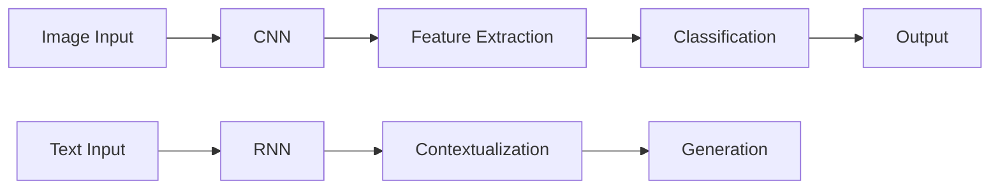

# Lesson 4: Performance Optimization Techniques

## 1. First-Principles Intuition & Invariants

In the realm of multimodal AI systems, performance optimization is a multifaceted challenge that requires a deep understanding of the underlying mechanics. At its core, optimization is about striking a balance between efficiency, scalability, and accuracy. To tackle this problem, we must first establish a solid foundation in the theoretical underpinnings of AI system performance.

Consider a multimodal AI system as a complex network of interconnected components, each with its own set of computational and memory requirements. The system's performance is a function of the interplay between these components, with the overall efficiency and scalability being a direct result of the interactions between them.

Mathematically, we can represent the system's performance as a function of the following invariants:

* **Computational Invariant**: The total computational load imposed by the system's components, measured in terms of floating-point operations per second (FLOPS) or other relevant metrics.
* **Memory Invariant**: The total memory required by the system's components, measured in terms of bytes or other relevant units.
* **Communication Invariant**: The total communication overhead between the system's components, measured in terms of bytes transferred per second or other relevant metrics.

These invariants serve as the foundation for our optimization efforts, providing a framework for understanding the system's performance characteristics and identifying areas for improvement.

## 2. Core Architecture & Mechanics

To optimize the performance of a multimodal AI system, we must first understand its internal architecture and mechanics. This involves dissecting the system's data structures, algorithms, and execution models to identify areas of inefficiency and opportunities for improvement.

Let's consider a simple example of a multimodal AI system, consisting of a convolutional neural network (CNN) for image processing and a recurrent neural network (RNN) for natural language processing. The system's architecture can be represented as follows:

In this example, the CNN and RNN components are responsible for processing the image and text inputs, respectively. The feature extraction and contextualization components are responsible for extracting relevant features from the inputs and providing contextual information to the classification and generation components.

By analyzing the system's architecture and mechanics, we can identify areas of inefficiency and opportunities for improvement. For example, we may find that the CNN component is bottlenecked by its computational requirements, while the RNN component is bottlenecked by its memory requirements.

## 3. High-Performance Optimization & Failure Modes

Once we have identified areas of inefficiency and opportunities for improvement, we can begin to apply high-performance optimization techniques to enhance the system's performance. This involves a range of strategies, including:

* **Concurrency**: Optimizing the system's concurrency to minimize idle time and maximize throughput.
* **Resource Scaling**: Scaling the system's resources (e.g., CPU, memory, and I/O) to match the changing demands of the workload.
* **Boundary Edge Cases**: Identifying and mitigating boundary edge cases that can cause the system to fail or degrade in performance.

To illustrate these concepts, let's consider a simple example of a multimodal AI system, consisting of a CNN for image processing and an RNN for natural language processing. The system's architecture can be represented as follows:

In this example, the CNN and RNN components are responsible for processing the image and text inputs, respectively. The feature extraction and contextualization components are responsible for extracting relevant features from the inputs and providing contextual information to the classification and generation components.

By applying high-performance optimization techniques, we can enhance the system's performance and mitigate failure modes. For example, we may use concurrency to minimize idle time and maximize throughput, or scale the system's resources to match the changing demands of the workload.

However, optimization is not a one-time task, but rather an ongoing process that requires continuous monitoring and adaptation. As the system's workload and requirements change, we must be prepared to adjust our optimization strategies to ensure optimal performance.

In the next lesson, we will explore the role of machine learning in multimodal AI systems, including the use of transfer learning, fine-tuning, and meta-learning to enhance performance and adaptability.
