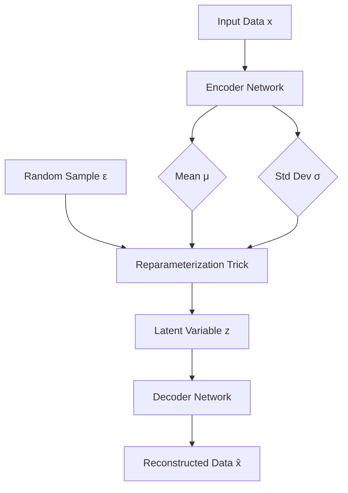

# Lesson 1: Introduction to Variational Autoencoders

## 1. First-Principles Intuition & Invariants

Generative models have long been a cornerstone of artificial intelligence, enabling machines to create new data instances that resemble a given dataset. Among the myriad of generative models, Variational Autoencoders (VAEs) stand out for their elegant mathematical formulation and practical applicability. To fully appreciate VAEs, we must first delve into the theoretical underpinnings of generative modeling and the specific challenges they address.

At the heart of generative modeling lies the problem of learning a probability distribution over a dataset. Given a dataset \( \mathcal{D} \) of observations, the goal is to learn a model \( p_\theta(x) \) that can generate new data points \( x \) that are statistically similar to those in \( \mathcal{D} \). This task is inherently complex due to the high-dimensional nature of real-world data and the intricate dependencies between features.

Traditional approaches to generative modeling, such as Gaussian Mixture Models (GMMs) and Hidden Markov Models (HMMs), often struggle with capturing the full complexity of real-world data distributions. These models typically assume simple parametric forms for the underlying distribution, which can lead to poor generalization and failure to capture intricate patterns in the data.

VAEs offer a more flexible and powerful approach to generative modeling by leveraging the principles of variational inference. The key idea behind VAEs is to approximate the true data distribution \( p(x) \) with a simpler, tractable distribution \( q_\phi(z) \) over a latent variable \( z \). This latent variable \( z \) is typically assumed to follow a simple distribution, such as a standard normal distribution, which allows for efficient sampling and inference.

The central challenge in VAEs is to find the parameters \( \phi \) and \( \theta \) that minimize the divergence between the true data distribution \( p(x) \) and the approximate distribution \( q_\phi(z) \). This is achieved through the use of the Kullback-Leibler (KL) divergence, a measure of the difference between two probability distributions. The KL divergence between the true posterior \( p(z|x) \) and the approximate posterior \( q_\phi(z|x) \) is given by:

\[
\text{KL}(q_\phi(z|x) \| p(z|x)) = \int q_\phi(z|x) \log \frac{q_\phi(z|x)}{p(z|x)} \, dz
\]

Minimizing the KL divergence is equivalent to maximizing the evidence lower bound (ELBO), which is defined as:

\[
\mathcal{L}(\theta, \phi) = \mathbb{E}_{q_\phi(z|x)}[\log p_\theta(x|z)] - \text{KL}(q_\phi(z|x) \| p(z))
\]

The first term in the ELBO, \( \mathbb{E}_{q_\phi(z|x)}[\log p_\theta(x|z)] \), represents the reconstruction loss, which measures how well the model can reconstruct the input data \( x \) from the latent variable \( z \). The second term, \( \text{KL}(q_\phi(z|x) \| p(z)) \), is the regularization term, which ensures that the latent variable \( z \) is close to the prior distribution \( p(z) \).

By maximizing the ELBO, VAEs learn a latent space representation of the data that captures the underlying structure and dependencies. This latent space can then be used for various applications, such as data generation, denoising, and anomaly detection.

## 2. Core Architecture & Mechanics

The architecture of a Variational Autoencoder consists of two main components: the encoder and the decoder. The encoder maps the input data \( x \) to a latent variable \( z \) by learning a distribution \( q_\phi(z|x) \). The decoder, on the other hand, maps the latent variable \( z \) back to the input space, generating a reconstructed data point \( \hat{x} \) by learning a distribution \( p_\theta(x|z) \).

To illustrate the architecture of a VAE, we can use a simple example with a Gaussian latent space. The encoder network takes an input data point \( x \) and outputs the parameters of a Gaussian distribution \( q_\phi(z|x) \), specifically the mean \( \mu \) and the standard deviation \( \sigma \). The latent variable \( z \) is then sampled from this Gaussian distribution using the reparameterization trick:

\[
z = \mu + \sigma \odot \epsilon
\]

where \( \epsilon \) is a random sample from a standard normal distribution. This reparameterization allows the gradients to flow through the stochastic sampling process, enabling end-to-end training of the VAE using backpropagation.

The decoder network takes the sampled latent variable \( z \) and generates a reconstructed data point \( \hat{x} \) by learning a distribution \( p_\theta(x|z) \). In practice, the decoder is often modeled as a neural network that maps the latent variable \( z \) to the input space.

To visualize the architecture of a VAE, we can use a Mermaid diagram:

In this diagram, the input data \( x \) is passed through the encoder network to obtain the mean \( \mu \) and standard deviation \( \sigma \). The latent variable \( z \) is then sampled using the reparameterization trick, and passed through the decoder network to generate the reconstructed data point \( \hat{x} \).

The training process of a VAE involves maximizing the ELBO, which is typically done using stochastic gradient descent. The reconstruction loss is often modeled as the negative log-likelihood of the input data given the reconstructed data, while the regularization term is modeled as the KL divergence between the approximate posterior \( q_\phi(z|x) \) and the prior distribution \( p(z) \).

## 3. High-Performance Optimization & Failure Modes

Optimizing the performance of a Variational Autoencoder involves several key considerations, including efficient sampling, stable training, and effective regularization. One of the main challenges in training VAEs is the trade-off between the reconstruction loss and the regularization term. If the regularization term is too strong, the model may collapse to a trivial solution where the latent variable \( z \) is independent of the input data \( x \). Conversely, if the regularization term is too weak, the model may overfit to the training data and fail to generalize.

To address these challenges, several techniques have been proposed to improve the performance and stability of VAEs. One such technique is the use of annealed KL annealing, where the weight of the regularization term is gradually increased during training. This allows the model to first focus on learning the reconstruction loss before incorporating the regularization term, which can help prevent mode collapse and improve the quality of the generated samples.

Another important consideration in VAE training is the choice of the prior distribution \( p(z) \). While a standard normal distribution is commonly used, other prior distributions, such as a Gaussian mixture model or a hierarchical prior, can also be used to capture more complex latent structures.

In terms of high-performance optimization, VAEs can benefit from various techniques, such as batch normalization, weight initialization, and learning rate scheduling. These techniques can help stabilize the training process and improve the convergence of the model.

Failure modes in VAEs can arise from several sources, including poor initialization, insufficient training, and improper regularization. One common failure mode is mode collapse, where the model generates a limited set of samples that do not cover the full diversity of the data distribution. To mitigate mode collapse, several techniques have been proposed, such as using a Gaussian mixture model as the prior distribution, incorporating a discriminator network, or using a different objective function, such as the Wasserstein Autoencoder (WAE).

In summary, Variational Autoencoders offer a powerful and flexible approach to generative modeling by leveraging the principles of variational inference. By learning a latent space representation of the data, VAEs can capture the underlying structure and dependencies, enabling various applications such as data generation, denoising, and anomaly detection. Through careful optimization and regularization, VAEs can be trained to generate high-quality samples that are statistically similar to the input data.
