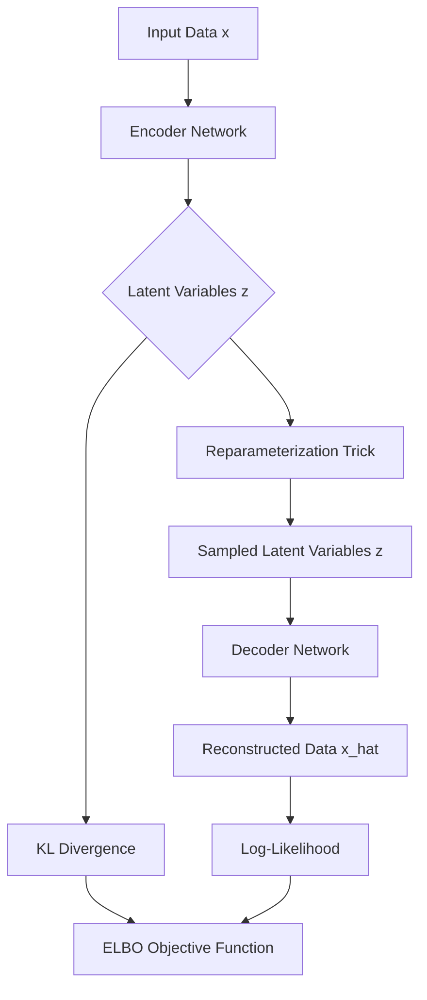

# Lesson 2: Mathematical Foundations of VAEs

## 1. First-Principles Intuition & Invariants

Variational Autoencoders (VAEs) are a class of generative models that have gained significant traction in the field of machine learning, particularly in the domain of generative artificial intelligence. To fully appreciate the elegance and power of VAEs, it is essential to delve into their mathematical underpinnings. This section will provide a deep narrative exposition that establishes the theoretical grounding, problem space, and mathematical invariants that define VAEs.

At the heart of VAEs lies the concept of probabilistic modeling. Probabilistic models are a powerful framework for understanding and generating data by capturing the inherent uncertainty and variability present in real-world phenomena. In the context of generative models, the goal is to learn a probability distribution over a dataset, such that we can generate new data samples that are similar to the training data. VAEs achieve this by leveraging the principles of variational inference, a method for approximating complex probability distributions.

To understand the problem space, consider the challenge of modeling a high-dimensional dataset, such as images or audio. The probability distribution over such data is often complex and multimodal, meaning that there are multiple distinct clusters or modes in the data. Traditional methods for modeling such distributions, such as maximum likelihood estimation, can struggle to capture the full complexity of the data. VAEs, on the other hand, provide a flexible and scalable framework for modeling complex probability distributions by introducing a latent variable representation.

The latent variable representation is a key invariant in VAEs. The idea is to introduce a set of latent variables that capture the underlying structure and variability in the data. These latent variables are typically modeled as a continuous probability distribution, such as a Gaussian distribution. By learning a mapping from the latent space to the data space, VAEs can generate new data samples by sampling from the latent distribution and passing the samples through the decoder network.

The probabilistic framework of VAEs is grounded in the principles of Bayesian inference. In Bayesian inference, we seek to infer the posterior distribution over the latent variables given the observed data. However, computing the exact posterior distribution is often intractable, especially for complex models and high-dimensional data. VAEs address this challenge by introducing a variational approximation to the posterior distribution. The variational approximation is a simpler distribution that is easier to compute and optimize, and it is parameterized by a set of variational parameters.

The variational approximation is defined as a family of distributions, such as a Gaussian distribution, and the goal is to find the parameters of the variational distribution that best approximate the true posterior distribution. This is achieved by minimizing the Kullback-Leibler (KL) divergence between the variational distribution and the true posterior distribution. The KL divergence is a measure of the difference between two probability distributions, and it provides a principled way to compare the variational approximation to the true posterior distribution.

The KL divergence is a key invariant in VAEs, as it provides a mathematical objective for optimizing the variational parameters. However, minimizing the KL divergence directly is often intractable, especially for complex models and high-dimensional data. VAEs address this challenge by introducing an auxiliary objective function, known as the Evidence Lower BOund (ELBO). The ELBO is a lower bound on the log-likelihood of the data, and it provides a tractable objective for optimizing the variational parameters.

The ELBO is defined as the difference between the expected log-likelihood of the data under the variational distribution and the KL divergence between the variational distribution and the prior distribution. The prior distribution is a fixed distribution that models the prior beliefs about the latent variables, and it is typically chosen to be a simple distribution, such as a Gaussian distribution. The ELBO provides a principled way to balance the trade-off between the expected log-likelihood of the data and the complexity of the variational distribution.

In summary, the mathematical foundations of VAEs are grounded in the principles of probabilistic modeling, variational inference, and the ELBO objective function. By introducing a latent variable representation and a variational approximation to the posterior distribution, VAEs provide a flexible and scalable framework for modeling complex probability distributions. The ELBO objective function provides a tractable objective for optimizing the variational parameters, and it balances the trade-off between the expected log-likelihood of the data and the complexity of the variational distribution.

## 2. Core Architecture & Mechanics

The core architecture of a Variational Autoencoder (VAE) is a sophisticated interplay between an encoder and a decoder, both typically implemented as neural networks. To dissect the internal data structures, algorithms, and execution models, we will explore the mechanics of VAEs in detail.

### Encoder Network

The encoder network in a VAE is responsible for mapping the input data to the latent space. This mapping is probabilistic, meaning that the encoder outputs a distribution over the latent variables rather than a single point in the latent space. The encoder network is typically a neural network with multiple layers, and it is trained to learn a mapping from the input data to the parameters of the latent distribution.

Let us denote the input data as \( x \) and the latent variables as \( z \). The encoder network outputs the parameters of the latent distribution, which are typically the mean \( \mu \) and the standard deviation \( \sigma \) of a Gaussian distribution. The latent variables \( z \) are then sampled from this Gaussian distribution using the reparameterization trick. The reparameterization trick is a key technique in VAEs that allows us to sample from the latent distribution while still being able to compute gradients with respect to the parameters of the latent distribution.

The reparameterization trick is based on the observation that we can express the latent variables \( z \) as a deterministic function of the parameters of the latent distribution and a random noise variable \( \epsilon \). Specifically, we can write:

\[ z = \mu + \sigma \odot \epsilon \]

where \( \odot \) denotes element-wise multiplication, and \( \epsilon \) is a random noise variable drawn from a standard normal distribution. By using the reparameterization trick, we can sample from the latent distribution while still being able to compute gradients with respect to the parameters \( \mu \) and \( \sigma \) using standard backpropagation.

### Decoder Network

The decoder network in a VAE is responsible for mapping the latent variables back to the data space. The decoder network is also typically a neural network with multiple layers, and it is trained to learn a mapping from the latent variables to the reconstructed data. The reconstructed data is a probabilistic approximation of the input data, and it is typically modeled as a distribution over the data space.

Let us denote the reconstructed data as \( \hat{x} \). The decoder network outputs the parameters of the data distribution, which are typically the mean and the standard deviation of a Gaussian distribution. The reconstructed data \( \hat{x} \) is then sampled from this Gaussian distribution. The goal of the decoder network is to learn a mapping from the latent variables to the reconstructed data that is as close as possible to the input data.

### Evidence Lower BOund (ELBO)

The Evidence Lower BOund (ELBO) is a key objective function in VAEs that provides a tractable objective for optimizing the variational parameters. The ELBO is defined as the difference between the expected log-likelihood of the data under the variational distribution and the KL divergence between the variational distribution and the prior distribution.

Mathematically, the ELBO can be written as:

\[ \mathcal{L}(\theta, \phi) = \mathbb{E}_{q_\phi(z|x)}[\log p_\theta(x|z)] - \text{KL}(q_\phi(z|x) \| p(z)) \]

where \( \theta \) are the parameters of the decoder network, \( \phi \) are the parameters of the encoder network, \( q_\phi(z|x) \) is the variational distribution over the latent variables, and \( p(z) \) is the prior distribution over the latent variables.

The first term in the ELBO, \( \mathbb{E}_{q_\phi(z|x)}[\log p_\theta(x|z)] \), is the expected log-likelihood of the data under the variational distribution. This term measures how well the decoder network can reconstruct the input data from the latent variables. The second term in the ELBO, \( \text{KL}(q_\phi(z|x) \| p(z)) \), is the KL divergence between the variational distribution and the prior distribution. This term measures the complexity of the variational distribution and ensures that it does not become too complex.

The ELBO provides a principled way to balance the trade-off between the expected log-likelihood of the data and the complexity of the variational distribution. By maximizing the ELBO, we can learn a mapping from the input data to the latent space that captures the underlying structure and variability in the data, while also ensuring that the variational distribution is not too complex.

### Diagrammatic Representation

To provide a visual representation of the VAE architecture, we can use a Mermaid diagram. The diagram below illustrates the flow of data through the encoder and decoder networks, as well as the computation of the ELBO objective function.

In this diagram, the input data \( x \) is passed through the encoder network to obtain the parameters of the latent distribution. The latent variables \( z \) are then sampled from the latent distribution using the reparameterization trick. The sampled latent variables \( z \) are passed through the decoder network to obtain the reconstructed data \( \hat{x} \). The KL divergence between the variational distribution and the prior distribution is computed, and the expected log-likelihood of the data under the variational distribution is computed. The ELBO objective function is then computed as the difference between the expected log-likelihood and the KL divergence.

## 3. High-Performance Optimization & Failure Modes

Optimizing Variational Autoencoders (VAEs) for high performance and robustness involves addressing several key challenges, including efficient computation of the ELBO objective function, handling high-dimensional data, and mitigating failure modes such as overfitting and mode collapse. This section will explore these challenges in detail and provide strategies for addressing them.

### Efficient Computation of the ELBO

The ELBO objective function is a key component of VAEs, and its efficient computation is crucial for training VAEs on large datasets. The ELBO objective function involves computing the expected log-likelihood of the data under the variational distribution and the KL divergence between the variational distribution and the prior distribution. Both of these terms can be computationally expensive to compute, especially for high-dimensional data.

To address this challenge, several strategies can be employed. One strategy is to use Monte Carlo sampling to approximate the expected log-likelihood term. Monte Carlo sampling involves sampling multiple latent variables from the variational distribution and computing the log-likelihood of the data for each sample. The expected log-likelihood can then be approximated as the average of the log-likelihoods over the samples. This strategy can be computationally expensive, but it provides a straightforward way to approximate the expected log-likelihood term.

Another strategy is to use variational bounds to approximate the KL divergence term. Variational bounds provide a way to approximate the KL divergence between two distributions without having to compute it exactly. One common variational bound is the Jensen-Shannon divergence, which provides a lower bound on the KL divergence. By using variational bounds, we can approximate the KL divergence term more efficiently, which can improve the overall efficiency of the ELBO objective function.

### Handling High-Dimensional Data

VAEs are particularly well-suited for modeling high-dimensional data, such as images and audio. However, handling high-dimensional data can be challenging, especially when the data is sparse or has complex dependencies. To address this challenge, several strategies can be employed.

One strategy is to use convolutional neural networks (CNNs) as the encoder and decoder networks. CNNs are well-suited for modeling high-dimensional data, such as images, because they can capture local dependencies and hierarchical structures in the data. By using CNNs as the encoder and decoder networks, we can learn a more expressive and flexible mapping from the input data to the latent space and from the latent space to the reconstructed data.

Another strategy is to use dimensionality reduction techniques to reduce the dimensionality of the input data before passing it through the encoder network. Dimensionality reduction techniques, such as principal component analysis (PCA) and autoencoders, can help to reduce the dimensionality of the input data while preserving the most important features. By reducing the dimensionality of the input data, we can improve the efficiency and effectiveness of the VAE.

### Mitigating Failure Modes

VAEs can suffer from several failure modes, including overfitting and mode collapse. Overfitting occurs when the VAE learns to model the training data too closely, resulting in poor generalization to new data. Mode collapse occurs when the VAE learns to generate a limited set of data samples, resulting in a lack of diversity in the generated samples. To address these failure modes, several strategies can be employed.

One strategy is to use regularization techniques to prevent overfitting. Regularization techniques, such as weight decay and dropout, can help to prevent the VAE from learning to model the training data too closely. By using regularization techniques, we can improve the generalization of the VAE to new data.

Another strategy is to use techniques to encourage diversity in the generated samples. One common technique is to use a Gaussian prior distribution for the latent variables, which encourages the VAE to explore the latent space more thoroughly. Another technique is to use a mixture of Gaussian distributions as the prior distribution, which can help to encourage diversity in the generated samples.

In summary, optimizing VAEs for high performance and robustness involves addressing several key challenges, including efficient computation of the ELBO objective function, handling high-dimensional data, and mitigating failure modes such as overfitting and mode collapse. By employing strategies such as Monte Carlo sampling, variational bounds, convolutional neural networks, dimensionality reduction techniques, regularization techniques, and techniques to encourage diversity, we can improve the performance and robustness of VAEs.
