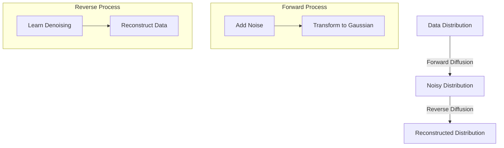

# Lesson 1: Introduction to Diffusion Models

## 1. First-Principles Intuition & Invariants

Diffusion models represent a powerful class of generative models in the realm of artificial intelligence, particularly within the domain of generative AI. At their core, diffusion models operate by gradually transforming a simple probability distribution, such as a standard Gaussian, into a complex data distribution through a series of small, controlled perturbations. This transformation is achieved through a forward diffusion process, which systematically adds noise to the data, and a reverse diffusion process, which seeks to remove this noise to reconstruct the original data distribution.

The theoretical grounding of diffusion models is deeply rooted in the principles of stochastic processes and partial differential equations. The forward diffusion process can be mathematically described by a Markov chain, where each step in the chain corresponds to the addition of noise to the data. This noise is typically modeled as a Gaussian distribution, and the forward process can be expressed as a sequence of conditional probability distributions:

\[ q(x_t | x_{t-1}) = \mathcal{N}(x_t; \sqrt{1 - \beta_t} x_{t-1}, \beta_t I) \]

Here, \( x_t \) represents the data at time step \( t \), \( x_{t-1} \) is the data at the previous time step, \( \beta_t \) is a variance schedule that controls the amount of noise added at each step, and \( I \) is the identity matrix. The reverse diffusion process, on the other hand, involves learning a series of conditional probability distributions that allow the model to denoise the data and reconstruct the original distribution:

\[ p_\theta(x_{t-1} | x_t) \approx \mathcal{N}(x_{t-1}; \mu_\theta(x_t, t), \Sigma_\theta(x_t, t)) \]

In this equation, \( \mu_\theta(x_t, t) \) and \( \Sigma_\theta(x_t, t) \) are parameterized by a neural network, which learns to predict the mean and variance of the denoised data given the noisy data and the current time step. The parameter \( \theta \) represents the weights of the neural network.

The invariants of diffusion models lie in their ability to systematically explore the data distribution by adding and removing noise. The forward process ensures that the data is transformed into a simple Gaussian distribution, while the reverse process reconstructs the original data distribution by learning to reverse the noise addition process. This duality between noise addition and denoising is a fundamental invariant that underpins the effectiveness of diffusion models in generative tasks.

## 2. Core Architecture & Mechanics

The architecture of diffusion models is intricately designed to balance the forward and reverse processes. At the heart of the model is a neural network that learns to predict the mean and variance of the denoised data at each time step. This neural network is trained using a maximum likelihood objective, which seeks to minimize the difference between the true conditional distribution and the learned distribution.

To illustrate the core mechanics of diffusion models, consider the following diagram:

In this diagram, the forward diffusion process transforms the original data distribution into a noisy distribution by adding Gaussian noise at each time step. The reverse diffusion process then learns to denoise the data by predicting the mean and variance of the denoised data at each time step. This process is repeated iteratively until the noisy distribution is transformed back into the original data distribution.

The neural network used in the reverse diffusion process is typically a deep convolutional neural network (CNN) or a transformer, depending on the specific application. The network is trained using a maximum likelihood objective, which seeks to minimize the difference between the true conditional distribution and the learned distribution. The training process involves optimizing the weights of the neural network using gradient descent and backpropagation.

## 3. High-Performance Optimization & Failure Modes

Optimizing diffusion models for high performance involves several key considerations, including the choice of neural network architecture, the variance schedule, and the training objective. The neural network architecture should be chosen based on the specific application and the complexity of the data distribution. For example, CNNs are well-suited for image data, while transformers are more effective for sequential data.

The variance schedule is a critical component of the forward diffusion process, as it controls the amount of noise added at each time step. A well-designed variance schedule can significantly improve the performance of diffusion models by ensuring that the noise is added in a controlled and systematic manner. The training objective should also be carefully chosen to ensure that the model learns to denoise the data effectively. Common training objectives include the maximum likelihood objective and the variational lower bound objective.

Concurrency and resource scaling are also important considerations when optimizing diffusion models. Training diffusion models can be computationally intensive, and efficient use of hardware resources is essential for achieving high performance. Techniques such as data parallelism and model parallelism can be used to distribute the training workload across multiple GPUs or TPUs. Additionally, efficient memory management and caching strategies can help to reduce the memory footprint and improve the training speed.

Failure modes in diffusion models can arise from a variety of sources, including poor model design, inadequate training data, and suboptimal hyperparameters. One common failure mode is overfitting, where the model learns to memorize the training data rather than generalizing to new data. To mitigate this risk, techniques such as data augmentation, regularization, and dropout can be used. Another common failure mode is underfitting, where the model is too simple to capture the complexity of the data distribution. To address this issue, more complex neural network architectures and larger training datasets can be used.

In conclusion, diffusion models represent a powerful and flexible class of generative models that are well-suited for a wide range of applications in artificial intelligence. By systematically exploring the data distribution through a forward diffusion process and learning to denoise the data through a reverse diffusion process, diffusion models can generate high-quality samples that are indistinguishable from real data. Through careful optimization and design, diffusion models can achieve high performance and robustness, making them a valuable tool in the generative AI toolkit.
