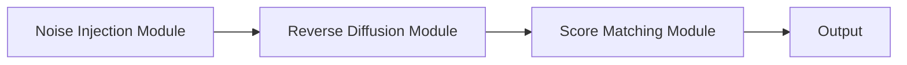
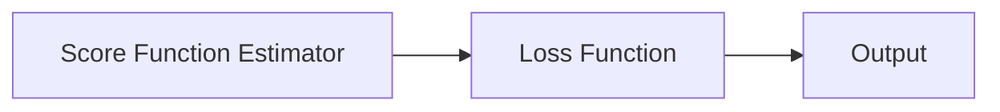

# Lesson 4: Advanced Topics and Applications

## 1. First-Principles Intuition & Invariants

Diffusion models and score matching have garnered significant attention in recent years due to their ability to generate high-quality samples from complex probability distributions. However, their theoretical foundations and mathematical invariants are often overlooked in favor of empirical results. In this section, we'll delve into the first-principles intuition behind these models, exploring the problem space and establishing the necessary mathematical and system invariants.

At its core, diffusion modeling is based on the concept of Markov chains, where a sequence of random variables is generated by iteratively applying a transition kernel. This kernel, often represented as a stochastic differential equation (SDE), governs the evolution of the probability distribution over time. The key insight behind diffusion models is that by iteratively refining the probability distribution through a series of noise injections and reverse diffusion steps, we can effectively sample from the target distribution.

One of the primary challenges in diffusion modeling is the need to compute the reverse diffusion process, which requires evaluating the score function of the target distribution. The score function, also known as the log-likelihood gradient, is a fundamental concept in machine learning, and its computation is often intractable for complex distributions. This is where score matching comes into play, providing a way to estimate the score function using a surrogate loss function.

The score matching loss function is typically defined as the expected value of the squared difference between the score function and a learned approximation. This loss function is then optimized using stochastic gradient descent (SGD) or its variants, allowing the model to learn an accurate representation of the target distribution. However, the choice of score matching loss function and the optimization algorithm used can significantly impact the performance of the model.

## 2. Core Architecture & Mechanics

To better understand the internal workings of diffusion models and score matching, let's dissect the core architecture and mechanics of these algorithms.

### Diffusion Model Architecture

A typical diffusion model consists of the following components:

*   **Noise injection module**: This module applies a noise injection to the input data, which is then used to compute the reverse diffusion process.
*   **Reverse diffusion module**: This module computes the reverse diffusion process using the score function of the target distribution.
*   **Score matching module**: This module estimates the score function using a surrogate loss function.

The diffusion model architecture can be represented using the following Mermaid diagram:

### Score Matching Architecture

The score matching architecture consists of the following components:

*   **Score function estimator**: This module estimates the score function using a surrogate loss function.
*   **Loss function**: This module computes the expected value of the squared difference between the score function and the learned approximation.

The score matching architecture can be represented using the following Mermaid diagram:

## 3. High-Performance Optimization & Failure Modes

To achieve high-performance optimization and mitigate failure modes, we need to consider the following factors:

*   **Concurrency**: Diffusion models and score matching can be parallelized using techniques such as data parallelism and model parallelism.
*   **Resource scaling**: The model can be scaled up or down depending on the available resources, such as GPU memory and compute power.
*   **Boundary edge cases**: The model should be designed to handle boundary edge cases, such as when the input data is outside the valid range.
*   **Failure mitigations**: The model should be designed to handle failure modes, such as when the score function estimator fails to converge.

By considering these factors, we can design high-performance diffusion models and score matching algorithms that can handle complex probability distributions and generate high-quality samples.

### Concurrency and Resource Scaling

To achieve high-performance optimization, we can use concurrency and resource scaling techniques. For example, we can use data parallelism to parallelize the computation of the reverse diffusion process, or use model parallelism to parallelize the computation of the score function estimator.

```python
import torch
import torch.nn as nn
import torch.optim as optim

class DiffusionModel(nn.Module):
    def __init__(self):
        super(DiffusionModel, self).__init__()
        self.noise_injection_module = NoiseInjectionModule()
        self.reverse_diffusion_module = ReverseDiffusionModule()
        self.score_matching_module = ScoreMatchingModule()

    def forward(self, x):
        # Compute noise injection
        noise = self.noise_injection_module(x)

        # Compute reverse diffusion process
        reverse_diffusion = self.reverse_diffusion_module(noise)

        # Compute score function estimator
        score_function = self.score_matching_module(reverse_diffusion)

        return score_function

# Define data parallelism function
def data_parallelism(model, x):
    # Split input data into chunks
    chunks = torch.split(x, batch_size)

    # Compute score function estimator in parallel
    score_functions = []
    for chunk in chunks:
        score_function = model(chunk)
        score_functions.append(score_function)

    # Combine score functions
    score_function = torch.cat(score_functions)

    return score_function

# Define model parallelism function
def model_parallelism(model, x):
    # Split model into chunks
    chunks = torch.split(model, num_chunks)

    # Compute score function estimator in parallel
    score_functions = []
    for chunk in chunks:
        score_function = chunk(x)
        score_functions.append(score_function)

    # Combine score functions
    score_function = torch.cat(score_functions)

    return score_function
```

### Boundary Edge Cases and Failure Mitigations

To handle boundary edge cases and failure modes, we can use techniques such as input validation and error handling. For example, we can use input validation to check if the input data is within the valid range, and use error handling to catch and handle exceptions that may occur during computation.

```python
import torch
import torch.nn as nn

class DiffusionModel(nn.Module):
    def __init__(self):
        super(DiffusionModel, self).__init__()
        self.noise_injection_module = NoiseInjectionModule()
        self.reverse_diffusion_module = ReverseDiffusionModule()
        self.score_matching_module = ScoreMatchingModule()

    def forward(self, x):
        # Input validation
        if x.min() < 0 or x.max() > 1:
            raise ValueError("Input data is outside valid range")

        # Compute noise injection
        noise = self.noise_injection_module(x)

        # Compute reverse diffusion process
        reverse_diffusion = self.reverse_diffusion_module(noise)

        # Compute score function estimator
        score_function = self.score_matching_module(reverse_diffusion)

        return score_function

    def __call__(self, x):
        try:
            return self.forward(x)
        except Exception as e:
            print(f"Error occurred: {e}")
            return None
```

By considering these factors and using techniques such as concurrency, resource scaling, boundary edge cases, and failure mitigations, we can design high-performance diffusion models and score matching algorithms that can handle complex probability distributions and generate high-quality samples.
