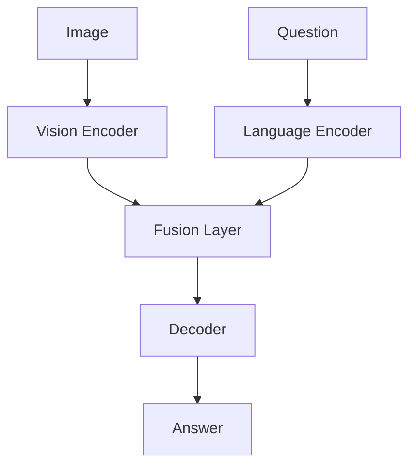

# Lesson 1: Overview of Multimodal Architectures

## 1. First-Principles Intuition & Invariants

In the realm of artificial intelligence, the integration of multiple modalities—such as vision and language—represents a profound leap forward in the capabilities of generative models. Multimodal architectures are designed to process and understand information from diverse sources, enabling machines to perform tasks that require a holistic understanding of the world. This integration is not merely additive; it is synergistic, allowing models to leverage the strengths of each modality to enhance overall performance and robustness.

At the heart of multimodal systems lies the challenge of aligning and fusing data from different domains. Vision, for instance, provides spatial and temporal information, while language offers semantic and contextual insights. The problem space is inherently complex, as it requires the model to not only understand each modality individually but also to comprehend how they interrelate. This intermodal alignment is crucial for tasks such as image captioning, visual question answering, and multimodal dialogue systems.

From a theoretical standpoint, multimodal architectures must adhere to several invariants. First, they must ensure that the fusion of modalities is both meaningful and efficient. This involves developing mechanisms that can capture the intricate relationships between different data types without overwhelming computational resources. Second, the models must be robust to variations in input data, such as changes in lighting, occlusions, or linguistic nuances. Third, they must maintain a high degree of interpretability, allowing developers and users to understand how decisions are made.

Mathematically, multimodal systems can be framed as a problem of joint probability estimation. Given a set of modalities \( M = \{m_1, m_2, \ldots, m_n\} \), the goal is to estimate the joint probability distribution \( P(M) \). This distribution encapsulates the dependencies and interactions between the different modalities, enabling the model to generate coherent and contextually relevant outputs. The challenge lies in accurately modeling this distribution, especially when the modalities are heterogeneous and complex.

## 2. Core Architecture & Mechanics

The architecture of a multimodal system is intricately designed to handle the integration and processing of multiple data types. At a high level, such a system can be divided into several key components: modality-specific encoders, a fusion layer, and a decoder. Each component plays a critical role in the overall functionality of the system.

### Modality-Specific Encoders

The first step in a multimodal system is to encode the input data from each modality into a common representation. This is achieved through modality-specific encoders, which are specialized neural networks tailored to process and extract features from each type of data. For vision, this typically involves convolutional neural networks (CNNs) that can capture spatial hierarchies and patterns in images. For language, recurrent neural networks (RNNs) or transformers are commonly used to model sequential data and capture semantic relationships.

For example, consider a multimodal system designed to perform image captioning. The vision encoder would take an image as input and produce a high-dimensional feature vector that captures the visual content. This feature vector is then passed to the fusion layer, where it is combined with the output of the language encoder.

### Fusion Layer

The fusion layer is responsible for integrating the encoded features from different modalities into a unified representation. This integration can be performed in various ways, depending on the specific architecture and the nature of the task. Common fusion strategies include early fusion, late fusion, and hybrid fusion.

- **Early Fusion:** In early fusion, the features from different modalities are combined at an early stage, often by concatenating them into a single vector. This approach is straightforward but can be limited in its ability to capture complex intermodal relationships.
  
- **Late Fusion:** Late fusion involves processing each modality independently and then combining the results at a later stage. This approach allows each modality to be processed using its most suitable model, but it can be less effective in capturing intermodal dependencies.

- **Hybrid Fusion:** Hybrid fusion combines elements of both early and late fusion, allowing for more flexible and powerful integration. For example, a hybrid fusion architecture might use early fusion to capture low-level features and late fusion to model high-level semantics.

### Decoder

The final component of a multimodal system is the decoder, which generates the output based on the fused representation. The decoder can take various forms, depending on the task. For image captioning, the decoder might be a language model that generates a sequence of words describing the image. For visual question answering, the decoder could be a classifier that predicts the answer to a given question.

To illustrate the mechanics of a multimodal system, consider the following simplified example. Suppose we have a multimodal system for visual question answering, which takes an image and a question as input and produces an answer. The system would consist of the following components:

- **Vision Encoder:** A CNN that processes the image and extracts visual features.
- **Language Encoder:** A transformer that processes the question and extracts linguistic features.
- **Fusion Layer:** A hybrid fusion module that combines the visual and linguistic features.
- **Decoder:** A classifier that predicts the answer based on the fused representation.

The following Mermaid diagram provides a visual representation of this architecture:

In this diagram, the vision encoder processes the image and the language encoder processes the question. The fusion layer combines the outputs of the two encoders, and the decoder generates the final answer.

## 3. High-Performance Optimization & Failure Modes

To ensure that multimodal systems perform efficiently and reliably, several optimization techniques and failure modes must be considered.

### Concurrency

Multimodal systems often involve processing large amounts of data from multiple sources simultaneously. To handle this, concurrency is a critical aspect of the architecture. This can be achieved through parallel processing, where different components of the system are executed concurrently on multiple processors or GPUs. For example, the vision and language encoders can be processed in parallel, and the fusion and decoding stages can be optimized for parallel execution.

### Resource Scaling

As the complexity of multimodal systems increases, so does the demand for computational resources. To ensure scalability, the architecture must be designed to efficiently utilize available resources. This can be achieved through techniques such as model pruning, quantization, and distributed training. Model pruning involves removing unnecessary weights and layers from the neural networks, reducing the computational load. Quantization reduces the precision of the model parameters, further decreasing resource usage. Distributed training allows the model to be trained across multiple machines, enabling faster convergence and handling of larger datasets.

### Boundary Edge Cases

Multimodal systems must be robust to a wide range of input data, including edge cases and variations. For example, an image captioning system should be able to generate accurate captions even when the image contains occlusions or unusual lighting conditions. Similarly, a visual question answering system should be able to handle questions with ambiguous or incomplete information. To address these challenges, the architecture must incorporate mechanisms for handling edge cases, such as data augmentation, robust feature extraction, and error correction.

### Failure Mitigations

Despite careful design and optimization, multimodal systems can still encounter failures. These failures can arise from various sources, such as data corruption, model overfitting, or hardware malfunctions. To mitigate these risks, the architecture should include mechanisms for error detection and recovery. For example, data validation and preprocessing can help ensure that the input data is clean and consistent. Regular model evaluation and validation can help detect overfitting and other issues. Additionally, redundancy and failover mechanisms can be implemented to ensure that the system remains operational even in the event of hardware failures.

In conclusion, multimodal architectures represent a powerful and versatile approach to building intelligent systems that can process and understand information from multiple sources. By integrating vision and language, these systems can perform tasks that require a holistic understanding of the world. The architecture of a multimodal system involves modality-specific encoders, a fusion layer, and a decoder, each designed to handle the unique challenges of processing and integrating different types of data. Through careful optimization and robust design, multimodal systems can achieve high performance and reliability, paving the way for a wide range of applications in artificial intelligence and beyond.
