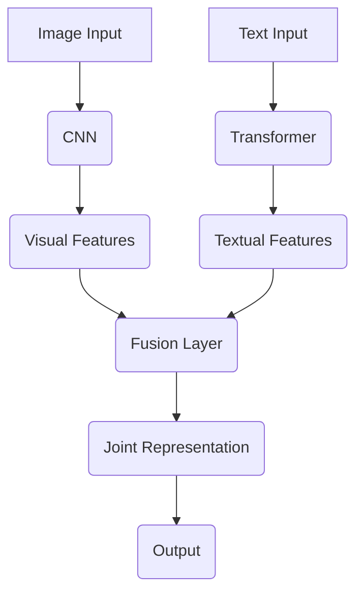

# Lesson 6: Applications and Future Directions

## 1. First-Principles Intuition & Invariants

Multimodal vision language models represent a paradigm shift in the intersection of computer vision and natural language processing. These models are designed to understand and generate content that seamlessly integrates visual and textual information, enabling a wide array of applications that were previously out of reach. At their core, multimodal models leverage deep learning architectures, particularly transformer-based models, to process and generate data from multiple modalities—most commonly images and text. The theoretical grounding of these models is rooted in the ability to learn joint representations that capture the intricate relationships between visual and textual data.

The problem space addressed by multimodal vision language models is vast and multifaceted. Traditionally, computer vision and natural language processing have been treated as separate domains, each with its own set of challenges and methodologies. However, real-world scenarios often require the integration of both modalities to achieve meaningful insights and interactions. For instance, understanding the context of an image requires not only recognizing objects and scenes but also interpreting the accompanying text, which might provide additional context or instructions. Similarly, generating descriptive text about an image necessitates a deep understanding of both the visual content and the linguistic nuances required to convey that content accurately.

Mathematically, multimodal models are built upon the principles of deep learning, specifically leveraging transformer architectures that have proven highly effective in handling sequential data. The transformer model, introduced by Vaswani et al. in 2017, revolutionized the field of natural language processing by providing a parallelizable architecture that could efficiently handle long-range dependencies in text. This architecture has since been adapted and extended to handle multimodal data, enabling models to learn joint representations that capture the complex interactions between different modalities.

The invariants that govern multimodal vision language models include the ability to handle large-scale datasets, the need for robust feature extraction mechanisms, and the requirement for effective fusion strategies that can integrate information from multiple modalities. These invariants are critical for ensuring that the models can generalize well to a wide range of applications and can handle the diverse and complex nature of real-world data.

## 2. Core Architecture & Mechanics

The core architecture of multimodal vision language models is built upon a combination of convolutional neural networks (CNNs) for visual feature extraction and transformer-based models for language processing. The CNNs are responsible for extracting high-level visual features from images, while the transformers handle the processing and generation of text. The integration of these two components is achieved through a fusion layer that combines the visual and textual features into a unified representation.

To illustrate the architecture, consider a simplified version of a multimodal vision language model. The model consists of three main components: a CNN for visual feature extraction, a transformer for language processing, and a fusion layer that integrates the two modalities.

In this architecture, the CNN processes the image input to extract visual features. These features are then passed to the fusion layer, which also receives textual features from the transformer. The fusion layer combines these features into a joint representation that captures the interactions between the visual and textual modalities. This joint representation is then used to generate the final output, which could be a description of the image, a question about the image, or any other form of multimodal interaction.

The fusion layer is a critical component of the architecture, as it determines how the visual and textual features are integrated. There are several strategies for fusion, including early fusion, late fusion, and hybrid fusion. Early fusion combines the features at a low level, while late fusion combines them at a high level. Hybrid fusion combines elements of both early and late fusion, allowing for more flexible and effective integration.

The transformer model used for language processing is based on the transformer architecture, which consists of a series of self-attention layers and feedforward neural networks. The self-attention mechanism allows the model to weigh the importance of different parts of the input sequence, enabling it to capture long-range dependencies. The feedforward neural networks are used to process the weighted inputs and generate the final output.

## 3. High-Performance Optimization & Failure Modes

High-performance optimization of multimodal vision language models is critical for ensuring that they can handle large-scale datasets and real-time applications. One of the key challenges in optimizing these models is the need to balance the computational demands of the CNN and transformer components. The CNNs are computationally intensive, particularly when processing high-resolution images, while the transformers require significant memory and computational resources to handle long sequences of text.

To optimize the performance of multimodal vision language models, several strategies can be employed. One approach is to use model parallelism, which involves distributing the model across multiple GPUs or other accelerators. This allows the model to process different parts of the input in parallel, reducing the overall processing time. Another approach is to use quantization, which involves reducing the precision of the model parameters to reduce memory usage and improve computational efficiency.

Concurrency is another critical aspect of high-performance optimization. Multimodal vision language models often need to handle multiple inputs simultaneously, particularly in real-time applications. To achieve concurrency, the model can be designed to process multiple inputs in parallel using techniques such as batch processing. This involves processing multiple inputs at once, which can significantly improve throughput and reduce latency.

Resource scaling is also an important consideration for high-performance optimization. As the size of the dataset and the complexity of the model increase, the computational and memory requirements also increase. To handle this, the model can be designed to scale horizontally by adding more resources, such as additional GPUs or memory, as needed. This allows the model to handle larger datasets and more complex tasks without sacrificing performance.

Boundary edge cases and failure modes are also critical considerations for multimodal vision language models. These models need to be robust to a wide range of inputs and be able to handle unexpected or malformed data. One common failure mode is the presence of noise or artifacts in the image input, which can lead to incorrect feature extraction. To mitigate this, the model can be designed to include noise reduction techniques, such as filtering or denoising, to improve the quality of the visual features.

Another failure mode is the presence of ambiguous or inconsistent text input, which can lead to incorrect language processing. To mitigate this, the model can be designed to include mechanisms for handling ambiguity, such as using context-aware embeddings or incorporating external knowledge sources. This allows the model to generate more accurate and consistent outputs, even in the presence of ambiguous or inconsistent inputs.

In conclusion, multimodal vision language models represent a powerful and versatile tool for integrating visual and textual data. By leveraging deep learning architectures, these models can handle a wide range of applications, from image captioning and visual question answering to image generation and multimodal dialogue. However, to achieve high performance and robustness, these models need to be carefully optimized and designed to handle a wide range of inputs and failure modes. As research in this field continues to advance, we can expect to see even more powerful and versatile multimodal models that can handle an even wider range of applications.
