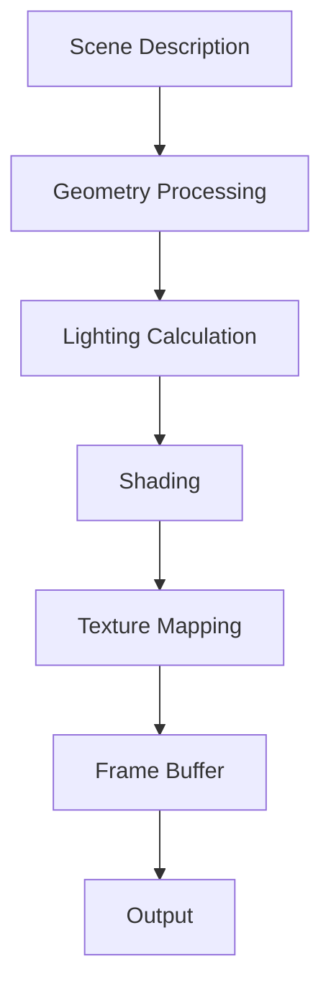

# Lesson 1: Overview of Audio and Video Generation

## 1. First-Principles Intuition & Invariants

Audio and video generation stand at the intersection of digital signal processing, computer graphics, and machine learning, representing a rich tapestry of technologies that have evolved to meet the demands of modern multimedia applications. At its core, audio generation involves the creation of sound waves, which are represented as digital signals, while video generation entails the synthesis of visual frames that are displayed in rapid succession to create the illusion of motion. Both domains leverage mathematical and computational principles to transform raw data into perceptually meaningful content.

The problem space of audio and video generation is vast and multifaceted. In audio, the challenge lies in accurately representing the nuances of sound, including pitch, timbre, and dynamics, while ensuring that the generated audio is both natural-sounding and computationally efficient. Video generation, on the other hand, requires the synthesis of complex visual scenes, complete with lighting, texture, and motion, all within the constraints of real-time performance. The mathematical invariants that underpin these domains include the Nyquist-Shannon sampling theorem, which dictates the minimum sampling rate required to accurately represent a signal without aliasing, and the principles of human perception, which guide the design of algorithms that produce content that is visually and aurally pleasing.

From a systems perspective, audio and video generation are constrained by the limitations of hardware and software. The computational resources required to generate high-fidelity audio and video are significant, and optimizing for performance while maintaining quality is a central challenge. This involves not only efficient data structures and algorithms but also the judicious use of parallelism and concurrency to leverage the capabilities of modern processors and GPUs.

## 2. Core Architecture & Mechanics

The architecture of audio and video generation systems is deeply intertwined with the underlying data structures and algorithms that enable the synthesis of content. In audio generation, the fundamental unit of data is the sample, which represents the amplitude of a sound wave at a specific point in time. These samples are typically organized into frames, which are processed in batches to produce the final audio output. The core algorithms in audio generation include digital signal processing techniques such as filtering, modulation, and synthesis, which are used to manipulate and combine audio signals to create complex sounds.

Video generation, by contrast, involves the synthesis of visual frames, each of which is composed of a grid of pixels. The data structures used in video generation include textures, which represent the color and intensity of individual pixels, and meshes, which define the geometry of objects in the scene. The core algorithms in video generation include rendering techniques such as ray tracing and rasterization, which are used to simulate the interaction of light with objects in the scene, and animation algorithms, which are used to create the illusion of motion.

To illustrate the architecture of a video generation system, consider the following simplified diagram:

In this diagram, the scene description is a high-level representation of the objects and lighting in the scene. This description is processed by the geometry processing stage, which calculates the position and orientation of each object in the scene. The lighting calculation stage then determines the intensity and direction of light sources, while the shading stage applies these lighting calculations to the objects in the scene. The texture mapping stage applies textures to the objects, and the final frame buffer is used to store the rendered image, which is then output to the display.

## 3. High-Performance Optimization & Failure Modes

High-performance optimization is a critical aspect of audio and video generation systems, as the computational demands of these applications can be significant. In audio generation, optimization techniques include the use of efficient data structures such as circular buffers, which enable the efficient processing of audio samples in real-time. Additionally, the use of parallel processing techniques, such as multi-threading and SIMD (Single Instruction, Multiple Data) instructions, can significantly improve the performance of audio generation algorithms.

In video generation, optimization techniques include the use of hardware acceleration, such as GPUs, to perform rendering and shading operations in parallel. Additionally, the use of efficient data structures such as octrees and bounding volume hierarchies can improve the performance of geometry processing algorithms by reducing the number of calculations required to render a scene.

Failure modes in audio and video generation systems can arise from a variety of sources, including hardware limitations, software bugs, and algorithmic inefficiencies. One common failure mode in audio generation is the introduction of artifacts, such as clicks or pops, which can occur when audio samples are processed incorrectly. In video generation, failure modes can include visual artifacts, such as flickering or tearing, which can occur when rendering operations are not synchronized with the display refresh rate. To mitigate these failure modes, it is essential to carefully design and test audio and video generation systems, using techniques such as unit testing, performance profiling, and stress testing to identify and resolve issues.

In conclusion, audio and video generation are complex and challenging domains that require a deep understanding of mathematical and computational principles. By leveraging efficient data structures, algorithms, and hardware acceleration, it is possible to create high-fidelity audio and video content that meets the demands of modern multimedia applications. However, achieving high performance and reliability requires careful design and optimization, as well as a thorough understanding of the underlying systems and technologies.
