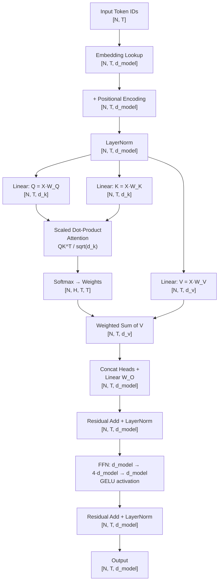
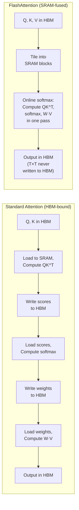
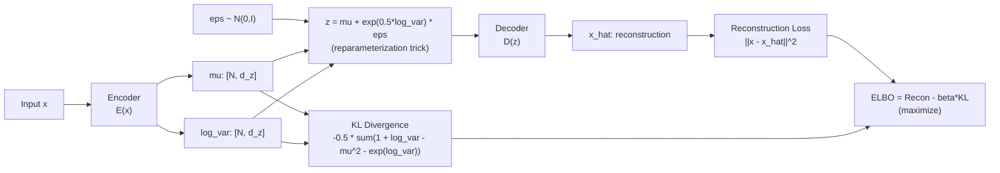
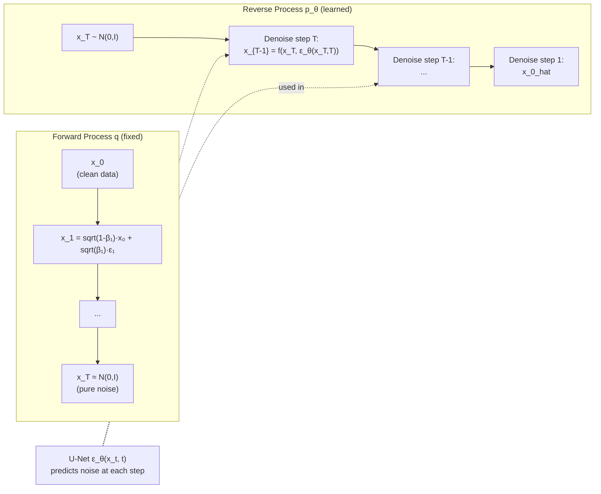
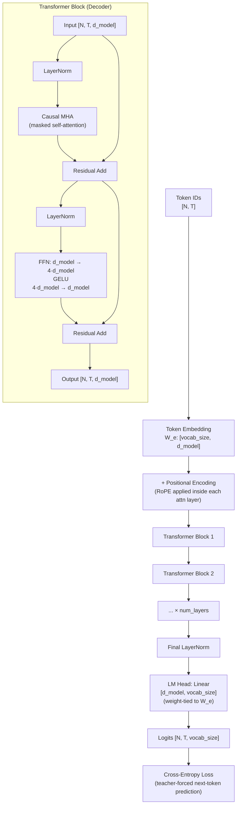
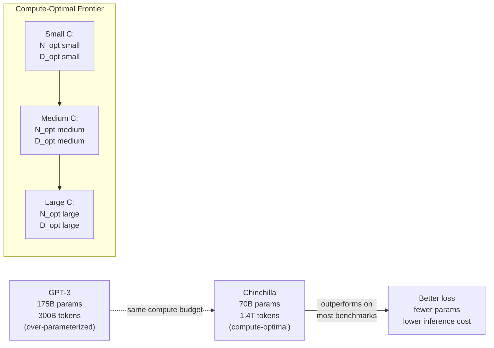

# Lesson 2: Core Architecture & Algorithmic Mechanics

## 1. Tensor Transformations & Dimensional Flows

A tensor is an n-dimensional array equipped with transformation rules under change of basis. The 0th-order tensor (scalar), 1st-order (vector), and 2nd-order (matrix) are special cases; in deep learning, 3rd- and 4th-order tensors are the standard currency. A batch of RGB images is a rank-4 tensor with shape `[N, C, H, W]` — batch size, channels, height, width — and every operation in the forward pass is a precisely defined contraction over one or more of those axes.

### 1.1 Matrix Multiplication as Tensor Contraction

The fundamental layer operation `y = Wx + b` is an affine map. For a weight matrix `W` of shape `[d_out, d_in]` and input `x` of shape `[d_in]`, the product contracts over the shared `d_in` axis, producing `y` of shape `[d_out]`. Batching promotes this to a matrix-matrix product: `Y = X @ W.T + b`, where `X` has shape `[N, d_in]` and `Y` has shape `[N, d_out]`.

The generalization to arbitrary tensor contractions is Einstein summation notation. NumPy and PyTorch expose this directly via `einsum`:

```python
import torch

# Batched matrix multiply: Y[b, i, k] = sum_j X[b, i, j] * W[j, k]
X = torch.randn(32, 64, 128)   # [batch, seq_len, d_in]
W = torch.randn(128, 256)       # [d_in, d_out]
Y = torch.einsum("bij,jk->bik", X, W)  # [batch, seq_len, d_out]

# Outer product: no summation axis
a = torch.randn(4)
b = torch.randn(5)
outer = torch.einsum("i,j->ij", a, b)  # [4, 5]

# Trace of a batched matrix
M = torch.randn(32, 8, 8)
trace = torch.einsum("bii->b", M)       # [32]
```

Einstein summation makes the contraction axes explicit. Any dimension appearing on both the left and right of the `->` separator is preserved; any dimension appearing only on the left is summed (contracted) away. This notation directly maps onto hardware-level GEMM (General Matrix-Matrix Multiply) kernels in cuBLAS and oneDNN, which exploit SIMD and tensor-core units to execute these contractions at peak throughput.

### 1.2 Convolutional Layers: Shared-Weight Tensor Contractions

A 2D convolution is not a general tensor contraction — it is a *structured* one that enforces weight sharing across spatial positions. Given input `X` of shape `[N, C_in, H, W]` and a filter bank `K` of shape `[C_out, C_in, kH, kW]`, the output at position `(n, c_out, h, w)` is:

```
Y[n, c_out, h, w] = sum_{c_in, kh, kw} X[n, c_in, h*s + kh, w*s + kw] * K[c_out, c_in, kh, kw] + b[c_out]
```

where `s` is the stride. The critical insight is that `K` is reused at every spatial location `(h, w)` — this is the inductive bias that makes CNNs translation-equivariant and dramatically reduces the parameter count relative to a fully connected layer operating on the same input.

The im2col transformation converts this structured contraction into a dense GEMM: each receptive field patch is unrolled into a row of a matrix, the filter bank is reshaped into a column matrix, and a single matrix multiply produces all outputs. Modern implementations (cuDNN, XNNPACK) use more sophisticated algorithms — Winograd's minimal filtering algorithm reduces arithmetic by roughly 2.25× for 3×3 kernels at the cost of additional memory traffic.

```python
import torch
import torch.nn as nn
import torch.nn.functional as F

class ResidualConvBlock(nn.Module):
    """
    A proper residual block: two 3x3 convolutions with batch normalization
    and a projection shortcut when spatial dimensions or channel count change.
    Uses pre-activation (BN -> ReLU -> Conv) per He et al. (2016).
    """
    def __init__(
        self,
        in_channels: int,
        out_channels: int,
        stride: int = 1,
    ) -> None:
        super().__init__()
        self.bn1   = nn.BatchNorm2d(in_channels)
        self.conv1 = nn.Conv2d(
            in_channels, out_channels,
            kernel_size=3, stride=stride, padding=1, bias=False
        )
        self.bn2   = nn.BatchNorm2d(out_channels)
        self.conv2 = nn.Conv2d(
            out_channels, out_channels,
            kernel_size=3, stride=1, padding=1, bias=False
        )
        # Projection shortcut matches dimensions when they diverge
        self.shortcut: nn.Module
        if stride != 1 or in_channels != out_channels:
            self.shortcut = nn.Sequential(
                nn.Conv2d(
                    in_channels, out_channels,
                    kernel_size=1, stride=stride, bias=False
                ),
                nn.BatchNorm2d(out_channels),
            )
        else:
            self.shortcut = nn.Identity()

    def forward(self, x: torch.Tensor) -> torch.Tensor:
        identity = self.shortcut(x)
        out = self.conv1(F.relu(self.bn1(x)))
        out = self.conv2(F.relu(self.bn2(out)))
        return out + identity   # residual addition, not concatenation
```

### 1.3 Dimensional Flow Through a Transformer Encoder

The transformer does not use convolution. Its dimensional flow is entirely driven by matrix multiplications over the sequence axis. The following diagram traces one input token's journey through a single encoder layer.



Every box preserves the batch `N` and sequence `T` dimensions. Only the feature dimension `d_model` is projected. This is a deliberate architectural choice: the residual stream maintains a fixed-width vector space of dimension `d_model` throughout all layers, and each sub-layer (attention, FFN) contributes an *additive update* to that stream. The gradient can therefore flow directly from the output loss to any early layer's parameters with no multiplicative bottleneck — this is why residual connections are inseparable from the transformer's trainability, not merely a performance enhancement.

---

## 2. Loss Surfaces, Gradients & Optimization Dynamics

### 2.1 The Geometry of Loss Surfaces

Training a neural network minimizes a function `L: R^p -> R`, where `p` is the total parameter count (billions for large language models). The loss surface is a hypersurface in `(p+1)`-dimensional space. Directly analyzing it is computationally intractable, but its local geometry near any point `theta` can be characterized by the first and second derivatives.

The gradient `g = grad_theta L` is a vector in `R^p` pointing in the direction of steepest ascent. Its magnitude indicates how far the current parameters are from a critical point (where `g = 0`). The Hessian `H = d²L/d(theta)²` is the `[p, p]` matrix of second partial derivatives. Its eigenvalue spectrum reveals the curvature structure:

- Positive eigenvalues: directions of upward curvature (the loss increases if you move along these eigenvectors). A local minimum has all positive eigenvalues.
- Negative eigenvalues: directions of downward curvature (saddle directions).
- Near-zero eigenvalues: flat directions where the loss is insensitive to parameter perturbations.

For large models, the Hessian spectrum has a characteristic shape: a dense bulk of near-zero eigenvalues (most directions are nearly flat) and a small number of large outlier eigenvalues corresponding to directions along which the loss is sharply curved. This structure motivates adaptive optimizers that rescale the gradient per-coordinate to compensate for the varying curvature.

### 2.2 Backpropagation: The Chain Rule Unrolled

Backpropagation is the application of the chain rule to a computational graph. For a scalar loss `L` and a parameter `w_ij` buried deep in the graph, the chain rule gives:

```
dL/dw_ij = sum_{paths from w_ij to L} (product of local Jacobians along path)
```

In a neural network with layers `f_1, f_2, ..., f_n`, the total Jacobian of `L` with respect to `x_0` (the input) is the matrix product of all layer Jacobians:

```
dL/dx_0 = (df_n/dx_{n-1}) * (df_{n-1}/dx_{n-2}) * ... * (df_1/dx_0) * (dL/dx_n)
```

Automatic differentiation engines (PyTorch's Autograd, JAX's `grad`) implement this in reverse mode: they execute the forward pass while recording operations in a dynamic computation graph (a "tape"), then replay that tape in reverse to accumulate gradients. This is efficient because the memory cost is proportional to the network depth, not the width.

The vanishing gradient problem arises when these Jacobian products repeatedly multiply values less than one, causing `dL/dx_0` to shrink exponentially with depth. The exploding gradient problem is the symmetric case. Residual connections address the vanishing case by adding an identity path that carries gradient directly; gradient clipping addresses the exploding case by rescaling `g` when `||g|| > threshold`.

```python
import torch
import torch.nn as nn
from torch.optim import AdamW
from torch.optim.lr_scheduler import CosineAnnealingLR
from typing import Iterator

def train_one_epoch(
    model: nn.Module,
    loader: torch.utils.data.DataLoader,
    optimizer: AdamW,
    scheduler: CosineAnnealingLR,
    grad_clip_norm: float = 1.0,
    device: torch.device = torch.device("cuda"),
) -> float:
    """
    One epoch of training with gradient clipping and mixed precision.
    Returns mean loss over all batches.
    """
    model.train()
    scaler = torch.cuda.amp.GradScaler()   # FP16 loss scaling
    total_loss = 0.0

    for step, (x, y) in enumerate(loader):
        x, y = x.to(device, non_blocking=True), y.to(device, non_blocking=True)
        optimizer.zero_grad(set_to_none=True)   # avoids zeroing; frees memory

        with torch.cuda.amp.autocast():          # forward in FP16
            logits = model(x)
            loss = nn.functional.cross_entropy(logits, y)

        scaler.scale(loss).backward()            # scaled backward pass

        # Unscale before clipping so clip threshold is in true gradient space
        scaler.unscale_(optimizer)
        torch.nn.utils.clip_grad_norm_(model.parameters(), grad_clip_norm)

        scaler.step(optimizer)
        scaler.update()
        scheduler.step()

        total_loss += loss.item()

    return total_loss / len(loader)
```

### 2.3 Adaptive Optimizers: AdamW and Its Mechanics

SGD with momentum maintains a single first-moment estimate of the gradient. Adam (Kingma & Ba, 2014) maintains both a first-moment estimate `m` (direction) and a second-moment estimate `v` (per-coordinate gradient variance), using them to compute an adaptive per-parameter learning rate:

```
m_t = beta1 * m_{t-1} + (1 - beta1) * g_t        # exponential moving average of gradient
v_t = beta2 * v_{t-1} + (1 - beta2) * g_t^2       # exponential moving average of squared gradient
m_hat = m_t / (1 - beta1^t)                        # bias-corrected first moment
v_hat = v_t / (1 - beta2^t)                        # bias-corrected second moment
theta_t = theta_{t-1} - lr * m_hat / (sqrt(v_hat) + epsilon)
```

The key insight: dividing by `sqrt(v_hat)` normalizes updates so that parameters with consistently large gradients receive smaller steps, and parameters with small gradients receive proportionally larger steps. This effectively approximates the inverse diagonal of the Hessian and partially compensates for anisotropic curvature.

**AdamW** (Loshchilov & Hutter, 2019) corrects a subtle but important error in Adam's original weight decay formulation. Standard Adam with L2 regularization adds `lambda * theta` to the gradient before the adaptive step, which causes the effective weight decay to be scaled by `1/sqrt(v_hat)` — meaning parameters with large gradients experience *less* regularization, the opposite of what is intended. AdamW decouples weight decay from the gradient update:

```
theta_t = theta_{t-1} - lr * m_hat / (sqrt(v_hat) + epsilon) - lr * lambda * theta_{t-1}
```

The weight decay term is now applied uniformly, independent of the gradient magnitude. For large transformer training, this distinction is non-trivial; AdamW consistently outperforms Adam with L2 regularization in practice.

### 2.4 GAN Training Dynamics: A Two-Player Minimax Game

The GAN objective function is:

```
min_G max_D E_{x~p_data}[log D(x)] + E_{z~p_z}[log(1 - D(G(z)))]
```

The discriminator `D` maximizes its ability to distinguish real data from generated samples. The generator `G` minimizes the discriminator's success. At the Nash equilibrium, `G` perfectly replicates the data distribution and `D` outputs 0.5 for all inputs — it cannot do better than random guessing.

The fundamental training instability of GANs arises from the fact that this minimax is solved by alternating gradient steps, not simultaneous optimization. If the discriminator trains to near-perfection before the generator has converged, the discriminator's loss saturates and its gradients vanish, giving `G` no learning signal. This is mode collapse at the optimization level — the generator finds a small region of output space where the discriminator is fooled and exploits it, failing to cover the full data distribution.

Wasserstein GAN (WGAN, Arjovsky et al., 2017) addresses this by replacing the Jensen-Shannon divergence implicit in the original loss with the Wasserstein-1 (Earth Mover's) distance, which is defined even when the generated and real distributions have non-overlapping support:

```
L_WGAN = E_{x~p_data}[D(x)] - E_{z~p_z}[D(G(z))]
```

The discriminator is now called a *critic* and is not constrained to `[0,1]`. To enforce the Lipschitz constraint required by the Wasserstein metric, WGAN-GP (Gulrajani et al., 2017) adds a gradient penalty:

```
L_GP = lambda * E_{x_hat}[(||grad_{x_hat} D(x_hat)||_2 - 1)^2]
```

where `x_hat` is sampled uniformly along straight lines between real and generated samples.

```python
import torch
import torch.nn as nn
import torch.nn.functional as F

def gradient_penalty(
    critic: nn.Module,
    real: torch.Tensor,
    fake: torch.Tensor,
    device: torch.device,
) -> torch.Tensor:
    """
    WGAN-GP gradient penalty (Gulrajani et al., 2017).
    Enforces the 1-Lipschitz constraint on the critic by penalizing
    gradient norms that deviate from 1 along interpolated samples.
    """
    batch_size = real.size(0)
    # Random interpolation coefficient, one per sample in the batch
    alpha = torch.rand(batch_size, 1, 1, 1, device=device)
    interpolated = alpha * real + (1.0 - alpha) * fake
    interpolated.requires_grad_(True)

    critic_out = critic(interpolated)

    gradients = torch.autograd.grad(
        outputs=critic_out,
        inputs=interpolated,
        grad_outputs=torch.ones_like(critic_out),
        create_graph=True,   # second-order: needed to differentiate through grad
        retain_graph=True,
    )[0]

    # Flatten each sample's gradient and compute its L2 norm
    gradients = gradients.view(batch_size, -1)
    gp = ((gradients.norm(2, dim=1) - 1.0) ** 2).mean()
    return gp


def wgan_gp_critic_loss(
    critic: nn.Module,
    real: torch.Tensor,
    fake: torch.Tensor,
    lambda_gp: float = 10.0,
    device: torch.device = torch.device("cuda"),
) -> torch.Tensor:
    """
    Full WGAN-GP critic loss: Wasserstein distance estimate minus GP.
    The critic is maximized, so we return the negated value as a loss.
    """
    w_dist = critic(real).mean() - critic(fake.detach()).mean()
    gp     = gradient_penalty(critic, real, fake.detach(), device)
    return -w_dist + lambda_gp * gp
```

---

## 3. Attention Mechanisms, Kernel Methods & Latent Geometry

### 3.1 Scaled Dot-Product Attention: Derivation from First Principles

Attention can be derived from a soft database lookup. Given a query vector `q`, a set of key vectors `{k_1, ..., k_T}`, and associated value vectors `{v_1, ..., v_T}`, the goal is to retrieve a weighted combination of values where the weights reflect the relevance of each key to the query.

The compatibility function (unnormalized weight) between `q` and `k_i` is their dot product `q · k_i`. Dot products grow in magnitude proportionally to `sqrt(d_k)` for random unit vectors in `d_k` dimensions because the variance of the sum of `d_k` products of independent unit normals is `d_k`. Without scaling, feeding large dot products into softmax pushes the output into the near-zero-gradient saturation regime. The scaling by `1/sqrt(d_k)` restores unit variance:

```
Attention(Q, K, V) = softmax(Q·K^T / sqrt(d_k)) · V
```

The softmax ensures the output is a convex combination of the values (weights sum to 1 and are non-negative). The argmax limit — as temperature approaches zero — would retrieve exactly one value; the softmax allows gradient flow by maintaining a smooth, differentiable approximation.

Multi-head attention runs `H` independent attention heads in parallel, each with its own projection matrices `W_Q^h, W_K^h, W_V^h`, then concatenates and projects the results:

```
MultiHead(Q, K, V) = Concat(head_1, ..., head_H) · W_O
where head_h = Attention(Q·W_Q^h, K·W_K^h, V·W_V^h)
```

Each head learns to attend to different relational structures. Empirical studies of BERT and GPT-2 show that individual heads specialize: some track syntactic dependencies, others coreference, others positional proximity. This specialization is not imposed by design; it emerges from the interaction of the attention mechanism with the task-specific loss.

```python
import torch
import torch.nn as nn
import math
from typing import Optional

class MultiHeadAttention(nn.Module):
    """
    Scaled dot-product multi-head attention per Vaswani et al. (2017).
    Supports both self-attention and cross-attention via the key_value_states arg.
    Includes causal masking for autoregressive decoding.
    """
    def __init__(self, d_model: int, num_heads: int, dropout: float = 0.0) -> None:
        super().__init__()
        assert d_model % num_heads == 0, "d_model must be divisible by num_heads"
        self.d_model    = d_model
        self.num_heads  = num_heads
        self.d_k        = d_model // num_heads

        self.W_q = nn.Linear(d_model, d_model, bias=False)
        self.W_k = nn.Linear(d_model, d_model, bias=False)
        self.W_v = nn.Linear(d_model, d_model, bias=False)
        self.W_o = nn.Linear(d_model, d_model, bias=False)
        self.dropout = nn.Dropout(dropout)

    def _split_heads(self, x: torch.Tensor) -> torch.Tensor:
        """[N, T, d_model] -> [N, H, T, d_k]"""
        N, T, _ = x.shape
        return x.view(N, T, self.num_heads, self.d_k).transpose(1, 2)

    def _merge_heads(self, x: torch.Tensor) -> torch.Tensor:
        """[N, H, T, d_k] -> [N, T, d_model]"""
        N, H, T, d_k = x.shape
        return x.transpose(1, 2).contiguous().view(N, T, H * d_k)

    def forward(
        self,
        query: torch.Tensor,                     # [N, T_q, d_model]
        key_value_states: Optional[torch.Tensor] = None,  # [N, T_k, d_model] or None for self-attn
        attn_mask: Optional[torch.Tensor] = None,         # [1, 1, T_q, T_k] additive mask
        key_padding_mask: Optional[torch.Tensor] = None,  # [N, T_k] bool mask
    ) -> tuple[torch.Tensor, torch.Tensor]:
        kv_src = key_value_states if key_value_states is not None else query

        Q = self._split_heads(self.W_q(query))    # [N, H, T_q, d_k]
        K = self._split_heads(self.W_k(kv_src))   # [N, H, T_k, d_k]
        V = self._split_heads(self.W_v(kv_src))   # [N, H, T_k, d_k]

        scale = math.sqrt(self.d_k)
        scores = torch.matmul(Q, K.transpose(-2, -1)) / scale  # [N, H, T_q, T_k]

        if attn_mask is not None:
            scores = scores + attn_mask  # additive; use -inf to mask positions

        if key_padding_mask is not None:
            # key_padding_mask: True where PADDED; expand to [N, 1, 1, T_k]
            scores = scores.masked_fill(
                key_padding_mask[:, None, None, :], float("-inf")
            )

        attn_weights = torch.softmax(scores, dim=-1)  # [N, H, T_q, T_k]
        attn_weights = self.dropout(attn_weights)

        context = torch.matmul(attn_weights, V)        # [N, H, T_q, d_k]
        output  = self.W_o(self._merge_heads(context)) # [N, T_q, d_model]

        return output, attn_weights


def make_causal_mask(seq_len: int, device: torch.device) -> torch.Tensor:
    """
    Returns an additive causal (lower-triangular) mask.
    Positions above the diagonal are set to -inf, blocking future token attention.
    Shape: [1, 1, T, T] for broadcasting over batch and head dimensions.
    """
    mask = torch.triu(
        torch.full((seq_len, seq_len), float("-inf"), device=device),
        diagonal=1,
    )
    return mask.unsqueeze(0).unsqueeze(0)
```

### 3.2 Attention Complexity and Linear Approximations

Standard attention is O(T²·d) in both time and memory, because the `[T, T]` attention matrix must be materialized. For long sequences this is prohibitive: a sequence of 100K tokens at 16-bit precision requires 100K × 100K × 2 bytes ≈ 20 GB just for the attention matrix, per head.

Three families of approaches address this:

**Sparse Attention** (Longformer, BigBird): constrain the attention pattern to a predefined sparse structure — sliding windows, global tokens, random connections. This reduces complexity to O(T·w) where `w` is the window size, but requires specialized CUDA kernels to avoid materializing the full matrix.

**Low-Rank Approximation** (Linformer): approximate the full attention matrix by projecting keys and values to a lower-dimensional space `k << T`, reducing complexity to O(T·k). The approximation is valid when the attention matrix has approximately low rank, which empirical studies confirm for many NLP tasks.

**Kernel Trick / Linear Attention** (Performer, Katharopoulos et al., 2020): rewrite the softmax attention as a kernel function and use the associativity of matrix multiplication to swap the order of operations:

```
standard: (softmax(Q·K^T/sqrt(d_k))) · V  — O(T^2 d) due to T×T intermediate
linear:   phi(Q) · (phi(K)^T · V)         — O(T d^2) by computing K^T·V first
```

where `phi` is a feature map that approximates the exponential kernel `exp(q·k)`. Performers use random Fourier features for `phi`, providing an unbiased or positive estimator of the softmax kernel while enabling O(T) memory.

**FlashAttention** (Dao et al., 2022) takes a different approach: it does not reduce asymptotic complexity but achieves 2-4× wall-clock speedup by reformulating the algorithm to be IO-aware. Standard attention performs multiple passes over the `[T, T]` matrix, which must be repeatedly read from and written to slow GPU HBM (high-bandwidth memory). FlashAttention uses online softmax to fuse the entire attention computation into a single kernel that tiles through Q, K, V in SRAM-resident blocks, never materializing the full attention matrix in HBM.



### 3.3 Positional Encodings: Absolute, Relative, and Rotary

The attention mechanism is permutation-equivariant by construction: shuffling the input sequence produces the same outputs in a shuffled order. It has no inherent notion of position. Positional encodings inject order information.

**Sinusoidal PE** (Vaswani et al., 2017): adds fixed, non-learned vectors to the input embeddings:

```
PE(pos, 2i)   = sin(pos / 10000^(2i/d_model))
PE(pos, 2i+1) = cos(pos / 10000^(2i/d_model))
```

The rationale: for any fixed offset `k`, `PE(pos+k)` can be expressed as a linear transformation of `PE(pos)`. This allows the model to learn to attend by relative position using linear attention patterns.

**Relative PE** (Shaw et al., 2018; Transformer-XL): modifies the attention score computation to include a learned bias for each relative position `(i-j)`:

```
score(i, j) = (q_i + u)·k_j + (q_i + v)·r_{i-j}
```

where `r_{i-j}` is a sinusoidal encoding of the relative distance and `u, v` are global bias vectors.

**Rotary PE (RoPE)** (Su et al., 2021), used in LLaMA, GPT-NeoX, and PaLM 2: encodes position by rotating query and key vectors in 2D subspaces. The dot product `q_m · k_n` between a query at position `m` and a key at position `n` depends only on the relative position `(m - n)`:

```
RoPE(x, pos) = x * cos(pos * theta) + rotate_half(x) * sin(pos * theta)
```

where `rotate_half` swaps and negates adjacent pairs of dimensions to implement the 2D rotation. RoPE can be extended to longer sequences than seen during training with mild degradation, and its relative nature makes it more consistent with the actual information structure (what matters is *how far apart* two tokens are, not their absolute position in the document).

```python
import torch

def rotate_half(x: torch.Tensor) -> torch.Tensor:
    """Splits x into two halves along last dim and rotates: [-x2, x1]."""
    x1 = x[..., : x.shape[-1] // 2]
    x2 = x[..., x.shape[-1] // 2 :]
    return torch.cat([-x2, x1], dim=-1)

def apply_rotary_pos_emb(
    q: torch.Tensor,       # [N, H, T, d_k]
    k: torch.Tensor,       # [N, H, T, d_k]
    cos: torch.Tensor,     # [1, 1, T, d_k]  precomputed cosines
    sin: torch.Tensor,     # [1, 1, T, d_k]  precomputed sines
) -> tuple[torch.Tensor, torch.Tensor]:
    """
    Applies Rotary Position Embeddings (RoPE) to query and key tensors.
    The resulting dot product q_rotated · k_rotated encodes relative position.
    """
    q_rotated = (q * cos) + (rotate_half(q) * sin)
    k_rotated = (k * cos) + (rotate_half(k) * sin)
    return q_rotated, k_rotated

def precompute_rope_freqs(
    d_k: int,
    max_seq_len: int,
    base: float = 10000.0,
    device: torch.device = torch.device("cpu"),
) -> tuple[torch.Tensor, torch.Tensor]:
    """
    Precomputes cosine and sine tables for RoPE.
    theta_i = 1 / base^(2i / d_k) for i in [0, d_k/2).
    """
    i = torch.arange(0, d_k, 2, dtype=torch.float32, device=device)
    theta = 1.0 / (base ** (i / d_k))                           # [d_k/2]
    positions = torch.arange(max_seq_len, device=device).float() # [T]
    freqs = torch.outer(positions, theta)                         # [T, d_k/2]
    freqs = torch.cat([freqs, freqs], dim=-1)                     # [T, d_k]
    return freqs.cos()[None, None], freqs.sin()[None, None]       # [1,1,T,d_k]
```

### 3.4 Latent Space Geometry: Variational Autoencoders

An autoencoder maps input `x` through an encoder `E` to a latent code `z = E(x)`, then reconstructs via `x_hat = D(z)`. The loss is purely reconstruction: `L = ||x - x_hat||^2`. The resulting latent space is unstructured — no guarantee that points between two latent codes correspond to meaningful interpolations, and no guarantee that random samples from the space produce valid outputs. This makes autoencoders poor generative models.

The Variational Autoencoder (VAE, Kingma & Welling, 2013) addresses this by treating `z` as a latent random variable with a learned posterior distribution `q(z|x)` and a fixed prior `p(z) = N(0, I)`. The encoder outputs the parameters of the posterior distribution: mean `mu` and log-variance `log_var`. The Evidence Lower BOund (ELBO) on the log-likelihood is:

```
log p(x) >= E_{z~q(z|x)}[log p(x|z)] - KL(q(z|x) || p(z))
         = reconstruction_term          - regularization_term
```

Maximizing the ELBO simultaneously pushes the decoder to reconstruct `x` faithfully and pushes the posterior `q(z|x)` toward the prior `N(0, I)`. The KL term has a closed form for Gaussian distributions:

```
KL(N(mu, sigma^2) || N(0, I)) = -0.5 * sum(1 + log_var - mu^2 - exp(log_var))
```

The *reparameterization trick* is the mechanism that makes the ELBO differentiable with respect to the encoder parameters. Sampling `z ~ N(mu, sigma^2)` is non-differentiable, but writing `z = mu + sigma * eps` where `eps ~ N(0, I)` is a fixed noise source makes the sample deterministic given `eps`, and gradients flow through `mu` and `sigma`:



The `beta-VAE` (Higgins et al., 2017) adds a scalar `beta > 1` to the KL term. Increasing `beta` increases the information bottleneck pressure on the latent space, which empirically encourages *disentangled* representations — individual latent dimensions capture independent, interpretable factors of variation (e.g., one dimension controls azimuth, another controls lighting in a 3D scene dataset). This comes at the cost of reconstruction quality.

```python
import torch
import torch.nn as nn
import torch.nn.functional as F
from dataclasses import dataclass

@dataclass
class VAEOutput:
    x_hat: torch.Tensor
    mu: torch.Tensor
    log_var: torch.Tensor

class BetaVAE(nn.Module):
    """
    Beta-VAE with convolutional encoder/decoder for image inputs.
    beta=1 recovers the standard VAE (Kingma & Welling, 2013).
    beta>1 encourages disentangled latent representations.
    """
    def __init__(
        self,
        in_channels: int = 3,
        latent_dim: int = 128,
        beta: float = 4.0,
    ) -> None:
        super().__init__()
        self.beta = beta
        self.latent_dim = latent_dim

        # Encoder: input [N,3,H,W] -> flatten -> [N, latent_dim*2]
        self.encoder = nn.Sequential(
            nn.Conv2d(in_channels, 32, 4, stride=2, padding=1),  nn.ReLU(),
            nn.Conv2d(32,          64, 4, stride=2, padding=1),  nn.ReLU(),
            nn.Conv2d(64,         128, 4, stride=2, padding=1),  nn.ReLU(),
            nn.Conv2d(128,        256, 4, stride=2, padding=1),  nn.ReLU(),
        )
        # For 64x64 input, encoder output is [N, 256, 4, 4] = [N, 4096]
        self.fc_mu      = nn.Linear(4096, latent_dim)
        self.fc_log_var = nn.Linear(4096, latent_dim)

        # Decoder: [N, latent_dim] -> [N, 3, H, W]
        self.fc_decode = nn.Linear(latent_dim, 4096)
        self.decoder = nn.Sequential(
            nn.ConvTranspose2d(256, 128, 4, stride=2, padding=1), nn.ReLU(),
            nn.ConvTranspose2d(128,  64, 4, stride=2, padding=1), nn.ReLU(),
            nn.ConvTranspose2d( 64,  32, 4, stride=2, padding=1), nn.ReLU(),
            nn.ConvTranspose2d( 32,   in_channels, 4, stride=2, padding=1),
            nn.Sigmoid(),   # outputs in [0,1] for normalized image pixels
        )

    def encode(self, x: torch.Tensor) -> tuple[torch.Tensor, torch.Tensor]:
        h = self.encoder(x).flatten(start_dim=1)  # [N, 4096]
        return self.fc_mu(h), self.fc_log_var(h)

    def reparameterize(self, mu: torch.Tensor, log_var: torch.Tensor) -> torch.Tensor:
        if self.training:
            std = torch.exp(0.5 * log_var)
            eps = torch.randn_like(std)   # eps ~ N(0, I), detached from graph
            return mu + std * eps
        return mu  # deterministic at eval time (mean of posterior)

    def decode(self, z: torch.Tensor) -> torch.Tensor:
        h = self.fc_decode(z).view(-1, 256, 4, 4)
        return self.decoder(h)

    def forward(self, x: torch.Tensor) -> VAEOutput:
        mu, log_var = self.encode(x)
        z = self.reparameterize(mu, log_var)
        return VAEOutput(x_hat=self.decode(z), mu=mu, log_var=log_var)

    def loss(self, x: torch.Tensor, out: VAEOutput) -> dict[str, torch.Tensor]:
        # Reconstruction: mean over pixels, sum over batch for ELBO interpretation
        recon = F.binary_cross_entropy(out.x_hat, x, reduction="sum") / x.size(0)
        # KL divergence: closed-form for diagonal Gaussians vs N(0,I)
        kl = -0.5 * torch.sum(1 + out.log_var - out.mu.pow(2) - out.log_var.exp()) / x.size(0)
        total = recon + self.beta * kl
        return {"loss": total, "recon": recon, "kl": kl}
```

### 3.5 Diffusion Models: Score Matching and the Denoising Perspective

Diffusion models (Ho et al., 2020; Song et al., 2021) define a *forward process* that gradually corrupts data with Gaussian noise over `T` timesteps, and a learned *reverse process* that iteratively denoises. The forward process is a fixed Markov chain:

```
q(x_t | x_{t-1}) = N(x_t; sqrt(1-beta_t) * x_{t-1}, beta_t * I)
```

where `beta_t` is a noise schedule (linear, cosine, or learned). By the Markov property, we can sample `x_t` directly from `x_0` in closed form:

```
q(x_t | x_0) = N(x_t; sqrt(alpha_bar_t) * x_0, (1 - alpha_bar_t) * I)
where alpha_bar_t = product_{s=1}^{t} (1 - beta_s)
```

This means `x_t = sqrt(alpha_bar_t) * x_0 + sqrt(1 - alpha_bar_t) * eps`, where `eps ~ N(0, I)`. As `t -> T`, `alpha_bar_T -> 0` and `x_T ~ N(0, I)` — pure noise.

The reverse process is parameterized by a neural network `eps_theta(x_t, t)` trained to predict the noise `eps` that was added at timestep `t`. The simplified training objective (Ho et al., 2020) is just an L2 loss on this noise prediction:

```
L_simple = E_{t, x_0, eps}[||eps - eps_theta(sqrt(alpha_bar_t)*x_0 + sqrt(1-alpha_bar_t)*eps, t)||^2]
```

Generation is a T-step iterative process: start from `x_T ~ N(0, I)`, predict and subtract the noise at each step, optionally re-add a small amount of noise for stochasticity, until `x_0` is reached. The connection to score matching (Hyvärinen, 2005; Song & Ermon, 2019) is that `eps_theta(x_t, t) / sqrt(1 - alpha_bar_t)` approximates `- score(x_t) = -grad_{x_t} log p(x_t)`, the gradient of the log density. DDIM (Song et al., 2021) derives a deterministic sampler that follows an ODE trajectory through the score field, reducing the required number of function evaluations from ~1000 to 20-50 without retraining.



The neural network architecture for `eps_theta` is typically a U-Net with time-conditioning: the timestep `t` is encoded as a sinusoidal embedding and injected into each ResNet block via learned affine transformations of the feature maps (scale and shift, analogous to FiLM conditioning). Latent Diffusion Models (LDM, Rombach et al., 2022 — the architecture underlying Stable Diffusion) operate the diffusion process not in pixel space but in the latent space of a pretrained VAE, reducing the spatial resolution by 8× and dramatically cutting the cost of the T-step reverse process.

---

## 4. The Transformer Architecture: Full Stack View

The preceding sections covered individual components. This section integrates them into the full decoder-only transformer used by GPT-class language models.



Several design decisions in this architecture are non-obvious:

**Weight Tying**: The token embedding matrix `W_e` and the LM head matrix share weights. This was introduced in Press & Wolf (2017) and reduces the parameter count by `vocab_size × d_model` (e.g., 32K × 4096 ≈ 131M parameters for LLaMA-7B). The intuition: a token that is semantically similar to another should have similar input embeddings *and* similar output logit contributions, so sharing weights is a form of regularization.

**Pre-LayerNorm vs. Post-LayerNorm**: Original transformers applied LayerNorm after the residual addition (Post-LN). Most modern large models use Pre-LN — LayerNorm before the sub-layer. Pre-LN stabilizes training at large scale because the residual stream is never passed through a non-normalized sub-layer; the input to each sub-layer always has controlled statistics.

**FFN Architecture**: The two-layer FFN with expansion factor 4 (`d_model -> 4*d_model -> d_model`) implements a bottleneck that filters and recombines features. The `4×` expansion is empirically stable across scales; the choice of GELU over ReLU preserves small negative values that help preserve gradient flow. Gated Linear Unit (GLU) variants (SwiGLU, used in LLaMA and PaLM) further improve performance:

```
FFN_SwiGLU(x) = (SiLU(x·W_1) ⊗ (x·W_3)) · W_2
```

where `⊗` is elementwise multiplication. This introduces a learned gate that controls the information flow through the FFN, adding a multiplicative interaction without increasing depth.

```python
import torch
import torch.nn as nn
import torch.nn.functional as F

class SwiGLUFFN(nn.Module):
    """
    SwiGLU feed-forward network as used in LLaMA (Touvron et al., 2023).
    Uses 2/3 * 4 * d_model as hidden dim to keep parameter count comparable
    to a standard 4x FFN.
    """
    def __init__(self, d_model: int, hidden_dim: int | None = None) -> None:
        super().__init__()
        if hidden_dim is None:
            # LLaMA convention: 2/3 * 4 * d_model, rounded to nearest multiple of 256
            raw = int(2 / 3 * 4 * d_model)
            hidden_dim = 256 * ((raw + 255) // 256)
        self.w1 = nn.Linear(d_model, hidden_dim, bias=False)  # gate projection
        self.w2 = nn.Linear(hidden_dim, d_model, bias=False)  # down projection
        self.w3 = nn.Linear(d_model, hidden_dim, bias=False)  # up projection

    def forward(self, x: torch.Tensor) -> torch.Tensor:
        # SiLU(x·W1) ⊗ (x·W3): gated activation
        return self.w2(F.silu(self.w1(x)) * self.w3(x))


class DecoderBlock(nn.Module):
    """
    One GPT-style decoder block with Pre-LN, causal MHA (RoPE-ready),
    and SwiGLU FFN.
    """
    def __init__(self, d_model: int, num_heads: int, ffn_hidden: int | None = None) -> None:
        super().__init__()
        self.ln1  = nn.RMSNorm(d_model)   # LLaMA uses RMSNorm; equivalent to LayerNorm without mean subtraction
        self.attn = MultiHeadAttention(d_model, num_heads)
        self.ln2  = nn.RMSNorm(d_model)
        self.ffn  = SwiGLUFFN(d_model, ffn_hidden)

    def forward(
        self,
        x: torch.Tensor,                            # [N, T, d_model]
        cos: torch.Tensor,                          # RoPE cosines [1,1,T,d_k]
        sin: torch.Tensor,                          # RoPE sines   [1,1,T,d_k]
        causal_mask: torch.Tensor,                  # [1,1,T,T] additive mask
        key_padding_mask: torch.Tensor | None = None,
    ) -> torch.Tensor:
        # Pre-LN + causal self-attention + residual
        normed = self.ln1(x)
        # Apply RoPE inside attention: inject cos/sin into the attention call
        # (In practice, MultiHeadAttention.forward would accept cos/sin and
        #  call apply_rotary_pos_emb before computing scores.)
        attn_out, _ = self.attn(normed, attn_mask=causal_mask, key_padding_mask=key_padding_mask)
        x = x + attn_out

        # Pre-LN + FFN + residual
        x = x + self.ffn(self.ln2(x))
        return x
```

---

## 5. Scaling Laws & Emergent Behavior

Kaplan et al. (2020) established that the loss of a transformer language model follows predictable power laws as a function of three quantities: parameter count `N`, dataset tokens `D`, and compute budget `C = 6ND` (FLOPs for a single forward+backward pass on one token):

```
L(N) ≈ (N_c / N)^(alpha_N)    with alpha_N ≈ 0.076, N_c ≈ 8.8e13
L(D) ≈ (D_c / D)^(alpha_D)    with alpha_D ≈ 0.095, D_c ≈ 5.4e13
```

These laws hold across six orders of magnitude of compute and are approximately independent of model shape (depth vs. width), optimizer hyperparameters, and architecture details — provided all other quantities are held constant.

The critical operational insight from Chinchilla (Hoffmann et al., 2022): the Kaplan et al. compute-optimal frontier was derived while holding dataset size constant and scaling only parameters. When both `N` and `D` are optimized simultaneously for a fixed compute budget `C`, the optimal allocation is:

```
N_opt ∝ C^0.5
D_opt ∝ C^0.5
```

This means parameters and tokens should be scaled equally. Kaplan-era models (GPT-3: 175B parameters, 300B tokens) were significantly undertrained — they used far more parameters than the compute-optimal frontier, and far fewer tokens. The Chinchilla-optimal 70B model trained on 1.4T tokens outperformed GPT-3 on most benchmarks despite having 2.5× fewer parameters.

**Emergence**: Certain capabilities appear at approximately zero performance below a compute threshold and near-human performance above it, with an apparently discontinuous transition. Wei et al. (2022) cataloged over 100 such emergent abilities (arithmetic, chain-of-thought, code synthesis). The apparent discontinuity may be an artifact of evaluation metrics: a task graded by exact-match accuracy shows a sharp transition because the model's probability assigned to the correct answer crosses the decoding threshold, even though the underlying log-probability improves smoothly. Under smooth metrics (BPB, calibration), emergence becomes a continuous scaling trend. This distinction matters for predicting future model capabilities.



---

## 6. Practical Diagnostic: Reading Training Dynamics

A model's training curves encode its failure modes. The following patterns are diagnostic:

**Loss spikes**: Sudden increases in training loss followed by partial recovery indicate gradient instability — typically caused by encountering a batch with unusual statistics, excessive learning rate, or accumulation of numerical error in optimizer state. Mitigations: gradient clipping, learning rate warm-up, `bfloat16` instead of `float16` (bfloat16 has a wider dynamic range, reducing the probability of overflow in activations).

**Validation loss plateaus while training loss decreases**: Classic overfitting. In large models, this manifests slowly due to the data scale; the gap typically appears after multiple epochs over the same data. Mitigation: weight decay (AdamW's decoupled form), dropout at moderate rates, early stopping.

**Gradient norm growing monotonically**: The model is approaching an exploding gradient regime. Clip immediately and check for learning rate schedule; cosine decay should prevent this in well-tuned runs.

**KL collapse in VAEs**: When `beta` is too large or warm-up too aggressive, the encoder posteriors collapse to the prior (`mu -> 0, log_var -> 0`), the KL term drops to near-zero, and the decoder ignores the latent code entirely. The model then generates via the decoder prior alone. Mitigation: KL annealing (linearly increase `beta` from 0 to target over the first N iterations), free bits (impose a minimum KL per dimension).

```python
import torch
from torch.utils.tensorboard import SummaryWriter

class TrainingMonitor:
    """
    Tracks and logs key training diagnostics to TensorBoard.
    Detects loss spikes, gradient explosion, and KL collapse.
    """
    def __init__(self, log_dir: str, spike_threshold: float = 2.0) -> None:
        self.writer          = SummaryWriter(log_dir)
        self.spike_threshold = spike_threshold
        self._prev_loss: float | None = None

    def log_step(
        self,
        step: int,
        loss: float,
        model: torch.nn.Module,
        kl: float | None = None,
    ) -> None:
        self.writer.add_scalar("train/loss", loss, step)

        # Detect loss spike: >2x previous loss is likely instability, not noise
        if self._prev_loss is not None:
            ratio = loss / (self._prev_loss + 1e-8)
            if ratio > self.spike_threshold:
                print(f"[WARNING] Loss spike at step {step}: {self._prev_loss:.4f} -> {loss:.4f} (×{ratio:.2f})")
        self._prev_loss = loss

        # Gradient norm across all parameters
        total_norm = 0.0
        for p in model.parameters():
            if p.grad is not None:
                total_norm += p.grad.data.norm(2).item() ** 2
        total_norm = total_norm ** 0.5
        self.writer.add_scalar("train/grad_norm", total_norm, step)

        if total_norm > 10.0:
            print(f"[WARNING] High gradient norm at step {step}: {total_norm:.2f}. Check clip threshold.")

        # KL collapse detection for VAE training
        if kl is not None:
            self.writer.add_scalar("train/kl", kl, step)
            if kl < 0.01:
                print(f"[WARNING] KL collapse at step {step}: KL={kl:.6f}. Consider KL annealing.")

    def close(self) -> None:
        self.writer.close()
```

---

## Summary

The generative AI stack is a composition of mathematically precise operations: tensor contractions governed by Einstein summation, attention mechanisms derived from soft database retrieval with explicit scaling to prevent gradient saturation, variational objectives that impose geometric structure on the latent space via the KL divergence, and diffusion processes that frame generation as learned score estimation. Each architectural decision — residual connections, pre-layer normalization, weight tying, RoPE, SwiGLU, decoupled weight decay — has a specific, derivable justification rooted in gradient flow, optimization geometry, or scaling behavior. Understanding these justifications is what distinguishes an engineer who can tune a model from one who can design one.
