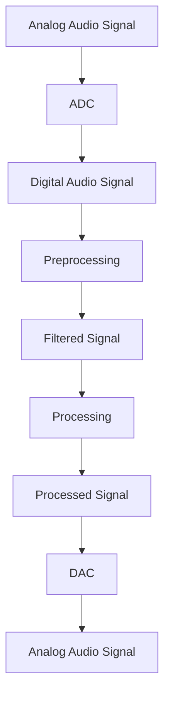

# Lesson 2: Audio Processing Techniques

## 1. First-Principles Intuition & Invariants

Audio processing is a fundamental domain that intersects signal processing, computer science, and electrical engineering. At its core, audio processing involves the manipulation of sound waves to achieve various objectives such as noise reduction, audio synthesis, and feature extraction for machine learning models. To understand the intricacies of audio processing, we must delve into the first-principles of sound and its digital representation.

Sound is a mechanical wave that propagates through a medium, typically air, as a series of compressions and rarefactions. These waves can be described mathematically using the wave equation, which captures the relationship between the wave's amplitude, frequency, and phase. In the digital domain, sound waves are sampled at regular intervals to create a discrete-time signal. The Nyquist-Shannon sampling theorem states that to accurately reconstruct a continuous-time signal, the sampling rate must be at least twice the highest frequency component of the signal. This critical theorem sets the foundation for the digital representation of audio, ensuring that no information is lost during the sampling process.

The digital signal is typically represented as a sequence of samples, each corresponding to the amplitude of the sound wave at a specific point in time. These samples are often stored in a linear format, such as PCM (Pulse Code Modulation), where each sample is encoded as a binary number. The choice of sample size (e.g., 16-bit, 24-bit) and sampling rate (e.g., 44.1 kHz, 96 kHz) directly impacts the quality and storage requirements of the audio signal. Higher sample sizes and rates provide greater fidelity but require more storage and computational resources.

In the context of generative AI, audio processing techniques play a crucial role in tasks such as speech synthesis, music generation, and audio enhancement. These tasks often involve complex signal processing algorithms that manipulate the digital audio signal to achieve the desired outcome. For instance, in speech synthesis, audio processing techniques are used to generate natural-sounding speech from text, while in music generation, they are used to create new musical compositions by manipulating audio signals.

To ensure the robustness and efficiency of audio processing algorithms, it is essential to understand the underlying mathematical and system invariants. These invariants provide a framework for designing algorithms that are both effective and efficient. For example, the principle of time-invariance states that the output of a system does not change if the input is shifted in time. This principle is crucial in designing filters and other signal processing algorithms that operate on audio signals.

## 2. Core Architecture & Mechanics

The architecture of audio processing systems is deeply rooted in the principles of signal processing and digital signal processing (DSP). At a high level, an audio processing system consists of several key components, including signal acquisition, preprocessing, processing, and output. Each of these components plays a critical role in the overall functionality of the system.

### Signal Acquisition

The first step in the audio processing pipeline is signal acquisition, which involves capturing the analog audio signal and converting it into a digital format. This process is typically performed using an analog-to-digital converter (ADC), which samples the analog signal at regular intervals and quantizes the samples into digital values. The choice of ADC and its specifications, such as sample rate and bit depth, directly impact the quality of the digital audio signal.

### Preprocessing

Once the audio signal is digitized, it often undergoes preprocessing to prepare it for further processing. Preprocessing techniques include filtering, normalization, and noise reduction. Filtering is used to remove unwanted frequency components from the signal, such as noise or interference. Normalization is used to adjust the amplitude of the signal to a consistent level, while noise reduction techniques are used to remove background noise from the signal.

### Processing

The core of the audio processing system lies in the processing stage, where the digital audio signal is manipulated to achieve the desired outcome. This stage involves a wide range of signal processing algorithms, including filtering, modulation, and synthesis. Filtering algorithms are used to modify the frequency content of the signal, while modulation techniques are used to vary the amplitude or frequency of the signal over time. Synthesis techniques are used to generate new audio signals from scratch, such as in music generation or speech synthesis.

One of the most important signal processing algorithms in audio processing is the Fast Fourier Transform (FFT). The FFT is a highly efficient algorithm for computing the Discrete Fourier Transform (DFT) of a signal, which decomposes the signal into its frequency components. The FFT is widely used in audio processing for tasks such as spectral analysis, filtering, and feature extraction. The FFT operates by recursively dividing the signal into smaller sub-signals, computing the DFT of each sub-signal, and combining the results to obtain the DFT of the original signal. This divide-and-conquer approach significantly reduces the computational complexity of the DFT, making it feasible to process large audio signals in real-time.

Another important signal processing algorithm in audio processing is the Wavelet Transform. The Wavelet Transform is a time-frequency analysis technique that decomposes the signal into its time-frequency components. Unlike the FFT, which provides a fixed frequency resolution, the Wavelet Transform provides a variable frequency resolution that adapts to the signal's characteristics. This makes the Wavelet Transform particularly useful for analyzing non-stationary signals, such as speech or music, where the frequency content changes over time.

### Output

The final stage of the audio processing pipeline is output, where the processed digital audio signal is converted back into an analog format and played through a speaker or other audio output device. This process is typically performed using a digital-to-analog converter (DAC), which converts the digital samples into analog voltages that can be amplified and played through a speaker. The choice of DAC and its specifications, such as sample rate and bit depth, directly impact the quality of the output audio signal.

To illustrate the architecture of an audio processing system, we can use a Mermaid diagram to visualize the key components and their interactions. The diagram below shows a high-level overview of an audio processing system, including the signal acquisition, preprocessing, processing, and output stages.

In this diagram, the analog audio signal is first converted into a digital format using an ADC. The digital signal is then preprocessed to remove unwanted frequency components and noise. The preprocessed signal is then processed using a range of signal processing algorithms, such as filtering and synthesis. The processed signal is finally converted back into an analog format using a DAC and played through a speaker.

## 3. High-Performance Optimization & Failure Modes

To ensure the high performance and reliability of audio processing systems, it is essential to optimize the algorithms and data structures used in the system. High-performance optimization involves a range of techniques, including algorithmic optimization, data structure optimization, and parallelization.

### Algorithmic Optimization

Algorithmic optimization involves improving the efficiency of the signal processing algorithms used in the system. One of the most important techniques for algorithmic optimization is the use of efficient algorithms, such as the FFT and Wavelet Transform, which significantly reduce the computational complexity of signal processing tasks. Another important technique is the use of optimized data structures, such as circular buffers and ring buffers, which allow for efficient data storage and retrieval.

### Data Structure Optimization

Data structure optimization involves improving the efficiency of the data structures used in the system. One of the most important data structures in audio processing is the circular buffer, which is used to store and retrieve audio samples in a circular fashion. Circular buffers are particularly useful in real-time audio processing, where data must be processed and output in a continuous stream. Another important data structure is the ring buffer, which is used to store and retrieve audio samples in a fixed-size buffer. Ring buffers are particularly useful in scenarios where the size of the audio signal is unknown in advance.

### Parallelization

Parallelization involves dividing the signal processing tasks into smaller sub-tasks that can be executed concurrently on multiple processors or cores. Parallelization can significantly improve the performance of audio processing systems, particularly for large audio signals or complex signal processing algorithms. One of the most important techniques for parallelization is the use of multi-threading, which allows multiple threads to execute concurrently on a multi-core processor. Another important technique is the use of SIMD (Single Instruction, Multiple Data) instructions, which allow a single instruction to operate on multiple data elements simultaneously.

In addition to high-performance optimization, it is also essential to consider the failure modes of audio processing systems. Failure modes refer to the ways in which the system can fail or produce incorrect results. One of the most important failure modes in audio processing is aliasing, which occurs when the sampling rate is too low to accurately capture the frequency content of the signal. Aliasing can result in unwanted frequency components in the output signal, such as distortion or noise. To mitigate aliasing, it is essential to use a high sampling rate and apply anti-aliasing filters to the signal before sampling.

Another important failure mode in audio processing is quantization error, which occurs when the digital samples are quantized to a finite number of bits. Quantization error can result in loss of fidelity in the output signal, such as distortion or noise. To mitigate quantization error, it is essential to use a high bit depth and apply dithering to the signal before quantization. Dithering involves adding a small amount of noise to the signal to randomize the quantization error, which can significantly reduce the perceptual impact of the error.

In conclusion, audio processing is a complex and fascinating domain that involves the manipulation of sound waves to achieve various objectives. To design effective and efficient audio processing systems, it is essential to understand the first-principles of sound and its digital representation, as well as the underlying mathematical and system invariants. The architecture of audio processing systems is deeply rooted in the principles of signal processing and digital signal processing, and involves a range of key components, including signal acquisition, preprocessing, processing, and output. High-performance optimization and failure mode mitigation are critical for ensuring the robustness and efficiency of audio processing systems.
