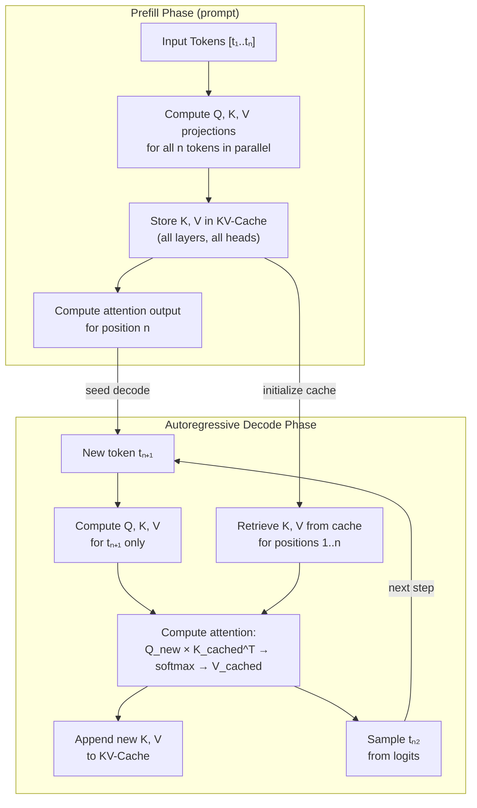
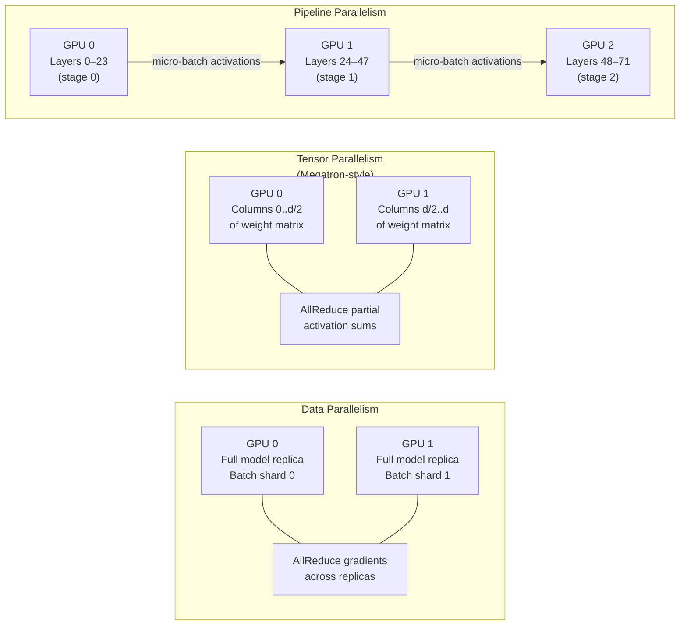
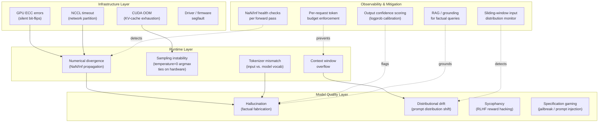
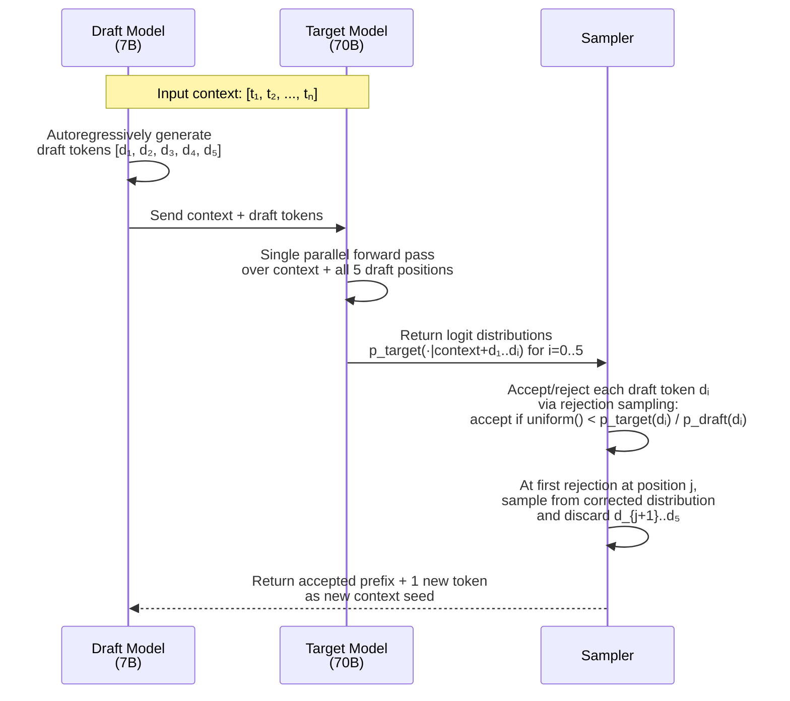

# Lesson 3: Advanced Optimization, Serving & Failure Modes

## 1. Memory Bandwidth, KV-Cache Optimization & Quantization Bounds

### 1.1 Why Memory Bandwidth Is the Dominant Bottleneck

Modern transformer-based language models are, at inference time, fundamentally **memory-bandwidth-bound**, not compute-bound. Understanding why requires examining the arithmetic intensity of the autoregressive decoding loop.

**Arithmetic intensity** is defined as the ratio of floating-point operations (FLOPs) to bytes transferred from DRAM:

```
Arithmetic Intensity = FLOPs / Bytes
```

For a single linear layer with weight matrix **W** ∈ ℝ^(d_model × d_ff) during batched decoding with batch size B=1:

- FLOPs: `2 × d_model × d_ff` (one matrix-vector multiply)
- Bytes transferred: `d_model × d_ff × bytes_per_param` (the entire weight matrix must be streamed from DRAM)

For a 70B parameter model in FP16, that is roughly **140 GB** of weights that must traverse the memory bus on every forward pass. An A100 SXM has a peak FP16 compute of ~312 TFLOPS but a memory bandwidth of only ~2 TB/s. The roofline model shows that for batch sizes below roughly 150–200, the operation sits firmly in the memory-bandwidth-bound regime—compute units are starved waiting for data, not the reverse.

The implication is direct: **optimizing inference throughput means minimizing bytes transferred per token generated**, not minimizing raw FLOPs.

### 1.2 The KV-Cache: Architecture and True Purpose

The KV-cache is frequently described imprecisely. It does **not** cache "model weights" — weights are static and always resident. The KV-cache stores the **key (K) and value (V) projections** from every attention head for every previously processed token in the current sequence context.

In a standard multi-head attention block, for a sequence of tokens [t₁, t₂, ..., tₙ], to generate token tₙ₊₁ the model must compute attention scores against every prior position. Without a KV-cache, this requires recomputing K and V projections for all n prior tokens at every decoding step — O(n) redundant computation per step, O(n²) total. The KV-cache eliminates this by materializing and storing those projections after their first computation.

**KV-cache memory footprint** (per layer, per token):

```
bytes = 2 × n_heads × d_head × bytes_per_element
```

For a 70B model with 64 layers, 8 KV heads (GQA), d_head=128, in FP16:

```
per_token = 2 × 8 × 128 × 2 = 4096 bytes = 4 KB
total_for_4096_ctx = 64 × 4096 × 4 KB ≈ 1 GB
```

At 100K token context lengths (GPT-4-class models), the KV-cache can consume **tens of gigabytes per sequence**, rivaling the model weights themselves. This is the genuine memory pressure the KV-cache introduces.



### 1.3 KV-Cache Optimization: PagedAttention and Memory Fragmentation

Naïve KV-cache implementations pre-allocate a contiguous memory block sized for the maximum sequence length. This wastes memory when requests finish early and prevents serving multiple concurrent requests efficiently.

**PagedAttention** (vLLM, 2023) addresses this by managing KV-cache memory analogously to virtual memory in an OS. The cache is divided into fixed-size **blocks** (pages), each holding K and V vectors for a fixed number of tokens (the block size, typically 16 or 32 tokens). A per-sequence **block table** maps logical token positions to physical block addresses in GPU memory, enabling:

1. **Non-contiguous allocation**: sequences share the same physical memory pool without fragmentation.
2. **Copy-on-write prefix sharing**: sequences that share a common prompt prefix (e.g., system prompts in chat applications) can share physical KV blocks, reducing redundant storage.
3. **Dynamic memory management**: blocks are allocated/freed as sequences grow and terminate.

The result is near-zero internal fragmentation (typically < 4%) versus 60–80% waste in max-length pre-allocation schemes.

```python
# Simplified PagedAttention block table concept
import torch
from dataclasses import dataclass, field
from typing import List, Optional

BLOCK_SIZE = 16  # tokens per physical block
NUM_BLOCKS = 1024  # total physical blocks in the KV pool

@dataclass
class PhysicalBlock:
    block_id: int
    ref_count: int = 0

@dataclass
class SequenceGroup:
    seq_id: int
    # Maps logical block index -> physical block id
    block_table: List[int] = field(default_factory=list)
    num_tokens: int = 0

class BlockManager:
    def __init__(self, num_blocks: int, block_size: int):
        self.block_size = block_size
        self.free_blocks: List[int] = list(range(num_blocks))
        self.physical_blocks: dict[int, PhysicalBlock] = {
            i: PhysicalBlock(block_id=i) for i in range(num_blocks)
        }

    def allocate_block(self) -> Optional[int]:
        if not self.free_blocks:
            return None  # OOM: trigger preemption
        block_id = self.free_blocks.pop()
        self.physical_blocks[block_id].ref_count = 1
        return block_id

    def append_token(self, seq: SequenceGroup) -> bool:
        """Allocate a new block if the current last block is full."""
        if seq.num_tokens % self.block_size == 0:
            block_id = self.allocate_block()
            if block_id is None:
                return False  # signal preemption needed
            seq.block_table.append(block_id)
        seq.num_tokens += 1
        return True

    def fork_sequence(self, parent: SequenceGroup, child: SequenceGroup):
        """Copy-on-write: child shares parent's physical blocks."""
        child.block_table = parent.block_table.copy()
        child.num_tokens = parent.num_tokens
        for block_id in child.block_table:
            self.physical_blocks[block_id].ref_count += 1

    def free_sequence(self, seq: SequenceGroup):
        for block_id in seq.block_table:
            block = self.physical_blocks[block_id]
            block.ref_count -= 1
            if block.ref_count == 0:
                self.free_blocks.append(block_id)
        seq.block_table.clear()
```

### 1.4 Multi-Query Attention and Grouped-Query Attention

**Multi-Head Attention (MHA)** uses `n_heads` independent K/V projection matrices — the KV-cache scales as O(n_heads × seq_len). **Multi-Query Attention (MQA)** (Shazeer, 2019) uses a single shared K/V projection across all heads, reducing KV-cache size by a factor of `n_heads` at the cost of minor quality degradation. **Grouped-Query Attention (GQA)** (Ainslie et al., 2023) interpolates between MHA and MQA by grouping query heads to share K/V heads — LLaMA-2 70B uses 8 KV heads for 64 query heads (8:1 ratio), yielding an 8× KV-cache reduction with minimal perplexity regression.

| Variant | KV Heads | Relative KV-Cache Size | Quality vs. MHA |
|---------|----------|------------------------|-----------------|
| MHA | n_heads (e.g., 64) | 1× (baseline) | Baseline |
| GQA | n_heads/G (e.g., 8) | 1/G | ≈ MHA (small gap) |
| MQA | 1 | 1/n_heads | Slight regression |

### 1.5 Quantization: First Principles and Error Bounds

Quantization maps a floating-point value x ∈ [α, β] to an integer q ∈ [0, 2^b − 1] via:

```
q = round( (x - α) / scale )
scale = (β - α) / (2^b − 1)
x̂ = q × scale + α
```

The quantization error is bounded: |x − x̂| ≤ scale/2. For uniform quantization to b bits over a range of width (β − α):

```
max_error = (β - α) / (2 × (2^b − 1))
```

Going from FP32 to INT8 reduces model size 4×; to INT4, 8×. The memory bandwidth saving is proportional — an INT4 model streams 8× fewer bytes per parameter during inference.

**The critical failure mode** is not simply rounding error on individual weights but the **accumulation of quantization error across layers**. In a 96-layer model, small per-layer errors compound. The key insight from GPTQ (Frantar et al., 2022) and AWQ (Lin et al., 2023) is that weight channels are **not equally sensitive to quantization** — a small fraction (≈1%) of weights have disproportionate influence on output due to their magnitude relative to activation distributions. Standard per-tensor uniform quantization treats all weights equally and degrades these critical channels.

**GPTQ** uses second-order gradient information (the Hessian of the layer's reconstruction error) to optimally redistribute quantization error: after quantizing one weight, it updates all remaining weights in the row to compensate. This runs in O(d²) per row, feasible as a one-time offline operation.

**AWQ** observes that protecting only the 1% of weights corresponding to large-magnitude activations (identified by calibration data) is sufficient. It scales those channels up before quantization and down after, keeping them in a more precise effective range, without changing the bit-width.

```python
# Minimal demonstration of per-channel vs per-tensor quantization error
import numpy as np

def quantize_tensor(weights: np.ndarray, bits: int = 8) -> tuple[np.ndarray, float]:
    """Per-tensor uniform symmetric quantization."""
    alpha = weights.max()
    scale = alpha / (2 ** (bits - 1) - 1)
    q = np.round(weights / scale).clip(-(2**(bits-1)), 2**(bits-1) - 1)
    dequant = q * scale
    error = np.mean((weights - dequant) ** 2)
    return dequant, error

def quantize_per_channel(weights: np.ndarray, bits: int = 8) -> tuple[np.ndarray, float]:
    """Per-channel quantization: separate scale per output channel (row)."""
    alphas = np.abs(weights).max(axis=1, keepdims=True)
    scales = alphas / (2 ** (bits - 1) - 1)
    q = np.round(weights / scales).clip(-(2**(bits-1)), 2**(bits-1) - 1)
    dequant = q * scales
    error = np.mean((weights - dequant) ** 2)
    return dequant, error

rng = np.random.default_rng(42)
# Simulate a weight matrix with one "outlier" channel (column 0 has 10× magnitude)
W = rng.standard_normal((256, 256)).astype(np.float32)
W[:, 0] *= 10.0  # outlier channel

_, err_tensor = quantize_tensor(W, bits=8)
_, err_channel = quantize_per_channel(W, bits=8)

print(f"Per-tensor MSE:  {err_tensor:.6f}")
print(f"Per-channel MSE: {err_channel:.6f}")
# Per-channel will show dramatically lower MSE on outlier-containing matrices
```

**Quantization formats in production:**

| Format | Bits | Technique | Typical Perplexity Delta (vs. FP16) |
|--------|------|-----------|--------------------------------------|
| FP16 | 16 | Native | 0 (baseline) |
| BF16 | 16 | Native (wider exponent range) | ≈0 |
| GPTQ INT8 | 8 | Second-order weight compensation | < 0.1 PPL |
| GPTQ INT4 | 4 | Second-order weight compensation | 0.2–0.5 PPL |
| AWQ INT4 | 4 | Activation-aware channel scaling | 0.1–0.3 PPL |
| GGUF Q4_K_M | ~4.5 | Mixed k-quants (llama.cpp) | 0.2–0.4 PPL |
| INT2 | 2 | QuIP#, AQLM | 1–3 PPL (task-dependent) |

---

## 2. Distributed Sharding, Pipeline Parallelism & Communication Overhead

### 2.1 Parallelism Taxonomy

Scaling a model beyond a single GPU requires decomposing computation across devices. There are three orthogonal dimensions:



**Data Parallelism (DP):** Each device holds a full model copy; the global batch is split across devices. Gradients are synchronized via AllReduce after the backward pass. Effective for training but provides no inference memory relief — every GPU still holds all weights.

**Tensor Parallelism (TP)** (Shoeybi et al., 2019 — Megatron-LM): Each linear layer's weight matrix is sharded column- or row-wise across devices. For an MLP with weight W ∈ ℝ^(d × 4d), column parallelism splits W into [W₁ | W₂] across two GPUs; each GPU computes XW_i independently, and results are concatenated (or summed for row-parallel layers) via AllReduce. TP requires **synchronous high-bandwidth interconnect** (NVLink, InfiniBand) — a single AllReduce per layer means O(L) collective operations per forward pass, where L is the number of layers.

**Pipeline Parallelism (PP):** The model is partitioned **by layer** into stages, each stage assigned to one or more GPUs. A micro-batch flows through stages sequentially. The critical challenge is the **pipeline bubble**: with P stages and M micro-batches, the fraction of time stages are idle is:

```
bubble_fraction = (P - 1) / (M + P - 1)
```

For P=8 stages and M=8 micro-batches, 46.7% of cycles are wasted. This can be reduced by increasing M (more micro-batches per batch) or via interleaved scheduling (1F1B — one-forward-one-backward), which reduces peak activation memory at the cost of increased communication frequency.

**Expert Parallelism (EP):** Used in Mixture-of-Experts (MoE) architectures — each device hosts a subset of expert networks. Requires All-to-All routing of tokens to their assigned experts, introducing variable-latency communication with potential load imbalance.

Production systems like Megatron-LM and DeepSpeed combine all four (DP + TP + PP + EP), requiring a carefully configured **4D parallelism topology**.

### 2.2 Tensor Parallelism: Column and Row Partitioning

For an attention block with projection matrices Q, K, V ∈ ℝ^(d × d):

**Column-parallel (Q, K, V projections):** Each GPU i computes X × W_i where W_i is the i-th column partition. No communication required before this layer's output — each GPU independently holds a subset of attention heads.

**Row-parallel (output projection):** Each GPU i holds a row partition W_i and computes a partial sum. The final output requires AllReduce across GPUs to sum partial products:

```
Y = X₀W₀ + X₁W₁ + ... (AllReduce sum)
```

The column-parallel → row-parallel pattern is designed so that a single AllReduce per transformer sub-layer suffices, minimizing synchronization points.

```python
# Conceptual Megatron-style column-parallel linear (simplified)
import torch
import torch.nn as nn
import torch.distributed as dist

class ColumnParallelLinear(nn.Module):
    """
    Linear layer sharded column-wise across tensor_model_parallel_size GPUs.
    Input X: [batch, seq_len, in_features]  (replicated across GPUs)
    Output:  [batch, seq_len, out_features // tp_size]  (each GPU holds a shard)
    """
    def __init__(self, in_features: int, out_features: int,
                 tp_size: int, tp_rank: int, bias: bool = True):
        super().__init__()
        assert out_features % tp_size == 0
        self.shard_size = out_features // tp_size
        self.weight = nn.Parameter(
            torch.empty(self.shard_size, in_features)
        )
        self.bias = nn.Parameter(torch.zeros(self.shard_size)) if bias else None
        nn.init.kaiming_uniform_(self.weight, a=5**0.5)

    def forward(self, x: torch.Tensor) -> torch.Tensor:
        # Each GPU computes its own output shard independently — no comm needed
        return torch.nn.functional.linear(x, self.weight, self.bias)


class RowParallelLinear(nn.Module):
    """
    Linear layer sharded row-wise.
    Input:  [batch, seq_len, in_features // tp_size]  (each GPU holds a shard)
    Output: [batch, seq_len, out_features]  (AllReduced across GPUs)
    """
    def __init__(self, in_features: int, out_features: int,
                 tp_size: int, process_group: dist.ProcessGroup,
                 bias: bool = True):
        super().__init__()
        self.process_group = process_group
        assert in_features % tp_size == 0
        self.shard_size = in_features // tp_size
        self.weight = nn.Parameter(
            torch.empty(out_features, self.shard_size)
        )
        self.bias = nn.Parameter(torch.zeros(out_features)) if bias else None
        nn.init.kaiming_uniform_(self.weight, a=5**0.5)

    def forward(self, x: torch.Tensor) -> torch.Tensor:
        # Compute partial sum on this GPU's input shard
        partial = torch.nn.functional.linear(x, self.weight)
        # AllReduce sums partial products across all TP ranks
        dist.all_reduce(partial, op=dist.ReduceOp.SUM,
                        group=self.process_group)
        if self.bias is not None:
            partial += self.bias
        return partial
```

### 2.3 Communication Overhead: Quantifying the Cost

AllReduce on a ring topology transfers `2 × (n-1)/n × message_size` bytes per GPU for N GPUs. For NVLink (600 GB/s bidirectional on H100 SXM) versus PCIe (64 GB/s), the latency difference for a 100 MB activation tensor is:

- NVLink: ~0.33 ms
- PCIe: ~3.1 ms (9.5× slower)

This is why tensor parallelism is typically restricted to intra-node (NVLink) communication, while pipeline parallelism (smaller point-to-point activation tensors) tolerates inter-node InfiniBand (~400 Gbps = 50 GB/s).

**Collective communication costs for a 70B model, TP=8 (single node), one transformer layer:**

Each AllReduce transfers approximately `2 × batch × seq_len × d_model × 2 bytes`. For batch=1, seq_len=1 (decode step), d_model=8192:

```
message = 2 × 1 × 1 × 8192 × 2 = 32 KB per AllReduce
latency ≈ 32 KB / 600 GB/s ≈ 0.053 µs (bandwidth-bound for large tensors)
```

At decode time, the message is tiny and **latency-bound** (NVLink round-trip latency ~1 µs), not bandwidth-bound. This makes TP less efficient for small-batch decode — the overhead is dominated by the fixed latency of launching the collective, not data transfer time. Larger TP degrees (8 vs 4) may **increase** decode latency despite having more compute.

### 2.4 ZeRO: Eliminating Redundancy in Data Parallel Training

DeepSpeed's **ZeRO** (Zero Redundancy Optimizer) stages partition optimizer state, gradients, and parameters across DP ranks rather than replicating them:

| ZeRO Stage | Partitioned | Memory Reduction (vs. DDP) | Communication Overhead |
|------------|-------------|----------------------------|------------------------|
| Stage 1 | Optimizer states | 4× | Minimal (scatter/gather optimizer states) |
| Stage 2 | Optimizer states + gradients | 8× | Moderate (reduce-scatter gradients) |
| Stage 3 | Optimizer states + gradients + parameters | 64× (for Adam) | High (AllGather params each forward/backward) |

ZeRO-3 enables training a 1T parameter model across 512 GPUs without tensor or pipeline parallelism, but introduces AllGather operations for every layer's parameters during the forward pass and reduce-scatter during backward — roughly doubling communication volume versus standard DDP.

---

## 3. Production Failure Domains, Drift & Hallucination Mitigation

### 3.1 Failure Taxonomy for Production LLM Systems

A production LLM serving system is not a single failure domain. Failures cascade through distinct layers:



### 3.2 Numerical Divergence: NaN/Inf Propagation

Autoregressive generation is numerically fragile. A single NaN in an intermediate activation propagates forward and contaminates all subsequent logits, producing garbage output or infinite loops. The root causes:

1. **Softmax overflow**: `exp(large_logit)` overflows FP16 (max ~65504). The standard fix is to subtract the row maximum before exponentiation (`numerically stable softmax`), but naive implementations in custom CUDA kernels sometimes omit this.
2. **Mixed-precision residual overflow**: In FP16 training, residual stream values can exceed 65504 after many additions. BF16 (8-bit exponent, max ~3.4×10³⁸) largely eliminates this at the cost of lower mantissa precision.
3. **Loss scaling underflow**: In AMP training, loss scaling that is too low causes gradients to flush to zero. Loss scaling that is too high causes overflow. Dynamic loss scaling (PyTorch's `GradScaler`) addresses this.

**Production mitigation in serving:**

```python
import torch
import logging
from functools import wraps
from typing import Callable

logger = logging.getLogger(__name__)

def guard_numerics(fn: Callable) -> Callable:
    """
    Decorator that checks for NaN/Inf in model output logits.
    Raises an exception instead of returning corrupt outputs to callers.
    """
    @wraps(fn)
    def wrapper(*args, **kwargs):
        result = fn(*args, **kwargs)
        if isinstance(result, torch.Tensor):
            if not torch.isfinite(result).all():
                nan_count = torch.isnan(result).sum().item()
                inf_count = torch.isinf(result).sum().item()
                logger.error(
                    "Numerical divergence detected: "
                    f"NaN={nan_count}, Inf={inf_count}, shape={result.shape}"
                )
                raise RuntimeError(
                    f"Model produced non-finite logits: NaN={nan_count}, Inf={inf_count}. "
                    "Request aborted to prevent corrupt output."
                )
        return result
    return wrapper


class LogitPostProcessor:
    """
    Applies numerically stable transformations to raw logits before sampling.
    Handles temperature scaling, top-k, and top-p (nucleus) filtering.
    """
    def __init__(self, temperature: float = 1.0, top_k: int = 0,
                 top_p: float = 1.0, min_tokens_to_keep: int = 1):
        assert temperature > 0, "Temperature must be positive"
        assert 0.0 < top_p <= 1.0
        self.temperature = temperature
        self.top_k = top_k
        self.top_p = top_p
        self.min_tokens_to_keep = min_tokens_to_keep

    @torch.no_grad()
    def __call__(self, logits: torch.Tensor) -> torch.Tensor:
        """
        Args:
            logits: [vocab_size] or [batch, vocab_size] raw logits
        Returns:
            Filtered log-probabilities ready for multinomial sampling.
        """
        # Temperature scaling (do NOT scale if greedy — argmax is scale-invariant)
        logits = logits / self.temperature

        # Top-k filtering: zero out all but top-k logits
        if self.top_k > 0:
            k = min(self.top_k, logits.size(-1))
            top_k_values, _ = torch.topk(logits, k, dim=-1)
            threshold = top_k_values[..., -1, None]
            logits = logits.masked_fill(logits < threshold, float('-inf'))

        # Top-p (nucleus) filtering: keep the smallest set of tokens
        # whose cumulative probability exceeds top_p
        if self.top_p < 1.0:
            sorted_logits, sorted_indices = torch.sort(logits, dim=-1, descending=True)
            cumulative_probs = torch.cumsum(
                torch.softmax(sorted_logits, dim=-1), dim=-1
            )
            # Remove tokens where cumulative prob exceeds top_p threshold
            # Shift right to keep the token that pushes over the threshold
            remove_mask = cumulative_probs - torch.softmax(sorted_logits, dim=-1) > self.top_p
            remove_mask[..., :self.min_tokens_to_keep] = False
            sorted_logits[remove_mask] = float('-inf')
            logits = torch.scatter(logits, -1, sorted_indices, sorted_logits)

        return torch.log_softmax(logits, dim=-1)
```

### 3.3 Hallucination: Causes and Mitigation at the Architecture Level

**Hallucination** in LLMs is not a vague "model making things up" phenomenon — it has specific mechanistic causes:

1. **Parametric memory interpolation**: The model's factual knowledge is encoded in weight parameters during training. For queries requiring precise facts (entity attributes, numerical values, dates), the model interpolates between training examples that may be conflicting, underrepresented, or temporally stale. The probability distribution over token sequences does not distinguish between "highly confident factual recall" and "plausible-sounding interpolation."

2. **Exposure bias / distributional shift**: During training with teacher-forcing, the model always receives ground-truth previous tokens. At inference, it conditions on its own (potentially erroneous) prior outputs. Errors compound: a factually incorrect claim at position n creates a conditioning context that makes further incorrect claims more probable at position n+1.

3. **RLHF sycophancy**: Reward models trained on human preference data often reward fluency and confident tone, inadvertently penalizing expressions of uncertainty. Models learn to produce confident-sounding outputs even when the parametric knowledge is sparse.

**Retrieval-Augmented Generation (RAG)** mitigates parametric memory failures by injecting retrieved documents into the context window, shifting the information source from parametric to retrieved. The model's task changes from recall to extraction/synthesis — a substantially easier problem with lower hallucination rates for factual queries.

**Architectural constraint**: RAG does not eliminate hallucination when the retrieved context is insufficient, contradictory, or when the model fails to attend to the relevant retrieved passage. This is an attention and context-length limitation, not a retrieval failure.

**Logprob calibration** provides a hallucination signal: for factual span predictions, low token probability under the model's distribution often (not always) correlates with low factual accuracy. The correlation is weak for smooth-sounding falsehoods — the model assigns high probability to plausible fabrications.

```python
# Hallucination risk scoring via per-token log-probabilities
import torch
import torch.nn.functional as F
from dataclasses import dataclass
from typing import List

@dataclass
class TokenScore:
    token_id: int
    token_text: str
    log_prob: float
    is_low_confidence: bool  # flagged if below threshold

@dataclass 
class GenerationRiskReport:
    tokens: List[TokenScore]
    mean_log_prob: float
    min_log_prob: float
    low_confidence_ratio: float
    risk_level: str  # "low" | "medium" | "high"


def score_generation(
    logits_sequence: torch.Tensor,  # [seq_len, vocab_size]
    generated_ids: torch.Tensor,     # [seq_len]
    tokenizer,
    low_conf_threshold: float = -2.0,  # log prob threshold (≈ top 13.5%)
    high_risk_ratio: float = 0.3,
) -> GenerationRiskReport:
    """
    Compute per-token confidence scores for a generated sequence.
    Log-prob threshold of -2.0 means p(token) < e^-2 ≈ 0.135.
    """
    log_probs = F.log_softmax(logits_sequence, dim=-1)
    # Gather log-prob of the actually sampled token at each position
    token_log_probs = log_probs.gather(
        dim=-1,
        index=generated_ids.unsqueeze(-1)
    ).squeeze(-1)  # [seq_len]

    scores = []
    for i, (tid, lp) in enumerate(zip(generated_ids.tolist(),
                                       token_log_probs.tolist())):
        scores.append(TokenScore(
            token_id=tid,
            token_text=tokenizer.decode([tid]),
            log_prob=lp,
            is_low_confidence=lp < low_conf_threshold,
        ))

    mean_lp = token_log_probs.mean().item()
    min_lp = token_log_probs.min().item()
    low_conf_ratio = sum(1 for s in scores if s.is_low_confidence) / len(scores)

    if low_conf_ratio >= high_risk_ratio or min_lp < -5.0:
        risk = "high"
    elif low_conf_ratio >= 0.15 or mean_lp < -1.5:
        risk = "medium"
    else:
        risk = "low"

    return GenerationRiskReport(
        tokens=scores,
        mean_log_prob=mean_lp,
        min_log_prob=min_lp,
        low_confidence_ratio=low_conf_ratio,
        risk_level=risk,
    )
```

### 3.4 Distributional Drift in Production

**Distributional drift** occurs when the statistical distribution of real-world inputs diverges from the distribution the model was trained and evaluated on. For LLMs, this manifests in several dimensions:

- **Temporal drift**: The model's training data has a knowledge cutoff; facts, entities, and terminology evolve. User queries increasingly reference post-cutoff information, and the model's parametric responses become unreliable.
- **Domain drift**: A model fine-tuned on customer support data may be deployed in a context where query intent, domain vocabulary, or task type shifts gradually.
- **Prompt format drift**: Changes to system prompts, instruction templates, or downstream application behavior alter the effective input distribution, potentially degrading RLHF-calibrated behavior.

Detecting drift requires **statistical monitoring of the input embedding space** rather than naive surface-level metrics. The standard approach embeds incoming queries and tracks their distribution against a reference set using:

- **Maximum Mean Discrepancy (MMD)**: A kernel-based two-sample test that compares distributions without assuming a parametric form. Computationally expensive for high dimensions.
- **Model-based drift detectors**: Train a binary classifier to distinguish reference vs. production queries. Rising classifier accuracy signals drift.
- **Representation drift**: Track cluster assignments of incoming embeddings against clusters from the reference distribution. Increasing fraction of "out-of-cluster" queries signals shift.

```python
# Sliding-window MMD-based drift detection (simplified)
import numpy as np
from scipy.spatial.distance import cdist

def rbf_kernel(X: np.ndarray, Y: np.ndarray, gamma: float = 1.0) -> np.ndarray:
    """Radial basis function (Gaussian) kernel: k(x,y) = exp(-gamma * ||x-y||^2)"""
    sq_dists = cdist(X, Y, metric='sqeuclidean')
    return np.exp(-gamma * sq_dists)

def maximum_mean_discrepancy(
    X_ref: np.ndarray,   # [n_ref, embedding_dim] reference embeddings
    X_prod: np.ndarray,  # [n_prod, embedding_dim] production embeddings
    gamma: float = 0.01,
) -> float:
    """
    Unbiased MMD² estimate between reference and production distributions.
    MMD² → 0 implies distributions are identical.
    MMD² > threshold implies statistically significant drift.
    """
    K_xx = rbf_kernel(X_ref, X_ref, gamma)
    K_yy = rbf_kernel(X_prod, X_prod, gamma)
    K_xy = rbf_kernel(X_ref, X_prod, gamma)

    n, m = len(X_ref), len(X_prod)
    # Unbiased estimator: excludes diagonal (self-kernel) terms
    mmd2 = (
        (K_xx.sum() - np.trace(K_xx)) / (n * (n - 1))
        + (K_yy.sum() - np.trace(K_yy)) / (m * (m - 1))
        - 2 * K_xy.mean()
    )
    return float(mmd2)


class DriftMonitor:
    """
    Maintains a sliding window of recent production embeddings and
    computes MMD against a fixed reference distribution.
    """
    def __init__(self, reference_embeddings: np.ndarray,
                 window_size: int = 500, alert_threshold: float = 0.05,
                 gamma: float = 0.01):
        self.reference = reference_embeddings
        self.window_size = window_size
        self.alert_threshold = alert_threshold
        self.gamma = gamma
        self.window: list[np.ndarray] = []

    def observe(self, embedding: np.ndarray) -> dict:
        """Add a new production embedding and return a drift report."""
        self.window.append(embedding)
        if len(self.window) > self.window_size:
            self.window.pop(0)

        report = {"window_size": len(self.window), "mmd2": None,
                  "drift_detected": False}

        if len(self.window) >= 50:  # minimum samples for reliable estimate
            X_prod = np.stack(self.window)
            mmd2 = maximum_mean_discrepancy(
                self.reference, X_prod, gamma=self.gamma
            )
            report["mmd2"] = mmd2
            report["drift_detected"] = mmd2 > self.alert_threshold

        return report
```

### 3.5 Speculative Decoding: Latency Reduction Without Quality Degradation

Speculative decoding (Leviathan et al., 2022; Chen et al., 2022) addresses the fundamental latency problem of autoregressive generation: the target model (large, accurate) generates one token per forward pass. The technique uses a **draft model** (small, fast — typically 7B vs. 70B) to propose K candidate tokens speculatively, then verifies all K in a single parallel forward pass of the target model.

The verification step uses a modified rejection sampling scheme that guarantees the **accepted token distribution is identical to what the target model would have produced independently** — there is no quality degradation, only latency improvement when the draft model's predictions are accepted.

**Acceptance rate** α is the key metric: if the draft model agrees with the target model at rate α per token, the expected tokens generated per target model call is:

```
E[accepted_tokens] = (1 - α^(K+1)) / (1 - α)
```

For α=0.8, K=5: E = (1 - 0.8⁶) / 0.2 ≈ 3.98 tokens per call vs. 1 without speculation — a ~4× throughput improvement with zero quality change.



---

## 4. Serving Infrastructure & SLO Engineering

### 4.1 Throughput vs. Latency Trade-offs

LLM serving systems must balance two conflicting objectives:

- **Time-to-first-token (TTFT)**: Latency from request submission to first output token. Dominated by the prefill computation (prompt processing). Users perceive this as "thinking time."
- **Time-per-output-token (TPOT)**: Latency per subsequent token during decode. Dominated by memory bandwidth (KV-cache reads + weight streaming). Users perceive this as "typing speed."

**Continuous batching** (Orca, 2022) is the foundational scheduling algorithm for production LLM serving. Rather than processing requests in fixed-size batches (which forces all requests to wait for the longest one), continuous batching inserts new requests into the in-progress batch at token boundaries. When a sequence finishes, its slot is immediately freed and assigned to a waiting request. This achieves near-optimal GPU utilization without padding-induced waste.

```mermaid
gantt
    title Continuous Batching vs. Static Batching
    dateFormat X
    axisFormat %s

    section Static Batch
    Request A (10 tokens) :done, 0, 10
    Request B (40 tokens) :done, 0, 40
    Request C (25 tokens) :done, 0, 25
    Wait for B to finish  :crit, 10, 40
    Next batch starts     :milestone, 40, 40

    section Continuous Batch
    Request A (10 tokens)       :done, 0, 10
    Request B (40 tokens)       :done, 0, 40
    Request C (25 tokens)       :done, 0, 25
    Request D (inserted at t=10):active, 10, 35
    Request E (inserted at t=25):active, 25, 50
```



### 4.2 Prefill-Decode Disaggregation

Modern high-throughput serving architectures (Distserve, Splitwise) separate **prefill** and **decode** into distinct pools of servers:

- **Prefill servers**: Optimized for high compute throughput (large batch, long sequences). Benefit from larger TP degree.
- **Decode servers**: Optimized for low latency and high KV-cache capacity. Benefit from smaller TP degree (less AllReduce latency) and larger DRAM.

After prefill completes on a prefill server, the KV-cache is migrated (via RDMA or NVLink fabric) to a decode server. This migration adds latency but enables independent scaling of prefill and decode capacity based on workload characteristics — a critical operational advantage for mixed-query workloads.

### 4.3 Structured Output Enforcement

Production deployments often require outputs conforming to a specific schema (JSON, SQL, regex patterns). **Constrained decoding** enforces this by masking the logit distribution at each step to zero out tokens that would violate the grammar:

At each step, given current output prefix `p`, the system:
1. Advances a finite automaton (or parser state) through the prefix.
2. Queries valid next tokens from the automaton's current state.
3. Masks all invalid tokens in the logit vector to `-inf` before sampling.

This guarantees structural validity while sampling from the highest-probability valid token at each step — no post-hoc validation or rejection-retry loops required.

Libraries implementing this include Outlines (dottxt-ai), Guidance (Microsoft), and LMQL.

```python
# Minimal regex-constrained decoding using a character-level finite automaton
import re
import torch
from typing import Set

class RegexConstrainedSampler:
    """
    Constrains token sampling to outputs matching a target regex.
    Uses interegular / automaton state to determine valid next tokens at each step.
    
    NOTE: Production implementations use tokenizer-aware automaton construction
    (e.g., Outlines library) for efficiency. This is a conceptual illustration.
    """
    def __init__(self, pattern: str, tokenizer, vocab_size: int):
        self.pattern = pattern
        self.tokenizer = tokenizer
        self.vocab_size = vocab_size
        # Compile pattern for incremental matching
        self.regex = re.compile(pattern)

    def get_valid_token_ids(self, current_text: str) -> Set[int]:
        """
        Return set of token IDs that, appended to current_text,
        still permit a complete match of self.pattern.
        
        A token is valid if current_text + token_text is a prefix
        of some string matching the full pattern.
        """
        valid = set()
        for token_id in range(self.vocab_size):
            token_text = self.tokenizer.decode([token_id])
            candidate = current_text + token_text
            # Check if candidate is a valid prefix: pattern matches at ^ with DOTALL
            if re.match(self.pattern, candidate) or \
               re.match(self.pattern + '.*', candidate, re.DOTALL):
                valid.add(token_id)
        return valid  # Note: iterate over full vocab is O(V) — optimized via tries in production

    def apply_mask(self, logits: torch.Tensor, current_text: str) -> torch.Tensor:
        """Zero out logits for tokens that would violate the pattern."""
        valid_ids = self.get_valid_token_ids(current_text)
        mask = torch.full((self.vocab_size,), float('-inf'), dtype=logits.dtype)
        for token_id in valid_ids:
            mask[token_id] = 0.0  # additive mask: 0 preserves, -inf eliminates
        return logits + mask
```

---

## Summary: First-Principles Mental Model

The performance and reliability of a production LLM system flows from three interlocking constraints:

**Memory bandwidth** determines decode throughput — not compute. Every optimization (quantization, GQA, speculative decoding) is ultimately reducing bytes transferred per generated token.

**Communication topology** determines scalability — the parallelism strategy must match the hardware interconnect. Tensor parallelism requires NVLink-class bandwidth; pipeline parallelism tolerates InfiniBand; forcing TP across slow links is worse than no parallelism at all.

**Statistical reliability** requires acknowledging that the model's output distribution is not a knowledge retrieval system — it is a probabilistic function over token sequences. Hallucination, drift, and sycophancy are predictable failure modes with specific mechanistic causes and tractable (though imperfect) mitigations. Production systems must monitor, detect, and degrade gracefully rather than assume correctness.

No single technique — quantization, RAG, speculative decoding — solves the problem in isolation. They compose: a production 70B serving stack might combine INT4 weights (AWQ), FP16 KV-cache with GQA, PagedAttention scheduling, speculative decoding with a 7B draft model, continuous batching, and logprob-based hallucination flagging simultaneously. Understanding each layer's mechanics is prerequisite to tuning the stack as a system.
