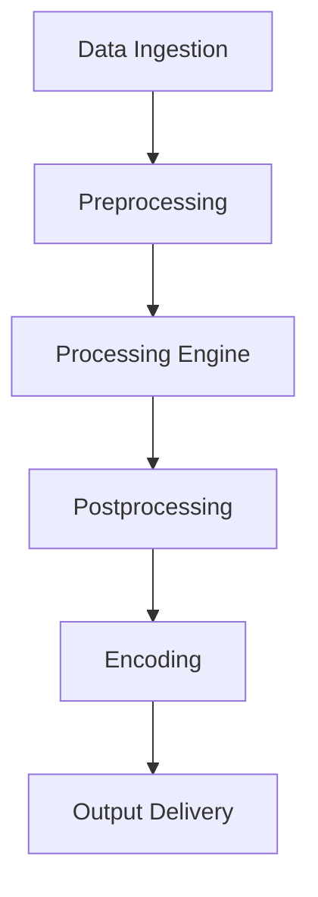

# Lesson 6: Architectural Design for Audio and Video Systems

## 1. First-Principles Intuition & Invariants

In the realm of audio and video generation, the foundational principles of signal processing and media encoding are paramount. These principles underpin the design of scalable and efficient systems capable of handling the vast data streams and computational demands inherent in audio and video processing. At the heart of these systems lies the need to balance quality, performance, and resource utilization, all while ensuring robustness and reliability.

Audio and video data are fundamentally temporal signals, characterized by their continuous nature and the need for precise timing and synchronization. Audio signals are typically represented as discrete samples of amplitude over time, captured at a specific sampling rate (e.g., 44.1 kHz for CD-quality audio). Video, on the other hand, is a sequence of frames, each representing a still image captured at a specific frame rate (e.g., 24 fps for film, 30 fps for NTSC video). The challenge in audio and video generation is to process these signals in real-time or near-real-time, often with minimal latency and high fidelity.

From a mathematical perspective, audio and video signals can be analyzed using Fourier transforms, which decompose the signals into their constituent frequencies. This decomposition is crucial for tasks such as filtering, compression, and synthesis. In the context of audio, frequency analysis can help identify and manipulate specific audio components, such as bass, midrange, and treble. For video, frequency analysis can be used to identify spatial and temporal redundancies, which are key to efficient compression techniques.

The invariants in audio and video systems include the need for consistent sampling rates and frame rates, the preservation of signal integrity during processing, and the efficient use of computational resources. These invariants are critical for ensuring that the generated audio and video content meets the desired quality standards and can be delivered in a timely manner.

## 2. Core Architecture & Mechanics

The architecture of an audio and video generation system is a complex interplay of components designed to handle data ingestion, processing, and output. At a high level, the system can be divided into several key components: the data pipeline, the processing engine, and the output interface.

### Data Pipeline

The data pipeline is responsible for ingesting raw audio and video data, preprocessing it, and making it available for further processing. This involves tasks such as decoding compressed audio and video streams, synchronizing audio and video tracks, and converting data into a format suitable for processing. The data pipeline must be robust and efficient, capable of handling large volumes of data with minimal latency.

### Processing Engine

The processing engine is the core of the audio and video generation system, responsible for applying various transformations and effects to the input data. This can include tasks such as audio equalization, video filtering, and the application of generative models to synthesize new audio and video content. The processing engine must be highly parallelizable, leveraging modern hardware accelerators such as GPUs and FPGAs to achieve high performance.

### Output Interface

The output interface is responsible for encoding the processed audio and video data into a format suitable for delivery. This involves tasks such as encoding audio and video streams using compression algorithms, packaging the data into a container format, and delivering the final output to the end user. The output interface must be flexible, supporting a wide range of output formats and delivery mechanisms.

To illustrate the architecture of an audio and video generation system, consider the following diagram:

In this diagram, the data ingestion component is responsible for acquiring raw audio and video data from various sources. The preprocessing component performs initial transformations, such as decoding and synchronization. The processing engine applies the core transformations and effects, leveraging parallel processing techniques to achieve high performance. The postprocessing component performs any final transformations, such as filtering and normalization. The encoding component compresses the processed data into a suitable format, and the output delivery component delivers the final output to the end user.

## 3. High-Performance Optimization & Failure Modes

To ensure the scalability and efficiency of an audio and video generation system, several optimization techniques and failure modes must be considered.

### Concurrency

Concurrency is a critical aspect of audio and video processing, as the system must handle large volumes of data in real-time. To achieve high concurrency, the system can leverage parallel processing techniques, such as multithreading and GPU acceleration. Multithreading can be used to parallelize tasks such as data preprocessing and postprocessing, while GPU acceleration can be used to accelerate computationally intensive tasks such as video filtering and generative model inference.

### Resource Scaling

Resource scaling is another critical aspect of audio and video processing, as the system must be able to handle varying loads and resource constraints. To achieve resource scaling, the system can leverage cloud-based infrastructure, such as Kubernetes clusters, to dynamically allocate resources based on demand. Kubernetes provides a declarative state machine for managing containerized applications, allowing the system to scale up or down as needed.

### Boundary Edge Cases

Boundary edge cases are a common source of failure in audio and video processing systems. These cases include scenarios such as missing or corrupted data, unexpected input formats, and extreme processing loads. To mitigate these failure modes, the system must be robust and resilient, capable of handling unexpected inputs and recovering from errors. This can be achieved through the use of error detection and correction techniques, as well as comprehensive testing and validation.

### Failure Mitigations

Failure mitigations are critical for ensuring the reliability and robustness of an audio and video generation system. To mitigate failures, the system can leverage redundancy and fault tolerance techniques, such as load balancing and failover mechanisms. Load balancing can be used to distribute processing tasks across multiple nodes, ensuring that no single node becomes a bottleneck. Failover mechanisms can be used to automatically switch to a backup node in the event of a failure, ensuring that the system remains operational.

In conclusion, the design of an audio and video generation system requires a deep understanding of the underlying principles of signal processing and media encoding. The architecture must be robust, efficient, and scalable, capable of handling large volumes of data in real-time. By leveraging parallel processing techniques, cloud-based infrastructure, and redundancy and fault tolerance mechanisms, the system can achieve high performance and reliability, delivering high-quality audio and video content to the end user.
