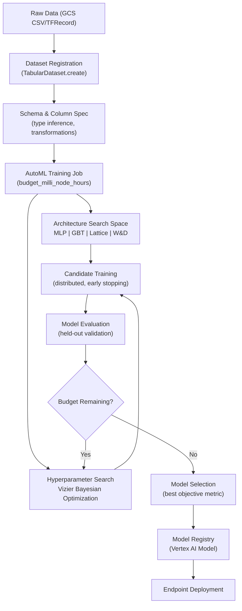
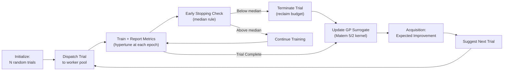

# Lesson 2: AutoML Training Mechanisms

## 1. First-Principles Intuition & Invariants

Automated machine learning collapses three interlocking optimization problems into a single managed execution context. Given a dataset $D$, the AutoML system seeks the joint optimum across an architecture space $\mathcal{A}$, a hyperparameter space $\Theta$, and a data transformation space $\Phi$. Formally, the objective is to find $(a^*, \theta^*, \phi^*) = \arg\min_{a, \theta, \phi} \mathcal{L}(f_a(\cdot; \theta), \phi(D_{\text{val}}))$, where $\mathcal{L}$ is a task-specific loss function and $f_a$ is a model parameterized by architecture $a$ and weights determined during training under hyperparameter configuration $\theta$. This joint optimization is what separates AutoML from simple hyperparameter tuning: the search space includes the model topology itself, not just the knobs on a fixed topology.

The combinatorial explosion is immediate. Consider a modest search space: 6 choices for number of layers, 8 choices for hidden width, 4 activation functions, 3 optimizer families, a continuous learning rate range, dropout probability, and 15 possible feature engineering transforms per column. The Cartesian product exceeds $10^{15}$ configurations. Exhaustive evaluation is computationally infeasible for any non-trivial model, which forces AutoML systems to operate as sample-efficient search algorithms rather than brute-force enumerators.

Google Vertex AI addresses this intractability through two complementary engines. The first, AutoML Tables (and its counterparts for vision, text, and video), provides a fully managed neural architecture search over a curated space of model families including multi-layer perceptrons, gradient-boosted trees, TensorFlow Lattice models for monotonicity constraints, and Wide & Deep architectures. The second, Vertex AI Vizier, exposes a general-purpose black-box optimization service based on Bayesian optimization, allowing practitioners to tune hyperparameters on custom training jobs. Both engines share a common theoretical foundation: Gaussian Process (GP) surrogate modeling combined with acquisition functions that balance exploration of uncertain regions against exploitation of promising ones.

The Gaussian Process surrogate is the mathematical object that makes AutoML tractable. A GP defines a distribution over functions, parameterized by a mean function $\mu(x)$ and a kernel $k(x, x')$ that encodes similarity between configurations. Given a set of evaluated configurations $\{(x_i, y_i)\}_{i=1}^n$ where $x_i$ is a hyperparameter vector and $y_i$ is the observed validation metric, the posterior distribution at a new point $x_*$ is Gaussian with mean $\mu_*(x_*) = k_*^T (K + \sigma_n^2 I)^{-1} y$ and variance $\sigma_*^2(x_*) = k(x_*, x_*) - k_*^T (K + \sigma_n^2 I)^{-1} k_*$, where $K$ is the kernel matrix over evaluated points and $k_*$ is the kernel vector between $x_*$ and the evaluated points. Vizier uses a Matérn-5/2 kernel, which produces twice-differentiable sample paths that better model the non-smooth loss landscapes typical of neural network training than the smoother squared-exponential kernel. The posterior mean $\mu_*(x_*)$ estimates expected performance at $x_*$, while the posterior variance $\sigma_*^2(x_*)$ quantifies uncertainty. The acquisition function uses both quantities to decide where to sample next.

Vertex AI Vizier's default acquisition strategy is Expected Improvement (EI), defined as $\text{EI}(x) = \mathbb{E}[\max(f(x) - f(x^+), 0)]$, where $f(x^+)$ is the best observed value. Under the GP posterior, this has a closed-form solution: $\text{EI}(x) = (\mu_*(x) - f(x^+) - \xi) \Phi\left(\frac{\mu_*(x) - f(x^+) - \xi}{\sigma_*(x)}\right) + \sigma_*(x) \phi\left(\frac{\mu_*(x) - f(x^+) - \xi}{\sigma_*(x)}\right)$, where $\Phi$ and $\phi$ are the standard normal CDF and PDF, and $\xi$ is an exploration parameter. When $\sigma_*(x)$ is high (unexplored region), the second term dominates, encouraging exploration. When $\mu_*(x)$ is high (explored, promising region), the first term dominates, encouraging exploitation. This balance is what gives Bayesian optimization its sample efficiency relative to random or grid search, typically finding near-optimal configurations in 10-50 evaluations where grid search would require thousands.

Transfer learning injects a structural prior into this optimization. Instead of searching architectures from scratch, the system starts from a pre-trained backbone (EfficientNet for vision, BERT-family Transformers for text, or learned embeddings for tabular data) and searches only over the classification head, learning rate, and fine-tuning schedule. This reduces the effective search space by orders of magnitude, because the backbone's feature extraction layers are already initialized to a useful representation. The theoretical justification is that pre-training on a large corpus (ImageNet, Wikipedia) places the model in a region of parameter space that generalizes across tasks, and the fine-tuning optimization landscape is correspondingly smoother and more convex near this initialization. In practice, this means a transfer learning pipeline on Vertex AI can achieve state-of-the-art accuracy with a training budget of minutes rather than the hours required for full NAS.

The training budget is the invariant that governs the entire AutoML process. Vertex AI expresses this in milli-node-hours, where one thousand milli-node-hours equals one compute-node running for one hour. The budget is a hard constraint: the search algorithm allocates these compute resources across candidate architectures and hyperparameter configurations, and when the budget is exhausted, the best-performing model found so far is returned. This framing makes the tradeoff explicit. A larger budget allows the GP surrogate to model the loss landscape more accurately and increases the probability of finding the global optimum, but it costs more. A smaller budget forces the search to be more aggressive in pruning underperforming candidates, which risks missing good configurations in unexplored regions. The practitioner's job is to set this budget at a level where the marginal improvement in model quality justifies the marginal compute cost.

Early stopping is the mechanism that reclaims wasted budget from underperforming trials. The median stopping rule, used by Vizier, terminates a trial if its intermediate metric at step $t$ falls below the median of all completed trials' metrics at the same step, with a grace period of `min_trials` initial evaluations before the rule activates. This is computationally cheap (no surrogate model required) and robust to non-stationary training dynamics, because it compares trials at the same training step rather than extrapolating. The rule assumes that if a trial's validation loss is below the median at step $t$, it is unlikely to surpass the best trial by the end of training. This assumption is empirically well-supported for most supervised learning tasks, though it can be violated by training schedules with large late-stage learning rate drops, where a trial might recover after appearing to underperform.

## 2. Core Architecture & Mechanics

The Vertex AI AutoML pipeline operates as a sequence of managed stages, each of which transforms an input artifact into an output artifact suitable for the next stage. Raw data in Google Cloud Storage enters the pipeline as CSV or TFRecord files. The dataset service registers this data with a schema, creating a versioned artifact that the training job references. The AutoML training job then orchestrates the search over architectures and hyperparameters, producing a trained model artifact. The model evaluation service computes metrics on a held-out partition, and the model registry stores the final model for deployment.



The Vizier optimization loop operates concurrently with this pipeline, managing the search as a closed-loop control system. It maintains the GP surrogate model, selects the next configuration via the acquisition function, dispatches trials to worker machines, collects intermediate metrics, applies early stopping, and updates the surrogate. The loop runs until the trial count reaches its maximum or the budget is exhausted.



### AutoML Tables: Managed Architecture Search

The AutoML Tables training job encapsulates the entire search process. The practitioner defines the dataset, the optimization objective, the column specifications, and the budget. Vertex AI handles the rest: architecture selection, hyperparameter tuning, distributed training, early stopping, and model evaluation. The following code creates a tabular dataset, defines column transformations, submits an AutoML training job with a specified budget, and retrieves the evaluation metrics.

```python
import google.cloud.aiplatform as aiplatform
import json
import time

PROJECT_ID = "ml-platform-prod"
REGION = "us-central1"
BUCKET_URI = f"gs://{PROJECT_ID}-automl-artifacts"
DATA_SOURCE = f"{BUCKET_URI}/data/churn_train.csv"

aiplatform.init(project=PROJECT_ID, location=REGION, staging_bucket=BUCKET_URI)

dataset = aiplatform.TabularDataset.create(
    display_name="churn-prediction-dataset",
    gcs_source=DATA_SOURCE,
)

column_transformations = [
    {"auto": {"column_name": "tenure_months"}},
    {"auto": {"column_name": "monthly_charges"}},
    {"auto": {"column_name": "total_charges"}},
    {"auto": {"column_name": "avg_call_minutes"}},
    {"auto": {"column_name": "num_support_tickets"}},
    {"categorical": {"column_name": "contract_type"}},
    {"categorical": {"column_name": "payment_method"}},
    {"categorical": {"column_name": "internet_service"}},
    {"categorical": {"column_name": "online_security"}},
    {"categorical": {"column_name": "tech_support"}},
    {"categorical": {"column_name": "streaming_tv"}},
    {"categorical": {"column_name": "paperless_billing"}},
    {"categorical": {"column_name": "gender"}},
    {"categorical": {"column_name": "senior_citizen"}},
    {"categorical": {"column_name": "partner"}},
    {"categorical": {"column_name": "dependents"}},
]

job = aiplatform.AutoMLTabularTrainingJob(
    display_name="churn-automl-classifier",
    optimization_prediction_type="classification",
    optimization_objective="maximize-au-prc",
    column_transformations=column_transformations,
)

model = job.run(
    dataset=dataset,
    target_column="churn",
    budget_milli_node_hours=2000,
    model_display_name="churn-model-v1",
    predefined_split_column_name="split_column",
    sync=True,
)

evaluations = model.list_evaluations()
for evaluation in evaluations:
    metrics = evaluation.metrics
    print(json.dumps(metrics, indent=2))

feature_importance = model.get_feature_importance()
for feature, importance in feature_importance:
    print(f"{feature}: {importance:.4f}")

model.deploy(
    deployed_model_display_name="churn-endpoint-v1",
    machine_type="n1-standard-4",
    min_replica_count=1,
    max_replica_count=3,
    traffic_split={"0": 100},
    sync=True,
)
```

The `budget_milli_node_hours` parameter is the primary control on search depth. A value of 2000 allocates two node-hours of compute. For a binary classification task with 16 features and roughly 50,000 rows, this budget is sufficient for Vizier to evaluate 30-50 candidate architectures, including several MLP configurations, gradient-boosted tree ensembles, and Wide & Deep variants. Doubling the budget to 4000 typically yields a 1-3% improvement in the optimization objective, with diminishing returns beyond 8000 milli-node-hours for tabular datasets of this scale. The `predefined_split_column_name` parameter references a column in the dataset containing values `TRAIN`, `VALIDATE`, and `TEST`, which AutoML uses to partition the data deterministically rather than randomly, ensuring reproducibility across runs.

### Vizier Bayesian Hyperparameter Tuning

When the architecture is fixed and the search space consists only of hyperparameters, Vertex AI Vizier provides direct access to the Bayesian optimization engine. The practitioner defines a study specification containing the search space (parameters and their ranges), the optimization metric, the search algorithm, and the trial execution configuration. Vizier then manages the search loop, suggesting configurations and collecting results.

The study specification maps each hyperparameter to a type and range. Continuous parameters use `double_value_spec` with `min_value` and `max_value`. Discrete ordinal parameters use `integer_value_spec`. Categorical parameters use `categorical_value_spec` with a list of allowed values. The `scale_type` parameter tells Vizier how to space samples within the range: `UNIT_LOG_SCALE` samples logarithmically (appropriate for learning rates and regularization strengths where the useful range spans orders of magnitude), while `UNIT_LINEAR_SCALE` samples uniformly (appropriate for layer counts and batch sizes where the useful range is compact).

```python
import google.cloud.aiplatform as aiplatform
from google.cloud import aiplatform_v1

PROJECT_ID = "ml-platform-prod"
REGION = "us-central1"
BUCKET_URI = f"gs://{PROJECT_ID}-vizier-artifacts"
IMAGE_URI = f"us-docker.pkg.dev/{PROJECT_ID}/vertex-containers/tf-tuner:latest"
DATA_PATH = f"{BUCKET_URI}/data/churn"

aiplatform.init(project=PROJECT_ID, location=REGION, staging_bucket=BUCKET_URI)

study_spec = {
    "algorithm": "BAYESIAN_OPTIMIZATION",
    "parameters": [
        {
            "parameter_id": "learning_rate",
            "double_value_spec": {
                "min_value": 0.0001,
                "max_value": 0.01,
            },
            "scale_type": "UNIT_LOG_SCALE",
        },
        {
            "parameter_id": "num_layers",
            "integer_value_spec": {
                "min_value": 2,
                "max_value": 8,
            },
            "scale_type": "UNIT_LINEAR_SCALE",
        },
        {
            "parameter_id": "hidden_units",
            "integer_value_spec": {
                "min_value": 32,
                "max_value": 512,
            },
            "scale_type": "UNIT_LOG_SCALE",
        },
        {
            "parameter_id": "dropout_rate",
            "double_value_spec": {
                "min_value": 0.0,
                "max_value": 0.6,
            },
            "scale_type": "UNIT_LINEAR_SCALE",
        },
        {
            "parameter_id": "l2_strength",
            "double_value_spec": {
                "min_value": 1e-8,
                "max_value": 1e-2,
            },
            "scale_type": "UNIT_LOG_SCALE",
        },
        {
            "parameter_id": "optimizer",
            "categorical_value_spec": {
                "values": ["adam", "adamw", "sgd_momentum"],
            },
        },
        {
            "parameter_id": "batch_size",
            "integer_value_spec": {
                "min_value": 16,
                "max_value": 256,
            },
            "scale_type": "UNIT_LOG_SCALE",
        },
        {
            "parameter_id": "warmup_steps",
            "integer_value_spec": {
                "min_value": 0,
                "max_value": 500,
            },
            "scale_type": "UNIT_LINEAR_SCALE",
        },
    ],
    "metrics": [
        {
            "metric_id": "val_loss",
            "goal": "MINIMIZE",
        },
        {
            "metric_id": "val_auc",
            "goal": "MAXIMIZE",
        },
    ],
    "measurement_selection_type": "BEST_MEASUREMENT",
    "max_trial_count": 200,
    "parallel_trial_count": 10,
}

worker_pool_specs = [
    {
        "machine_spec": {
            "machine_type": "n1-standard-8",
        },
        "replica_count": 1,
        "container_spec": {
            "image_uri": IMAGE_URI,
            "args": [
                f"--data_path={DATA_PATH}",
                "--learning_rate=${trial.learning_rate}",
                "--num_layers=${trial.num_layers}",
                "--hidden_units=${trial.hidden_units}",
                "--dropout_rate=${trial.dropout_rate}",
                "--l2_strength=${trial.l2_strength}",
                "--optimizer=${trial.optimizer}",
                "--batch_size=${trial.batch_size}",
                "--warmup_steps=${trial.warmup_steps}",
            ],
        },
    }
]

hpt_job = aiplatform.HyperparameterTuningJob(
    display_name="churn-bayesian-tuning-v1",
    worker_pool_specs=worker_pool_specs,
    study_spec=study_spec,
    max_trial_count=200,
    parallel_trial_count=10,
)

hpt_job.run(sync=True)

trials = hpt_job.trials
completed = [t for t in trials if t.state == 2]

completed.sort(key=lambda t: t.final_measurement.metrics[0].value)
best_trial = completed[0]
print(f"Best trial ID: {best_trial.id}")
print(f"Best val_loss: {best_trial.final_measurement.metrics[0].value:.6f}")

for param in best_trial.parameters:
    print(f"  {param.parameter_id}: {param.value}")

print(f"\nTotal completed trials: {len(completed)}/{len(trials)}")
print(f"Early-stopped trials: {len([t for t in trials if t.state == 3])}")
```

The `measurement_selection_type` field controls how Vizier aggregates multiple intermediate measurements from a single trial. `BEST_MEASUREMENT` selects the best metric value reported during the trial, which is appropriate when training is non-monotonic (for example, when learning rate decay causes a late improvement). `LAST_MEASUREMENT` uses the final reported value, which is appropriate when training is reliably monotonic. The `max_trial_count` caps the total number of configurations Vizier will evaluate, while `parallel_trial_count` controls how many trials run simultaneously. Setting the parallel count too high relative to the total count undermines the Bayesian optimization's sample efficiency, because many trials launch before the surrogate model has enough data to make informed suggestions. A ratio of 5-10% parallel to total (for example, 10 parallel out of 200 total) gives the GP time to incorporate early trial results before dispatching later ones.

The training script that runs inside the container must parse the hyperparameters passed as command-line arguments and report intermediate metrics back to Vizier using the `cloudml-hypertune` library. The library writes metrics to a file that Vertex AI's trial manager reads at each step, which Vizier uses both for the GP update and for early stopping decisions.

```python
import argparse
import json
import os
import hypertune
import tensorflow as tf
import numpy as np

def parse_args():
    parser = argparse.ArgumentParser(
        description="Vertex AI Vizier hyperparameter tuning training script"
    )
    parser.add_argument("--learning_rate", type=float, default=0.001)
    parser.add_argument("--num_layers", type=int, default=4)
    parser.add_argument("--hidden_units", type=int, default=256)
    parser.add_argument("--dropout_rate", type=float, default=0.3)
    parser.add_argument("--l2_strength", type=float, default=1e-5)
    parser.add_argument("--optimizer", type=str, default="adam")
    parser.add_argument("--batch_size", type=int, default=64)
    parser.add_argument("--warmup_steps", type=int, default=100)
    parser.add_argument("--epochs", type=int, default=200)
    parser.add_argument("--patience", type=int, default=20)
    parser.add_argument("--data_path", type=str, required=True)
    parser.add_argument(
        "--model_dir",
        type=str,
        default=os.environ.get("AIP_MODEL_DIR", "/tmp/model"),
    )
    return parser.parse_args()


def create_optimizer(name, learning_rate):
    if name == "adam":
        return tf.keras.optimizers.Adam(learning_rate=learning_rate)
    elif name == "adamw":
        return tf.keras.optimizers.AdamW(
            learning_rate=learning_rate, weight_decay=0.01
        )
    elif name == "sgd_momentum":
        return tf.keras.optimizers.SGD(
            learning_rate=learning_rate, momentum=0.9, nesterov=True
        )
    raise ValueError(f"Unknown optimizer: {name}")


def build_model(args, num_features):
    inputs = tf.keras.Input(shape=(num_features,), name="features")

    x = inputs
    for i in range(args.num_layers):
        x = tf.keras.layers.Dense(
            args.hidden_units,
            activation="relu",
            kernel_initializer="he_normal",
            kernel_regularizer=tf.keras.regularizers.l2(args.l2_strength),
            name=f"dense_{i}",
        )(x)
        x = tf.keras.layers.BatchNormalization(name=f"bn_{i}")(x)
        x = tf.keras.layers.Dropout(args.dropout_rate, name=f"dropout_{i}")(x)

    outputs = tf.keras.layers.Dense(1, activation="sigmoid", name="output")(x)

    model = tf.keras.Model(inputs=inputs, outputs=outputs)

    optimizer = create_optimizer(args.optimizer, args.learning_rate)
    model.compile(
        optimizer=optimizer,
        loss="binary_crossentropy",
        metrics=[
            tf.keras.metrics.BinaryAccuracy(name="accuracy"),
            tf.keras.metrics.AUC(name="auc"),
        ],
    )
    return model


def load_csv_dataset(file_path, batch_size, is_training):
    dataset = tf.data.experimental.make_csv_dataset(
        file_path,
        batch_size=batch_size,
        label_name="churn",
        num_epochs=1 if not is_training else None,
        shuffle=is_training,
        shuffle_buffer_size=10000,
        na_value="",
    )

    def preprocess(features, label):
        numeric_tensors = []
        for key in sorted(features.keys()):
            tensor = tf.cast(features[key], tf.float32)
            numeric_tensors.append(tensor)
        feature_vector = tf.stack(numeric_tensors, axis=1)
        label = tf.cast(label, tf.float32)
        label = tf.reshape(label, [-1, 1])
        return feature_vector, label

    dataset = dataset.map(preprocess, num_parallel_calls=tf.data.AUTOTUNE)
    dataset = dataset.prefetch(tf.data.AUTOTUNE)
    return dataset


class WarmupLearningRateSchedule(tf.keras.optimizers.schedules.LearningRateSchedule):
    def __init__(self, base_lr, warmup_steps, total_steps, decay_rate=0.97):
        super().__init__()
        self.base_lr = base_lr
        self.warmup_steps = warmup_steps
        self.total_steps = total_steps
        self.decay_rate = decay_rate

    def __call__(self, step):
        step = tf.cast(step, tf.float32)
        warmup_lr = self.base_lr * (step / tf.cast(self.warmup_steps, tf.float32))
        decay_steps = tf.maximum(step - tf.cast(self.warmup_steps, tf.float32), 0.0)
        decay_lr = self.base_lr * tf.pow(
            self.decay_rate, decay_steps / 1000.0
        )
        return tf.where(
            step < tf.cast(self.warmup_steps, tf.float32),
            warmup_lr,
            decay_lr,
        )

    def get_config(self):
        return {
            "base_lr": self.base_lr,
            "warmup_steps": self.warmup_steps,
            "total_steps": self.total_steps,
            "decay_rate": self.decay_rate,
        }


class VizierReporter(tf.keras.callbacks.Callback):
    def __init__(self, hpt):
        super().__init__()
        self.hpt = hpt

    def on_epoch_end(self, epoch, logs=None):
        if logs is None:
            return
        val_loss = float(logs.get("val_loss", 0.0))
        val_auc = float(logs.get("val_auc", 0.0))
        self.hpt.report_hyperparameter_tuning_metric(
            hyperparameter_metric_tag="val_loss",
            metric_value=val_loss,
            global_step=epoch,
        )
        self.hpt.report_hyperparameter_tuning_metric(
            hyperparameter_metric_tag="val_auc",
            metric_value=val_auc,
            global_step=epoch,
        )


def main():
    args = parse_args()
    hpt = hypertune.HyperTune()

    train_path = os.path.join(args.data_path, "train.csv")
    val_path = os.path.join(args.data_path, "val.csv")

    with open(train_path, "r") as f:
        header = f.readline().strip().split(",")
    num_features = len(header) - 1

    train_dataset = load_csv_dataset(train_path, args.batch_size, is_training=True)
    val_dataset = load_csv_dataset(val_path, args.batch_size, is_training=False)

    model = build_model(args, num_features)

    if args.warmup_steps > 0:
        steps_per_epoch = 500
        total_steps = steps_per_epoch * args.epochs
        lr_schedule = WarmupLearningRateSchedule(
            base_lr=args.learning_rate,
            warmup_steps=args.warmup_steps,
            total_steps=total_steps,
        )
        optimizer = model.optimizer.__class__.from_config(model.optimizer.get_config())
        optimizer.learning_rate = lr_schedule
        model.compile(
            optimizer=optimizer,
            loss=model.loss,
            metrics=model.compiled_metrics.metrics,
        )

    callbacks = [
        tf.keras.callbacks.EarlyStopping(
            monitor="val_loss",
            patience=args.patience,
            restore_best_weights=True,
            mode="min",
            verbose=1,
        ),
        tf.keras.callbacks.ReduceLROnPlateau(
            monitor="val_loss",
            factor=0.5,
            patience=8,
            min_lr=1e-8,
            mode="min",
            verbose=1,
        ),
        VizierReporter(hpt),
    ]

    history = model.fit(
        train_dataset,
        validation_data=val_dataset,
        epochs=args.epochs,
        callbacks=callbacks,
        verbose=2,
    )

    model.save(args.model_dir)

    best_val_loss = min(history.history["val_loss"])
    best_val_auc = max(history.history["val_auc"])
    best_epoch = history.history["val_loss"].index(best_val_loss)

    print(f"\nBest epoch: {best_epoch + 1}")
    print(f"Best val_loss: {best_val_loss:.6f}")
    print(f"Best val_auc: {best_val_auc:.6f}")
    print(f"Model saved to: {args.model_dir}")


if __name__ == "__main__":
    main()
```

The container image for this training script uses Vertex AI's pre-built TensorFlow image as a base, adding only the `cloudml-hypertune` package and the training script.

```dockerfile
FROM us-docker.pkg.dev/vertex-ai/training/tf-cpu.2-11:latest

WORKDIR /app

RUN pip install --no-cache-dir cloudml-hypertune==0.1.0.dev6

COPY trainer.py /app/trainer.py

ENTRYPOINT ["python", "trainer.py"]
```

Building and pushing the container:

```bash
docker build -t tf-tuner:latest .
docker tag tf-tuner:latest us-docker.pkg.dev/${PROJECT_ID}/vertex-containers/tf-tuner:latest
docker push us-docker.pkg.dev/${PROJECT_ID}/vertex-containers/tf-tuner:latest
```

### Transfer Learning on Vertex AI

Transfer learning bypasses the architecture search entirely by anchoring on a pre-trained backbone. The search space collapses to the classification head's architecture, the learning rate, and the fine-tuning schedule. This reduces the Vizier study to a small number of continuous parameters, typically converging in 10-20 trials rather than the 100+ required for from-scratch NAS.

For image classification, the backbone is typically an EfficientNet or ResNet variant from TensorFlow Hub. The training script loads the backbone as a non-trainable Keras layer during an initial warmup phase, then selectively unfreezes the top layers for fine-tuning at a reduced learning rate. The following training script implements this two-phase approach.

```python
import argparse
import os
import hypertune
import tensorflow as tf
import tensorflow_hub as hub

def parse_args():
    parser = argparse.ArgumentParser(
        description="Transfer learning training script for Vertex AI"
    )
    parser.add_argument(
        "--backbone_url",
        type=str,
        default="https://tfhub.dev/google/imagenet/efficientnet_b0/feature_vector/5",
    )
    parser.add_argument("--num_classes", type=int, default=10)
    parser.add_argument("--head_units", type=int, default=512)
    parser.add_argument("--head_layers", type=int, default=2)
    parser.add_argument("--dropout_rate", type=float, default=0.3)
    parser.add_argument("--learning_rate", type=float, default=0.001)
    parser.add_argument("--fine_tune_lr", type=float, default=0.0001)
    parser.add_argument("--warmup_epochs", type=int, default=5)
    parser.add_argument("--fine_tune_epochs", type=int, default=20)
    parser.add_argument("--batch_size", type=int, default=32)
    parser.add_argument("--image_size", type=int, default=224)
    parser.add_argument("--data_path", type=str, required=True)
    parser.add_argument(
        "--model_dir",
        type=str,
        default=os.environ.get("AIP_MODEL_DIR", "/tmp/model"),
    )
    return parser.parse_args()


def build_transfer_model(backbone_url, num_classes, head_units, head_layers,
                         dropout_rate, image_size, trainable_backbone=False):
    inputs = tf.keras.Input(
        shape=(image_size, image_size, 3), name="input_image"
    )
    x = tf.keras.layers.Rescaling(1.0 / 255.0, name="rescaling")(inputs)

    backbone = hub.KerasLayer(
        backbone_url,
        trainable=trainable_backbone,
        name="backbone",
    )
    features = backbone(x)

    for i in range(head_layers):
        features = tf.keras.layers.Dense(
            head_units,
            activation="relu",
            kernel_initializer="he_normal",
            name=f"head_dense_{i}",
        )(features)
        features = tf.keras.layers.BatchNormalization(
            name=f"head_bn_{i}"
        )(features)
        features = tf.keras.layers.Dropout(
            dropout_rate, name=f"head_dropout_{i}"
        )(features)

    outputs = tf.keras.layers.Dense(
        num_classes, activation="softmax", name="classification_head"
    )(features)

    model = tf.keras.Model(inputs=inputs, outputs=outputs, name="transfer_model")
    return model, backbone


def load_image_dataset(data_dir, batch_size, image_size, is_training):
    pattern = os.path.join(data_dir, "*" if is_training else "val/*")
    dataset = tf.keras.utils.image_dataset_from_directory(
        data_dir,
        image_size=(image_size, image_size),
        batch_size=batch_size,
        shuffle=is_training,
        seed=42 if is_training else None,
        label_mode="categorical",
    )

    def augment(image, label):
        if is_training:
            image = tf.image.random_flip_left_right(image)
            image = tf.image.random_brightness(image, max_delta=0.1)
            image = tf.image.random_contrast(image, lower=0.9, upper=1.1)
            image = tf.image.random_saturation(image, lower=0.9, upper=1.1)
        return image, label

    dataset = dataset.map(augment, num_parallel_calls=tf.data.AUTOTUNE)
    dataset = dataset.prefetch(tf.data.AUTOTUNE)
    return dataset


class VizierReporter(tf.keras.callbacks.Callback):
    def __init__(self, hpt, metric_tag="val_loss"):
        super().__init__()
        self.hpt = hpt
        self.metric_tag = metric_tag

    def on_epoch_end(self, epoch, logs=None):
        if logs is None:
            return
        val_loss = float(logs.get("val_loss", 0.0))
        val_accuracy = float(logs.get("val_accuracy", 0.0))
        self.hpt.report_hyperparameter_tuning_metric(
            hyperparameter_metric_tag="val_loss",
            metric_value=val_loss,
            global_step=epoch,
        )
        self.hpt.report_hyperparameter_tuning_metric(
            hyperparameter_metric_tag="val_accuracy",
            metric_value=val_accuracy,
            global_step=epoch,
        )


def main():
    args = parse_args()
    hpt = hypertune.HyperTune()

    train_dir = os.path.join(args.data_path, "train")
    val_dir = os.path.join(args.data_path, "val")

    train_dataset = load_image_dataset(
        train_dir, args.batch_size, args.image_size, is_training=True
    )
    val_dataset = load_image_dataset(
        val_dir, args.batch_size, args.image_size, is_training=False
    )

    # Phase 1: Frozen backbone, train only the classification head
    print("=" * 60)
    print("Phase 1: Training classification head (frozen backbone)")
    print("=" * 60)

    model, backbone = build_transfer_model(
        backbone_url=args.backbone_url,
        num_classes=args.num_classes,
        head_units=args.head_units,
        head_layers=args.head_layers,
        dropout_rate=args.dropout_rate,
        image_size=args.image_size,
        trainable_backbone=False,
    )

    model.compile(
        optimizer=tf.keras.optimizers.Adam(learning_rate=args.learning_rate),
        loss="categorical_crossentropy",
        metrics=["accuracy"],
    )

    phase1_callbacks = [
        tf.keras.callbacks.EarlyStopping(
            monitor="val_loss", patience=5, restore_best_weights=True,
            mode="min", verbose=1,
        ),
        VizierReporter(hpt),
    ]

    model.fit(
        train_dataset,
        validation_data=val_dataset,
        epochs=args.warmup_epochs,
        callbacks=phase1_callbacks,
        verbose=2,
    )

    # Phase 2: Unfreeze backbone for fine-tuning at reduced learning rate
    print("=" * 60)
    print("Phase 2: Fine-tuning backbone (unfrozen, reduced LR)")
    print("=" * 60)

    backbone.trainable = True

    model.compile(
        optimizer=tf.keras.optimizers.Adam(learning_rate=args.fine_tune_lr),
        loss="categorical_crossentropy",
        metrics=["accuracy"],
    )

    phase2_callbacks = [
        tf.keras.callbacks.EarlyStopping(
            monitor="val_loss", patience=8, restore_best_weights=True,
            mode="min", verbose=1,
        ),
        tf.keras.callbacks.ReduceLROnPlateau(
            monitor="val_loss", factor=0.5, patience=4,
            min_lr=1e-8, mode="min", verbose=1,
        ),
        VizierReporter(hpt),
    ]

    history = model.fit(
        train_dataset,
        validation_data=val_dataset,
        epochs=args.fine_tune_epochs,
        callbacks=phase2_callbacks,
        verbose=2,
    )

    model.save(args.model_dir)

    best_val_loss = min(history.history["val_loss"])
    best_val_acc = max(history.history["val_accuracy"])
    best_epoch = history.history["val_loss"].index(best_val_loss)

    print(f"\nBest epoch: {best_epoch + 1}")
    print(f"Best val_loss: {best_val_loss:.6f}")
    print(f"Best val_accuracy: {best_val_acc:.6f}")
    print(f"Model saved to: {args.model_dir}")


if __name__ == "__main__":
    main()
```

The two-phase training schedule is the mechanism that makes transfer learning effective. During Phase 1, the backbone is frozen, and only the randomly initialized classification head trains. The gradients flow through the backbone's pre-trained features but do not update its weights, which preserves the useful representations learned during pre-training. The learning rate can be relatively high (1e-3 is typical) because only the head's parameters are moving. During Phase 2, the backbone is unfrozen, and the entire model trains at a much lower learning rate (1e-4 or lower). This low rate is critical: a high learning rate applied to the unfrozen backbone would catastrophically forget the pre-trained features, degrading performance below even the frozen-backbone baseline.

Submitting this as a custom container training job on Vertex AI:

```python
import google.cloud.aiplatform as aiplatform

PROJECT_ID = "ml-platform-prod"
REGION = "us-central1"
BUCKET_URI = f"gs://{PROJECT_ID}-transfer-artifacts"
IMAGE_URI = f"us-docker.pkg.dev/{PROJECT_ID}/vertex-containers/transfer-trainer:latest"

aiplatform.init(project=PROJECT_ID, location=REGION, staging_bucket=BUCKET_URI)

job = aiplatform.CustomContainerTrainingJob(
    display_name="transfer-learning-efficientnet",
    container_uri=IMAGE_URI,
    model_serving_container_image_uri="us-docker.pkg.dev/vertex-ai/prediction/tf2-cpu.2-11:latest",
    model_serving_container_environment_vars={"GOOGLE_VERTEX_AI_PROJECT": PROJECT_ID},
)

model = job.run(
    args=[
        "--data_path=gs://your-bucket/image-data",
        "--num_classes=10",
        "--warmup_epochs=5",
        "--fine_tune_epochs=25",
        "--learning_rate=0.001",
        "--fine_tune_lr=0.0001",
        "--batch_size=32",
        "--dropout_rate=0.3",
    ],
    replica_count=1,
    machine_type="n1-standard-8",
    accelerator_type="NVIDIA_TESLA_T4",
    accelerator_count=1,
    model_display_name="transfer-model-v1",
    sync=True,
)

print(f"Model resource name: {model.resource_name}")
```

### Automated Feature Engineering with TensorFlow Transform

Automated feature engineering operates as a pre-processing stage that transforms raw data into a representation suitable for the model search. TensorFlow Transform (TFT) computes statistics over the entire training dataset (global aggregation) and applies transformations that depend on those statistics. This is fundamentally different from per-batch normalization, because the statistics are computed once over the full dataset and then fixed, ensuring that the same transformation is applied at training and serving time.

The key invariant of TFT is that the transformation function is computed in two phases. During the analyze phase, TFT reads the entire dataset and computes global statistics (means, standard deviations, vocabulary lists, quantile boundaries for bucketization). These statistics are serialized as a TensorFlow graph. During the transform phase, this graph is applied to each row of the dataset, producing transformed features. The same graph is embedded in the serving input receiver, so inference applies identical transformations without requiring a separate preprocessing server.

```python
import tensorflow as tf
import tensorflow_transform as tft
import tensorflow_transform.beam as tft_beam
from tfx_bsl.public import tfxio
import apache_beam as beam
import os
import argparse


COLUMNS = [
    "tenure_months",
    "monthly_charges",
    "total_charges",
    "avg_call_minutes",
    "num_support_tickets",
    "contract_type",
    "payment_method",
    "internet_service",
    "online_security",
    "tech_support",
    "streaming_tv",
    "paperless_billing",
    "gender",
    "senior_citizen",
    "partner",
    "dependents",
    "churn",
]

NUMERIC_COLUMNS = [
    "tenure_months",
    "monthly_charges",
    "total_charges",
    "avg_call_minutes",
    "num_support_tickets",
]

CATEGORICAL_COLUMNS = [
    "contract_type",
    "payment_method",
    "internet_service",
    "online_security",
    "tech_support",
    "streaming_tv",
    "paperless_billing",
    "gender",
    "senior_citizen",
    "partner",
    "dependents",
]

LABEL_COLUMN = "churn"

RAW_SCHEMA_TEXT = """
tenure_months: FLOAT
monthly_charges: FLOAT
total_charges: FLOAT
avg_call_minutes: FLOAT
num_support_tickets: FLOAT
contract_type: STRING
payment_method: STRING
internet_service: STRING
online_security: STRING
tech_support: STRING
streaming_tv: STRING
paperless_billing: STRING
gender: STRING
senior_citizen: STRING
partner: STRING
dependents: STRING
churn: STRING
"""


def preprocessing_fn(inputs):
    outputs = {}

    for col in NUMERIC_COLUMNS:
        filled = tft.fill_in_missing(inputs[col])
        outputs[col] = tft.scale_to_z_score(filled)

    total_charges = tft.fill_in_missing(inputs["total_charges"])
    total_charges = tf.maximum(total_charges, 0.01)
    outputs["total_charges_log"] = tft.scale_to_z_score(tf.math.log(total_charges))

    outputs["tenure_bucketized"] = tft.bucketize(
        tft.fill_in_missing(inputs["tenure_months"]),
        num_buckets=5,
    )

    outputs["charges_per_month"] = tft.scale_to_z_score(
        tf.math.divide(
            tft.fill_in_missing(inputs["total_charges"]),
            tf.maximum(tft.fill_in_missing(inputs["tenure_months"]), 1.0),
        )
    )

    for col in CATEGORICAL_COLUMNS:
        outputs[col] = tft.compute_and_apply_vocabulary(
            tft.fill_in_missing(inputs[col]),
            default_value=-1,
            num_oov_buckets=1,
        )

    outputs["contract_x_payment"] = tft.compute_and_apply_vocabulary(
        tf.strings.join([
            tft.fill_in_missing(inputs["contract_type"]),
            tft.fill_in_missing(inputs["payment_method"]),
        ], separator="_"),
        default_value=-1,
        num_oov_buckets=1,
    )

    outputs["label"] = tft.compute_and_apply_vocabulary(
        tft.fill_in_missing(inputs[LABEL_COLUMN]),
        default_value=-1,
    )

    return outputs


def run_tft_pipeline(input_pattern, output_dir, temp_dir):
    os.makedirs(temp_dir, exist_ok=True)

    schema = tft.tf_metadata.schema_utils.schema_from_feature_spec({
        col: tf.io.FixedLenFeature([], tf.float32) for col in NUMERIC_COLUMNS
    })

    from tensorflow_metadata.proto.v0 import schema_pb2
    from google.protobuf import text_format

    schema = text_format.Parse(RAW_SCHEMA_TEXT, schema_pb2.Schema())

    with beam.Pipeline() as pipeline:
        with tft_beam.Context(temp_dir=temp_dir):
            csv_tfxio = tfxio.CsvTfxIo(
                file_pattern=input_pattern,
                column_names=COLUMNS,
                schema=schema,
            )

            raw_data = (
                pipeline
                | "ReadCSV" >> csv_tfxio.BeamSource()
            )

            raw_data, raw_metadata = (
                raw_data
                | "AnalyzeDataset" >> tft_beam.AnalyzeAndTransformDataset(
                    preprocessing_fn
                )
            )

            transformed_data, transformed_metadata = raw_data

            transformed_example_coder = tft.coders.ExampleProtoCoder(
                transformed_metadata.schema
            )

            _ = (
                transformed_data
                | "Serialize" >> beam.Map(transformed_example_coder.encode)
                | "WriteTFRecords" >> beam.io.WriteToTFRecord(
                    file_path_prefix=os.path.join(output_dir, "transformed"),
                    file_name_suffix=".tfrecord",
                )
            )

            _ = (
                raw_metadata
                | "WriteTransformFn" >> tft_beam.WriteTransformFn(output_dir)
            )

            _ = (
                transformed_metadata
                | "WriteTransformedMetadata"
                >> tft_beam.WriteTransformedMetadata(output_dir)
            )

    print(f"Transform artifacts written to {output_dir}")


if __name__ == "__main__":
    parser = argparse.ArgumentParser()
    parser.add_argument("--input", type=str, required=True)
    parser.add_argument("--output", type=str, required=True)
    parser.add_argument("--temp_dir", type=str, default="/tmp/tft")
    args = parser.parse_args()

    run_tft_pipeline(
        input_pattern=args.input,
        output_dir=args.output,
        temp_dir=args.temp_dir,
    )
```

The crossed feature `contract_x_payment` demonstrates one of TFT's key capabilities: computing a vocabulary over a derived feature that does not exist in the raw data. The vocabulary is computed during the analyze phase by applying the join operation to the entire dataset, then applying `compute_and_apply_vocabulary` to the joined strings. At serving time, the same transformation graph applies the join and vocabulary lookup, so the model receives the same integer index for the same combination of contract type and payment method.

### Early Stopping: Mechanism and Configuration

The training script implements early stopping at two levels. The first level is intra-trial: the Keras `EarlyStopping` callback monitors `val_loss` and terminates training if it does not improve for `patience` consecutive epochs. The `restore_best_weights=True` flag ensures the model is saved with the weights from the best epoch, not the final epoch. The second level is inter-trial: Vizier's median stopping rule compares each running trial's intermediate metrics against the median of all completed trials at the same step and terminates underperforming trials early, reclaiming their remaining budget for new trials.

The Keras callback implements a simple but effective criterion. If `val_loss` has not decreased for `patience` epochs, the model has likely converged or begun to overfit. The patience parameter trades off between wasting compute on a converged model and prematurely stopping a model that might improve after a temporary plateau. A patience of 15-20 epochs is appropriate for most tabular models; for image fine-tuning, where the loss landscape is smoother, 5-10 epochs suffices. The `ReduceLROnPlateau` callback works in concert with early stopping by halving the learning rate when `val_loss` plateaus, which often allows the model to escape a local minimum and continue improving before early stopping triggers.

## 3. High-Performance Optimization & Failure Modes

### Budget Allocation Strategies

The training budget in Vertex AI is denominated in milli-node-hours, but its effective cost depends on how many parallel trials the system runs and how early stopping reclaims budget from underperforming trials. The optimal allocation depends on the shape of the loss landscape. For smooth, convex problems (linear models, shallow networks), a small budget of 500-1000 milli-node-hours is sufficient because the GP surrogate converges quickly and most trials converge to similar loss values. For non-convex problems (deep networks, large search spaces), a budget of 3000-5000 milli-node-hours allows Vizier to explore the landscape adequately before concentrating compute on the most promising region.

The parallel trial count should be set to approximately 5% of the max trial count for Bayesian optimization. With 200 max trials, 10 parallel trials gives Vizier 20 sequential rounds of optimization. Each round, the GP surrogate incorporates the results of the previous round's trials before suggesting the next batch. Setting parallel trial count too high (for example, 50 parallel out of 200 total) wastes the first quarter of the budget on essentially random configurations, because the surrogate has no data to guide its suggestions. Setting it too low (1 parallel out of 200 total) maximizes the surrogate's information per trial but underutilizes available compute, extending wall-clock time.

### Search Space Design

The most common failure mode in hyperparameter tuning is an ill-conditioned search space. If the learning rate range spans six orders of magnitude (1e-8 to 1e-2) but the useful range is narrow (1e-4 to 1e-3), Vizier wastes trials sampling in the unproductive tails. The `UNIT_LOG_SCALE` setting helps by concentrating samples logarithmically, but it does not solve the problem of an overly wide range. The practitioner should start with a moderate range informed by prior knowledge and expand it only if the best configuration lands at the boundary.

Categorical parameters with many values (more than 5-6) are particularly costly for Bayesian optimization, because the GP surrogate must model a discrete space with no ordinal relationship between categories. If the practitioner must search over many optimizers or activation functions, they should consider encoding the choice as a structured parameter and running separate studies for each category, which allows each GP to model a continuous space independently.

### Common Failure Modes and Mitigations

**Surrogate model misfit** occurs when the GP's kernel inadequately captures the loss landscape's structure. The Matérn-5/2 kernel assumes that similar hyperparameter configurations have similar loss values, which is violated when the loss landscape has discontinuities (for example, when a model fails to converge below a learning rate threshold and produces NaN loss). Vizier handles this by capping reported losses at a large but finite value, but practitioners should ensure their training script reports a finite loss even when training diverges, rather than letting the process crash.

**Overfitting to the validation set** is a subtle but serious failure mode in AutoML. When the system evaluates hundreds of configurations on the same validation set, the best-performing configuration is selected partly on merit and partly on random noise. This selection bias inflates the validation metric relative to the true generalization performance. The mitigation is to hold out a separate test set that is never used during the search and evaluate the final model on it. The `predefined_split_column_name` parameter in AutoML Tables supports this by allowing the practitioner to define `TRAIN`, `VALIDATE`, and `TEST` splits in the data.

**Catastrophic forgetting in transfer learning** occurs when the fine-tuning learning rate is too high relative to the backbone's pre-trained weights. The symptoms are a rapid initial decrease in training loss followed by a degradation in validation accuracy. The fix is to reduce `fine_tune_lr` by an order of magnitude (from 1e-4 to 1e-5) and increase the patience of the early stopping callback, allowing the model to recover from the initial perturbation.

**Data leakage in automated feature engineering** arises when TFT computes statistics over the entire dataset, including the validation and test rows. Vocabulary sizes, normalization means, and bucketization boundaries then encode information about the validation set, inflating the validation metric. The mitigation is to split the data before running TFT and compute statistics only on the training partition. The `predefined_split_column_name` approach does not solve this for TFT, because TFT reads the raw data before the split is applied. The practitioner should pre-split the data in GCS and run TFT separately on the training partition.

**Resource starvation under parallel trials** manifests as trials taking longer than expected or timing out. When 10 trials run in parallel on n1-standard-8 machines, each consuming 8 vCPUs, the total demand is 80 vCPUs. If the project's quota is 64 vCPUs in the target region, Vizier will queue trials until quota becomes available, increasing wall-clock time without reducing cost. The practitioner should verify the project's CPU and GPU quota before submitting large tuning jobs and request quota increases in advance for production-scale runs.

```python
import subprocess
import json

def check_vertex_ai_quota(project_id, region):
    result = subprocess.run(
        [
            "gcloud", "compute", "regions", "describe", region,
            "--format=json",
            "--project", project_id,
        ],
        capture_output=True, text=True,
    )
    region_info = json.loads(result.stdout)
    quotas = region_info.get("quotas", [])
    cpu_quota = next(
        (q for q in quotas if q["metric"] == "CPUS"), {"limit": 0, "usage": 0}
    )
    gpu_quota = next(
        (q for q in quotas if q["metric"] == "NVIDIA_TESLA_T4"),
        {"limit": 0, "usage": 0},
    )
    print(f"CPU quota in {region}:")
    print(f"  Limit: {cpu_quota['limit']}")
    print(f"  In use: {cpu_quota['usage']}")
    print(f"  Available: {cpu_quota['limit'] - cpu_quota['usage']}")
    print(f"\nNVIDIA T4 GPU quota in {region}:")
    print(f"  Limit: {gpu_quota['limit']}")
    print(f"  In use: {gpu_quota['usage']}")
    print(f"  Available: {gpu_quota['limit'] - gpu_quota['usage']}")

    max_parallel_cpu = int(
        (cpu_quota["limit"] - cpu_quota["usage"]) / 8
    )
    print(f"\nMax parallel n1-standard-8 trials: {max_parallel_cpu}")
    return max_parallel_cpu

check_vertex_ai_quota("ml-platform-prod", "us-central1")
```

### Monitoring and Diagnostics

Vertex AI provides built-in monitoring for training jobs through the Cloud Logging integration. Each trial's logs, including the `hypertune` metric reports, are available in Cloud Logging under the resource type `aiplatform.googleapis.com/CustomJob`. The following command retrieves the trial logs for a specific hyperparameter tuning job.

```bash
gcloud logging read \
  'resource.type="aiplatform.googleapis.com/CustomJob" AND \
   resource.labels.custom_job_id="YOUR_JOB_ID" AND \
   severity>=INFO' \
  --limit=100 \
  --format=json \
  --project=ml-platform-prod
```

For deeper analysis, the Vizier study can be queried directly via the API to retrieve all trial parameters, intermediate measurements, and final metrics. This data supports post-hoc analysis of the search trajectory, including the GP surrogate's improvement over time and the early stopping rate.

```python
from google.cloud import aiplatform_v1

def analyze_study(study_resource_name):
    client = aiplatform_v1.VizierServiceClient()
    request = aiplatform_v1.ListTrialsRequest(
        parent=study_resource_name,
    )
    trials = client.list_trials(request).trials

    completed = [t for t in trials if t.state == 2]
    early_stopped = [t for t in trials if t.state == 3]
    infeasible = [t for t in trials if t.state == 4]

    print(f"Study: {study_resource_name}")
    print(f"  Total trials: {len(trials)}")
    print(f"  Completed: {len(completed)}")
    print(f"  Early stopped: {len(early_stopped)}")
    print(f"  Infeasible: {len(infeasible)}")

    if completed:
        losses = [
            t.final_measurement.metrics[0].value for t in completed
        ]
        best_loss = min(losses)
        best_trial = completed[losses.index(best_loss)]
        print(f"\n  Best trial ID: {best_trial.id}")
        print(f"  Best val_loss: {best_loss:.6f}")
        for param in best_trial.parameters:
            print(f"    {param.parameter_id}: {param.value}")

        import numpy as np
        losses_sorted = sorted(losses)
        print(f"\n  Loss distribution:")
        print(f"    Min:    {losses_sorted[0]:.6f}")
        print(f"    P25:    {losses_sorted[len(losses_sorted)//4]:.6f}")
        print(f"    Median: {losses_sorted[len(losses_sorted)//2]:.6f}")
        print(f"    P75:    {losses_sorted[3*len(losses_sorted)//4]:.6f}")
        print(f"    Max:    {losses_sorted[-1]:.6f}")

    if early_stopped:
        stopped_steps = [
            len(t.measurements) for t in early_stopped
        ]
        avg_stopped_steps = sum(stopped_steps) / len(stopped_steps)
        print(f"\n  Early stopping saved approx. "
              f"{avg_stopped_steps:.0f} epochs per stopped trial")

study_name = (
    "projects/ml-platform-prod/locations/us-central1"
    "/studies/YOUR_STUDY_ID"
)
analyze_study(study_name)
```

The loss distribution reveals whether the search space is well-conditioned. If the P25, median, and P75 values are clustered tightly, the landscape is smooth and most configurations perform similarly, suggesting the budget could be reduced. If the distribution is bimodal (many very good and many very bad trials, few in between), the landscape has sharp transitions, and the search space may need refinement to exclude the regions that produce failures. The early stopping savings estimate quantifies how much compute the median stopping rule reclaimed, which informs future budget allocation: if early stopping saved 40% of compute, the next study can either reduce the budget by that fraction or increase the trial count to explore more thoroughly within the same budget.
