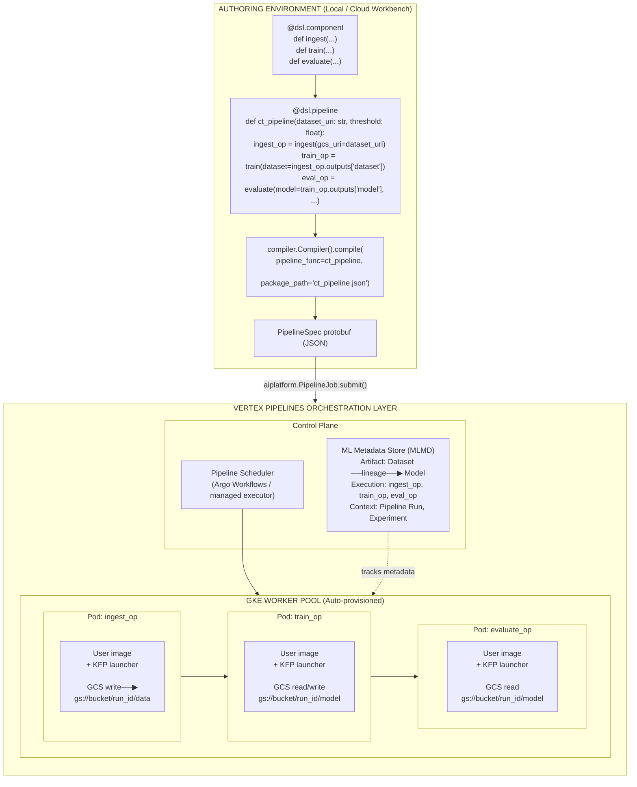

# Lesson 4: MLOps Pipeline Orchestration

## 1. First-Principles Intuition & Invariants

The history of machine learning in production is largely a history of pipelines gone wrong. Models trained on stale features. Experiments that cannot be reproduced because nobody recorded which preprocessing version ran against which dataset slice. Retraining jobs triggered manually by an engineer who happened to notice model drift in a dashboard at 2 AM. These failure modes are not incidental; they are structural consequences of treating ML workflows as imperative scripts rather than as declarative, versioned systems.

Vertex Pipelines addresses this structural deficiency by forcing the engineer to think in directed acyclic graphs of composable, containerized computation steps, each step producing and consuming typed artifacts whose provenance is recorded automatically in a centralized metadata store. This is not merely an aesthetic preference for graph-shaped code. The DAG structure is the foundational invariant that makes the entire system tractable: because the graph is acyclic, there is a well-defined topological order of execution; because each node is a hermetically sealed container, its behavior is fully determined by its inputs; and because inputs and outputs are typed artifacts rather than raw file paths, the system can reason about lineage across pipeline runs and across pipeline versions.

The formal model underlying Vertex Pipelines is Kubeflow Pipelines v2 (KFP v2). Understanding this lineage is essential because Vertex Pipelines is not a proprietary reimplementation; it is a managed execution substrate for KFP v2 compiled pipelines. When you author a pipeline using the KFP SDK, the Python DSL compiles to an Intermediate Representation (IR) encoded as a PipelineSpec protobuf serialized to JSON. That compiled artifact is what you submit to Vertex Pipelines; the managed service deserializes it, schedules components onto Google Kubernetes Engine worker pools, injects credentials, wires artifact URIs through Google Cloud Storage, and records every execution event in Vertex ML Metadata. The KFP SDK is therefore not a convenience wrapper; it is the canonical compiler frontend for the pipeline IR, and understanding its compilation semantics is prerequisite to building pipelines that behave correctly at scale.

Three invariants govern every correctly designed Vertex pipeline and violating any one of them produces the class of bugs most commonly seen in production ML systems.

The first invariant is **hermetic containerization**. Every pipeline component runs in an explicitly specified container image. There is no ambient environment, no shared filesystem between components (outside of explicitly passed artifact URIs), and no implicit dependency on the host that happens to execute the step. This invariant is what makes pipelines reproducible: if you re-run a pipeline at a future date with the same inputs, the same container image produces the same outputs. Engineers who try to pass raw Python closures or reference global state between components inevitably discover this invariant at the cost of a failed run.

The second invariant is **artifact-mediated communication**. Components do not communicate through shared memory, message queues, or ephemeral local storage. They communicate exclusively through Vertex ML Metadata artifact references, backed by Cloud Storage URIs. When component A produces a dataset artifact and component B consumes it, the system records the lineage edge in the metadata store, and component B receives the artifact's URI, not a copy of the data. This turns every pipeline run into a first-class lineage event, enabling the downstream queries that make MLOps auditable: "which model currently serving in production was trained on which dataset version using which hyperparameters?"

The third invariant is **declarative parameterization**. A pipeline is a parameterized function, not a hardcoded script. Training dataset URIs, hyperparameter ranges, evaluation thresholds, and deployment targets are all pipeline parameters passed at submission time. This is what enables the continuous training pattern: a Cloud Scheduler trigger submits a new pipeline run with updated parameters without requiring any code changes to the pipeline definition itself.

---

## 2. Core Architecture & Mechanics

### The KFP v2 Compilation Model

To understand Vertex Pipelines execution, you must first understand what the KFP SDK actually compiles and what that compiled artifact contains.

When you annotate a Python function with `@dsl.component`, the KFP SDK inspects the function signature using Python's `inspect` module. Type annotations on parameters and return values are mapped to KFP's type system: `str`, `int`, `float`, and `bool` become pipeline *parameters* (passed by value), while `Input[Dataset]`, `Output[Model]`, `Input[Metrics]`, and other artifact types become pipeline *artifacts* (passed as URI references managed by the metadata store). The SDK generates a component specification that includes the base container image, the Python packages to install at runtime, and a generated entrypoint script that deserializes input parameters from command-line arguments and serializes output artifacts to paths provided by the pipeline runner.

When you annotate a Python function with `@dsl.pipeline` and call component functions inside it, you are not executing those functions; you are recording the calls as nodes in an in-memory graph. Each node captures the component specification and the wiring of outputs from upstream nodes to inputs of downstream nodes. When the outer pipeline function returns, the SDK walks this graph, assigns unique names to all nodes, resolves all inter-component data dependencies into artifact references, and serializes the entire graph into a `PipelineSpec` protobuf. The JSON serialization of this protobuf is your compiled pipeline — a static, versionable artifact that contains no Python at runtime.

The following diagram illustrates the full compilation and execution path.



### Component Specification: Lightweight vs. Containerized

KFP v2 offers two component authoring modes. The **lightweight Python component**, declared with `@dsl.component`, is the most common pattern for rapid development. The SDK serializes the function body as a string, embeds it in a generated runner script, and executes it inside a base Python image with pip-installed dependencies specified in the decorator. The **containerized component** references a pre-built Docker image and a custom entrypoint, giving you full control over the runtime environment and enabling non-Python workloads.

Lightweight components are convenient but carry a hidden coupling: the function body is captured as source text at compile time, which means any external modules the function imports must be available in the executing container. Engineers who attempt to import local utility modules into lightweight components discover this at runtime. The correct pattern is to publish shared utilities as an installable package and declare it in the `packages_to_install` list.

The following is a production-grade example of a complete three-stage continuous training pipeline covering data ingestion, distributed training, and conditional deployment, written to the KFP v2 API and deployable against Vertex Pipelines.

```python
# pipeline/components/ingest.py
from kfp.v2 import dsl
from kfp.v2.dsl import Dataset, Output

@dsl.component(
    base_image="python:3.10-slim",
    packages_to_install=["google-cloud-storage==2.14.0", "pandas==2.1.4"],
)
def ingest_data(
    gcs_source_uri: str,
    dataset_display_name: str,
    output_dataset: Output[Dataset],
) -> None:
    """
    Downloads a CSV from GCS, validates schema, and writes the validated
    dataset as a Vertex ML Metadata Dataset artifact.
    """
    import pandas as pd
    from google.cloud import storage

    client = storage.Client()
    # Parse gs://bucket/blob into components
    without_prefix = gcs_source_uri[len("gs://"):]
    bucket_name, blob_path = without_prefix.split("/", 1)
    bucket = client.bucket(bucket_name)
    blob = bucket.blob(blob_path)

    local_path = "/tmp/raw_data.csv"
    blob.download_to_filename(local_path)

    df = pd.read_csv(local_path)

    required_columns = {"feature_a", "feature_b", "feature_c", "label"}
    if not required_columns.issubset(set(df.columns)):
        missing = required_columns - set(df.columns)
        raise ValueError(f"Schema validation failed. Missing columns: {missing}")

    # The KFP runtime provides output_dataset.path as the GCS URI the artifact
    # should be written to. We write the validated parquet there.
    df.to_parquet(output_dataset.path, index=False)
    output_dataset.metadata["row_count"] = len(df)
    output_dataset.metadata["source_uri"] = gcs_source_uri
    output_dataset.metadata["display_name"] = dataset_display_name
```

```python
# pipeline/components/train.py
from kfp.v2 import dsl
from kfp.v2.dsl import Dataset, Input, Model, Output, Metrics

@dsl.component(
    base_image="us-docker.pkg.dev/vertex-ai/training/scikit-learn-cpu.1-0:latest",
    packages_to_install=["pandas==2.1.4", "pyarrow==14.0.0"],
)
def train_model(
    input_dataset: Input[Dataset],
    n_estimators: int,
    max_depth: int,
    output_model: Output[Model],
    output_metrics: Output[Metrics],
) -> None:
    """
    Trains a scikit-learn RandomForestClassifier on the validated dataset artifact
    and writes the serialized model and training metrics as Vertex artifacts.
    """
    import joblib
    import pandas as pd
    from sklearn.ensemble import RandomForestClassifier
    from sklearn.model_selection import train_test_split
    from sklearn.metrics import accuracy_score, f1_score
    import os

    df = pd.read_parquet(input_dataset.path)

    feature_cols = ["feature_a", "feature_b", "feature_c"]
    X = df[feature_cols].values
    y = df["label"].values

    X_train, X_val, y_train, y_val = train_test_split(X, y, test_size=0.2, random_state=42)

    clf = RandomForestClassifier(
        n_estimators=n_estimators,
        max_depth=max_depth,
        n_jobs=-1,
        random_state=42,
    )
    clf.fit(X_train, y_train)

    preds = clf.predict(X_val)
    acc = accuracy_score(y_val, preds)
    f1 = f1_score(y_val, preds, average="weighted")

    # Write metrics into ML Metadata via the Output[Metrics] artifact
    output_metrics.log_metric("accuracy", acc)
    output_metrics.log_metric("f1_score", f1)
    output_metrics.log_metric("n_estimators", n_estimators)
    output_metrics.log_metric("max_depth", max_depth)

    # joblib serializes to the KFP-managed GCS path
    model_dir = output_model.path
    os.makedirs(model_dir, exist_ok=True)
    joblib.dump(clf, os.path.join(model_dir, "model.joblib"))

    output_model.metadata["framework"] = "scikit-learn"
    output_model.metadata["accuracy"] = acc
    output_model.metadata["f1_score"] = f1
```

```python
# pipeline/components/evaluate.py
from kfp.v2 import dsl
from kfp.v2.dsl import Input, Model, Metrics, ClassificationMetrics, Output

@dsl.component(
    base_image="us-docker.pkg.dev/vertex-ai/training/scikit-learn-cpu.1-0:latest",
    packages_to_install=["pandas==2.1.4", "pyarrow==14.0.0"],
)
def evaluate_model(
    input_model: Input[Model],
    test_dataset: Input[Dataset],
    accuracy_threshold: float,
    output_classification_metrics: Output[ClassificationMetrics],
) -> dsl.NamedTuple("EvalOutput", [("deploy", str), ("accuracy", float)]):
    """
    Evaluates the model on a held-out test set and returns a deploy decision
    string ('true'/'false') based on threshold comparison. This return value
    is used to drive conditional deployment in the pipeline DAG.
    """
    import joblib
    import os
    import pandas as pd
    from collections import namedtuple
    from sklearn.metrics import (
        accuracy_score,
        confusion_matrix,
    )

    model_path = os.path.join(input_model.path, "model.joblib")
    clf = joblib.load(model_path)

    df = pd.read_parquet(test_dataset.path)
    feature_cols = ["feature_a", "feature_b", "feature_c"]
    X_test = df[feature_cols].values
    y_test = df["label"].values

    preds = clf.predict(X_test)
    acc = float(accuracy_score(y_test, preds))

    cm = confusion_matrix(y_test, preds)
    labels = [str(c) for c in sorted(set(y_test))]
    output_classification_metrics.log_confusion_matrix(labels, cm.tolist())

    deploy_decision = "true" if acc >= accuracy_threshold else "false"

    EvalOutput = namedtuple("EvalOutput", ["deploy", "accuracy"])
    return EvalOutput(deploy=deploy_decision, accuracy=acc)
```

```python
# pipeline/components/deploy.py
from kfp.v2 import dsl
from kfp.v2.dsl import Input, Model

@dsl.component(
    base_image="python:3.10-slim",
    packages_to_install=["google-cloud-aiplatform==1.42.1"],
)
def deploy_model(
    input_model: Input[Model],
    project_id: str,
    location: str,
    endpoint_display_name: str,
    serving_container_image_uri: str,
    min_replica_count: int,
    max_replica_count: int,
) -> None:
    """
    Uploads the trained model artifact to Vertex AI Model Registry and deploys
    it to a named endpoint. If an endpoint with the given display name already
    exists, it deploys to that endpoint (enabling blue/green traffic splitting
    or shadow deployment). Otherwise, it creates a new endpoint.
    """
    from google.cloud import aiplatform

    aiplatform.init(project=project_id, location=location)

    # Upload model artifact to Vertex Model Registry
    uploaded_model = aiplatform.Model.upload(
        display_name=endpoint_display_name + "-model",
        artifact_uri=input_model.path,
        serving_container_image_uri=serving_container_image_uri,
        labels={
            "framework": input_model.metadata.get("framework", "unknown"),
            "pipeline_managed": "true",
        },
    )

    # Look for an existing endpoint with this display name
    existing_endpoints = aiplatform.Endpoint.list(
        filter=f'display_name="{endpoint_display_name}"',
        order_by="create_time desc",
    )

    if existing_endpoints:
        endpoint = existing_endpoints[0]
    else:
        endpoint = aiplatform.Endpoint.create(display_name=endpoint_display_name)

    uploaded_model.deploy(
        endpoint=endpoint,
        machine_type="n1-standard-4",
        min_replica_count=min_replica_count,
        max_replica_count=max_replica_count,
        traffic_percentage=100,
        sync=True,
    )
```

### DAG Composition, Conditional Execution, and Caching

With all four components defined, the pipeline function wires them into a DAG using the KFP v2 `dsl.Condition` primitive for conditional deployment and an explicit cache configuration per step.

```python
# pipeline/pipeline.py
from kfp.v2 import dsl, compiler

@dsl.pipeline(
    name="continuous-training-pipeline",
    description="End-to-end CT pipeline: ingest, train, evaluate, and conditionally deploy.",
)
def continuous_training_pipeline(
    gcs_source_uri: str,
    dataset_display_name: str,
    n_estimators: int = 200,
    max_depth: int = 10,
    accuracy_threshold: float = 0.90,
    project_id: str = "my-gcp-project",
    location: str = "us-central1",
    endpoint_display_name: str = "fraud-classifier-endpoint",
    serving_container_image_uri: str = (
        "us-docker.pkg.dev/vertex-ai/prediction/sklearn-cpu.1-0:latest"
    ),
    min_replica_count: int = 1,
    max_replica_count: int = 5,
) -> None:

    # Stage 1: Ingest and validate.
    # Caching is explicitly enabled. If this component runs with identical
    # input parameters, Vertex will return the cached output artifact instead
    # of re-executing the container. This is correct for idempotent data pulls
    # from versioned GCS objects.
    ingest_op = ingest_data(
        gcs_source_uri=gcs_source_uri,
        dataset_display_name=dataset_display_name,
    )
    ingest_op.set_caching_options(enable_caching=True)
    ingest_op.set_cpu_limit("2")
    ingest_op.set_memory_limit("4G")

    # Stage 2: Train. Caching is disabled here because even with identical
    # hyperparameters we may wish to retrain against a refreshed dataset
    # artifact. In continuous training, non-deterministic data drift means
    # the same parameters do not necessarily produce the same model.
    train_op = train_model(
        input_dataset=ingest_op.outputs["output_dataset"],
        n_estimators=n_estimators,
        max_depth=max_depth,
    )
    train_op.set_caching_options(enable_caching=False)
    train_op.set_cpu_limit("8")
    train_op.set_memory_limit("16G")

    # Stage 3: Evaluate. Split the ingested dataset to serve as the test set.
    # In a production pipeline, ingest would produce separate train/test splits
    # as distinct artifact outputs; this example reuses the full dataset for
    # brevity and places the split logic inside the evaluator component.
    eval_op = evaluate_model(
        input_model=train_op.outputs["output_model"],
        test_dataset=ingest_op.outputs["output_dataset"],
        accuracy_threshold=accuracy_threshold,
    )
    eval_op.set_caching_options(enable_caching=False)
    eval_op.set_cpu_limit("2")
    eval_op.set_memory_limit("4G")

    # Stage 4: Conditional deployment.
    # dsl.Condition creates a conditional branch in the pipeline DAG. The
    # Vertex Pipelines backend serializes this as a conditional node in the
    # PipelineSpec IR; non-matching branches are skipped without failure.
    with dsl.Condition(
        eval_op.outputs["deploy"] == "true",
        name="deploy-if-accuracy-sufficient",
    ):
        deploy_op = deploy_model(
            input_model=train_op.outputs["output_model"],
            project_id=project_id,
            location=location,
            endpoint_display_name=endpoint_display_name,
            serving_container_image_uri=serving_container_image_uri,
            min_replica_count=min_replica_count,
            max_replica_count=max_replica_count,
        )
        deploy_op.set_caching_options(enable_caching=False)


if __name__ == "__main__":
    compiler.Compiler().compile(
        pipeline_func=continuous_training_pipeline,
        package_path="ct_pipeline.json",
    )
```

### Submitting the Pipeline and Querying Metadata Lineage

After compiling the pipeline to `ct_pipeline.json`, you submit it to Vertex Pipelines using the Vertex AI SDK. The `PipelineJob` abstraction handles authentication via Application Default Credentials, uploads the compiled spec to a staging GCS bucket, and returns a job handle that you can poll or attach callbacks to.

```python
# scripts/submit_pipeline.py
from google.cloud import aiplatform
import datetime

PROJECT_ID = "my-gcp-project"
LOCATION = "us-central1"
PIPELINE_ROOT = "gs://my-mlops-bucket/pipeline-root"
COMPILED_PIPELINE_PATH = "ct_pipeline.json"

aiplatform.init(project=PROJECT_ID, location=LOCATION)

run_timestamp = datetime.datetime.utcnow().strftime("%Y%m%d-%H%M%S")

job = aiplatform.PipelineJob(
    display_name=f"ct-pipeline-run-{run_timestamp}",
    template_path=COMPILED_PIPELINE_PATH,
    pipeline_root=PIPELINE_ROOT,
    parameter_values={
        "gcs_source_uri": "gs://my-mlops-bucket/data/training_v3.csv",
        "dataset_display_name": "fraud-training-v3",
        "n_estimators": 300,
        "max_depth": 12,
        "accuracy_threshold": 0.91,
        "project_id": PROJECT_ID,
        "location": LOCATION,
        "endpoint_display_name": "fraud-classifier-endpoint",
        "serving_container_image_uri": (
            "us-docker.pkg.dev/vertex-ai/prediction/sklearn-cpu.1-0:latest"
        ),
        "min_replica_count": 2,
        "max_replica_count": 10,
    },
    enable_caching=True,
)

# Submit without blocking; attach to an existing experiment for grouping runs.
job.submit(experiment="fraud-classifier-ct-experiment")
print(f"Pipeline job submitted: {job.resource_name}")
print(f"Console URL: {job._dashboard_uri()}")
```

Once a pipeline run completes, Vertex ML Metadata records every artifact produced and every execution that produced it. The following script queries the metadata store to retrieve the full artifact lineage for the most recent model, demonstrating how you reconstruct the complete provenance chain from a serving model back to its source dataset.

```python
# scripts/query_lineage.py
from google.cloud import aiplatform
from google.cloud.aiplatform_v1 import MetadataServiceClient
from google.cloud.aiplatform_v1.types import metadata_service

PROJECT_ID = "my-gcp-project"
LOCATION = "us-central1"
METADATA_STORE = "default"

# Initialize the low-level MetadataService client for lineage traversal.
client = MetadataServiceClient(
    client_options={"api_endpoint": f"{LOCATION}-aiplatform.googleapis.com"}
)

parent = (
    f"projects/{PROJECT_ID}/locations/{LOCATION}"
    f"/metadataStores/{METADATA_STORE}"
)

# List all Model artifacts created by our pipeline.
artifact_request = metadata_service.ListArtifactsRequest(
    parent=parent,
    filter='schema_title="system.Model" AND metadata.framework="scikit-learn"',
    order_by="create_time desc",
)
artifacts = list(client.list_artifacts(request=artifact_request))

if not artifacts:
    print("No scikit-learn Model artifacts found in metadata store.")
else:
    latest_model = artifacts[0]
    print(f"Latest model artifact: {latest_model.name}")
    print(f"  URI:      {latest_model.uri}")
    print(f"  Accuracy: {latest_model.metadata.get('accuracy', 'N/A')}")
    print(f"  F1 Score: {latest_model.metadata.get('f1_score', 'N/A')}")

    # Query the lineage subgraph rooted at this artifact.
    # query_artifact_lineage_subgraph returns all events (executions and
    # artifacts) connected to the target artifact within the given hop distance.
    lineage_request = metadata_service.QueryArtifactLineageSubgraphRequest(
        artifact=latest_model.name,
        max_hops=10,
        filter="",
    )
    subgraph = client.query_artifact_lineage_subgraph(request=lineage_request)

    print(f"\nLineage subgraph ({len(subgraph.artifacts)} artifacts, "
          f"{len(subgraph.executions)} executions):")

    for artifact in subgraph.artifacts:
        schema = artifact.schema_title.split(".")[-1]
        print(f"  Artifact [{schema}]: {artifact.display_name} -> {artifact.uri}")

    for execution in subgraph.executions:
        schema = execution.schema_title.split(".")[-1]
        state = execution.State.Name(execution.state)
        print(f"  Execution [{schema}]: {execution.display_name} state={state}")
```

### Pipeline Versioning Strategy

The compiled `ct_pipeline.json` artifact is itself a versioned asset that belongs in your repository's release workflow. Because the PipelineSpec is a deterministic serialization of your pipeline DSL code, you can version it by committing it to a Git tag, uploading it to Cloud Storage under a versioned prefix (`gs://my-mlops-bucket/pipeline-specs/v1.4.2/ct_pipeline.json`), or registering it in Artifact Registry as an OCI artifact. The critical operational rule is that the same compiled spec that was validated in staging must be the exact binary submitted to production. Any code change, however minor, must trigger a recompilation, a new version tag, and a fresh validation run before promotion.

Vertex Pipelines supports template-based scheduling through the `PipelineJobSchedule` resource, which references a template URI in Cloud Storage and accepts parameter overrides at trigger time. This decouples the pipeline definition from its invocation schedule, letting you update either independently.

```python
# scripts/create_schedule.py
from google.cloud import aiplatform

PROJECT_ID = "my-gcp-project"
LOCATION = "us-central1"
TEMPLATE_URI = "gs://my-mlops-bucket/pipeline-specs/v1.4.2/ct_pipeline.json"
PIPELINE_ROOT = "gs://my-mlops-bucket/pipeline-root"

aiplatform.init(project=PROJECT_ID, location=LOCATION)

schedule = aiplatform.PipelineJobSchedule.create(
    display_name="fraud-classifier-weekly-ct",
    pipeline_job_display_name="fraud-classifier-ct-scheduled",
    template_path=TEMPLATE_URI,
    pipeline_root=PIPELINE_ROOT,
    parameter_values={
        "gcs_source_uri": "gs://my-mlops-bucket/data/latest/training.csv",
        "dataset_display_name": "fraud-training-scheduled",
        "n_estimators": 300,
        "max_depth": 12,
        "accuracy_threshold": 0.91,
        "project_id": PROJECT_ID,
        "location": LOCATION,
        "endpoint_display_name": "fraud-classifier-endpoint",
        "serving_container_image_uri": (
            "us-docker.pkg.dev/vertex-ai/prediction/sklearn-cpu.1-0:latest"
        ),
        "min_replica_count": 2,
        "max_replica_count": 10,
    },
    cron="0 2 * * 1",  # Every Monday at 02:00 UTC
    max_concurrent_run_count=1,
    max_run_count=0,  # 0 = unlimited
)

print(f"Schedule created: {schedule.resource_name}")
```

---

## 3. High-Performance Optimization & Failure Modes

### Caching Semantics and When to Disable Them

Vertex Pipelines implements task-level caching through a cache key computed from four factors: the component's container image digest (not its tag, the content-addressed SHA256), the component's input parameter values, the URIs of all input artifacts, and the pipeline's root GCS path. When all four factors match a previous successful execution, the cached output artifacts are reused and the container is not launched.

This caching model is enormously valuable for iterative development, where you want to change only the training hyperparameters without re-ingesting terabytes of data. It is dangerous in continuous training when input artifacts are mutable. If your data pipeline overwrites `gs://bucket/data/latest/training.csv` in place rather than writing to a versioned URI, the ingest component will see the same URI as a previous run and serve stale cached results. The correct pattern is immutable, versioned artifact paths: `gs://bucket/data/training_v{timestamp}.csv`. This guarantees that any new data produces a new cache key and forces re-execution.

For the training component specifically, caching should almost always be disabled in production CT pipelines, even with versioned inputs. Because model training is typically not fully deterministic (random seeds in frameworks like TensorFlow, stochastic gradient descent, non-deterministic GPU operations), cached training outputs may misrepresent what the current code would produce. Disable caching on training steps and rely on ML Metadata for reproducibility queries rather than cache hits.

### Resource Optimization: Right-Sizing Components

Each pipeline step runs in an independently provisioned GKE pod. The machine type is not configured globally; it is set per component through the KFP SDK's resource constraint setters. Underestimating memory limits causes OOMKilled pod terminations that surface in the Vertex Pipelines console as component failures with exit code 137. Overestimating wastes money and can delay scheduling on a cluster whose autoscaler has not yet provisioned the requested instance type.

Profile your components before fixing their resource requests. The Vertex training custom jobs API exposes detailed CPU and memory utilization metrics in Cloud Monitoring under the `aiplatform.googleapis.com/training` metric prefix. For components that perform large pandas operations, resident set size (RSS) typically peaks at 2–3x the compressed parquet size on disk; a 500 MB parquet file commonly produces a 1.2–1.5 GB RSS peak. Set memory limits at 2x the profiled peak to absorb variance.

For GPU-accelerated training components, declare the accelerator type and count through the KFP resource setter. Because Vertex Pipelines provisions GKE nodes through Node Auto Provisioning, the first run of a GPU component may wait several minutes for a GPU node to be added to the cluster. Subsequent runs find the node already present (unless it was scaled down). Keep this cold-start latency in mind when calculating SLA for CT pipelines that run on infrequent schedules.

```python
# Attaching GPU accelerator requirements to a training component task
from kfp.v2 import dsl

# Inside the pipeline function, after constructing the train_op:
train_op.set_accelerator_type("NVIDIA_TESLA_T4")
train_op.set_accelerator_limit("1")
train_op.set_cpu_limit("8")
train_op.set_memory_limit("30G")
```

### Parallelism, Fan-Out, and the ParallelFor Primitive

A common pattern in hyperparameter search pipelines is fan-out: launching multiple independent training runs simultaneously across a hyperparameter grid and aggregating results in a downstream evaluation step. KFP v2's `dsl.ParallelFor` primitive handles this correctly by dynamically instantiating component nodes from a list parameter.

```python
# pipeline/parallel_hparam_pipeline.py
from kfp.v2 import dsl, compiler
from kfp.v2.dsl import Dataset, Input
from typing import List

@dsl.component(
    base_image="us-docker.pkg.dev/vertex-ai/training/scikit-learn-cpu.1-0:latest",
    packages_to_install=["pandas==2.1.4", "pyarrow==14.0.0"],
)
def train_single_config(
    input_dataset: Input[Dataset],
    n_estimators: int,
    max_depth: int,
    run_id: str,
    output_model: dsl.Output[dsl.Model],
    output_metrics: dsl.Output[dsl.Metrics],
) -> None:
    import joblib
    import os
    import pandas as pd
    from sklearn.ensemble import RandomForestClassifier
    from sklearn.model_selection import train_test_split
    from sklearn.metrics import accuracy_score

    df = pd.read_parquet(input_dataset.path)
    feature_cols = ["feature_a", "feature_b", "feature_c"]
    X = df[feature_cols].values
    y = df["label"].values
    X_train, X_val, y_train, y_val = train_test_split(X, y, test_size=0.2, random_state=42)

    clf = RandomForestClassifier(n_estimators=n_estimators, max_depth=max_depth, random_state=42)
    clf.fit(X_train, y_train)
    acc = float(accuracy_score(y_val, clf.predict(X_val)))

    output_metrics.log_metric("accuracy", acc)
    output_metrics.log_metric("n_estimators", n_estimators)
    output_metrics.log_metric("max_depth", max_depth)
    output_metrics.log_metric("run_id", run_id)

    os.makedirs(output_model.path, exist_ok=True)
    joblib.dump(clf, os.path.join(output_model.path, "model.joblib"))
    output_model.metadata["accuracy"] = acc
    output_model.metadata["run_id"] = run_id


@dsl.pipeline(name="parallel-hparam-search")
def hparam_pipeline(
    gcs_source_uri: str,
    hparam_configs: list,
) -> None:
    ingest_op = ingest_data(
        gcs_source_uri=gcs_source_uri,
        dataset_display_name="hparam-search-dataset",
    )
    ingest_op.set_caching_options(enable_caching=True)

    with dsl.ParallelFor(
        items=hparam_configs,
        parallelism=4,  # At most 4 concurrent training pods at any time
    ) as config:
        train_op = train_single_config(
            input_dataset=ingest_op.outputs["output_dataset"],
            n_estimators=config.n_estimators,
            max_depth=config.max_depth,
            run_id=config.run_id,
        )
        train_op.set_caching_options(enable_caching=False)
        train_op.set_cpu_limit("4")
        train_op.set_memory_limit("8G")


if __name__ == "__main__":
    compiler.Compiler().compile(
        pipeline_func=hparam_pipeline,
        package_path="hparam_pipeline.json",
    )

# Submit with a list of hyperparameter configurations as a JSON-serializable list
# of dicts. Each dict maps to a ParallelFor iteration.
# Example invocation:
# job = aiplatform.PipelineJob(
#     display_name="hparam-search-run-001",
#     template_path="hparam_pipeline.json",
#     pipeline_root=PIPELINE_ROOT,
#     parameter_values={
#         "gcs_source_uri": "gs://my-bucket/data/training_v3.csv",
#         "hparam_configs": [
#             {"n_estimators": 100, "max_depth": 5,  "run_id": "cfg-1"},
#             {"n_estimators": 200, "max_depth": 10, "run_id": "cfg-2"},
#             {"n_estimators": 300, "max_depth": 15, "run_id": "cfg-3"},
#             {"n_estimators": 400, "max_depth": 20, "run_id": "cfg-4"},
#         ],
#     },
# )
```

The `parallelism` argument on `dsl.ParallelFor` is a semaphore that caps concurrent pod launches. Without it, a 50-configuration grid search would attempt to launch 50 pods simultaneously, potentially overwhelming the Node Auto Provisioner and exhausting your project's regional GPU or high-memory instance quota. Set it at a value that respects your Compute Engine quota headroom.

### Failure Modes and Retry Semantics

Pipeline failures fall into three categories, each requiring a different operational response. The first is **component failure**: the container exits with a non-zero status because of a programming error, a missing artifact, or an external service error (e.g., a Cloud Storage permission denied). The failed step appears in red in the Vertex Pipelines console; downstream steps that depend on its outputs are automatically skipped, while independent parallel branches may continue. The correct response is to examine the component's Cloud Logging output via the logs link in the console, fix the root cause, and resubmit.

The second category is **infra-level transient failure**: the GKE node running a pod is preempted, the node runs out of ephemeral storage, or the Vertex control plane experiences a brief API outage. These failures surface as pod evictions or scheduler timeouts. The KFP v2 component retry decorator handles this class of failure by relaying the component with exponential backoff.

```python
@dsl.component(
    base_image="python:3.10-slim",
    packages_to_install=["google-cloud-storage==2.14.0", "pandas==2.1.4"],
)
def ingest_data_with_retry(
    gcs_source_uri: str,
    dataset_display_name: str,
    output_dataset: dsl.Output[dsl.Dataset],
) -> None:
    # Same implementation as ingest_data above.
    pass


# Apply retry policy on the task object inside the pipeline function:
# ingest_op = ingest_data_with_retry(...)
# ingest_op.set_retry(num_retries=3, backoff_duration="30s", backoff_factor=2.0)
```

The third failure category is **semantic failure**: the pipeline completes without error but produces a model with accuracy below the deployment threshold. This is not a failure from the orchestration system's perspective — the DAG executed correctly and the conditional deployment branch was simply not taken. The correct observability hook is to alert on a Cloud Monitoring metric derived from the ML Metadata artifact's accuracy value, not on pipeline execution status alone. Senior ML engineers build dashboards that plot model quality metrics per pipeline run, overlaid with the deployment decision, so that a systematic downward trend in accuracy over successive CT runs is visible before it crosses the deployment threshold and silently stops updating the serving model.

### Continuous Training Pattern: Event-Driven Triggering

The scheduled CT pipeline shown earlier covers time-based retraining, which is appropriate when data arrives on a predictable cadence. For event-driven scenarios — where retraining should trigger immediately on significant data drift or on ingestion of a new labeled batch — the correct architecture is a Cloud Pub/Sub subscription feeding a Cloud Functions or Cloud Run function that calls `aiplatform.PipelineJob.submit()`.

The data drift trigger typically derives from a Vertex Model Monitoring job, which continuously samples prediction traffic, computes feature distribution skew and prediction drift against a training baseline, and publishes anomaly events to a designated Pub/Sub topic when configured thresholds are breached. Subscribing your CT trigger function to this topic closes the feedback loop: detected drift automatically initiates a new training run, which upon successful evaluation redeploys the model, which then resets the monitoring baseline. This is the architecture that earns the term "continuous training" in a rigorous sense, distinguishing it from mere periodic batch retraining.

```python
# cloud_functions/trigger_ct_pipeline/main.py
# Deployed as a Cloud Functions (
```
