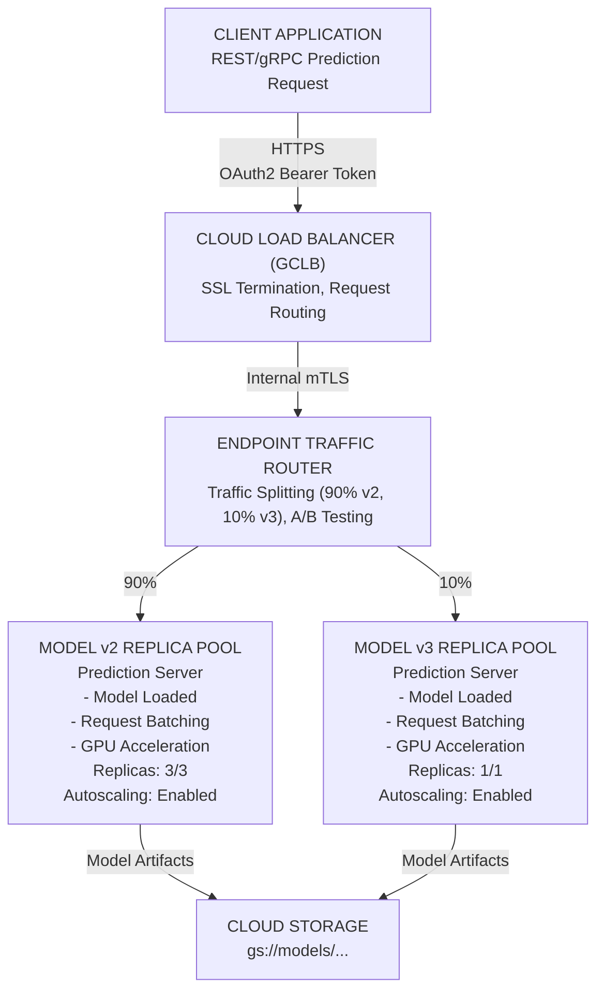

# Lesson 5: Model Serving Prediction Infrastructure

## 1. First-Principles Intuition & Invariants

The transition from trained model artifact to production prediction service represents one of the most consequential engineering boundaries in the machine learning lifecycle. A model existing as a serialized checkpoint on disk—whether TensorFlow SavedModel, PyTorch state dictionary, or ONNX graph—possesses no inherent capacity to receive requests, manage concurrent inference workloads, or honor service-level objectives. The prediction infrastructure must transform this static computational graph into a fault-tolerant, horizontally scalable, latency-bounded service that operates under real-world traffic patterns, resource constraints, and operational failure modes.

Vertex AI Prediction addresses this transformation through a managed serving layer that abstracts the undifferentiated operational complexity of model deployment while exposing fine-grained control surfaces for performance tuning, traffic management, and inference acceleration. At its foundation, the serving architecture operates as a request-response system where client applications submit prediction payloads over REST or gRPC protocols, the service orchestrates model execution on specialized compute hardware, and responses flow back with sub-second latency guarantees. This seemingly straightforward contract conceals substantial engineering depth: multi-tenant resource isolation, dynamic model loading and unloading, horizontal autoscaling with sub-minute response times, and intelligent request batching to maximize GPU utilization.

The architectural invariants governing production model serving derive from fundamental tradeoffs between latency, throughput, cost efficiency, and operational flexibility. Online prediction services optimize for tail latency—the 95th or 99th percentile response time—because user-facing applications demand consistent experience rather than average performance. A recommendation system that responds in 50 milliseconds on average but occasionally stalls for 2 seconds creates perceptible user friction. Conversely, batch prediction workloads optimize for aggregate throughput and cost efficiency, tolerating higher per-request latency in exchange for massive parallelism across thousands of input records. A fraud detection pipeline reprocessing yesterday's transactions can afford 500-millisecond per-record inference if the overall job completes in minutes rather than hours.

Vertex AI Prediction reconciles these competing objectives through distinct execution paths: online endpoints for synchronous request-response serving with millisecond-scale SLOs, and batch prediction jobs for asynchronous bulk inference with hour-scale completion targets. Online endpoints maintain persistent compute resources—CPU or GPU accelerator instances—that load model artifacts into memory and amortize initialization costs across thousands of requests. The service binds each endpoint to a stable HTTPS URL with OAuth2 authentication, allowing seamless integration into production API gateways and microservice meshes. Batch prediction jobs provision ephemeral compute clusters that read input data from Cloud Storage or BigQuery, execute inference in parallel across distributed workers, and write results to persistent sinks before terminating. The cost model reflects this architectural distinction: online endpoints incur continuous per-hour charges for provisioned capacity regardless of utilization, while batch jobs charge only for active compute time and auto-deallocate resources upon completion.

The model versioning and deployment lifecycle introduces additional invariants around traffic management and rollout safety. Production systems rarely tolerate abrupt model replacements where version N ceases serving and version N+1 immediately assumes all traffic. The deployment process must support gradual traffic shifting—initially routing 5% of requests to the new version while monitoring error rates and latency distributions, then progressively increasing allocation as confidence builds. Vertex AI implements this through traffic splitting at the endpoint level, where a single prediction URL can route requests across multiple deployed model versions according to configurable percentage weights. The underlying infrastructure maintains independent replica sets for each model version, ensuring that traffic shifts do not trigger resource contention or cold-start latencies.

Model serving latency decomposes into several distinct components, each governed by different optimization strategies. Network round-trip time represents the irreducible baseline imposed by physical propagation delays and TCP connection establishment. For a client in Virginia invoking an endpoint in Iowa, network RTT alone consumes 30-40 milliseconds before any computation begins. Model loading and initialization latency occurs when the serving runtime must fetch model artifacts from Cloud Storage and materialize computational graphs in accelerator memory. A 2GB TensorFlow SavedModel with complex custom layers might require 3-5 seconds to load, making this cost prohibitive on a per-request basis. Inference execution latency measures the actual forward-pass computation, which scales with model complexity and input dimensionality. A BERT-Base transformer processing 512-token sequences on a V100 GPU executes in 20-30 milliseconds, while a ResNet-50 image classifier on the same hardware completes in 5-8 milliseconds.

Vertex AI mitigates loading latency through persistent model servers that load artifacts once during replica initialization and maintain them in memory across request lifetimes. The service provisions replica pools sized to target request rates, ensuring sufficient warm capacity to absorb traffic without cold starts. When autoscaling triggers replica additions, the control plane pre-warms new instances by loading model artifacts before directing traffic, preventing user-visible latency spikes. This warm pool architecture trades memory footprint and idle compute costs for latency predictability, a fundamental tradeoff in managed serving systems.

The computational model for batch prediction differs fundamentally from online serving. Rather than optimizing individual request latency, batch jobs maximize aggregate throughput by processing large input datasets in parallel across distributed workers. The system partitions input data into shards—contiguous subsets of records—and dispatches each shard to an independent worker instance. Each worker executes a tight loop: read batch of records from input source, execute inference across batch dimension, write results to output sink, repeat until shard exhausted. The batch size parameter governs the granularity of this loop, creating a classic throughput-latency tradeoff. Larger batches amortize I/O overhead and improve GPU utilization through increased parallelism in matrix operations, but also increase memory footprint and per-batch processing time.

For GPU-accelerated models, the batch size directly determines utilization efficiency. A ResNet-50 model processing single images on a V100 GPU achieves only 15-20% utilization because the computational workload fails to saturate the device's 5120 CUDA cores and 640 tensor cores. Increasing batch size to 32 images pushes utilization above 80%, reducing per-image inference cost by 4-5x. However, memory capacity imposes hard limits: the same V100 with 16GB HBM2 memory exhausts VRAM at batch sizes above 64 for ResNet-50, triggering out-of-memory failures. Vertex AI Prediction exposes this tradeoff through the batch size configuration parameter, allowing practitioners to tune for their specific model architecture and accelerator type.

The autoscaling mechanism for online endpoints operates as a continuous control loop that adjusts replica counts based on observed traffic patterns and utilization metrics. The controller monitors request rate, CPU utilization, GPU utilization, and replica count every 30 seconds, computing a target replica count that satisfies configured constraints: minimum replicas for baseline availability, maximum replicas for cost containment, and target utilization for efficiency. When observed utilization exceeds the target threshold—typically 60-70% to maintain headroom for traffic spikes—the controller increments replica count and provisions additional instances. Conversely, sustained periods of low utilization trigger scale-down events that deallocate idle capacity. The control loop incorporates hysteresis and rate limiting to prevent oscillation: replica counts cannot change more frequently than once per minute, and scale-down events apply more conservative thresholds than scale-up to avoid thrashing.

This reactive autoscaling model introduces inherent lag between traffic increase and capacity availability. A sudden 10x traffic spike at time T₀ triggers scale-up at T₀+30s when the next control loop iteration observes elevated utilization. New replicas require 90-180 seconds to provision, load models, and begin serving, meaning full capacity arrives at T₀+2m to T₀+3.5m. During this interval, existing replicas absorb excess load, potentially violating latency SLOs or returning 503 Service Unavailable errors if request queues saturate. Vertex AI partially mitigates this through predictive scaling based on historical traffic patterns, proactively adding capacity before anticipated load increases, but unpredictable traffic spikes remain a fundamental availability challenge in reactive autoscaling systems.

## 2. Core Architecture & Mechanics

The Vertex AI Prediction architecture decomposes into several interacting subsystems: the control plane managing endpoint lifecycle and configuration, the data plane executing inference workloads, and the telemetry pipeline collecting metrics and logs for monitoring and autoscaling decisions. Understanding the mechanical operation of each subsystem illuminates the optimization strategies and failure modes encountered in production deployments.

The control plane exposes the Endpoint resource as the primary abstraction for model deployment. An endpoint represents a stable HTTPS URL bound to a specific GCP region, capable of hosting multiple deployed models with independent traffic allocations. Creating an endpoint provisions the necessary networking infrastructure—load balancers, SSL certificates, and OAuth2 authentication policies—but allocates no compute resources until model deployment occurs. This separation allows endpoint URLs to remain stable across model version updates, preventing client applications from hardcoding version-specific URLs.

Deploying a model to an endpoint creates a DeployedModel resource that specifies the model artifact location, machine type, accelerator configuration, and traffic allocation. The control plane translates this declarative specification into an imperative sequence: provision compute instances of the specified machine type in the target region, attach GPU accelerators if configured, install the prediction server runtime (TensorFlow Serving, TorchServe, or custom container), download model artifacts from Cloud Storage, load model into server memory, register the replica pool with the traffic router, and begin serving traffic according to the allocated percentage.

The prediction server runtime operates as a multi-threaded process that maintains an in-memory model representation and executes inference requests through optimized execution paths. For TensorFlow models, Vertex AI employs TensorFlow Serving, a production-grade server that loads SavedModel artifacts and exposes REST and gRPC endpoints conforming to the TensorFlow Serving API specification. The server implements dynamic batching, an optimization technique that aggregates multiple concurrent requests into a single batched inference operation to maximize GPU utilization. When a request arrives, the server enqueues it in a bounded buffer and waits for additional requests to arrive within a configurable timeout window—typically 1-5 milliseconds. Once the timeout expires or the buffer reaches capacity, the server executes inference on the accumulated batch, then dispatches individual responses back to waiting clients.

Dynamic batching introduces a deliberate latency-throughput tradeoff. The timeout window adds directly to tail latency—a request arriving when the buffer is empty incurs the full timeout delay before execution begins. However, batched execution dramatically improves GPU utilization and aggregate throughput. Consider a BERT model with 110M parameters executing on a V100 GPU. Single-request inference utilizes only 10-15% of GPU compute, completing in 25ms but processing only 40 requests/second. With dynamic batching accumulating 16 requests, GPU utilization increases to 75%, and although per-request latency rises to 35ms (25ms inference + 10ms batching window), aggregate throughput reaches 450 requests/second, an 11x improvement. The optimal timeout and maximum batch size depend on model architecture, hardware characteristics, and latency SLO, requiring empirical tuning for each deployment.

The traffic splitting mechanism operates at the endpoint's traffic router layer, which intercepts incoming requests and routes them to deployed model replicas according to configured percentage allocations. The router maintains a consistent hash ring mapping request identifiers to model versions, ensuring that requests from the same client consistently route to the same model version for the duration of a session. This session affinity prevents user confusion during A/B tests where different model versions might produce divergent outputs for identical inputs. The router updates its hash ring atomically when traffic allocation changes, preventing split-brain scenarios where some requests observe old allocations while others observe new allocations.

Traffic shifting supports canary deployments and shadow traffic patterns. A canary deployment gradually increases traffic to a new model version while monitoring error rates, latency percentiles, and business metrics. The typical progression allocates 5% traffic initially, doubling every 30 minutes if metrics remain healthy: 5% → 10% → 20% → 40% → 80% → 100%. At each step, the deployment can pause for manual validation or roll back if automated checks detect anomalies. Shadow traffic duplicates production requests to a new model version without returning its predictions to clients, allowing offline comparison between current and candidate models under real traffic patterns. The shadow model's predictions are logged for analysis but discarded from the response path, preventing any user impact from untested model behavior.

Batch prediction jobs operate through a fundamentally different execution model optimized for bulk throughput. The batch prediction API accepts input data references—Cloud Storage URIs or BigQuery table identifiers—and spawns a distributed job that partitions input data, provisions worker instances, executes inference in parallel, and writes results to an output destination. The job scheduler estimates required worker count based on input data size and configured machine type, aiming to complete execution within a target duration while minimizing cost.

The batch prediction data flow begins with input partitioning. The scheduler scans the input data source, determining total record count and size, then divides it into N shards where N equals the provisioned worker count. For Cloud Storage inputs, sharding respects file boundaries—each shard consists of one or more complete files to avoid complex offset-based splitting. For BigQuery inputs, the scheduler generates a set of SQL queries with LIMIT and OFFSET clauses that partition the table into non-overlapping subsets.

Each worker executes an identical program: initialize prediction server runtime, load model artifacts from Cloud Storage, enter processing loop. Within the loop, the worker reads a batch of records from its assigned shard, transforms records into model input tensors, executes inference, transforms output tensors into result records, and writes results to the output destination. The batch size parameter controls how many records are processed in each inference invocation, directly determining GPU utilization and memory footprint as previously discussed.

The output writer implements atomic result commits to prevent partial or duplicate writes. For Cloud Storage outputs, each worker writes to a temporary staging location with a unique worker ID suffix, then atomically renames files to their final destinations upon successful completion. For BigQuery outputs, workers stream results to a temporary table during execution, then execute a final atomic INSERT query that appends the temporary table to the destination table. If a worker crashes mid-execution, its partial results remain in the staging area and are never visible to downstream consumers. The job controller detects worker failures through heartbeat timeouts and reschedules failed shards on healthy workers, ensuring exactly-once semantics for the overall job.

Model versioning in Vertex AI operates through the Model resource, which represents a logical model identity that can contain multiple Version resources. Each version points to a distinct artifact location and encapsulates version-specific metadata like framework version, input schema, and performance characteristics. Deploying a model version to an endpoint creates a DeployedModel resource that references the specific version, allowing the same endpoint to serve multiple versions concurrently during rollout periods.

The version management workflow supports blue-green deployments and rollback scenarios. A typical production update sequence begins with uploading a new model version's artifacts to Cloud Storage and registering it with the Model resource. The new version is then deployed to the production endpoint with 0% traffic allocation, provisioning replicas but routing no user traffic. Once deployment completes and health checks pass, traffic allocation shifts from 0% to 10%, beginning the canary phase. If metrics remain healthy after 30 minutes, allocation increases to 50%, and finally to 100%. The previous version remains deployed with 0% allocation for several hours, allowing instant rollback by simply reverting traffic percentages if issues emerge post-deployment.

Inference acceleration techniques optimize the computational efficiency of model execution, reducing latency and cost per prediction. Vertex AI supports several acceleration mechanisms, each targeting different optimization opportunities. Model compilation through TensorFlow's XLA (Accelerated Linear Algebra) compiler performs whole-graph optimization, fusing multiple operations into optimized GPU kernels and eliminating intermediate tensor materializations. For a typical computer vision model, XLA compilation reduces inference latency by 20-30% and memory footprint by 15-25% without any model architecture changes.

Quantization trades numeric precision for computational efficiency by representing model weights and activations with lower-bitwidth integers rather than 32-bit floating-point values. Post-training quantization converts a trained FP32 model to INT8 representation through calibration on a representative dataset, reducing model size by 75% and accelerating inference by 2-4x on CPUs and 1.5-2x on GPUs. The precision reduction introduces minor accuracy degradation—typically 0.5-1% for vision models and 1-2% for language models—which must be validated against task-specific accuracy thresholds.

Mixed-precision inference executes certain operations in FP16 while maintaining FP32 precision for numerically sensitive operations like batch normalization and loss computation. Modern GPUs contain specialized tensor cores optimized for FP16 matrix multiplication, delivering 2-3x throughput improvements over FP32 execution. Vertex AI automatically enables mixed precision for supported accelerators and model architectures, transparently converting models during deployment without requiring explicit configuration.

Custom prediction containers extend the serving infrastructure beyond standard framework runtimes. For models requiring specialized preprocessing, custom inference logic, or unsupported frameworks, practitioners can package their prediction code into Docker containers conforming to Vertex AI's prediction container contract. The container must expose an HTTP server on port 8080 that responds to POST requests at `/predict` with JSON request bodies containing prediction instances. The server loads the model during container initialization, typically from artifacts mounted from Cloud Storage, and executes inference within the HTTP request handler.

The prediction container contract specifies health check and metadata endpoints that the serving infrastructure uses to manage container lifecycle. The health check endpoint at `/health` returns HTTP 200 when the container is ready to serve traffic, allowing the control plane to determine when a newly started replica can begin receiving requests. The metadata endpoint at `/v1/models/default` returns JSON describing the model's input and output schemas, enabling automatic client-side validation and documentation generation.

Resource allocation for prediction deployments balances cost efficiency against performance and availability requirements. Vertex AI exposes several tuning parameters: machine type (CPU, memory, local SSD), accelerator type and count (NVIDIA T4, V100, A100, TPU), minimum and maximum replica counts, and autoscaling target utilization. The optimal configuration depends on model characteristics and traffic patterns, requiring empirical measurement and iterative refinement.

For CPU-bound models like gradient boosting trees and linear models, high-CPU machine types (32-64 vCPUs) maximize throughput by exploiting intra-request parallelism. These models rarely benefit from GPU acceleration because their computational patterns—sparse feature lookups and branching logic—map poorly to GPU architectures. Deploying such models on GPU instances wastes accelerator capacity and inflates costs.

For memory-bound models like large transformer language models, memory capacity becomes the primary constraint. A GPT-3 variant with 175B parameters requires approximately 700GB of memory in FP32 representation or 350GB in FP16, exceeding the capacity of any single GPU. Multi-GPU deployments with model parallelism distribute the model across multiple accelerators, requiring custom serving logic to coordinate cross-device communication. Alternatively, aggressive quantization to INT8 or INT4 reduces memory footprint to 87GB or 44GB respectively, enabling single-GPU deployment at the cost of accuracy degradation.

For compute-bound models like convolutional neural networks and attention-based models, GPU acceleration delivers 10-100x latency improvements over CPU execution. The optimal accelerator selection balances per-request latency, aggregate throughput, and cost. NVIDIA T4 GPUs provide the most cost-efficient option for moderate throughput workloads, delivering 65 TFLOPS of FP16 performance at $0.35/hour. V100 GPUs offer 2x higher throughput at 2.5x higher cost, suitable for high-QPS endpoints where amortized cost per request remains lower despite higher hourly rates. A100 GPUs provide cutting-edge performance with 312 TFLOPS of FP16 and support for sparsity acceleration and multi-instance GPU partitioning, but command premium pricing at $2.93/hour.

## 3. High-Performance Optimization & Failure Modes

Optimizing prediction infrastructure requires systematic profiling to identify performance bottlenecks and validate optimization hypotheses. Vertex AI exposes request-level latency metrics through Cloud Monitoring, decomposed into network time, queue time, and inference time components. Network time measures round-trip latency between client and load balancer, influenced by geographic distance and network congestion. Queue time measures how long requests wait in the prediction server's internal buffer before execution begins, indicating whether replica count is sufficient for current traffic. Inference time measures actual model execution duration, reflecting computational complexity and accelerator utilization.

High queue times signal insufficient capacity: traffic exceeds the throughput of provisioned replicas, causing request queuing and elevated tail latency. The resolution is to increase minimum replica count or adjust autoscaling parameters to scale up more aggressively. However, if queue times remain negligible while inference times are high, the bottleneck lies in model efficiency rather than capacity. Optimization efforts should focus on model compilation, quantization, or architectural simplification rather than adding replicas.

GPU utilization metrics reveal whether accelerator resources are fully exploited. Low utilization (below 40%) indicates that inference workloads fail to saturate available compute, often due to insufficient batching or CPU preprocessing bottlenecks. Increasing dynamic batching parameters or offloading preprocessing to CPU can improve utilization. High utilization (above 90%) suggests the accelerator is fully saturated, and further throughput gains require adding GPU replicas or upgrading to higher-performance accelerators.

Memory utilization determines batch size limits and replica density. GPU memory exhaustion manifests as OOM (out-of-memory) errors during inference, requiring batch size reduction or memory-efficient model variants. For CPU deployments, memory pressure triggers swapping to disk, catastrophically degrading latency. Monitoring RSS (resident set size) and configuring memory-based autoscaling prevents memory-induced performance collapse.

The cold start problem presents a persistent challenge in autoscaling systems. When traffic increases trigger replica additions, new instances require 90-180 seconds to provision, load model artifacts, and initialize serving infrastructure before accepting requests. During this interval, existing replicas absorb excess load, potentially violating SLOs. Vertex AI mitigates cold starts through predictive autoscaling based on traffic pattern learning, proactively adding capacity before anticipated load increases. For workloads with known traffic schedules—daily batch inference jobs or business-hours API traffic—practitioners can configure scheduled autoscaling that adds capacity ahead of expected demand surges.

Persistent warm pools represent an alternative cold start mitigation strategy. By configuring minimum replica count above typical baseline traffic requirements, the deployment maintains excess capacity that can absorb transient spikes without triggering autoscaling. This approach trades idle compute costs for latency predictability, appropriate for latency-critical applications where SLO violations impose high business costs.

Request batching optimization requires balancing GPU utilization against tail latency constraints. The batching timeout parameter controls the maximum delay a request incurs waiting for additional requests to arrive before inference executes. Shorter timeouts reduce latency at the cost of smaller average batch sizes and lower GPU utilization. Longer timeouts increase utilization but inflate P95 and P99 latency as requests wait for the timeout window to expire. The optimal timeout depends on traffic arrival patterns and SLO requirements, typically falling in the 1-10ms range for latency-sensitive applications and 10-50ms for throughput-optimized deployments.

Maximum batch size limits the number of requests executed in a single inference operation, preventing memory exhaustion and bounding per-batch processing time. Setting the maximum too high causes OOM failures when large batches exceed GPU memory capacity. Setting it too low caps GPU utilization and throughput. Empirical tuning identifies the sweet spot: gradually increase maximum batch size while monitoring GPU memory utilization and OOM error rates, selecting the largest value that maintains stable operation under peak traffic.

Traffic splitting for A/B testing requires careful experimental design to ensure statistical validity. Random traffic assignment distributes users across model versions according to configured percentages, but naive randomization can introduce bias if request characteristics correlate with routing decisions. Vertex AI implements session-based routing where requests with the same session identifier consistently route to the same model version, preventing users from observing inconsistent predictions during a session. However, session-based routing requires sufficient session diversity to achieve statistical balance; deployments with only dozens of active sessions may exhibit significant skew in version allocation.

Model version comparison demands rigorous metric instrumentation beyond automated system metrics. Prediction accuracy, business KPIs, and user engagement metrics must be logged for each model version and analyzed through statistical hypothesis tests. A new model version with 5% lower latency but 2% lower prediction accuracy might improve user experience or degrade it depending on the application's sensitivity to accuracy versus responsiveness. A/B tests should run for sufficient duration to observe multiple business cycles—daily patterns for consumer applications, weekly patterns for B2B systems—ensuring that metric differences reflect genuine performance divergence rather than temporal confounding.

Batch prediction optimization focuses on maximizing aggregate throughput while minimizing cost. Input data partitioning strategy significantly impacts efficiency: poorly balanced shards cause some workers to finish early while others continue processing, resulting in idle worker time and wasted cost. Vertex AI's automatic sharding heuristic aims for equal-size shards, but skewed input data distributions can still produce imbalance. For example, if processing video files with variable duration, file-count-based sharding may produce shards with dramatically different processing times. Custom sharding strategies that partition based on estimated processing cost—e.g., total video duration rather than file count—yield better load balance.

Preemptible worker instances reduce batch prediction costs by 60-80% compared to standard instances at the cost of potential interruptions. Google Compute Engine can preempt preemptible instances with 30-second notice, requiring robust checkpoint and restart logic. Vertex AI batch prediction automatically handles preemption by checkpointing progress at shard boundaries and restarting interrupted shards on replacement workers. For long-running batch jobs spanning multiple hours, preemptible instances deliver substantial cost savings with minimal latency impact, as the occasional preemption delay is negligible relative to total job duration.

Worker machine type selection balances cost and completion time. High-CPU machine types with 32-96 vCPUs enable aggressive parallelism within each worker, reducing the number of workers required and minimizing coordination overhead. However, if the model is GPU-bound, excessive CPU capacity provides no benefit while inflating costs. The optimal configuration provisions enough CPU to keep GPUs fully utilized without paying for idle cores. For a model requiring 8 CPU cores per GPU to sustain full utilization, a machine type with 8 CPUs and 1 GPU achieves perfect balance, while 16 CPUs and 1 GPU wastes half the CPU capacity.

Output writing optimization prevents I/O bottlenecks from limiting throughput. Writing results to Cloud Storage supports higher parallelism and throughput than BigQuery streaming inserts, but at the cost of requiring downstream processing to load results into analytical systems. For applications requiring immediate query access to prediction results, BigQuery streaming provides better end-to-end latency despite lower per-worker throughput. For offline processing pipelines, Cloud Storage outputs with batch BigQuery loads optimize for cost and throughput.

Failure modes in prediction infrastructure manifest across multiple dimensions: transient request failures, sustained degradation, and catastrophic outages. Transient failures like 503 Service Unavailable errors typically indicate temporary capacity saturation during traffic spikes before autoscaling completes. Client applications should implement exponential backoff retry logic with jitter to avoid thundering herd amplification when replicas return to service. However, retries must respect timeout deadlines to prevent retry storms from exacerbating overload conditions.

Sustained degradation—elevated latency or error rates persisting for minutes—suggests underlying infrastructure issues rather than temporary capacity constraints. Common causes include model version bugs, resource leaks in custom prediction containers, or cloud infrastructure problems. Rapid rollback to a known-good model version provides immediate mitigation while root cause investigation proceeds. Vertex AI's traffic splitting enables instant rollback by reverting traffic allocation percentages without reprovisioning replicas, typically completing in under 30 seconds.

Catastrophic outages—total endpoint unavailability—result from control plane failures, networking issues, or region-wide infrastructure problems. Multi-region deployment with global load balancing provides disaster recovery, routing traffic to healthy regions when a region becomes unavailable. The endpoint URL remains stable as the global load balancer transparently fails over to backup regions, providing seamless failover from the client perspective. However, multi-region deployment doubles serving costs and introduces cross-region data consistency challenges that require careful architectural consideration.

Model staleness represents a subtle but impactful failure mode in continuously evolving data distributions. A model trained on historical data gradually degrades in accuracy as the real-world distribution drifts, a phenomenon called concept drift. For example, a product recommendation model trained on 2024 purchase patterns may perform poorly in 2025 as consumer preferences evolve. Continuous model retraining and A/B testing against production traffic provides early detection of staleness, triggering retraining cycles before accuracy degrades below acceptable thresholds.

Input validation prevents malformed requests from causing inference failures or security vulnerabilities. Custom prediction containers should validate input schema, data type, and value ranges before executing inference, returning HTTP 400 errors for invalid requests rather than propagating them to the model. Adversarial inputs—intentionally crafted to exploit model vulnerabilities—pose additional risks in security-sensitive applications. Preprocessing layers can sanitize inputs, but fundamentally adversarial-robust models require architectural defenses like certified robustness training or input randomization.

Monitoring and alerting infrastructure provides operational visibility into prediction service health. Essential metrics include request rate, error rate, P50/P95/P99 latency percentiles, replica count, GPU/CPU utilization, and memory usage. Alert thresholds should trigger on sustained degradation rather than transient spikes: error rate above 1% for 5 minutes, P95 latency above SLO for 3 minutes, or GPU memory utilization above 90% for 10 minutes. Overly sensitive alerts generate alarm fatigue, while insufficiently sensitive alerts allow degradation to impact users before triggering response.

Cost optimization for prediction infrastructure requires understanding the cost model's structure and tuning deployment parameters to minimize waste. Online endpoint costs decompose into compute time (per-hour charges for provisioned replicas) and network egress (data transfer to clients). Compute costs dominate for most workloads, making replica count and machine type the primary optimization levers. Aggressive autoscaling that scales down to minimum replicas during low-traffic periods reduces costs but increases cold start frequency. Committed use discounts for sustained compute usage provide 30-50% savings for workloads with predictable baseline capacity requirements.

Batch prediction costs derive from worker compute time and are directly proportional to total processing duration. Optimizing batch size, worker machine type, and input partitioning to minimize job duration directly reduces costs. Preemptible instances deliver 60-80% cost reduction with minimal duration impact for most workloads, making them the default choice for cost-conscious batch processing. Spot pricing for opportunistic workloads further reduces costs but introduces unpredictable availability and interruption rates unsuitable for time-sensitive jobs.

The prediction infrastructure landscape continues evolving with advances in model compression, specialized inference accelerators, and edge deployment patterns. Emerging techniques like neural architecture search automatically discover efficient model architectures that balance accuracy and latency. Model distillation transfers knowledge from large teacher models to compact student models, maintaining 95%+ accuracy while reducing inference cost by 10-100x. Quantization-aware training incorporates quantization into the training process, producing models that maintain accuracy under aggressive INT8 or INT4 quantization. These techniques increasingly enable deployment of sophisticated models to resource-constrained environments like mobile devices and edge IoT systems, expanding the reach of production machine learning beyond cloud infrastructure to truly ubiquitous intelligent systems.
