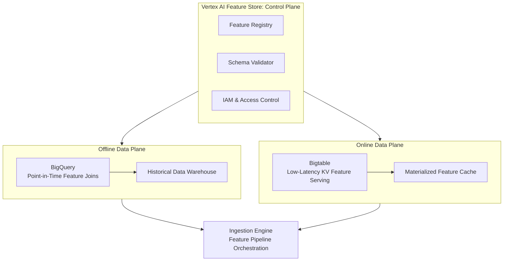

# Lesson 6: Feature Store Explainability Governance

## 1. First-Principles Intuition & Invariants

Machine learning systems in production face a fundamental duality: they must simultaneously serve predictions with sub-millisecond latency while maintaining complete auditability of how those predictions were derived. This tension between operational efficiency and governance transparency defines the architectural challenge of modern ML platforms. Traditional software systems operate under deterministic state machines where inputs map to outputs through explicit, traceable code paths. Machine learning systems, by contrast, encode decision boundaries learned from historical data, creating an opacity problem that becomes acute when models influence high-stakes decisions in healthcare, finance, or criminal justice.

The feature store emerged as the architectural solution to a specific consistency problem that plagued early production ML systems. Consider a fraud detection model trained on historical transaction data where features like "average transaction amount over the last 30 days" are computed during batch training runs. When the model deploys to production, the same feature must be recomputed in real-time from streaming transaction events. Even minor discrepancies in aggregation logic, timestamp handling, or null value treatment between training and serving pipelines create train-serve skew, causing model performance to degrade silently in production while validation metrics remain artificially optimistic in offline evaluations.

Google Vertex AI Feature Store addresses this skew through a single source of truth architecture where feature definitions are materialized once and served consistently across training, batch prediction, and online inference. The system maintains dual storage layers: an offline store backed by BigQuery for historical point-in-time correctness during training, and an online store implemented on Bigtable for low-latency serving during inference. This dual-store pattern reflects a fundamental tradeoff in distributed systems between analytical query expressiveness and operational throughput. BigQuery excels at temporal SQL operations like windowed aggregations and point-in-time joins, operations that are computationally expensive but essential for training on historical snapshots without data leakage. Bigtable, conversely, provides single-digit millisecond key-value lookups optimized for high-QPS serving workloads where features are pre-materialized and indexed by entity identifiers.

The critical invariant enforced by Vertex Feature Store is point-in-time correctness: when training on historical data at timestamp T, the feature values retrieved must reflect only information that existed prior to T, excluding any future observations that would constitute data leakage. This temporal consistency requires maintaining feature versioning and materialization timestamps as first-class metadata. Each feature value carries an event timestamp indicating when the underlying observation occurred and a processing timestamp recording when the feature was computed and written to storage. During training, point-in-time joins use event timestamps to ensure temporal validity, while serving systems use processing timestamps to implement cache invalidation and freshness guarantees.

Model explainability techniques decompose predictions into feature attribution scores, quantifying how much each input feature contributed to a specific prediction. These methods rest on axiomatic foundations from cooperative game theory, particularly the Shapley value, which uniquely satisfies desirable fairness properties: symmetry (features with identical marginal contributions receive equal credit), dummy player (irrelevant features receive zero attribution), and additivity (attributions sum to the total prediction deviation from baseline). Computing exact Shapley values requires evaluating the model on all possible feature subsets, a combinatorial explosion that grows as 2^n for n features. Practical implementations therefore resort to approximation methods, with Vertex AI Explainable AI implementing both kernel SHAP (model-agnostic sampling) and integrated gradients (gradient-based path integration for differentiable models).

Integrated gradients trace the prediction path from a baseline input to the actual input, integrating the model's gradients along this path to accumulate feature attributions. The method satisfies the completeness axiom: attributions sum exactly to the difference between the prediction and the baseline prediction. For a model f and input x, the integrated gradient for feature i is computed as the path integral from baseline x' to x, where the integral accumulates gradients ∂f/∂x_i scaled by the path traversal. In practice, this integral is approximated through Riemann sums with discrete steps along the path, trading computational cost against attribution accuracy.

Model monitoring for drift detection operates under the assumption that production data distributions may diverge from training distributions due to non-stationarity in the real world. Feature drift occurs when the marginal distribution P(X) of input features changes, while prediction drift indicates shifts in the conditional distribution P(Y|X) of outcomes given features. Vertex AI Model Monitoring samples inference requests and ground truth labels (when available through delayed feedback loops), computing statistical divergence metrics between training and production distributions. The system supports both Population Stability Index (PSI) for numerical features and chi-squared tests for categorical features, with configurable alerting thresholds that balance false positive noise against detection latency for true distribution shifts.

Fairness evaluation introduces constraint satisfaction into the model optimization problem, requiring that predictions satisfy statistical parity, equalized odds, or calibration conditions across protected demographic groups. These fairness metrics reflect different ethical frameworks: demographic parity enforces equal positive prediction rates across groups, equalized odds requires equal true positive and false positive rates, while calibration demands that predicted probabilities match observed outcomes within each group. Crucially, these criteria are mutually incompatible under realistic distributions, forcing practitioners to make explicit value judgments about which fairness definition to prioritize for their application domain. Vertex AI supports fairness evaluation through sliced metrics computed across user-defined feature subsets, exposing performance disparities that may violate regulatory requirements or organizational policies.

The model registry serves as an immutable audit trail for model lineage, tracking the provenance chain from training data through feature engineering, hyperparameter tuning, and evaluation to deployed model artifacts. Each model version captures metadata including the training dataset snapshot, feature store schema version, hyperparameter configuration, and evaluation metrics across fairness slices. This versioning enables rollback to previous model states when production incidents occur and supports compliance requirements for model risk management in regulated industries. Vertex AI Model Registry integrates with Cloud IAM to enforce access control policies, ensuring that only authorized personnel can promote models from staging to production environments.

Enterprise governance controls formalize the approval workflows and policy enforcement mechanisms required for model deployment in high-stakes domains. These controls implement separation of concerns between model development, validation, and deployment, preventing individual data scientists from unilaterally deploying models without independent review. Vertex AI supports multi-stage deployment pipelines where models progress through development, staging, and production environments, with manual approval gates and automated validation checks at each stage. Policy enforcement can mandate explainability analysis, fairness evaluation, and differential privacy guarantees before allowing model promotion, creating guardrails that prevent compliance violations while maintaining development velocity.

## 2. Core Architecture & Mechanics

Vertex AI Feature Store implements a layered architecture where the control plane manages feature definitions and schema metadata while dual data planes handle offline historical access and online serving workloads. The control plane persists feature group schemas in a centralized metadata service, defining feature data types, entity relationships, and serving configuration. When users register a new feature, the system creates corresponding BigQuery tables for offline storage and Bigtable namespaces for online storage, establishing the physical storage topology that supports the dual-store pattern.



Feature ingestion pipelines transform raw event streams and batch data sources into materialized feature values stored in both BigQuery and Bigtable. For streaming features, ingestion jobs consume from Pub/Sub topics, apply windowed aggregations or stateful transformations, and write results atomically to both stores. The system maintains eventual consistency between offline and online stores through a materialization process that snapshots BigQuery feature values and synchronizes them to Bigtable at configurable intervals. This synchronization strategy accepts temporary online-offline divergence in exchange for decoupling high-throughput batch writes to BigQuery from latency-sensitive Bigtable updates.

Point-in-time correctness during training requires special query semantics that standard SQL does not naturally express. Consider a training example with label timestamp T and entity identifier E. The training system must retrieve feature values for entity E that were valid at timestamp T, meaning the latest feature value with event timestamp less than or equal to T. This temporal join pattern is implemented through SQL window functions that partition feature values by entity, order by event timestamp, and select the latest value preceding each label timestamp. The query becomes computationally expensive when performed across millions of training examples and dozens of features, motivating Vertex AI's pre-computation of feature snapshots at regular intervals.

```python
from google.cloud import aiplatform
from google.cloud.aiplatform_v1.types import Feature, FeatureValueType
from google.cloud.aiplatform_v1.types import EntityType
from datetime import datetime, timedelta

# Initialize Vertex AI SDK with project and region
aiplatform.init(project="ml-production-project", location="us-central1")

# Create Feature Store instance
feature_store = aiplatform.FeatureStore.create(
    featurestore_id="financial_features",
    online_serving_config=aiplatform.FeatureStore.OnlineServingConfig(
        fixed_node_count=3  # Bigtable node count for serving
    ),
    labels={"environment": "production", "domain": "fraud-detection"}
)

# Define entity type for customer features
customer_entity = feature_store.create_entity_type(
    entity_type_id="customer",
    description="Customer-level aggregated features for fraud detection"
)

# Register features with explicit type specifications
customer_entity.create_feature(
    feature_id="avg_transaction_amount_30d",
    value_type=FeatureValueType.DOUBLE,
    description="Average transaction amount over trailing 30-day window"
)

customer_entity.create_feature(
    feature_id="transaction_count_7d",
    value_type=FeatureValueType.INT64,
    description="Count of transactions in trailing 7-day window"
)

customer_entity.create_feature(
    feature_id="merchant_diversity_score",
    value_type=FeatureValueType.DOUBLE,
    description="Entropy measure of merchant category distribution"
)

# Ingest features from BigQuery with point-in-time semantics
from google.cloud.aiplatform_v1.types import (
    Feature,
    FeatureValueType,
    ImportFeatureValuesRequest,
    FeatureValueList
)
import pandas as pd

# Feature ingestion job configuration
feature_time_field = "event_timestamp"
entity_id_field = "customer_id"

# Define BigQuery source for batch feature ingestion
bq_source = ImportFeatureValuesRequest.BigQuerySource(
    input_uri="bq://ml-production-project.fraud_features.customer_aggregates"
)

# Import features with explicit timestamp handling
import_job = customer_entity.import_feature_values(
    feature_ids=[
        "avg_transaction_amount_30d",
        "transaction_count_7d", 
        "merchant_diversity_score"
    ],
    feature_time_field=feature_time_field,
    entity_id_field=entity_id_field,
    bigquery_source=bq_source,
    worker_count=10  # Parallelization for large-scale imports
)

print(f"Feature import job: {import_job.resource_name}")
import_job.wait()  # Block until ingestion completes

# Online feature serving for real-time inference
from google.cloud.aiplatform_v1.types import FeatureSelector

# Serve features for specific customer entity
entity_ids = ["customer_12345"]
feature_selector = FeatureSelector(
    id_matcher=FeatureSelector.IdMatcher(ids=["*"])  # Select all features
)

read_response = customer_entity.read(
    entity_ids=entity_ids,
    feature_selector=feature_selector
)

for entity_view in read_response.entity_view:
    entity_id = entity_view.entity_id
    for feature_data in entity_view.data:
        feature_id = feature_data.feature_id
        feature_value = feature_data.value
        print(f"{entity_id} | {feature_id}: {feature_value}")
```

Model explainability integration requires instrumenting prediction requests to capture feature values alongside model outputs. Vertex AI Explainable AI wraps deployed models with an explanation service that intercepts prediction requests, applies attribution methods, and returns both predictions and feature importance scores. The system supports multiple attribution methods through configuration parameters specified during model deployment. For tree-based models, the explanation service uses path-dependent feature attributions computed from tree traversal. For neural networks, integrated gradients require specifying a baseline input representing the absence of signal, typically the training set mean or a synthetic zero-input.

```python
from google.cloud import aiplatform
from google.cloud.aiplatform import Model, Endpoint
from google.cloud.aiplatform_v1.types import (
    ExplanationSpec,
    ExplanationParameters,
    ExplanationMetadata,
    IntegratedGradientsAttribution,
    SampledShapleyAttribution
)

# Configure integrated gradients for neural network model
explanation_metadata = ExplanationMetadata(
    inputs={
        "avg_transaction_amount_30d": ExplanationMetadata.InputMetadata(
            input_tensor_name="features",
            encoding=ExplanationMetadata.InputMetadata.Encoding.IDENTITY,
            modality="numeric",
            input_baselines=[0.0]  # Baseline for path integration
        ),
        "transaction_count_7d": ExplanationMetadata.InputMetadata(
            input_tensor_name="features",
            encoding=ExplanationMetadata.InputMetadata.Encoding.IDENTITY,
            modality="numeric", 
            input_baselines=[0.0]
        ),
        "merchant_diversity_score": ExplanationMetadata.InputMetadata(
            input_tensor_name="features",
            encoding=ExplanationMetadata.InputMetadata.Encoding.IDENTITY,
            modality="numeric",
            input_baselines=[0.5]  # Domain-specific baseline
        )
    },
    outputs={
        "fraud_probability": ExplanationMetadata.OutputMetadata(
            output_tensor_name="predictions"
        )
    }
)

explanation_parameters = ExplanationParameters(
    integrated_gradients_attribution=IntegratedGradientsAttribution(
        step_count=50,  # Path integration resolution
        smooth_grad_config=IntegratedGradientsAttribution.SmoothGradConfig(
            noise_sigma=0.1,
            noisy_sample_count=30  # Noise sampling for gradient smoothing
        )
    )
)

explanation_spec = ExplanationSpec(
    parameters=explanation_parameters,
    metadata=explanation_metadata
)

# Upload model with explainability configuration
model = aiplatform.Model.upload(
    display_name="fraud_detector_v3",
    artifact_uri="gs://ml-models/fraud-detector/v3",
    serving_container_image_uri="us-docker.pkg.dev/vertex-ai/prediction/tf2-cpu.2-12:latest",
    explanation_spec=explanation_spec,
    labels={"framework": "tensorflow", "version": "v3"}
)

# Deploy model to endpoint with explanation enabled
endpoint = model.deploy(
    deployed_model_display_name="fraud-detector-production",
    machine_type="n1-standard-4",
    min_replica_count=2,
    max_replica_count=10,
    traffic_percentage=100
)

# Request predictions with explanations
instances = [
    {
        "avg_transaction_amount_30d": 245.50,
        "transaction_count_7d": 12,
        "merchant_diversity_score": 0.73
    }
]

# Prediction returns both scores and feature attributions
response = endpoint.predict(instances=instances)
predictions = response.predictions
explanations = response.explanations

for pred, expl in zip(predictions, explanations):
    fraud_prob = pred[0]
    attributions = expl.attributions[0].feature_attributions
    
    print(f"Fraud Probability: {fraud_prob:.4f}")
    print("Feature Attributions:")
    for feature_name, attribution_value in attributions.items():
        print(f"  {feature_name}: {attribution_value:.6f}")
```

Model monitoring infrastructure operates as a continuous evaluation pipeline that samples inference traffic, computes drift metrics, and triggers alerts when statistical thresholds are exceeded. The monitoring service maintains a baseline distribution snapshot captured from the training dataset, then compares production request distributions against this baseline. For numerical features, the system bins values into histogram buckets and computes Population Stability Index, quantifying distributional divergence through a weighted sum of log-likelihood ratios across bins. For categorical features, chi-squared goodness-of-fit tests determine whether the production category distribution significantly differs from the training distribution.

```python
from google.cloud import aiplatform
from google.cloud.aiplatform import ModelDeploymentMonitoringJob
from google.cloud.aiplatform_v1.types import (
    ModelDeploymentMonitoringObjectiveConfig,
    ModelDeploymentMonitoringScheduleConfig,
    SamplingStrategy,
    ThresholdConfig
)
from google.protobuf.duration_pb2 import Duration

# Configure model monitoring job for deployed endpoint
monitoring_objective = ModelDeploymentMonitoringObjectiveConfig(
    deployed_model_id=endpoint.deployed_model_ids[0],
    objective_config=ModelDeploymentMonitoringObjectiveConfig.ObjectiveConfig(
        training_dataset=ModelDeploymentMonitoringObjectiveConfig.TrainingDataset(
            target_field="fraud_label",
            bigquery_source=ModelDeploymentMonitoringObjectiveConfig.TrainingDataset.BigQuerySource(
                input_uri="bq://ml-production-project.training_data.fraud_labels_v3"
            ),
            data_format="bigquery"
        ),
        training_prediction_skew_detection_config=ModelDeploymentMonitoringObjectiveConfig.TrainingPredictionSkewDetectionConfig(
            skew_thresholds={
                "avg_transaction_amount_30d": ThresholdConfig(value=0.15),  # PSI threshold
                "transaction_count_7d": ThresholdConfig(value=0.15),
                "merchant_diversity_score": ThresholdConfig(value=0.20)
            },
            attribution_score_skew_thresholds={
                "avg_transaction_amount_30d": ThresholdConfig(value=0.10),  # Attribution drift
                "transaction_count_7d": ThresholdConfig(value=0.10)
            }
        ),
        prediction_drift_detection_config=ModelDeploymentMonitoringObjectiveConfig.PredictionDriftDetectionConfig(
            drift_thresholds={
                "fraud_probability": ThresholdConfig(value=0.10)  # Prediction output drift
            }
        )
    )
)

# Sampling strategy for monitoring workload efficiency
sampling_strategy = SamplingStrategy(
    random_sample_config=SamplingStrategy.RandomSampleConfig(
        sample_rate=0.10  # Monitor 10% of inference traffic
    )
)

# Schedule configuration for monitoring job execution
monitoring_schedule = ModelDeploymentMonitoringScheduleConfig(
    monitor_interval=Duration(seconds=3600)  # Hourly monitoring analysis
)

# Create monitoring job with alerting configuration
monitoring_job = ModelDeploymentMonitoringJob.create(
    display_name="fraud-detector-drift-monitoring",
    project="ml-production-project",
    location="us-central1",
    endpoint=endpoint,
    logging_sampling_strategy=sampling_strategy,
    schedule_config=monitoring_schedule,
    model_deployment_monitoring_objective_configs=[monitoring_objective],
    notification_channels=[
        "projects/ml-production-project/notificationChannels/alert-channel-id"
    ],
    labels={"model": "fraud-detector", "version": "v3"}
)

print(f"Monitoring job created: {monitoring_job.resource_name}")

# Query monitoring metrics programmatically
from google.cloud.aiplatform_v1.types import SearchModelDeploymentMonitoringStatsAnomaliesRequest

stats_request = SearchModelDeploymentMonitoringStatsAnomaliesRequest(
    model_deployment_monitoring_job=monitoring_job.resource_name,
    deployed_model_id=endpoint.deployed_model_ids[0],
    feature_display_name="avg_transaction_amount_30d",
    objectives=[
        SearchModelDeploymentMonitoringStatsAnomaliesRequest.StatsAnomaliesObjective.FEATURE_ATTRIBUTION_SKEW
    ]
)

monitoring_client = aiplatform.gapic.JobServiceClient(
    client_options={"api_endpoint": "us-central1-aiplatform.googleapis.com"}
)

anomalies_response = monitoring_client.search_model_deployment_monitoring_stats_anomalies(
    request=stats_request
)

for anomaly in anomalies_response.monitoring_stats:
    print(f"Timestamp: {anomaly.stats_time}")
    print(f"Drift Score: {anomaly.stats.feature_stats[0].distribution_deviation}")
```

Fairness evaluation requires defining protected attribute slices and computing performance metrics independently for each slice. Vertex AI supports sliced evaluation through the Model Evaluation service, which accepts ground truth labels, predictions, and slice definitions, then computes standard classification metrics stratified by slice membership. The evaluation process generates confusion matrices, precision-recall curves, and ROC curves for each slice, exposing performance disparities that may indicate discriminatory model behavior.

```python
from google.cloud import aiplatform
from google.cloud.aiplatform import Model
from google.cloud.aiplatform_v1.types import (
    ModelEvaluation,
    ModelEvaluationSlice
)
import pandas as pd

# Load ground truth labels and predictions for fairness evaluation
evaluation_data = pd.read_gbq(
    "SELECT customer_id, fraud_label, predicted_fraud_prob, age_group, "
    "income_bracket FROM `ml-production-project.evaluation.fraud_predictions_v3`",
    project_id="ml-production-project"
)

# Define protected attribute slices for fairness analysis
slice_specs = [
    {"age_group": ["18-25", "26-35", "36-45", "46-55", "56+"]},
    {"income_bracket": ["low", "medium", "high"]}
]

# Compute slice-wise metrics using Vertex AI Model Evaluation
model = aiplatform.Model(model_name="projects/123456/locations/us-central1/models/fraud_detector_v3")

# Batch prediction for evaluation dataset
batch_predict_job = model.batch_predict(
    job_display_name="fairness-evaluation-predictions",
    gcs_source="gs://ml-evaluation/fraud-test-set.jsonl",
    gcs_destination_prefix="gs://ml-evaluation/predictions/",
    machine_type="n1-standard-4",
    starting_replica_count=10,
    max_replica_count=20
)

batch_predict_job.wait()

# Create model evaluation with slice specifications
evaluation = model.evaluate(
    prediction_type="classification",
    target_field_name="fraud_label",
    class_labels=["benign", "fraud"],
    gcs_source_uris=["gs://ml-evaluation/predictions/*.jsonl"],
    prediction_label_column="predicted_fraud_prob",
    prediction_score_column="predicted_fraud_prob",
    slice_specs=slice_specs
)

# Retrieve and analyze slice metrics
for slice_eval in evaluation.list_model_evaluation_slices():
    slice_dimensions = slice_eval.slice_.dimension
    slice_value = slice_eval.slice_.value
    
    metrics = slice_eval.metrics
    precision = metrics["classification/precision"]
    recall = metrics["classification/recall"]
    auc = metrics["classification/auRoc"]
    fpr = metrics["classification/falsePositiveRate"]
    
    print(f"Slice: {slice_dimensions} = {slice_value}")
    print(f"  Precision: {precision:.4f}")
    print(f"  Recall: {recall:.4f}")
    print(f"  AUC: {auc:.4f}")
    print(f"  False Positive Rate: {fpr:.4f}")
    print()

# Statistical parity computation across slices
def compute_statistical_parity(evaluation_data, protected_attr, threshold=0.5):
    """Compute demographic parity disparity across protected attribute."""
    positive_rates = {}
    
    for group_value in evaluation_data[protected_attr].unique():
        group_data = evaluation_data[evaluation_data[protected_attr] == group_value]
        positive_rate = (group_data["predicted_fraud_prob"] >= threshold).mean()
        positive_rates[group_value] = positive_rate
    
    max_rate = max(positive_rates.values())
    min_rate = min(positive_rates.values())
    disparity_ratio = min_rate / max_rate if max_rate > 0 else 0
    
    return positive_rates, disparity_ratio

age_parity, age_disparity = compute_statistical_parity(evaluation_data, "age_group")
print(f"Age Group Positive Prediction Rates: {age_parity}")
print(f"Demographic Parity Ratio (Age): {age_disparity:.4f}")

income_parity, income_disparity = compute_statistical_parity(evaluation_data, "income_bracket")
print(f"Income Bracket Positive Prediction Rates: {income_parity}")
print(f"Demographic Parity Ratio (Income): {income_disparity:.4f}")
```

Model registry integration provides versioned storage and lineage tracking for model artifacts, enabling reproducibility and compliance auditing. Each model version registered in Vertex AI captures comprehensive metadata including training dataset URIs, feature store schema versions, hyperparameter configurations, and evaluation metrics. The registry supports tagging models with environment labels such as development, staging, and production, facilitating controlled promotion workflows through CI/CD pipelines.

```python
from google.cloud import aiplatform
from google.cloud.aiplatform import Model
from datetime import datetime
import json

# Register model version with comprehensive metadata
model_artifact_uri = "gs://ml-models/fraud-detector/v3"
training_metadata = {
    "training_dataset": "bq://ml-production-project.training_data.fraud_labels_v3",
    "feature_store_version": "financial_features@2024-01-15",
    "training_start_time": "2024-01-20T08:00:00Z",
    "training_end_time": "2024-01-20T14:30:00Z",
    "hyperparameters": {
        "learning_rate": 0.001,
        "batch_size": 512,
        "num_layers": 4,
        "dropout_rate": 0.3,
        "optimizer": "adam"
    },
    "training_metrics": {
        "final_loss": 0.1234,
        "auc_roc": 0.9456,
        "precision": 0.8923,
        "recall": 0.8567
    }
}

model = aiplatform.Model.upload(
    display_name="fraud_detector_v3",
    artifact_uri=model_artifact_uri,
    serving_container_image_uri="us-docker.pkg.dev/vertex-ai/prediction/tf2-cpu.2-12:latest",
    description="Fraud detection model with merchant diversity features",
    labels={
        "environment": "staging",
        "model_type": "neural_network",
        "framework": "tensorflow",
        "version": "v3.0.0"
    }
)

# Store lineage metadata in model resource
model.update(
    labels=model.labels | {"training_job": "fraud-training-20240120"}
)

# Add custom metadata to model version
model.add_model_version_aliases(["staging", f"v3-{datetime.now().strftime('%Y%m%d')}"])

print(f"Model registered: {model.resource_name}")
print(f"Version aliases: {model.version_aliases}")

# Model promotion workflow with validation gates
def validate_model_for_production(model, evaluation_results):
    """Validate model meets production deployment criteria."""
    validation_checks = {
        "min_auc": 0.90,
        "min_precision": 0.85,
        "min_recall": 0.80,
        "max_fairness_disparity": 0.20
    }
    
    metrics = evaluation_results["metrics"]
    auc_check = metrics["auc_roc"] >= validation_checks["min_auc"]
    precision_check = metrics["precision"] >= validation_checks["min_precision"]
    recall_check = metrics["recall"] >= validation_checks["min_recall"]
    
    fairness_disparities = evaluation_results["fairness_metrics"]
    fairness_check = all(
        disparity >= (1 - validation_checks["max_fairness_disparity"])
        for disparity in fairness_disparities.values()
    )
    
    all_checks_pass = all([auc_check, precision_check, recall_check, fairness_check])
    
    validation_report = {
        "timestamp": datetime.now().isoformat(),
        "model_version": model.version_id,
        "checks": {
            "auc_threshold": auc_check,
            "precision_threshold": precision_check,
            "recall_threshold": recall_check,
            "fairness_criteria": fairness_check
        },
        "approved_for_production": all_checks_pass
    }
    
    return validation_report

# Example validation and promotion
evaluation_results = {
    "metrics": {
        "auc_roc": 0.9456,
        "precision": 0.8923,
        "recall": 0.8567
    },
    "fairness_metrics": {
        "age_group_parity": 0.85,
        "income_bracket_parity": 0.88
    }
}

validation_report = validate_model_for_production(model, evaluation_results)

if validation_report["approved_for_production"]:
    # Update model labels to indicate production approval
    model.update(labels=model.labels | {"environment": "production", "approved": "true"})
    model.add_model_version_aliases(["production", "latest"])
    print("Model promoted to production")
else:
    print("Model validation failed, not promoted")
    print(json.dumps(validation_report, indent=2))

# List all model versions with lineage metadata
all_versions = aiplatform.Model.list(
    filter='labels.model_type="neural_network"',
    order_by="create_time desc"
)

for version in all_versions[:5]:  # Show 5 most recent versions
    print(f"\nModel: {version.display_name}")
    print(f"  Version: {version.version_id}")
    print(f"  Aliases: {version.version_aliases}")
    print(f"  Environment: {version.labels.get('environment', 'unknown')}")
    print(f"  Created: {version.create_time}")
```

Enterprise governance controls enforce organizational policies through deployment pipelines that require explicit approval before model promotion. Vertex AI integrates with Cloud Build and Cloud Deploy to implement multi-stage deployment workflows where models progress from development to staging to production environments. Each stage transition requires validation checks and manual approval gates, creating an audit trail of who approved model deployments and when.

```python
from google.cloud import aiplatform
from google.cloud.aiplatform import PipelineJob
from google.cloud.aiplatform_v1.types import PipelineState
import kfp
from kfp.v2 import dsl
from kfp.v2.dsl import component, pipeline, Input, Output, Model, Metrics

# Define governance-enforced deployment pipeline
@component(
    base_image="python:3.9",
    packages_to_install=["google-cloud-aiplatform>=1.38.0"]
)
def validate_model_quality(
    model: Input[Model],
    evaluation_metrics: Input[Metrics],
    min_auc: float,
    min_precision: float,
    approval_output: Output[str]
) -> bool:
    """Automated quality gate for model deployment approval."""
    import json
    
    metrics = json.loads(evaluation_metrics.get())
    
    auc_pass = metrics["auc_roc"] >= min_auc
    precision_pass = metrics["precision"] >= min_precision
    
    approval_decision = auc_pass and precision_pass
    
    with open(approval_output.path, "w") as f:
        json.dump({
            "approved": approval_decision,
            "auc_check": auc_pass,
            "precision_check": precision_pass,
            "metrics": metrics
        }, f)
    
    return approval_decision

@component(
    base_image="python:3.9",
    packages_to_install=["google-cloud-aiplatform>=1.38.0"]
)
def validate_fairness_criteria(
    model: Input[Model],
    fairness_metrics: Input[Metrics],
    max_disparity: float,
    approval_output: Output[str]
) -> bool:
    """Fairness gate for equitable model deployment."""
    import json
    
    fairness_data = json.loads(fairness_metrics.get())
    
    all_disparities_acceptable = all(
        disparity >= (1.0 - max_disparity)
        for disparity in fairness_data["slice_disparities"].values()
    )
    
    with open(approval_output.path, "w") as f:
        json.dump({
            "approved": all_disparities_acceptable,
            "disparities": fairness_data["slice_disparities"],
            "threshold": max_disparity
        }, f)
    
    return all_disparities_acceptable

@component(
    base_image="python:3.9",
    packages_to_install=["google-cloud-aiplatform>=1.38.0"]
)
def deploy_model_to_endpoint(
    model: Input[Model],
    endpoint_id: str,
    traffic_split: int,
    machine_type: str
):
    """Deploy validated model to production endpoint."""
    from google.cloud import aiplatform
    
    aiplatform.init(project="ml-production-project", location="us-central1")
    
    vertex_model = aiplatform.Model(model.uri)
    endpoint = aiplatform.Endpoint(endpoint_id)
    
    endpoint.deploy(
        model=vertex_model,
        deployed_model_display_name=f"{vertex_model.display_name}-production",
        machine_type=machine_type,
        min_replica_count=2,
        max_replica_count=10,
        traffic_percentage=traffic_split,
        sync=True
    )

@pipeline(
    name="model-deployment-governance-pipeline",
    description="Multi-stage deployment with automated and manual approval gates"
)
def model_deployment_pipeline(
    model_uri: str,
    evaluation_metrics_uri: str,
    fairness_metrics_uri: str,
    endpoint_id: str,
    min_auc: float = 0.90,
    min_precision: float = 0.85,
    max_fairness_disparity: float = 0.20
):
    """Governance-enforced model deployment workflow."""
    
    # Load model and evaluation artifacts
    model_artifact = dsl.importer(
        artifact_uri=model_uri,
        artifact_class=Model,
        reimport=False
    )
    
    eval_metrics = dsl.importer(
        artifact_uri=evaluation_metrics_uri,
        artifact_class=Metrics,
        reimport=False
    )
    
    fairness_metrics = dsl.importer(
        artifact_uri=fairness_metrics_uri,
        artifact_class=Metrics,
        reimport=False
    )
    
    # Automated quality validation gate
    quality_validation = validate_model_quality(
        model=model_artifact.output,
        evaluation_metrics=eval_metrics.output,
        min_auc=min_auc,
        min_precision=min_precision
    )
    
    # Automated fairness validation gate
    fairness_validation = validate_fairness_criteria(
        model=model_artifact.output,
        fairness_metrics=fairness_metrics.output,
        max_disparity=max_fairness_disparity
    )
    
    # Both gates must pass before deployment
    with dsl.Condition(
        quality_validation.output == True,
        name="quality-gate-passed"
    ):
        with dsl.Condition(
            fairness_validation.output == True,
            name="fairness-gate-passed"
        ):
            # Deploy to staging first with 10% traffic
            staging_deployment = deploy_model_to_endpoint(
                model=model_artifact.output,
                endpoint_id=endpoint_id,
                traffic_split=10,
                machine_type="n1-standard-4"
            )
            
            # Manual approval gate would be implemented here through
            # external system integration (e.g., JIRA, ServiceNow)
            
            # After manual approval, deploy to production with full traffic
            # This step would be triggered by separate pipeline run after approval

# Compile and execute governance pipeline
from kfp.v2 import compiler

compiler.Compiler().compile(
    pipeline_func=model_deployment_pipeline,
    package_path="model_deployment_governance.json"
)

# Submit pipeline job with governance controls
pipeline_job = aiplatform.PipelineJob(
    display_name="fraud-detector-v3-deployment",
    template_path="model_deployment_governance.json",
    pipeline_root="gs://ml-pipelines/deployment-runs",
    parameter_values={
        "model_uri": "gs://ml-models/fraud-detector/v3",
        "evaluation_metrics_uri": "gs://ml-evaluation/metrics/fraud-v3-eval.json",
        "fairness_metrics_uri": "gs://ml-evaluation/fairness/fraud-v3-fairness.json",
        "endpoint_id": "projects/123456/locations/us-central1/endpoints/fraud-endpoint"
    },
    enable_caching=False
)

pipeline_job.submit()
print(f"Governance pipeline submitted: {pipeline_job.resource_name}")

# Monitor pipeline execution and approval status
pipeline_job.wait()

if pipeline_job.state == PipelineState.PIPELINE_STATE_SUCCEEDED:
    print("Model deployment governance pipeline completed successfully")
    print("Model approved for production deployment pending manual sign-off")
else:
    print(f"Pipeline failed with state: {pipeline_job.state}")
```

## 3. High-Performance Optimization & Failure Modes

Feature serving latency becomes the critical bottleneck in real-time prediction systems where end-to-end request latency must remain below 100 milliseconds. Vertex AI Feature Store optimizes online serving through Bigtable's distributed key-value architecture, which provides single-digit millisecond read latencies at scale. The performance depends critically on key design and access patterns. Bigtable shards data across tablet servers based on row key lexicographic ordering, meaning sequential entity identifiers can create hotspots where all traffic concentrates on a single tablet. To prevent hotspots, entity identifiers should be hashed or salted to distribute load uniformly across tablets.

The online store maintains feature freshness through configurable sync intervals from the offline BigQuery store. This sync process introduces eventual consistency between training and serving: features may be stale by up to the sync interval duration. For applications requiring strict freshness guarantees, streaming feature ingestion pipelines write directly to both Bigtable and BigQuery, accepting higher write costs in exchange for reduced staleness. The tradeoff becomes explicit: batch sync minimizes cost but accepts staleness, while dual-write streaming maximizes freshness but doubles write traffic and costs.

Feature serving patterns often require retrieving features for multiple entities in a single prediction request, such as serving customer features and merchant features together for a transaction fraud prediction. The naive approach of sequential feature retrieval per entity scales linearly with entity count, quickly exceeding latency budgets. Vertex AI supports batch feature retrieval where multiple entity identifiers are specified in a single read request, allowing the Bigtable backend to parallelize lookups and return all features in one round-trip. This batching reduces network overhead and enables sub-10-millisecond total serving latency even when retrieving features for dozens of entities.

```python
from google.cloud import aiplatform
from google.cloud.aiplatform_v1.types import FeatureSelector
from concurrent.futures import ThreadPoolExecutor
import time

# Optimized batch feature serving for multiple entities
def serve_features_batch(entity_type, entity_ids, feature_ids):
    """Retrieve features for multiple entities in single batched request."""
    start_time = time.time()
    
    feature_selector = FeatureSelector(
        id_matcher=FeatureSelector.IdMatcher(ids=feature_ids)
    )
    
    read_response = entity_type.read(
        entity_ids=entity_ids,
        feature_selector=feature_selector
    )
    
    latency_ms = (time.time() - start_time) * 1000
    
    features_dict = {}
    for entity_view in read_response.entity_view:
        entity_id = entity_view.entity_id
        features_dict[entity_id] = {
            data.feature_id: data.value.double_value if data.value.HasField("double_value") 
                            else data.value.int64_value
            for data in entity_view.data
        }
    
    return features_dict, latency_ms

# Performance comparison: sequential vs batch retrieval
customer_entity = aiplatform.EntityType(
    entity_type_name="projects/123456/locations/us-central1/featurestores/financial_features/entityTypes/customer"
)

test_entity_ids = [f"customer_{i}" for i in range(50)]
required_features = ["avg_transaction_amount_30d", "transaction_count_7d", "merchant_diversity_score"]

# Batch retrieval (optimized)
batch_features, batch_latency = serve_features_batch(
    customer_entity, 
    test_entity_ids, 
    required_features
)
print(f"Batch retrieval latency: {batch_latency:.2f} ms for {len(test_entity_ids)} entities")

# Sequential retrieval (suboptimal - for comparison only)
sequential_start = time.time()
sequential_features = {}
for entity_id in test_entity_ids:
    features, _ = serve_features_batch(customer_entity, [entity_id], required_features)
    sequential_features.update(features)
sequential_latency = (time.time() - sequential_start) * 1000
print(f"Sequential retrieval latency: {sequential_latency:.2f} ms for {len(test_entity_ids)} entities")
print(f"Speedup: {sequential_latency / batch_latency:.1f}x")
```

Train-serve skew remains the most insidious failure mode in production ML systems because it manifests as silent performance degradation rather than explicit errors. The skew arises from subtle inconsistencies in feature computation logic between training and serving pipelines, such as differences in timestamp truncation, null value handling, or windowed aggregation boundaries. Consider computing a 30-day average transaction amount feature: if training uses inclusive date boundaries while serving uses exclusive boundaries, the same calendar day is treated differently in each pipeline, creating systematic feature value divergence.

Vertex AI enforces consistency through shared feature transformation code where the same Python functions define feature computation for both training and serving. The Feature Store ingestion API accepts user-defined transformation functions that process raw event data into feature values. These transformations are versioned alongside feature schemas, ensuring that training jobs and serving systems reference identical transformation logic. When transformation code changes, feature versions increment, preventing accidental mixing of features computed with different logic.

```python
from google.cloud import aiplatform
from google.cloud.aiplatform_v1.types import FeatureGroup
from datetime import datetime, timedelta
import pandas as pd

# Shared feature transformation logic for consistency
def compute_transaction_features(transaction_events: pd.DataFrame, 
                                reference_time: datetime) -> pd.DataFrame:
    """
    Compute aggregated transaction features with explicit timestamp semantics.
    Used identically in both training pipeline and serving pipeline.
    """
    # Filter events to only include those before reference_time (no future leakage)
    valid_events = transaction_events[
        transaction_events["event_timestamp"] < reference_time
    ]
    
    # Define lookback windows with explicit boundaries
    window_30d = reference_time - timedelta(days=30)
    window_7d = reference_time - timedelta(days=7)
    
    # Aggregate features with consistent null handling
    features = valid_events.groupby("customer_id").apply(
        lambda group: pd.Series({
            "avg_transaction_amount_30d": group[
                group["event_timestamp"] >= window_30d
            ]["amount"].mean() if len(group[group["event_timestamp"] >= window_30d]) > 0 else 0.0,
            
            "transaction_count_7d": len(group[
                group["event_timestamp"] >= window_7d
            ]),
            
            "merchant_diversity_score": -sum(
                (p := group["merchant_category"].value_counts(normalize=True)) * 
                (p.apply(lambda x: 0 if x == 0 else x * pd.np.log(x)))
            ) if len(group) > 0 else 0.0
        })
    ).reset_index()
    
    return features

# Use transformation in training pipeline
training_transactions = pd.read_gbq(
    "SELECT customer_id, event_timestamp, amount, merchant_category "
    "FROM `ml-production-project.raw_events.transactions` "
    "WHERE event_timestamp < '2024-01-01'",
    project_id="ml-production-project"
)

training_features = compute_transaction_features(
    training_transactions,
    reference_time=datetime(2024, 1, 1)
)

# Ingest computed features to Feature Store for serving
# The same transformation logic ensures consistency
feature_store = aiplatform.FeatureStore("financial_features")
customer_entity = feature_store.get_entity_type("customer")

customer_entity.ingest_from_df(
    feature_ids=["avg_transaction_amount_30d", "transaction_count_7d", "merchant_diversity_score"],
    feature_time="event_timestamp",
    entity_id_field="customer_id",
    df=training_features
)
```

Explainability computation latency presents a performance challenge because attribution methods require multiple model forward passes. Integrated gradients with 50 integration steps requires evaluating the model 50 times per prediction request, multiplying inference cost by a factor of 50. For latency-critical applications, this overhead is unacceptable. Vertex AI addresses this through asynchronous explanation computation where predictions return immediately while explanations are computed in background batch jobs and stored for later retrieval. Applications requiring synchronous explanations must reduce attribution granularity by decreasing integration steps or switching to faster approximation methods like kernel SHAP with reduced sample counts.

The computational cost of exact Shapley values becomes prohibitive for high-dimensional feature spaces. A model with 100 features requires evaluating 2^100 feature subsets for exact Shapley computation, a combinatorial impossibility. Practical implementations sample a subset of feature coalitions and estimate Shapley values through regression or kernel weighting. The estimation accuracy depends on sample count: kernel SHAP with 1000 samples provides reasonable approximations for most applications, while 10000 samples approach exact values at 10x higher cost. The tradeoff forces explicit choices about explanation quality versus computational budget.

```python
from google.cloud import aiplatform
from google.cloud.aiplatform_v1.types import ExplanationParameters, SampledShapleyAttribution

# Configure performance-tuned explainability
low_latency_explanation = ExplanationParameters(
    sampled_shapley_attribution=SampledShapleyAttribution(
        path_count=50  # Reduced sample count for lower latency (vs 10000 for high accuracy)
    )
)

high_accuracy_explanation = ExplanationParameters(
    sampled_shapley_attribution=SampledShapleyAttribution(
        path_count=10000  # High sample count for more accurate attributions
    )
)

# Deploy separate endpoints for different latency requirements
low_latency_endpoint = model.deploy(
    deployed_model_display_name="fraud-detector-fast-explain",
    machine_type="n1-standard-4",
    explanation_spec=ExplanationSpec(
        parameters=low_latency_explanation,
        metadata=explanation_metadata
    ),
    traffic_percentage=80  # Majority of traffic to low-latency endpoint
)

high_accuracy_endpoint = model.deploy(
    deployed_model_display_name="fraud-detector-accurate-explain", 
    machine_type="n1-standard-8",  # Larger instance for higher compute
    explanation_spec=ExplanationSpec(
        parameters=high_accuracy_explanation,
        metadata=explanation_metadata
    ),
    traffic_percentage=20  # Sample of traffic for detailed explanations
)
```

Model monitoring at scale requires sampling strategies to balance observability with computational costs. Monitoring all inference traffic for large-scale services processing millions of requests per day creates excessive storage and analysis costs. Vertex AI supports reservoir sampling where a fixed-size sample is maintained across arbitrary traffic volumes, providing statistically valid drift detection without proportional cost scaling. The sampling rate becomes a tradeoff parameter: higher sampling rates detect drift faster but increase costs, while lower rates reduce costs but increase detection latency.

False positive drift alerts plague monitoring systems when natural variation in production traffic triggers alerts despite no true distributional shift. Temporal smoothing through sliding window aggregation reduces false positives by averaging distributions across multiple monitoring intervals before computing divergence metrics. The window size controls the sensitivity-specificity tradeoff: larger windows reduce false positives but increase detection latency for true shifts, while smaller windows detect shifts faster but suffer more false positives.

```python
from google.cloud import aiplatform
from google.cloud.aiplatform_v1.types import (
    ModelDeploymentMonitoringJob,
    SamplingStrategy
)
from google.protobuf.duration_pb2 import Duration

# Configure monitoring with optimized sampling and smoothing
high_throughput_sampling = SamplingStrategy(
    random_sample_config=SamplingStrategy.RandomSampleConfig(
        sample_rate=0.01  # 1% sampling for high-traffic endpoints
    )
)

# Temporal smoothing through longer monitoring intervals
smoothed_monitoring_schedule = ModelDeploymentMonitoringScheduleConfig(
    monitor_interval=Duration(seconds=7200)  # 2-hour intervals for smoothing
)

# Adjusted thresholds to reduce false positives
conservative_thresholds = {
    "avg_transaction_amount_30d": ThresholdConfig(value=0.25),  # Higher threshold
    "transaction_count_7d": ThresholdConfig(value=0.25),
    "merchant_diversity_score": ThresholdConfig(value=0.30)
}

monitoring_job = ModelDeploymentMonitoringJob.create(
    display_name="fraud-detector-monitoring-production",
    endpoint=endpoint,
    logging_sampling_strategy=high_throughput_sampling,
    schedule_config=smoothed_monitoring_schedule,
    model_deployment_monitoring_objective_configs=[
        ModelDeploymentMonitoringObjectiveConfig(
            objective_config=ModelDeploymentMonitoringObjectiveConfig.ObjectiveConfig(
                training_prediction_skew_detection_config=ModelDeploymentMonitoringObjectiveConfig.TrainingPredictionSkewDetectionConfig(
                    skew_thresholds=conservative_thresholds
                )
            )
        )
    ]
)
```

Fairness evaluation introduces measurement challenges when protected attribute labels are unavailable in production data due to regulatory or privacy constraints. Models deployed in Europe under GDPR may be legally prohibited from logging demographic attributes, preventing direct fairness monitoring. Proxy-based fairness evaluation addresses this through correlation analysis where observable features serve as proxies for protected attributes. For example, zip code and income level correlate with race, enabling indirect fairness assessment. However, proxy-based methods introduce estimation error and may miss discrimination patterns that manifest through complex feature interactions rather than simple correlations.

The impossibility of satisfying multiple fairness criteria simultaneously creates fundamental tradeoffs in model optimization. Demographic parity and equalized odds are provably incompatible under realistic base rate differences across groups. A model cannot simultaneously achieve equal positive prediction rates and equal true positive rates when the true positive prevalence differs between groups. Practitioners must make explicit choices about which fairness definition to prioritize, recognizing that optimizing for one criterion necessarily violates others. Vertex AI surfaces these tradeoffs through multi-metric dashboards that display demographic parity, equalized odds, and calibration simultaneously, forcing transparent acknowledgment of the inevitable compromises.

```python
import pandas as pd
import numpy as np
from scipy.stats import chi2_contingency

# Proxy-based fairness assessment when protected attributes unavailable
def assess_fairness_via_proxy(predictions_df, proxy_feature, outcome_column, threshold=0.5):
    """
    Evaluate fairness using proxy features correlated with protected attributes.
    Returns both direct metrics and uncertainty estimates.
    """
    proxy_values = predictions_df[proxy_feature].unique()
    
    fairness_metrics = {}
    for proxy_value in proxy_values:
        subset = predictions_df[predictions_df[proxy_feature] == proxy_value]
        
        positive_rate = (subset[outcome_column] >= threshold).mean()
        
        # Compute confidence interval for uncertainty quantification
        n = len(subset)
        std_error = np.sqrt(positive_rate * (1 - positive_rate) / n)
        ci_lower = positive_rate - 1.96 * std_error
        ci_upper = positive_rate + 1.96 * std_error
        
        fairness_metrics[proxy_value] = {
            "positive_rate": positive_rate,
            "confidence_interval": (ci_lower, ci_upper),
            "sample_size": n
        }
    
    # Statistical test for independence between proxy and predictions
    contingency_table = pd.crosstab(
        predictions_df[proxy_feature],
        (predictions_df[outcome_column] >= threshold).astype(int)
    )
    chi2, p_value, dof, expected = chi2_contingency(contingency_table)
    
    return {
        "metrics": fairness_metrics,
        "independence_test": {
            "chi2": chi2,
            "p_value": p_value,
            "interpretation": "Significant dependency" if p_value < 0.05 else "No significant dependency"
        }
    }

# Example: assess fairness using zip code as proxy for protected attributes
proxy_fairness = assess_fairness_via_proxy(
    evaluation_data,
    proxy_feature="zip_code_prefix",
    outcome_column="predicted_fraud_prob"
)

print("Proxy-based Fairness Assessment:")
for proxy_val, metrics in proxy_fairness["metrics"].items():
    print(f"\n{proxy_val}:")
    print(f"  Positive Rate: {metrics['positive_rate']:.4f}")
    print(f"  95% CI: ({metrics['confidence_interval'][0]:.4f}, {metrics['confidence_interval'][1]:.4f})")
    print(f"  Sample Size: {metrics['sample_size']}")

print(f"\nIndependence Test: {proxy_fairness['independence_test']['interpretation']}")
print(f"p-value: {proxy_fairness['independence_test']['p_value']:.6f}")
```

Model registry versioning strategy must balance granularity with operational complexity. Every model training run could register a new version, creating thousands of versions over time and overwhelming manual review processes. Coarse versioning where only promoted models are registered reduces clutter but loses lineage information for experimental models. A practical middle ground registers all candidate models with automatic retention policies that archive non-promoted versions after a fixed time period, preserving auditability during active development while limiting long-term storage costs.

Governance enforcement through automated policies scales better than manual approval gates but requires careful policy specification to avoid blocking legitimate deployments. Overly conservative policies that flag every model change for review create approval bottlenecks and degrade deployment velocity. Effective governance policies use risk-based classification where low-risk changes (bug fixes, performance optimizations) auto-approve while high-risk changes (algorithmic modifications, new feature additions) require manual review. The policy logic must be explicitly codified in deployment pipelines, replacing implicit tribal knowledge with formal, version-controlled governance rules.

```python
from google.cloud import aiplatform
from typing import Dict, List, Tuple
import json

# Risk-based governance policy for automated approval
def classify_deployment_risk(
    current_model_metadata: Dict,
    new_model_metadata: Dict
) -> Tuple[str, List[str]]:
    """
    Classify deployment risk level and identify review requirements.
    Returns: (risk_level, required_reviews)
    """
    risk_factors = []
    required_reviews = []
    
    # Check for algorithmic changes
    if current_model_metadata["model_type"] != new_model_metadata["model_type"]:
        risk_factors.append("model_type_change")
        required_reviews.append("data_science_lead")
    
    # Check for feature schema changes
    if current_model_metadata["feature_store_version"] != new_model_metadata["feature_store_version"]:
        risk_factors.append("feature_schema_change")
        required_reviews.append("ml_engineer")
    
    # Check for significant performance degradation
    current_auc = current_model_metadata["metrics"]["auc_roc"]
    new_auc = new_model_metadata["metrics"]["auc_roc"]
    if new_auc < current_auc - 0.02:
        risk_factors.append("performance_degradation")
        required_reviews.append("model_validator")
    
    # Check for fairness metric regressions
    current_fairness = current_model_metadata.get("fairness_metrics", {})
    new_fairness = new_model_metadata.get("fairness_metrics", {})
    for metric_name, current_value in current_fairness.items():
        new_value = new_fairness.get(metric_name, 0)
        if new_value < current_value - 0.05:
            risk_factors.append("fairness_regression")
            required_reviews.append("ethics_review")
            break
    
    # Classify overall risk level
    if len(risk_factors) == 0:
        risk_level = "low"  # Auto-approve
    elif len(risk_factors) <= 1:
        risk_level = "medium"  # Single approval required
    else:
        risk_level = "high"  # Multiple approvals required
    
    return risk_level, list(set(required_reviews))

# Example governance workflow with automated risk assessment
current_production_model = {
    "model_type": "neural_network",
    "feature_store_version": "financial_features@2024-01-15",
    "metrics": {"auc_roc": 0.9456, "precision": 0.8923},
    "fairness_metrics": {"age_group_parity": 0.85, "income_parity": 0.88}
}

new_candidate_model = {
    "model_type": "neural_network",
    "feature_store_version": "financial_features@2024-01-15",
    "metrics": {"auc_roc": 0.9478, "precision": 0.8967},
    "fairness_metrics": {"age_group_parity": 0.86, "income_parity": 0.89}
}

risk_level, required_reviews = classify_deployment_risk(
    current_production_model,
    new_candidate_model
)

print(f"Deployment Risk Level: {risk_level}")
print(f"Required Reviews: {required_reviews if required_reviews else ['None - Auto-Approved']}")

if risk_level == "low":
    print("\nAuto-approving deployment - no manual review required")
    # Trigger automated deployment
elif risk_level == "medium":
    print(f"\nManual review required from: {', '.join(required_reviews)}")
    # Create review ticket and wait for approval
else:
    print(f"\nMultiple manual reviews required from: {', '.join(required_reviews)}")
    # Create review tickets and enforce all approvals before deployment
```

The architecture of Vertex AI Feature Store, explainability systems, monitoring infrastructure, and governance frameworks collectively address the operational challenges of production machine learning at enterprise scale. Feature stores solve train-serve consistency through unified storage and transformation logic. Explainability techniques decompose opaque model predictions into interpretable feature attributions, enabling human oversight and regulatory compliance. Monitoring systems detect distribution drift and performance degradation before they impact business outcomes. Fairness evaluation surfaces discriminatory patterns that violate ethical and legal constraints. Model registries establish immutable audit trails for compliance and incident response. Governance controls enforce organizational policies through automated validation gates and approval workflows. Together, these systems transform machine learning from experimental prototypes into reliable, accountable production infrastructure that meets the operational standards of mission-critical enterprise applications.
