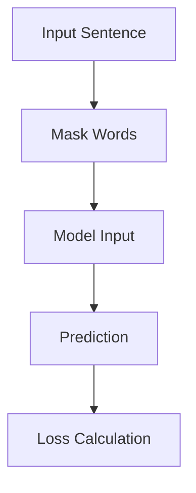
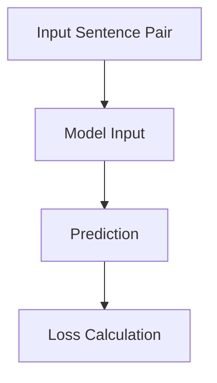

# Lesson 2: Pretraining Objectives

## 1. First-Principles Intuition & Invariants

In the realm of artificial intelligence, particularly within the domain of large language models (LLMs), the process of pretraining is foundational. Pretraining is the initial phase where a model is exposed to vast amounts of data to learn the underlying structure and semantics of the language. This phase is crucial because it equips the model with a rich understanding of language patterns, which can then be fine-tuned for specific tasks such as translation, summarization, or question answering. The objectives of pretraining are designed to capture the nuances of language in a way that is both comprehensive and efficient.

At the heart of pretraining objectives lies the concept of masked language modeling (MLM). This objective is rooted in the idea that a model should be able to predict missing words in a sentence, thereby learning the context and relationships between words. The intuition behind MLM is that by forcing the model to fill in the blanks, it must understand the semantic and syntactic structure of the language. This approach is grounded in the principle that language is a probabilistic system where the probability of a word appearing in a certain context is influenced by the surrounding words. Mathematically, this can be expressed as:

\[ P(w_i | w_1, w_2, \ldots, w_{i-1}, w_{i+1}, \ldots, w_n) \]

where \( w_i \) is the word to be predicted, and \( w_1, w_2, \ldots, w_n \) are the other words in the sentence. By maximizing this probability across a large corpus, the model learns to understand the language's structure.

Another critical pretraining objective is next sentence prediction (NSP). This objective is designed to teach the model the relationship between consecutive sentences, which is essential for understanding the coherence and flow of text. NSP involves training the model to predict whether a given sentence logically follows a preceding sentence. This is particularly important for tasks that require understanding the context across multiple sentences, such as dialogue generation or text summarization. The NSP objective can be formalized as:

\[ P(\text{NS} | \text{S}) \]

where \( \text{NS} \) is the next sentence and \( \text{S} \) is the current sentence. The model is trained to maximize this probability, thereby learning to recognize logical sentence transitions.

These pretraining objectives are not isolated; they work in tandem to provide a comprehensive understanding of language. MLM focuses on the local context within a sentence, while NSP extends this understanding to the global context across sentences. Together, they form a robust foundation for the model, enabling it to perform a wide range of language tasks with high accuracy.

## 2. Core Architecture & Mechanics

The architecture and mechanics of pretraining objectives are intricately designed to ensure that the model learns effectively from the data. Let us delve into the internal data structures and algorithms that underpin these objectives.

### Masked Language Modeling (MLM)

In MLM, a portion of the words in a sentence are randomly masked, and the model is tasked with predicting these masked words. The process involves several key steps:

1. **Masking Words**: A fixed percentage of words in each sentence are randomly selected and replaced with a special token, typically denoted as `[MASK]`. This token serves as a placeholder for the actual word that the model needs to predict.

2. **Model Input**: The sentence with masked words is fed into the model. The model processes the input through its layers, learning to understand the context around the masked words.

3. **Prediction**: The model outputs a probability distribution over the vocabulary for each masked position. The objective is to maximize the probability of the correct word being predicted.

4. **Loss Calculation**: The loss function, typically cross-entropy, is used to measure the difference between the predicted probability distribution and the true distribution (where the true word has a probability of 1 and all others have a probability of 0).

The following diagram illustrates the process of MLM:

### Next Sentence Prediction (NSP)

NSP involves training the model to predict whether a given sentence logically follows a preceding sentence. The process is structured as follows:

1. **Sentence Pairing**: For each sentence in the corpus, a pair of sentences is created. One pair consists of the sentence and a randomly selected sentence from the corpus (negative example), while the other pair consists of the sentence and the next sentence in the document (positive example).

2. **Model Input**: The sentence pair is fed into the model. The model processes the input through its layers, learning to understand the relationship between the two sentences.

3. **Prediction**: The model outputs a probability indicating whether the second sentence logically follows the first sentence.

4. **Loss Calculation**: The loss function, typically binary cross-entropy, is used to measure the difference between the predicted probability and the true label (1 for positive examples and 0 for negative examples).

The following diagram illustrates the process of NSP:

## 3. High-Performance Optimization & Failure Modes

Optimizing the performance of pretraining objectives is critical for ensuring that the model learns efficiently and effectively. Several strategies can be employed to enhance performance, while also addressing potential failure modes.

### Concurrency

Pretraining involves processing large datasets, which can be computationally intensive. To optimize performance, concurrency can be leveraged to parallelize the training process. This can be achieved through distributed training frameworks that distribute the workload across multiple GPUs or TPUs. By utilizing multiple processing units, the training time can be significantly reduced, allowing for more extensive experimentation and model refinement.

### Resource Scaling

Scaling resources is essential for handling the large-scale data requirements of pretraining. This involves optimizing the use of memory, CPU, and GPU resources. Techniques such as gradient accumulation, mixed precision training, and efficient data loading can be employed to maximize resource utilization. Gradient accumulation involves accumulating gradients over multiple mini-batches before updating the model weights, which can help in reducing memory usage. Mixed precision training involves using lower precision (e.g., float16) for certain operations to speed up computations and reduce memory usage. Efficient data loading involves optimizing the data pipeline to ensure that data is fed into the model at a consistent rate, minimizing bottlenecks.

### Boundary Edge Cases

Handling boundary edge cases is crucial for ensuring the robustness of the model. These cases include sentences with rare words, idiomatic expressions, and ambiguous contexts. To address these cases, the training data should be diverse and representative of the language's nuances. Additionally, techniques such as data augmentation and noise injection can be employed to improve the model's ability to handle edge cases. Data augmentation involves generating additional training examples by applying transformations to the existing data, while noise injection involves introducing random variations to the input data to make the model more robust.

### Failure Mitigations

Several failure modes can arise during pretraining, including overfitting, underfitting, and vanishing/exploding gradients. Overfitting occurs when the model learns to memorize the training data rather than generalizing to new data. To mitigate overfitting, techniques such as dropout, regularization, and early stopping can be employed. Dropout involves randomly dropping units during training to prevent the model from becoming too reliant on specific features. Regularization involves adding a penalty term to the loss function to discourage overly complex models. Early stopping involves monitoring the model's performance on a validation set and halting training when performance starts to degrade.

Underfitting occurs when the model is too simple to capture the underlying patterns in the data. To mitigate underfitting, the model architecture can be made more complex, and the training duration can be increased. Vanishing and exploding gradients can occur during training, particularly in deep networks. To mitigate these issues, techniques such as gradient clipping and using activation functions that are less prone to gradient vanishing/exploding (e.g., ReLU) can be employed.

In conclusion, pretraining objectives such as masked language modeling and next sentence prediction are fundamental to the development of large language models. These objectives provide the model with a comprehensive understanding of language, enabling it to perform a wide range of tasks with high accuracy. By optimizing the architecture and mechanics of these objectives and addressing potential failure modes, the performance of the model can be significantly enhanced, leading to more robust and effective language models.
