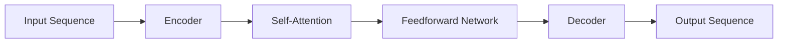

Lesson 4: Pretraining Architectures
=====================================

### 1. First-Principins Intuition & Invariants

Pretraining architectures are the foundation upon which large language models (LLMs) are built. These architectures are designed to learn general-purpose representations of language, which can then be fine-tuned for specific tasks. At their core, pretraining architectures are a manifestation of the universal approximation theorem, which states that a feedforward network with a single hidden layer can approximate any continuous function to any desired degree of accuracy.

The pretraining objective is to learn a representation of the input data that is both informative and compact. This is typically achieved through a combination of self-supervised learning objectives, such as masked language modeling (MLM) and next sentence prediction (NSP). The MLM objective involves randomly masking a subset of the input tokens and training the model to predict the original token. The NSP objective involves predicting whether two input sentences are adjacent in the original text.

Mathematically, the pretraining objective can be formalized as follows:

Let `x` be the input sequence, `y` be the corresponding output sequence, and `θ` be the model parameters. The pretraining objective is to minimize the following loss function:

`L(θ) = E[MLM(x, y) + NSP(x, y)]`

where `E` is the expectation operator, and `MLM` and `NSP` are the MLM and NSP objectives, respectively.

### 2. Core Architecture & Mechanics

The core architecture of a pretraining model is typically a transformer-based architecture, which consists of an encoder and a decoder. The encoder takes in the input sequence and produces a continuous representation of the input, while the decoder takes in the continuous representation and produces the output sequence.

The transformer architecture is based on self-attention mechanisms, which allow the model to attend to different parts of the input sequence simultaneously. The self-attention mechanism is computed as follows:

`Attention(Q, K, V) = softmax(QK^T / sqrt(d)) * V`

where `Q`, `K`, and `V` are the query, key, and value vectors, respectively, and `d` is the dimensionality of the vectors.

The transformer architecture consists of multiple layers, each of which consists of a self-attention mechanism followed by a feedforward network. The feedforward network is a fully connected network with two hidden layers, each of which is followed by a ReLU activation function.

Here is a high-level diagram of the transformer architecture:

### 3. High-Performance Optimization & Failure Modes

To achieve high-performance, pretraining models require careful optimization of the model architecture, hyperparameters, and training procedure. Some key considerations include:

* **Concurrency**: Pretraining models can be parallelized across multiple GPUs or TPUs to achieve high-performance.
* **Resource Scaling**: The model architecture and hyperparameters must be carefully tuned to ensure that the model can be trained on large datasets.
* **Boundary Edge Cases**: The model must be designed to handle edge cases, such as out-of-vocabulary words or sentences with multiple authors.
* **Failure Modes**: The model must be designed to handle failure modes, such as catastrophic forgetting or overfitting.

Some common failure modes of pretraining models include:

* **Catastrophic Forgetting**: The model forgets previously learned knowledge during fine-tuning.
* **Overfitting**: The model overfits to the training data and performs poorly on unseen data.
* **Underfitting**: The model underfits the training data and performs poorly on unseen data.

To mitigate these failure modes, careful consideration must be given to the model architecture, hyperparameters, and training procedure. Some common techniques include:

* **Early Stopping**: The training procedure is stopped early to prevent overfitting.
* **Regularization**: Regularization techniques, such as dropout and weight decay, are used to prevent overfitting.
* **Data Augmentation**: Data augmentation techniques, such as random masking and permutation, are used to increase the size of the training dataset.
* **Ensemble Methods**: Ensemble methods, such as bagging and boosting, are used to combine the predictions of multiple models.
