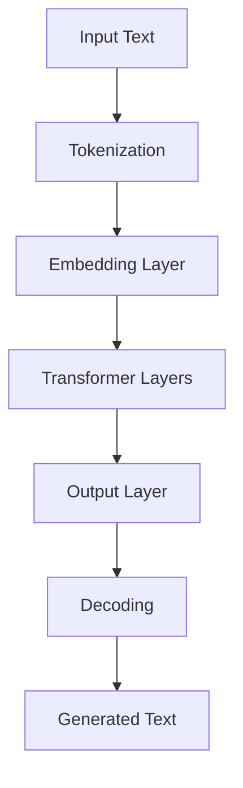

# Lesson 1: Introduction to Instruction Tuning

## 1. First-Principles Intuition & Invariants

Instruction tuning in the context of AI and large language models (LLMs) is a foundational practice that bridges the gap between raw computational power and meaningful, human-aligned outputs. At its core, instruction tuning involves the systematic refinement of prompts and instructions to elicit desired behaviors and responses from an AI model. This process is not merely about tweaking parameters or adjusting weights; it is a deep dive into the architecture and mechanics of how these models process and generate language.

The problem space of instruction tuning is inherently complex, as it requires a nuanced understanding of both the model's internal mechanisms and the external expectations placed upon it. Models like GPT-3 and GPT-4 are trained on vast corpora of text, which imbue them with a broad range of linguistic capabilities. However, this breadth can also lead to inconsistencies and unintended behaviors if not carefully managed. The challenge, then, is to align the model's outputs with human intentions and values, a task that is both art and science.

From a theoretical standpoint, instruction tuning can be viewed as a form of constrained optimization. The objective is to minimize the difference between the model's generated outputs and the desired outcomes specified by the instructions. This requires a rigorous understanding of the model's decision-making processes, which are governed by the underlying neural network architecture. The invariants in this system include the model's capacity to generalize from training data, its ability to handle unseen inputs, and its consistency in producing coherent and contextually relevant responses.

One of the key invariants in instruction tuning is the concept of alignment. Alignment refers to the degree to which the model's outputs are consistent with human values and intentions. This is a critical consideration, as AI models can sometimes produce outputs that are factually correct but ethically problematic or socially harmful. Ensuring alignment requires careful design of instructions and a deep understanding of the model's capabilities and limitations.

Another invariant is the principle of interpretability. As AI models become more complex, it becomes increasingly difficult to understand how they arrive at their outputs. Instruction tuning plays a crucial role in making the model's decision-making processes more transparent and interpretable. By carefully crafting instructions, we can guide the model towards producing outputs that are not only correct but also understandable to human users.

## 2. Core Architecture & Mechanics

To understand the mechanics of instruction tuning, it is essential to delve into the internal architecture of large language models. At a high level, these models are composed of multiple layers of interconnected neurons, each of which processes and transforms input data to produce an output. The architecture of a typical LLM can be visualized using a simplified diagram:



In this diagram, the input text is first tokenized into a sequence of discrete tokens, which are then converted into dense vector representations by the embedding layer. These embeddings are then processed by a series of transformer layers, which are the core building blocks of the model. Each transformer layer consists of a self-attention mechanism and a feedforward neural network, which work together to capture the complex relationships between tokens in the input sequence.

The output layer of the model generates a probability distribution over the vocabulary, which is then decoded into a sequence of tokens representing the generated text. This process is guided by the instructions provided to the model, which can significantly influence the quality and relevance of the output.

One of the key components of instruction tuning is the design of effective prompts. A prompt is a piece of text that is provided to the model as input, along with the instructions for generating a response. The quality of the prompt can have a profound impact on the model's output, as it sets the context and parameters for the generation process.

For example, consider a prompt that asks the model to generate a summary of a given article. The prompt might be structured as follows:

```
Article: [Insert article text here]

Summary:
```

In this case, the prompt provides the model with the necessary context and instructions to generate a concise summary of the article. The effectiveness of the prompt can be further enhanced by including additional details, such as the desired length of the summary or specific topics to focus on.

Another important aspect of instruction tuning is the use of data labeling and alignment. Data labeling involves the process of annotating training data with the desired outputs, which can then be used to fine-tune the model. This process is critical for ensuring that the model learns to produce outputs that are consistent with human intentions.

For example, consider a dataset of customer reviews that have been labeled with sentiment scores (positive, negative, or neutral). By fine-tuning the model on this dataset, we can train it to generate sentiment scores for new reviews with high accuracy. However, the quality of the model's outputs will depend on the accuracy and consistency of the labels provided in the training data.

Data alignment, on the other hand, involves the process of ensuring that the model's outputs are consistent with human values and intentions. This can be achieved through a combination of careful prompt design and ethical considerations. For example, a prompt that asks the model to generate a response to a sensitive topic should be carefully crafted to ensure that the output is respectful and non-offensive.

## 3. High-Performance Optimization & Failure Modes

Instruction tuning is not only about producing high-quality outputs; it is also about optimizing the performance of the model. This involves a range of techniques, from fine-tuning hyperparameters to scaling resources and managing concurrency.

One of the key challenges in instruction tuning is managing the trade-off between quality and performance. In many cases, producing high-quality outputs requires a significant amount of computational resources, which can be costly and time-consuming. To address this challenge, it is essential to carefully optimize the model's performance through techniques such as model pruning, quantization, and parallelization.

Model pruning involves the process of removing unnecessary weights and neurons from the model, which can significantly reduce its size and improve its performance. Quantization involves the process of converting the model's weights and activations from floating-point to integer representations, which can improve performance on hardware accelerators such as GPUs and TPUs. Parallelization involves the process of distributing the model's computations across multiple processors or machines, which can improve performance on large-scale datasets.

Another important aspect of instruction tuning is managing concurrency and resource scaling. As the size and complexity of LLMs continue to grow, it becomes increasingly challenging to manage the computational resources required to train and deploy these models. To address this challenge, it is essential to use techniques such as distributed training, load balancing, and resource allocation.

Distributed training involves the process of training the model across multiple machines, which can significantly reduce the time required to train the model. Load balancing involves the process of distributing the workload across multiple processors or machines, which can improve performance and reduce the risk of resource contention. Resource allocation involves the process of managing the computational resources required to train and deploy the model, which can improve performance and reduce costs.

Despite these optimizations, instruction tuning is not without its challenges and failure modes. One of the key challenges is managing the trade-off between quality and performance. In many cases, producing high-quality outputs requires a significant amount of computational resources, which can be costly and time-consuming. To address this challenge, it is essential to carefully optimize the model's performance through techniques such as model pruning, quantization, and parallelization.

Another important challenge is managing the risk of overfitting. Overfitting occurs when the model becomes too specialized to the training data, which can lead to poor performance on unseen inputs. To address this challenge, it is essential to use techniques such as regularization, dropout, and data augmentation to improve the model's generalization capabilities.

Finally, instruction tuning is also subject to a range of ethical and social considerations. As AI models become more powerful and pervasive, it is essential to ensure that they are aligned with human values and intentions. This requires careful design of instructions and a deep understanding of the model's capabilities and limitations.

In conclusion, instruction tuning is a critical practice in the development and deployment of large language models. It involves a range of techniques, from prompt design and data labeling to performance optimization and ethical considerations. By carefully tuning the instructions provided to the model, we can ensure that it produces high-quality, human-aligned outputs that are both accurate and meaningful.
