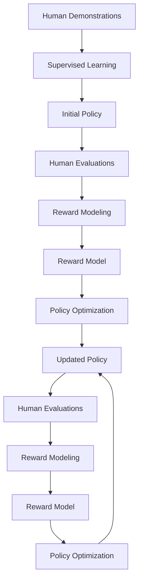

# Lesson 2: Overview of Reinforcement Learning from Human Feedback

## 1. First-Principles Intuition & Invariants

Reinforcement Learning from Human Feedback (RLHF) stands as a pivotal paradigm in the evolution of artificial intelligence, particularly in the realm of large language models (LLMs). At its core, RLHF seeks to imbue machines with the ability to learn not just from data, but from the nuanced, subjective judgments of human evaluators. This approach is rooted in the broader field of reinforcement learning (RL), which has historically been concerned with training agents to make a sequence of decisions that maximize some notion of cumulative reward. However, traditional RL often falls short when it comes to aligning these rewards with human values and preferences, especially in complex domains like natural language understanding and generation.

The problem space of RLHF is inherently multifaceted. It involves not only the technical challenges of designing effective reinforcement learning algorithms but also the ethical and practical considerations of gathering and interpreting human feedback. At the heart of RLHF lies the assumption that human evaluators can provide valuable insights into the quality and appropriateness of model outputs, which can then be used to guide the learning process. This feedback can take many forms, from binary judgments (e.g., "this response is better than that") to more nuanced evaluations (e.g., "this response is more coherent and relevant to the context").

Mathematically, RLHF can be framed as a process of iteratively refining a policy $\pi$ based on human feedback. The policy $\pi$ represents the model's strategy for generating responses, and the goal is to adjust $\pi$ such that it maximizes the expected human approval. This is typically achieved through a series of steps, including supervised learning from demonstrations, reward modeling based on human judgments, and policy optimization using reinforcement learning techniques. The invariants in this process include the consistency and reliability of human feedback, the ability of the model to generalize from limited feedback, and the robustness of the learning algorithms to various forms of noise and bias.

## 2. Core Architecture & Mechanics

The architecture of RLHF systems is designed to integrate human feedback seamlessly into the model training pipeline. At a high level, the process can be broken down into three main components: supervised learning, reward modeling, and policy optimization.

### Supervised Learning from Demonstrations

The first step in RLHF is often to train the model on a dataset of human-generated examples. This dataset serves as a starting point, providing the model with a baseline understanding of the desired behavior. The supervised learning phase involves training the model to mimic the human demonstrations, using techniques such as maximum likelihood estimation (MLE) or cross-entropy loss. This phase is crucial for initializing the model with a reasonable policy that can be further refined through reinforcement learning.

### Reward Modeling

Once the model has been initialized, the next step is to model the reward function based on human feedback. This involves training a separate reward model that can predict the quality of model outputs based on human judgments. The reward model is typically trained using a dataset of human evaluations, where each evaluation consists of a model output and a corresponding reward score. The reward model can take various forms, ranging from simple linear models to more complex neural networks. The key challenge in reward modeling is to ensure that the reward function accurately reflects human preferences and can be used to guide the reinforcement learning process.

### Policy Optimization

The final step in RLHF is to use the reward model to optimize the model's policy. This involves training the model to maximize the expected reward, using reinforcement learning techniques such as policy gradient methods or actor-critic algorithms. The policy optimization phase is iterative, with the model being updated based on the reward signals provided by the reward model. This process continues until the model's policy converges to a point where it consistently generates high-quality outputs that align with human preferences.

To illustrate the architecture of an RLHF system, we can use a Mermaid diagram:

In this diagram, the process of RLHF is depicted as a feedback loop, where the model's policy is iteratively refined based on human feedback. The supervised learning phase initializes the model with a baseline policy, which is then optimized using the reward model. The reward model is trained based on human evaluations, which provide the feedback signals needed to guide the policy optimization process.

## 3. High-Performance Optimization & Failure Modes

The high-performance optimization of RLHF systems involves several key considerations, including concurrency, resource scaling, boundary edge cases, and failure mitigations.

### Concurrency

One of the primary challenges in RLHF is the need to efficiently process large datasets of human demonstrations and evaluations. This requires the use of concurrent data processing techniques, such as parallel data loading and distributed training. Concurrency can be achieved through the use of multi-threading, multi-processing, or distributed computing frameworks like Apache Spark or Dask. The key challenge in concurrency is to ensure that the data processing pipeline is both efficient and scalable, while also maintaining the consistency and reliability of the data.

### Resource Scaling

RLHF systems often require significant computational resources, particularly for training large language models and reward models. Resource scaling involves the use of distributed computing frameworks, such as Kubernetes or Apache Mesos, to allocate resources across multiple nodes. The key challenge in resource scaling is to ensure that the system can efficiently utilize the available resources, while also maintaining the performance and reliability of the model training process.

### Boundary Edge Cases

RLHF systems must be robust to a wide range of boundary edge cases, including noisy or inconsistent human feedback, ambiguous or conflicting demonstrations, and unexpected model outputs. Boundary edge cases can arise from a variety of sources, including human error, data quality issues, and model limitations. The key challenge in handling boundary edge cases is to ensure that the system can gracefully handle these cases, while still maintaining the quality and reliability of the model outputs.

### Failure Mitigations

RLHF systems are complex and can be prone to a variety of failure modes, including overfitting, underfitting, and reward hacking. Overfitting occurs when the model becomes too specialized to the training data, while underfitting occurs when the model fails to capture the underlying patterns in the data. Reward hacking occurs when the model learns to exploit the reward function in unintended ways, rather than generating high-quality outputs. The key challenge in failure mitigation is to design the system in a way that minimizes the risk of these failure modes, while still allowing the model to learn effectively.

In summary, Reinforcement Learning from Human Feedback (RLHF) is a powerful paradigm for improving the performance of large language models by incorporating human feedback into the model training process. The architecture of RLHF systems involves three main components: supervised learning from demonstrations, reward modeling based on human evaluations, and policy optimization using reinforcement learning techniques. The high-performance optimization of RLHF systems involves several key considerations, including concurrency, resource scaling, boundary edge cases, and failure mitigations. By addressing these challenges, RLHF can help to ensure that large language models are not only technically proficient but also aligned with human values and preferences.
