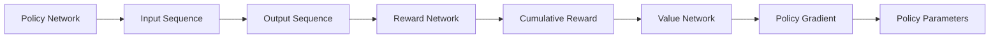

# Lesson 4: Practical RLHF Applications

## 1. First-Principles Intuition & Invariants

RLHF (Reinforcement Learning from Human Feedback) is a critical component of large language models, enabling them to learn from human evaluators and improve their performance on complex tasks. To grasp the essence of RLHF, let's delve into its theoretical foundations. At its core, RLHF is a variant of reinforcement learning, where the agent (the language model) learns to optimize its behavior by interacting with the environment (the human evaluators).

In RLHF, the agent receives feedback in the form of rewards or penalties, which are used to update its policy. The key invariant in RLHF is the concept of **value alignment**, which ensures that the agent's goals are aligned with those of the human evaluators. This is achieved through the use of **reward shaping**, where the rewards are designed to encourage the agent to exhibit desired behaviors.

Mathematically, RLHF can be represented as a Markov Decision Process (MDP), where the state space is the set of possible input sequences, the action space is the set of possible output sequences, and the reward function is the feedback provided by the human evaluators. The goal of the agent is to maximize the cumulative reward over an episode, which is a sequence of input-output pairs.

To illustrate the problem space, consider a language model tasked with generating coherent and informative text. The agent receives input sequences from the human evaluators, generates output sequences, and receives feedback in the form of rewards or penalties. The agent's goal is to maximize the cumulative reward over an episode, which is a sequence of input-output pairs.

## 2. Core Architecture & Mechanics

Let's dissect the internal data structures and algorithms used in RLHF. At its core, RLHF relies on a **policy network**, which is a neural network that maps input sequences to output sequences. The policy network is trained using **policy gradient methods**, which update the policy parameters based on the gradient of the cumulative reward.

The RLHF architecture typically consists of the following components:

*   **Policy Network**: A neural network that maps input sequences to output sequences.
*   **Reward Network**: A neural network that predicts the rewards for a given input-output pair.
*   **Value Network**: A neural network that predicts the cumulative reward for a given input sequence.

The policy network is trained using policy gradient methods, which update the policy parameters based on the gradient of the cumulative reward. The reward network and value network are used to provide feedback to the policy network during training.

Here is a high-level Mermaid diagram illustrating the RLHF architecture:

## 3. High-Performance Optimization & Failure Modes

RLHF is a computationally intensive task, requiring significant resources to train and deploy. To optimize performance, RLHF practitioners employ various techniques, including:

*   **Distributed Training**: Training the policy network in parallel across multiple machines.
*   **Model Pruning**: Reducing the number of parameters in the policy network to improve inference speed.
*   **Knowledge Distillation**: Transferring knowledge from a large policy network to a smaller one.

However, RLHF is not without its challenges and failure modes. Some common pitfalls include:

*   **Reward Hacking**: The agent exploiting the reward function to achieve suboptimal goals.
*   **Value Alignment**: The agent's goals diverging from those of the human evaluators.
*   **Overfitting**: The agent overfitting to the training data and failing to generalize to new situations.

To mitigate these risks, RLHF practitioners employ various techniques, including:

*   **Reward Shaping**: Designing the reward function to encourage desired behaviors.
*   **Value Alignment**: Ensuring that the agent's goals are aligned with those of the human evaluators.
*   **Regularization**: Regularizing the policy network to prevent overfitting.

By understanding the theoretical foundations, architecture, and optimization techniques of RLHF, practitioners can develop more effective and robust language models that align with human values.
