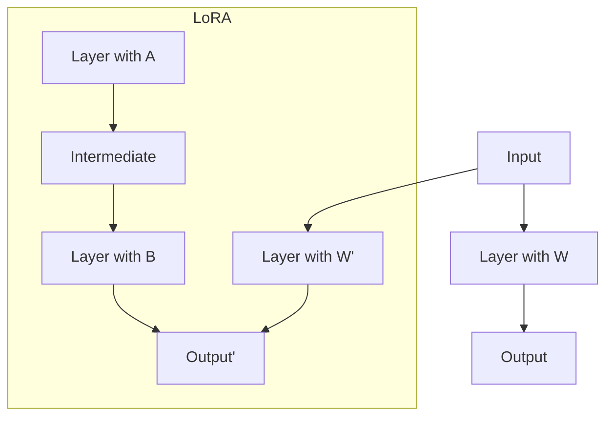

# Lesson 1: Introduction to LoRA

## 1. First-Principles Intuition & Invariants

In the realm of artificial intelligence, particularly within the domain of large language models (LLMs), the challenge of adapting pre-trained models to specific tasks while maintaining computational efficiency is paramount. Traditional fine-tuning approaches often require significant computational resources and time, as they involve updating a substantial portion of the model's parameters. This not only increases the training cost but also poses scalability issues, especially when deploying models in resource-constrained environments. To address these challenges, researchers have developed various parameter-efficient fine-tuning techniques, one of which is Low-Rank Adaptation (LoRA).

LoRA introduces a novel approach to fine-tuning by decomposing the adaptation process into low-rank updates. This method leverages the mathematical principle that many of the changes required for fine-tuning can be represented as small perturbations to the original model parameters. By focusing on these perturbations rather than modifying the entire model, LoRA significantly reduces the number of parameters that need to be updated, thereby minimizing computational overhead and resource consumption.

The theoretical grounding of LoRA is rooted in the concept of low-rank matrix factorization. In linear algebra, a low-rank matrix is one that can be expressed as a product of two matrices with much smaller dimensions. This property is particularly useful in the context of neural networks, where weight matrices often exhibit low-rank structures. By approximating these weight matrices with low-rank factors, LoRA can capture the essential changes required for fine-tuning without altering the bulk of the model's parameters.

The problem space that LoRA addresses is the need for efficient and scalable model adaptation. As LLMs continue to grow in size and complexity, the computational cost of fine-tuning becomes a critical bottleneck. Traditional fine-tuning methods, which involve updating all parameters of the model, are not feasible in many practical scenarios. LoRA provides a solution by focusing on the minimal set of parameters that need to be adjusted, thus enabling efficient fine-tuning even for large models.

The invariants of LoRA lie in its ability to maintain the integrity and performance of the original model while introducing targeted adaptations. By ensuring that only low-rank updates are applied, LoRA preserves the learned representations and knowledge of the pre-trained model, while allowing it to adapt to new tasks. This balance between efficiency and effectiveness is crucial for the successful deployment of LLMs in diverse applications.

## 2. Core Architecture & Mechanics

At the heart of LoRA's architecture is the concept of low-rank decomposition, which is applied to the weight matrices of the neural network. The core idea is to introduce two additional matrices, often referred to as "adapter matrices," that are used to modify the original weight matrices during the forward and backward passes of the model.

To illustrate this, consider a neural network layer with a weight matrix \( W \). In a standard fine-tuning approach, \( W \) would be updated directly. In contrast, LoRA introduces two additional matrices, \( A \) and \( B \), such that the modified weight matrix \( W' \) is given by:

\[ W' = W + A \cdot B \]

Here, \( A \) and \( B \) are low-rank matrices with dimensions much smaller than \( W \). The forward pass of the model involves computing the output using \( W' \), while the backward pass involves updating \( A \) and \( B \) to minimize the loss function. This decomposition allows LoRA to capture the necessary adaptations with a minimal number of parameters.

To visualize this process, consider the following Mermaid diagram:

In this diagram, the standard layer with weight matrix \( W \) is replaced by a LoRA-enhanced layer with weight matrix \( W' \). The intermediate computations involve the adapter matrices \( A \) and \( B \), which are used to modify the original weight matrix.

The mechanics of LoRA also involve careful initialization and training strategies to ensure that the low-rank updates are effective. Typically, the adapter matrices \( A \) and \( B \) are initialized with small random values, and the model is trained using standard optimization techniques such as stochastic gradient descent (SGD). The key challenge is to ensure that the low-rank updates do not disrupt the learned representations of the pre-trained model, while still allowing it to adapt to new tasks.

## 3. High-Performance Optimization & Failure Modes

The high-performance optimization of LoRA is achieved through its parameter-efficient nature. By focusing on low-rank updates, LoRA reduces the computational cost of fine-tuning, enabling faster training times and lower resource consumption. This is particularly beneficial in scenarios where computational resources are limited, such as edge devices or cloud environments with strict cost constraints.

Concurrency is another critical aspect of LoRA's performance optimization. Since the updates to the adapter matrices \( A \) and \( B \) are independent of the original weight matrix \( W \), they can be parallelized efficiently. This parallelism can be leveraged to accelerate the training process, further enhancing the performance of LoRA.

Resource scaling is another area where LoRA excels. The parameter-efficient nature of LoRA makes it well-suited for scaling across different hardware architectures, from high-performance GPUs to resource-constrained edge devices. By minimizing the number of parameters that need to be updated, LoRA can be deployed in a wide range of environments without significant performance degradation.

However, like any technique, LoRA is not immune to failure modes. One potential issue is the risk of overfitting, especially when the adapter matrices are too large relative to the size of the dataset. To mitigate this risk, careful tuning of the rank of the adapter matrices is essential. Additionally, the initialization of the adapter matrices plays a crucial role in ensuring that the low-rank updates are effective. Poor initialization can lead to suboptimal performance, and careful experimentation is often required to find the best initialization strategy.

Another failure mode arises from the potential for the low-rank updates to disrupt the learned representations of the pre-trained model. While LoRA is designed to minimize this risk, it is still possible for the adapter matrices to introduce unintended changes to the model's behavior. To address this, techniques such as regularization and careful monitoring of the training process are essential.

In conclusion, Low-Rank Adaptation (LoRA) provides a powerful and efficient approach to fine-tuning large language models. By focusing on low-rank updates, LoRA reduces the computational cost and resource consumption of fine-tuning, while maintaining the integrity and performance of the original model. Through careful initialization, training strategies, and optimization techniques, LoRA can be effectively deployed in a wide range of scenarios, making it an invaluable tool for senior software engineers, systems programmers, and domain architects working with large language models.
