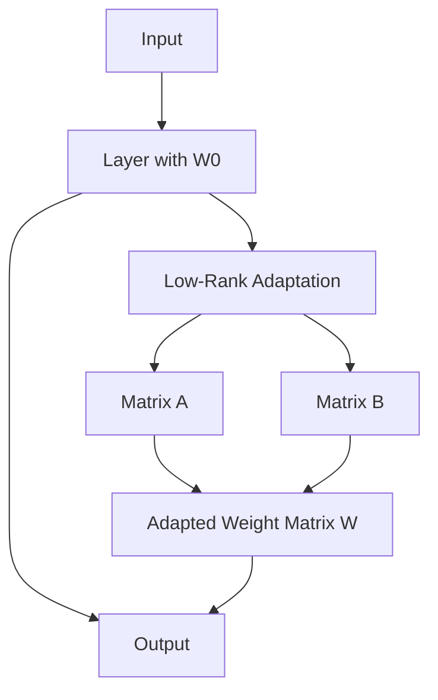

# Lesson 2: Mathematical Foundations of LoRA

## 1. First-Principles Intuition & Invariants

In the realm of large language models (LLMs), the quest for parameter-efficient fine-tuning has led to the development of techniques that allow for significant improvements in model performance with minimal increases in computational overhead. One such technique is Low-Rank Adaptation (LoRA), which leverages the mathematical principles of low-rank factorization to achieve these gains. To fully understand LoRA, we must delve into the underlying mathematical foundations that make it a powerful tool in the arsenal of AI practitioners.

At the heart of LoRA is the concept of low-rank factorization, a technique that decomposes a large matrix into a product of two smaller matrices. This decomposition is rooted in linear algebra, specifically in the Singular Value Decomposition (SVD) and its variants. The SVD is a fundamental theorem in linear algebra that states that any real matrix \( A \) can be decomposed into the product of three matrices: \( A = U \Sigma V^T \), where \( U \) and \( V \) are orthogonal matrices and \( \Sigma \) is a diagonal matrix containing the singular values of \( A \). The singular values represent the importance of each dimension in the matrix, and by retaining only the top \( r \) singular values, we can approximate \( A \) with a low-rank matrix \( A_r = U_r \Sigma_r V_r^T \), where \( r \) is the rank of the approximation.

The key insight of LoRA is that the weights of a large language model can be decomposed into a sum of a base model and a low-rank adaptation. This adaptation is achieved by introducing two small matrices, \( A \) and \( B \), such that the adapted weight matrix \( W \) can be expressed as \( W = W_0 + A B \), where \( W_0 \) is the original weight matrix. The matrices \( A \) and \( B \) are of much smaller dimensions than \( W \), which significantly reduces the number of parameters that need to be fine-tuned. This reduction in parameters not only decreases the computational cost but also mitigates the risk of overfitting, a common challenge in fine-tuning large models.

The invariants of LoRA lie in its ability to maintain the expressiveness of the original model while introducing minimal additional complexity. By decomposing the weight updates into a low-rank form, LoRA ensures that the model can still capture the necessary nuances and variations in the data, but with a more efficient parameterization. This efficiency is crucial in the context of large language models, where the number of parameters can easily exceed billions, making traditional fine-tuning methods computationally prohibitive.

## 2. Core Architecture & Mechanics

To illustrate the core architecture and mechanics of LoRA, let us consider a simplified example. Suppose we have a weight matrix \( W_0 \) of size \( m \times n \) in a neural network layer. Instead of fine-tuning \( W_0 \) directly, LoRA introduces two smaller matrices \( A \) and \( B \) of sizes \( m \times r \) and \( r \times n \), respectively, where \( r \) is the rank of the adaptation. The adapted weight matrix \( W \) is then given by:

\[ W = W_0 + A B \]

The matrices \( A \) and \( B \) are the primary parameters that are fine-tuned during the training process. The choice of \( r \) is a critical design decision, as it balances the trade-off between the expressiveness of the adaptation and the computational cost. A larger \( r \) allows for a more expressive adaptation but increases the number of parameters, while a smaller \( r \) reduces the number of parameters but may limit the model's ability to capture the necessary variations in the data.

To visualize the architecture of LoRA, we can use a simple diagram. Consider the following Mermaid diagram:

In this diagram, the input data is passed through a layer with the original weight matrix \( W_0 \). The low-rank adaptation is applied by introducing the matrices \( A \) and \( B \), which are combined to form the adapted weight matrix \( W \). The adapted weight matrix is then used to produce the final output.

The mechanics of LoRA involve the forward and backward passes of the neural network. During the forward pass, the input data is multiplied by the adapted weight matrix \( W \) to produce the output. During the backward pass, the gradients of the loss function with respect to the output are computed and propagated back through the network. The gradients are then used to update the matrices \( A \) and \( B \) using standard optimization techniques such as stochastic gradient descent (SGD) or Adam.

## 3. High-Performance Optimization & Failure Modes

The high-performance optimization of LoRA is achieved through several key strategies. First, the use of low-rank factorization significantly reduces the number of parameters that need to be fine-tuned, which in turn reduces the computational cost. Second, the matrices \( A \) and \( B \) can be optimized using efficient matrix multiplication algorithms, which take advantage of the low-rank structure to speed up the computations. Third, the use of hardware accelerators such as GPUs and TPUs can further accelerate the training process by leveraging their parallel processing capabilities.

However, the performance of LoRA is not without its challenges. One potential failure mode is the choice of the rank \( r \). If \( r \) is too small, the low-rank adaptation may not be expressive enough to capture the necessary variations in the data, leading to poor performance. On the other hand, if \( r \) is too large, the number of parameters may increase significantly, negating the benefits of low-rank factorization. Therefore, careful tuning of the rank \( r \) is essential to achieve the best performance.

Another potential failure mode is the initialization of the matrices \( A \) and \( B \). If the matrices are initialized poorly, the low-rank adaptation may not converge to a good solution, leading to suboptimal performance. To mitigate this risk, it is common to initialize the matrices \( A \) and \( B \) with small random values or zeros, and to use techniques such as weight decay and learning rate scheduling to stabilize the training process.

In conclusion, the mathematical foundations of LoRA provide a powerful framework for parameter-efficient fine-tuning of large language models. By leveraging the principles of low-rank factorization, LoRA enables significant improvements in model performance with minimal computational overhead. The core architecture and mechanics of LoRA involve the introduction of two small matrices \( A \) and \( B \), which are used to adapt the original weight matrix \( W_0 \). High-performance optimization and failure modes are addressed through careful tuning of the rank \( r \) and initialization of the matrices \( A \) and \( B \). Understanding these principles is essential for senior software engineers, systems programmers, and domain architects who seek to harness the power of LoRA in their work with large language models.
