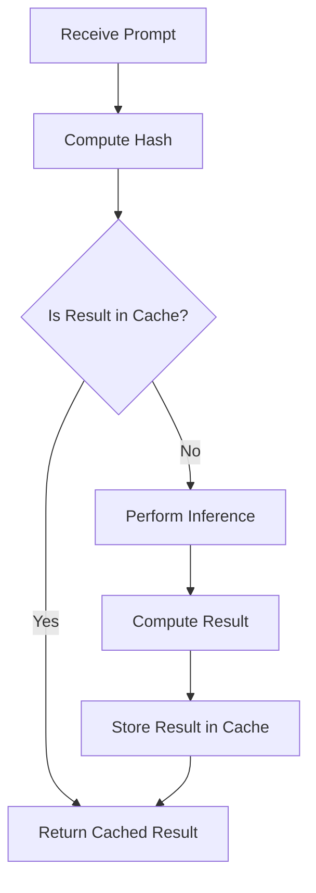

# Lesson 1: Prompt Caching Strategies

## 1. First-Principles Intuition & Invariants

In the realm of artificial intelligence and large language models (LLMs), prompt caching emerges as a critical strategy for optimizing inference performance and resource utilization. The essence of prompt caching lies in the recognition that many prompts are repetitive or similar across different user interactions, allowing the system to reuse previously computed results rather than re-evaluating the same prompts repeatedly. This not only accelerates response times but also reduces computational overhead, thereby enhancing the overall efficiency of the AI system.

To understand the theoretical grounding of prompt caching, we must delve into the problem space and the underlying invariants. At its core, prompt caching is a form of memoization tailored for the context of AI models. Memoization is a well-known technique in computer science where the results of expensive function calls are stored and reused when the same inputs occur again. In the context of LLMs, the "function" is the inference process, and the "inputs" are the prompts.

The problem space for prompt caching is multifaceted. On one hand, the system must efficiently store and retrieve cached prompts, ensuring that the lookup operations are fast and do not introduce significant latency. On the other hand, the system must manage the cache's memory footprint, ensuring that it does not consume excessive resources while still maintaining a high hit rate. Additionally, the system must handle the dynamic nature of prompts, where new prompts are continuously introduced, and old ones may become obsolete.

The invariants in prompt caching revolve around the consistency and correctness of the cached data. The system must ensure that the cached results are up-to-date and reflect the current state of the model. This is particularly important in scenarios where the model is updated or retrained, as the cached results must be invalidated or refreshed to reflect the new model state. Furthermore, the system must handle concurrent access to the cache, ensuring that multiple threads or processes can safely read from and write to the cache without introducing data races or inconsistencies.

## 2. Core Architecture & Mechanics

The architecture of a prompt caching system is intricately tied to the underlying data structures and algorithms that enable efficient storage and retrieval of cached prompts. At the heart of the system is the cache itself, which is typically implemented as a hash table or a more sophisticated data structure like a trie or a bloom filter, depending on the specific requirements and constraints.

To illustrate the core mechanics of prompt caching, let us consider a simple hash table-based cache. In this setup, each prompt is hashed to a unique key, and the corresponding result is stored in the hash table. When a new prompt is received, the system first computes its hash and checks if the result is already present in the cache. If the result is found, it is returned immediately, bypassing the inference process. If the result is not found, the system proceeds with the inference process, computes the result, and stores it in the cache for future use.

In this diagram, the process begins with the reception of a prompt. The prompt is then hashed, and the system checks if the result is already present in the cache. If the result is found, it is returned immediately. If the result is not found, the system proceeds with the inference process, computes the result, and stores it in the cache for future use.

To enhance the efficiency of the cache, various optimizations can be applied. One common optimization is the use of a least recently used (LRU) eviction policy, where the least recently accessed entries are removed from the cache when the cache reaches its capacity limit. This ensures that the cache retains the most frequently accessed prompts, maximizing the hit rate.

Another optimization is the use of a tiered cache architecture, where the cache is divided into multiple levels, each with different storage and access characteristics. For example, a two-level cache might consist of a small, fast in-memory cache and a larger, slower disk-based cache. This allows the system to balance the trade-off between speed and capacity, ensuring that the most frequently accessed prompts are stored in the fast cache, while less frequently accessed prompts are stored in the slower cache.

## 3. High-Performance Optimization & Failure Modes

To achieve high performance in prompt caching, several optimizations and considerations must be taken into account. Concurrency is a critical factor, as the system must handle multiple threads or processes accessing the cache simultaneously. To ensure thread safety, the cache must be protected by appropriate synchronization mechanisms, such as locks or atomic operations. However, excessive synchronization can introduce contention and reduce performance, so it is essential to strike a balance between safety and performance.

One approach to concurrency is the use of lock-free data structures, which allow multiple threads to access the cache without the need for locks. Lock-free data structures rely on atomic operations and compare-and-swap (CAS) instructions to ensure consistency and correctness. For example, a lock-free hash table can be implemented using atomic pointers and CAS operations to handle concurrent insertions and deletions.

Another consideration is resource scaling, as the system must be able to handle increasing loads and larger caches. To achieve this, the system can be designed to scale horizontally, with multiple cache instances distributed across different nodes or servers. This allows the system to distribute the load and increase the cache capacity as needed. Additionally, the system can be designed to scale vertically, with larger and more powerful nodes or servers to handle increased loads.

Boundary edge cases and failure modes must also be considered to ensure the robustness and reliability of the prompt caching system. One common failure mode is cache pollution, where the cache becomes filled with irrelevant or outdated entries, reducing the hit rate and performance. To mitigate this, the system can implement eviction policies that prioritize the removal of irrelevant or outdated entries, such as the LRU policy mentioned earlier.

Another failure mode is cache coherence, where the cache becomes inconsistent with the underlying data, leading to incorrect results. To ensure cache coherence, the system must invalidate or refresh the cache when the underlying data changes, such as when the model is updated or retrained. This can be achieved through various mechanisms, such as versioning or timestamps, that track the state of the underlying data and ensure that the cache is consistent with it.

In conclusion, prompt caching is a critical strategy for optimizing inference performance and resource utilization in large language models. By understanding the theoretical grounding, core architecture, and high-performance optimizations, we can design and implement efficient prompt caching systems that enhance the overall performance and reliability of AI models.
