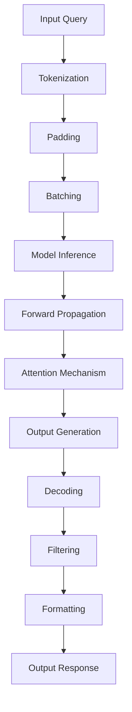
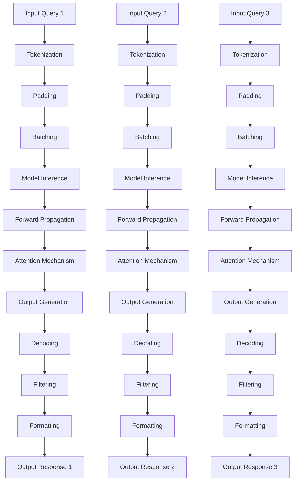
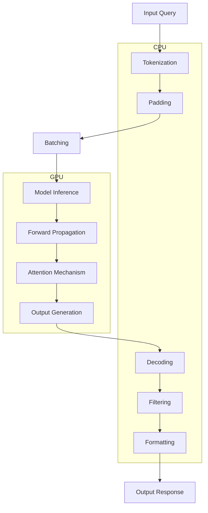

# Lesson 2: Inference Pipeline Optimization

## 1. First-Principles Intuition & Invariants

The inference pipeline of large language models (LLMs) is a complex system that bridges the gap between raw computational power and human-like understanding. At its core, the pipeline is responsible for transforming input queries into meaningful responses by leveraging the vast knowledge encoded within the model's parameters. This transformation involves a series of mathematical operations that are both computationally intensive and latency-sensitive. To optimize the inference pipeline, we must delve into the underlying principles that govern its operation, including the mathematical invariants and system constraints that define its behavior.

The primary goal of inference pipeline optimization is to reduce latency and improve throughput while maintaining the accuracy and quality of the generated responses. Latency refers to the time taken to produce a response from the moment a query is received, whereas throughput measures the number of queries that can be processed in a given time frame. These two metrics are often at odds with each other, as reducing latency may require more resources, which can in turn limit throughput. Therefore, optimization efforts must carefully balance these competing objectives.

A key invariant in the inference pipeline is the preservation of the model's accuracy. Any optimization technique that compromises the model's ability to generate accurate and relevant responses is fundamentally flawed. This invariant is grounded in the mathematical properties of the model, which are defined by its architecture and training process. The model's parameters are learned through a process of supervised learning, where the model is trained on a large corpus of text data to minimize the difference between its predicted outputs and the actual outputs. This training process establishes a set of invariants that define the model's behavior, and any optimization technique must respect these invariants to ensure the preservation of accuracy.

Another important invariant is the consistency of the inference pipeline across different queries and environments. The pipeline should produce consistent results regardless of the input query or the hardware on which it is running. This consistency is achieved through the use of well-defined data structures and algorithms that are designed to operate in a predictable and reliable manner. The pipeline should also be robust to variations in input data and environmental conditions, such as changes in network latency or memory availability.

To achieve optimal performance, the inference pipeline must be designed to efficiently utilize the available computational resources. This includes the CPU, GPU, and memory subsystems, as well as any specialized hardware accelerators that may be available. The pipeline should be optimized to minimize the overhead associated with data movement and synchronization, and to maximize the utilization of parallel processing capabilities. These optimizations are guided by the principles of high-performance computing, which emphasize the importance of efficient resource utilization and low-latency data access.

## 2. Core Architecture & Mechanics

The architecture of the inference pipeline is deeply intertwined with the architecture of the underlying large language model. At a high level, the pipeline can be divided into several key components, each of which plays a critical role in the transformation of input queries into meaningful responses. These components include the input preprocessing stage, the model inference stage, and the output postprocessing stage.

### Input Preprocessing Stage

The input preprocessing stage is responsible for transforming the raw input query into a format that can be processed by the model. This involves several key steps, including tokenization, padding, and batching. Tokenization is the process of breaking the input query into a sequence of tokens, which are the basic units of meaning in the model. The tokens are then converted into a numerical representation that can be fed into the model. Padding is the process of adding additional tokens to the input sequence to ensure that all input sequences have the same length. This is necessary because the model is designed to process fixed-length input sequences, and padding allows the pipeline to handle input sequences of varying lengths. Batching is the process of grouping multiple input sequences together into a single batch, which can be processed in parallel by the model. This improves the efficiency of the pipeline by reducing the overhead associated with data movement and synchronization.

### Model Inference Stage

The model inference stage is responsible for generating the output response by applying the model's parameters to the preprocessed input sequence. This involves several key steps, including forward propagation, attention mechanism, and output generation. Forward propagation is the process of applying the model's parameters to the input sequence to generate a set of hidden states. These hidden states capture the semantic meaning of the input sequence and are used to generate the output response. The attention mechanism is a key component of the model that allows it to focus on specific parts of the input sequence when generating the output response. This is achieved through the use of a set of attention weights that are learned during the training process. Output generation is the process of transforming the hidden states into a sequence of output tokens, which are then converted into a human-readable response.

### Output Postprocessing Stage

The output postprocessing stage is responsible for transforming the raw output sequence into a meaningful response that can be presented to the user. This involves several key steps, including decoding, filtering, and formatting. Decoding is the process of converting the output sequence of tokens into a human-readable response. This is achieved through the use of a vocabulary that maps tokens to their corresponding meanings. Filtering is the process of removing any irrelevant or inappropriate content from the output response. This is achieved through the use of a set of rules and heuristics that are designed to ensure the quality and relevance of the response. Formatting is the process of presenting the output response in a user-friendly format, such as plain text or HTML.

To illustrate the architecture of the inference pipeline, we can use a Mermaid diagram to visualize the key components and their interactions. The diagram below shows the high-level architecture of the inference pipeline, including the input preprocessing stage, the model inference stage, and the output postprocessing stage.

In this diagram, the input query is first tokenized and padded to ensure that it is in the correct format for the model. The preprocessed input sequence is then batched together with other input sequences and fed into the model for inference. The model applies its parameters to the input sequence to generate a set of hidden states, which are then processed by the attention mechanism to focus on specific parts of the input sequence. The hidden states are then used to generate the output sequence of tokens, which is decoded and filtered to produce the final output response.

## 3. High-Performance Optimization & Failure Modes

Optimizing the inference pipeline to reduce latency and improve throughput involves a combination of algorithmic and architectural techniques. These techniques are guided by the principles of high-performance computing, which emphasize the importance of efficient resource utilization and low-latency data access. In this section, we will explore some of the key optimization techniques that can be applied to the inference pipeline, as well as the failure modes that can arise when these techniques are not applied correctly.

### Concurrency

One of the key techniques for optimizing the inference pipeline is the use of concurrency. Concurrency allows multiple queries to be processed in parallel, which can significantly improve throughput. This is achieved through the use of multi-threading and multi-processing techniques, which allow the pipeline to utilize multiple CPU cores and GPUs simultaneously. Concurrency can be applied at multiple levels of the pipeline, including the input preprocessing stage, the model inference stage, and the output postprocessing stage. For example, the input preprocessing stage can be parallelized by tokenizing and padding multiple input sequences simultaneously. The model inference stage can be parallelized by processing multiple batches of input sequences simultaneously. The output postprocessing stage can be parallelized by decoding and filtering multiple output sequences simultaneously.

To illustrate the use of concurrency in the inference pipeline, we can use a Mermaid diagram to visualize the parallel processing of multiple queries. The diagram below shows the high-level architecture of the inference pipeline with concurrency applied at multiple levels.

In this diagram, multiple input queries are tokenized and padded in parallel, and then batched together into multiple batches. Each batch is then processed in parallel by the model for inference, and the resulting output sequences are decoded and filtered in parallel to produce the final output responses.

### Resource Scaling

Another key technique for optimizing the inference pipeline is the use of resource scaling. Resource scaling involves increasing the amount of computational resources available to the pipeline, such as the number of CPU cores, GPUs, and memory. This can significantly improve throughput and reduce latency, but it also requires careful management of resource allocation and utilization. Resource scaling can be applied at multiple levels of the pipeline, including the input preprocessing stage, the model inference stage, and the output postprocessing stage. For example, the input preprocessing stage can be scaled by increasing the number of CPU cores available for tokenization and padding. The model inference stage can be scaled by increasing the number of GPUs available for forward propagation and attention mechanism. The output postprocessing stage can be scaled by increasing the number of CPU cores available for decoding and filtering.

To illustrate the use of resource scaling in the inference pipeline, we can use a Mermaid diagram to visualize the allocation of resources across multiple stages. The diagram below shows the high-level architecture of the inference pipeline with resource scaling applied at multiple levels.

In this diagram, the input preprocessing stage is executed on the CPU, while the model inference stage is executed on the GPU. This allows the pipeline to leverage the parallel processing capabilities of the GPU to improve throughput and reduce latency. The output postprocessing stage is also executed on the CPU, which allows the pipeline to efficiently utilize the available CPU resources.

### Boundary Edge Cases

Optimizing the inference pipeline also involves careful consideration of boundary edge cases, which are the scenarios that occur at the limits of the system's capabilities. These edge cases can arise due to a variety of factors, such as large input queries, low memory availability, and high network latency. Boundary edge cases can significantly impact the performance and reliability of the inference pipeline, and they must be carefully managed to ensure optimal performance.

One common boundary edge case is the handling of large input queries. Large input queries can require significant amounts of memory and computational resources, which can lead to increased latency and reduced throughput. To handle large input queries, the inference pipeline can be optimized by using techniques such as memory pooling and lazy evaluation. Memory pooling involves pre-allocating a pool of memory that can be reused for multiple queries, which can reduce the overhead associated with memory allocation and deallocation. Lazy evaluation involves deferring the computation of certain operations until they are actually needed, which can reduce the amount of memory and computational resources required for large input queries.

Another common boundary edge case is the handling of low memory availability. Low memory availability can lead to increased latency and reduced throughput, as the pipeline may need to swap memory pages to and from disk, which can be a time-consuming operation. To handle low memory availability, the inference pipeline can be optimized by using techniques such as memory compression and data deduplication. Memory compression involves compressing the memory pages to reduce their size, which can improve the utilization of available memory. Data deduplication involves identifying and removing duplicate data, which can reduce the amount of memory required for the pipeline.

A third common boundary edge case is the handling of high network latency. High network latency can lead to increased latency and reduced throughput, as the pipeline may need to wait for data to be transmitted over the network. To handle high network latency, the inference pipeline can be optimized by using techniques such as data caching and asynchronous communication. Data caching involves storing frequently accessed data in a cache, which can reduce the amount of data that needs to be transmitted over the network. Asynchronous communication involves using non-blocking communication protocols, which can reduce the amount of time that the pipeline spends waiting for data to be transmitted over the network.

### Failure Mitigations

Optimizing the inference pipeline also involves careful consideration of failure modes, which are the scenarios that occur when the pipeline fails to meet its performance and reliability objectives. These failure modes can arise due to a variety of factors, such as hardware failures, software bugs, and network issues. Failure modes can significantly impact the performance and reliability of the inference pipeline, and they must be carefully managed to ensure optimal performance.

One common failure mode is the handling of hardware failures. Hardware failures can lead to increased latency and reduced throughput, as the pipeline may need to wait for the hardware to be repaired or replaced. To handle hardware failures, the inference pipeline can be optimized by using techniques such as redundancy and failover. Redundancy involves using multiple instances of the same hardware component, which can improve the reliability of the pipeline. Failover involves automatically switching to a backup instance of the hardware component when the primary instance fails, which can reduce the amount of downtime associated with hardware failures.

Another common failure mode is the handling of software bugs. Software bugs can lead to increased latency and reduced throughput, as the pipeline may need to be restarted or reconfigured to fix the bug. To handle software bugs, the inference pipeline can be optimized by using techniques such as testing and monitoring. Testing involves using a variety of test cases to verify the correctness and performance of the pipeline. Monitoring involves using a variety of metrics and logs to detect and diagnose issues in real-time, which can reduce the amount of downtime associated with software bugs.

A third common failure mode is the handling of network issues. Network issues can lead to increased latency and reduced throughput, as the pipeline may need to wait for the network to be restored. To handle network issues, the inference pipeline can be optimized by using techniques such as load balancing and failover. Load balancing involves distributing the workload across multiple network nodes, which can improve the reliability of the pipeline. Failover involves automatically switching to a backup network node when the primary node fails, which can reduce the amount of downtime associated with network issues.

In conclusion, optimizing the inference pipeline to reduce latency and improve throughput involves a combination of algorithmic and architectural techniques. These techniques are guided by the principles of high-performance computing, which emphasize the importance of efficient resource utilization and low-latency data access. By carefully considering the first-principles intuition and invariants that govern the behavior of the pipeline, as well as the core architecture and mechanics that define its operation, we can design and implement optimization techniques that are both effective and reliable. By carefully managing the boundary edge cases and failure modes that can arise during operation, we can ensure that the inference pipeline meets its performance and reliability objectives, even in the face of challenging and unpredictable conditions.
