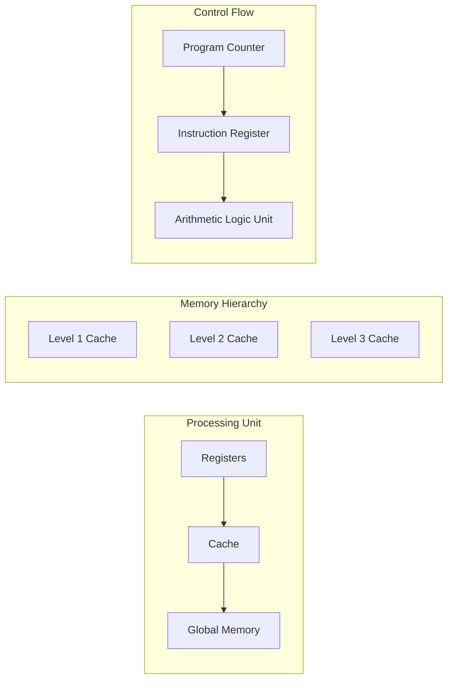

# Lesson 4: Hardware Acceleration Methods

## 1. First-Principles Intuition & Invariants

As we delve into the realm of hardware acceleration for AI inference tasks, it's essential to establish a solid foundation in the underlying principles. The primary goal of hardware acceleration is to offload computationally intensive tasks from the CPU to specialized hardware, thereby reducing latency and increasing throughput. This is particularly crucial for large language models, which require massive amounts of computational resources to process and generate text.

At its core, hardware acceleration relies on the concept of parallel processing. By distributing tasks across multiple processing units, we can achieve significant performance gains. However, this comes with its own set of challenges, including data transfer overhead, synchronization, and resource contention.

To better understand the problem space, let's consider the mathematical invariants that govern hardware acceleration. The key invariant is the ratio of computational work to memory access patterns. As we offload tasks to specialized hardware, we must ensure that the memory access patterns remain consistent and predictable. This is where the concept of memory coherence comes into play.

Memory coherence refers to the ability of multiple processing units to access and update shared memory locations in a consistent manner. This is a critical invariant, as it ensures that the data remains synchronized across all processing units. Failure to maintain memory coherence can lead to data corruption, errors, and even system crashes.

## 2. Core Architecture & Mechanics

To illustrate the internal data structures and algorithms used in hardware acceleration, let's consider the architecture of a modern Graphics Processing Unit (GPU). A GPU consists of multiple processing units, each with its own set of registers, caches, and memory interfaces. The processing units are organized into a hierarchical structure, with each level of the hierarchy responsible for a specific subset of tasks.

The following Mermaid diagram illustrates the internal architecture of a GPU:

This diagram highlights the key components of a GPU, including the processing units, memory hierarchy, and control flow. The processing units are responsible for executing instructions, while the memory hierarchy provides a hierarchical structure for storing and retrieving data.

## 3. High-Performance Optimization & Failure Modes

To achieve high-performance optimization, we must carefully balance the trade-offs between computational resources, memory access patterns, and synchronization. This requires a deep understanding of the underlying hardware architecture and the specific requirements of the AI inference task.

One critical aspect of high-performance optimization is concurrency. By distributing tasks across multiple processing units, we can achieve significant performance gains. However, this comes with its own set of challenges, including data transfer overhead, synchronization, and resource contention.

To mitigate these challenges, we can employ various techniques, including:

* **Resource scaling**: Dynamically adjusting the number of processing units and memory resources based on the workload.
* **Boundary edge cases**: Identifying and optimizing for the most critical performance bottlenecks.
* **Failure mitigations**: Implementing robust error handling and recovery mechanisms to ensure system reliability.

By carefully balancing these trade-offs and employing high-performance optimization techniques, we can unlock the full potential of hardware acceleration for AI inference tasks.
