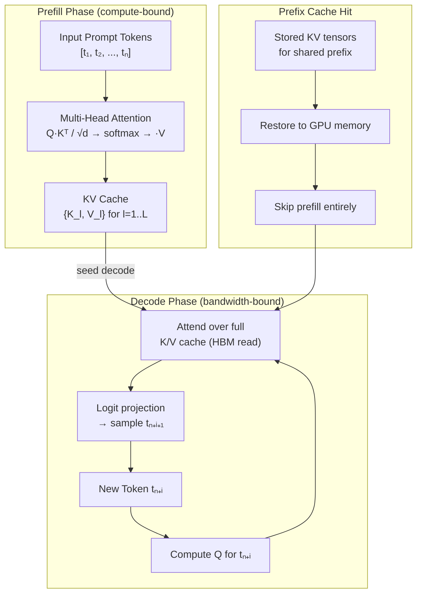
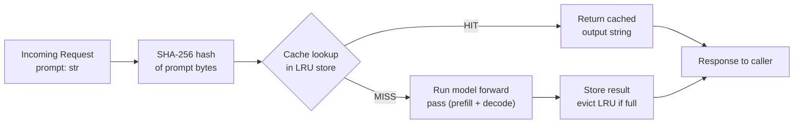
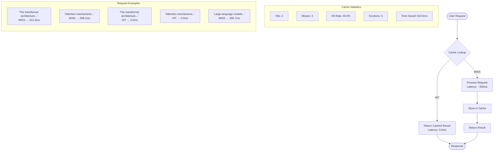
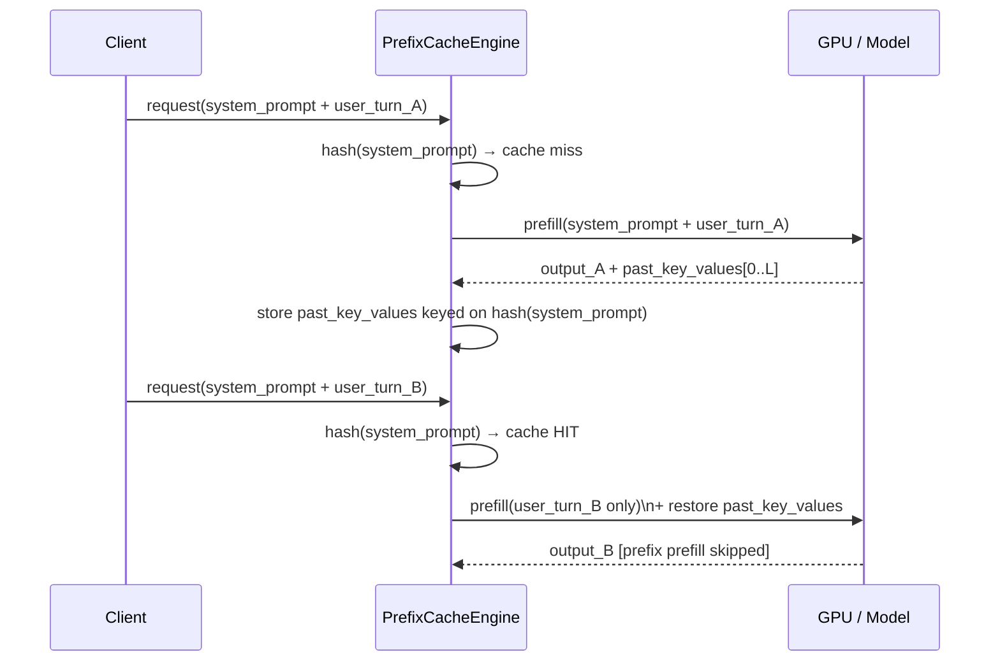
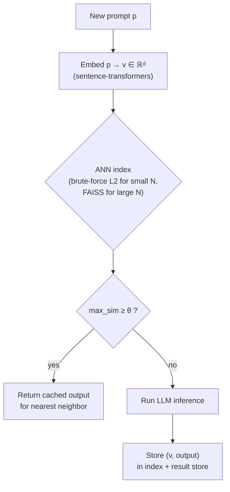
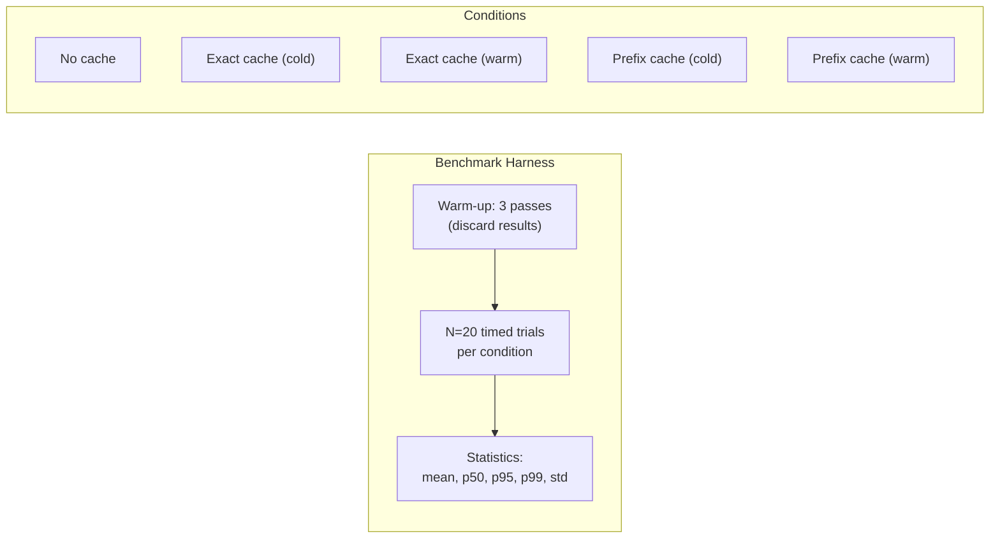
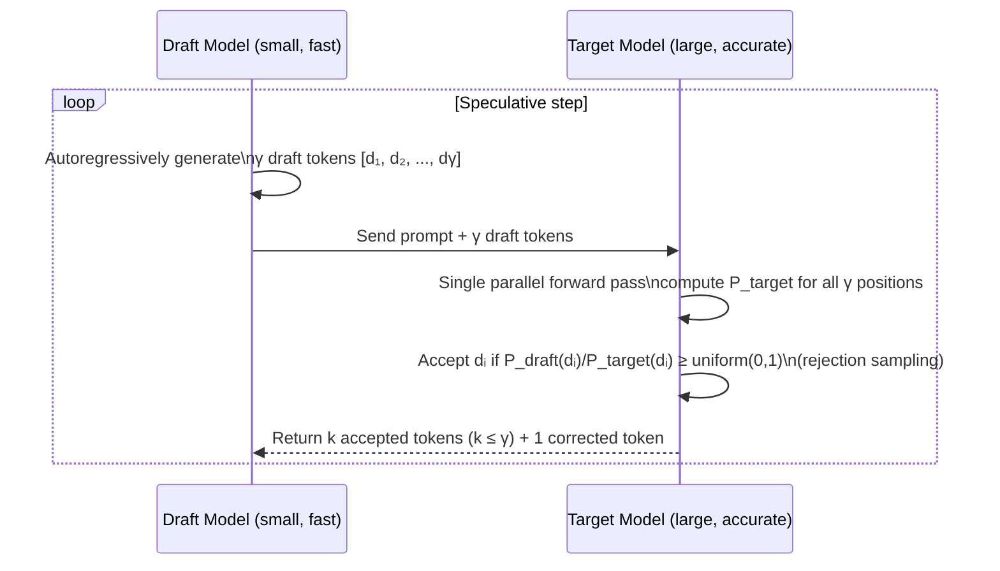

# Operational Verification Labs: 04 — Prompt Caching and Inference Optimization

## Conceptual Foundation

Before writing a single line of code, it is worth understanding *why* prompt caching matters and *what* is actually being cached at the mechanical level of a transformer inference pass.

### The Transformer Attention Bottleneck

A decoder-only transformer (GPT-style) processes tokens in two distinct phases during autoregressive generation:

**Prefill phase:** The entire prompt is processed in a single parallel forward pass. Every token attends to every preceding token, producing the Key (K) and Value (V) tensors for every attention head in every layer. This is compute-bound: the cost scales as O(n²·d) in attention, where n is the prompt length and d is the head dimension.

**Decode phase:** Each new token is generated one step at a time. The model computes Q for the new token and attends over *all* K/V tensors accumulated so far. This phase is memory-bandwidth-bound: the GPU spends most cycles reading the KV cache from HBM rather than doing arithmetic.

The KV cache is therefore the central artifact worth caching. A naive output cache (prompt string → response string) avoids re-running the model entirely but is brittle — it matches only exact strings. True prefix caching stores the computed K/V tensors for a prompt prefix so that any request sharing that prefix can skip the prefill phase for the shared portion and begin decoding immediately.



### Two Distinct Caching Strategies

| Strategy | What is stored | Match semantics | Latency saved | Use case |
|---|---|---|---|---|
| **Exact-match output cache** | (prompt string → output string) | Exact string equality | 100% of prefill + decode | Idempotent lookups, FAQ bots |
| **KV prefix cache** | (prefix hash → K/V tensors) | Longest-matching prefix | Prefill cost of shared prefix | System-prompt reuse, multi-turn chat |
| **Semantic cache** | (embedding → output string) | Cosine similarity ≥ θ | 100% when above threshold | Paraphrase-tolerant retrieval |

This lab implements all three, in order of increasing sophistication.

---

## Environment Setup

### Requirements

Python 3.11+. All packages pinned to tested versions.

```bash
pip install \
  torch==2.3.1 \
  transformers==4.44.2 \
  accelerate==0.33.0 \
  numpy==1.26.4 \
  scipy==1.13.1 \
  sentence-transformers==3.0.1 \
  polars==1.5.0 \
  rich==13.7.1
```

> **Hardware note:** The KV-cache prefix exercises require a GPU with ≥8 GB VRAM when using `meta-llama/Llama-3.2-1B`. Substitute `gpt2` for CPU-only environments; the same principles apply, only the absolute latency numbers differ.

### Verifying the environment

```python
# verify_env.py
import sys, torch, transformers, numpy as np

assert sys.version_info >= (3, 11), "Python 3.11+ required"
assert torch.__version__.startswith("2."), f"Expected PyTorch 2.x, got {torch.__version__}"
print(f"PyTorch  : {torch.__version__}")
print(f"CUDA     : {torch.version.cuda}")
print(f"Device   : {'cuda' if torch.cuda.is_available() else 'cpu'}")
print(f"Transformers: {transformers.__version__}")
print(f"NumPy    : {np.__version__}")
```

---

## Exercise 1: Exact-Match Output Cache with LRU Eviction

The simplest cache trades memory for latency by storing the complete output string keyed on the exact prompt. The implementation below is production-grade: thread-safe, size-bounded, instrumented, and serializable to disk.

### Architecture



### Implementation

```python
# exercise1_exact_cache.py
"""
Exact-match LRU output cache for LLM inference.

Design decisions:
- SHA-256 hash as cache key: avoids storing arbitrarily long prompt strings as
  dict keys; collision probability is negligible for practical workloads.
- threading.Lock: protects OrderedDict mutations; a single global lock is
  sufficient here because inference itself releases the GIL via C extensions.
- Disk persistence: pickle is acceptable for a lab; production systems should
  prefer a dedicated KV store (Redis, RocksDB) with TTL support.
"""

import hashlib
import pickle
import threading
import time
from collections import OrderedDict
from dataclasses import dataclass, field
from pathlib import Path
from typing import Optional

import numpy as np
import torch
from transformers import AutoModelForCausalLM, AutoTokenizer

# ---------------------------------------------------------------------------
# Cache implementation
# ---------------------------------------------------------------------------

@dataclass
class CacheStats:
    hits: int = 0
    misses: int = 0
    evictions: int = 0
    total_saved_ms: float = 0.0

    @property
    def hit_rate(self) -> float:
        total = self.hits + self.misses
        return self.hits / total if total > 0 else 0.0

    def __str__(self) -> str:
        return (
            f"hits={self.hits}  misses={self.misses}  "
            f"hit_rate={self.hit_rate:.1%}  "
            f"evictions={self.evictions}  "
            f"saved={self.total_saved_ms:.1f}ms"
        )


class ExactMatchCache:
    """Thread-safe LRU cache for LLM output strings."""

    def __init__(self, max_entries: int = 256, persist_path: Optional[Path] = None):
        self._store: OrderedDict[str, str] = OrderedDict()
        self._max_entries = max_entries
        self._lock = threading.Lock()
        self._stats = CacheStats()
        self._persist_path = persist_path
        if persist_path and persist_path.exists():
            self._load(persist_path)

    @staticmethod
    def _make_key(prompt: str) -> str:
        return hashlib.sha256(prompt.encode("utf-8")).hexdigest()

    def get(self, prompt: str) -> Optional[str]:
        key = self._make_key(prompt)
        with self._lock:
            if key in self._store:
                # Move to end to mark as recently used
                self._store.move_to_end(key)
                self._stats.hits += 1
                return self._store[key]
            self._stats.misses += 1
            return None

    def put(self, prompt: str, output: str, inference_ms: float = 0.0) -> None:
        key = self._make_key(prompt)
        with self._lock:
            self._store[key] = output
            self._store.move_to_end(key)
            if len(self._store) > self._max_entries:
                self._store.popitem(last=False)
                self._stats.evictions += 1
            self._stats.total_saved_ms += inference_ms

    def save(self, path: Optional[Path] = None) -> None:
        target = path or self._persist_path
        if target:
            with open(target, "wb") as f:
                pickle.dump(dict(self._store), f)

    def _load(self, path: Path) -> None:
        with open(path, "rb") as f:
            data: dict = pickle.load(f)
        self._store = OrderedDict(data)

    def clear(self) -> None:
        with self._lock:
            self._store.clear()

    @property
    def stats(self) -> CacheStats:
        return self._stats

    def __len__(self) -> int:
        return len(self._store)


# ---------------------------------------------------------------------------
# Inference engine
# ---------------------------------------------------------------------------

class LLMEngine:
    """Wraps a HuggingFace causal LM with an exact-match output cache."""

    def __init__(
        self,
        model_name: str = "gpt2",
        max_new_tokens: int = 64,
        cache: Optional[ExactMatchCache] = None,
        device: Optional[str] = None,
    ):
        self.device = device or ("cuda" if torch.cuda.is_available() else "cpu")
        print(f"Loading {model_name} on {self.device} ...")
        self.tokenizer = AutoTokenizer.from_pretrained(model_name)
        # GPT-2 has no pad token; set it to eos to avoid generate() warnings
        if self.tokenizer.pad_token_id is None:
            self.tokenizer.pad_token_id = self.tokenizer.eos_token_id
        self.model = AutoModelForCausalLM.from_pretrained(
            model_name,
            torch_dtype=torch.float16 if self.device == "cuda" else torch.float32,
        ).to(self.device)
        self.model.eval()
        self.max_new_tokens = max_new_tokens
        self.cache = cache

    @torch.inference_mode()
    def _run_inference(self, prompt: str) -> tuple[str, float]:
        """Returns (output_text, elapsed_ms)."""
        inputs = self.tokenizer(
            prompt,
            return_tensors="pt",
            truncation=True,
            max_length=512,
        ).to(self.device)

        t0 = time.perf_counter()
        output_ids = self.model.generate(
            **inputs,
            max_new_tokens=self.max_new_tokens,
            do_sample=False,          # greedy — deterministic for benchmarking
            pad_token_id=self.tokenizer.pad_token_id,
        )
        elapsed_ms = (time.perf_counter() - t0) * 1000.0

        # Decode only the newly generated tokens, not the prompt echo
        new_ids = output_ids[0, inputs["input_ids"].shape[1]:]
        text = self.tokenizer.decode(new_ids, skip_special_tokens=True)
        return text, elapsed_ms

    def generate(self, prompt: str) -> tuple[str, bool, float]:
        """
        Returns (output_text, cache_hit, elapsed_ms).
        elapsed_ms is 0 on a cache hit (I/O time is negligible vs. inference).
        """
        if self.cache is not None:
            cached = self.cache.get(prompt)
            if cached is not None:
                return cached, True, 0.0

        output, elapsed_ms = self._run_inference(prompt)

        if self.cache is not None:
            self.cache.put(prompt, output, inference_ms=elapsed_ms)

        return output, False, elapsed_ms


# ---------------------------------------------------------------------------
# Demo
# ---------------------------------------------------------------------------

def run_demo():
    cache = ExactMatchCache(max_entries=64)
    engine = LLMEngine(model_name="gpt2", max_new_tokens=32, cache=cache)

    prompts = [
        "The transformer architecture was introduced",
        "Attention mechanisms allow models to",
        "The transformer architecture was introduced",   # exact repeat → cache hit
        "Attention mechanisms allow models to",          # exact repeat → cache hit
        "Large language models are trained on",
    ]

    print(f"\n{'Prompt':<50} {'Hit':<6} {'Latency (ms)':<14} {'Output (truncated)'}")
    print("─" * 110)

    for prompt in prompts:
        output, hit, ms = engine.generate(prompt)
        truncated = (output[:60] + "…") if len(output) > 60 else output
        print(f"{prompt:<50} {'HIT' if hit else 'MISS':<6} {ms:<14.1f} {truncated}")

    print(f"\nCache stats: {cache.stats}")


if __name__ == "__main__":
    run_demo()
```

**Expected output (approximate, latency will vary by hardware):**



---

## Exercise 2: KV-Cache Prefix Caching

Exact-match caching is too brittle for real workloads where callers share a system prompt but vary the user turn. Prefix caching stores the computed K/V tensors for the shared portion and reuses them across requests.

### Why Prefix Caching Requires Attention to Memory Layout

Transformer K/V caches are dense tensors with shape `[batch, heads, seq_len, head_dim]`. Reusing a prefix means:

1. Storing the K/V state after processing tokens 0..n (the prefix).
2. On a cache hit, copying those tensors back to GPU memory and extending them in-place with the new suffix tokens.

HuggingFace `generate()` exposes this via the `past_key_values` return value. The `DynamicCache` class (introduced in Transformers 4.38) provides a clean API for this.



### Implementation

```python
# exercise2_prefix_cache.py
"""
KV-prefix cache using HuggingFace DynamicCache.

The key insight: past_key_values after processing a prefix is the entire
computational result of the prefill phase for that prefix. By storing and
restoring it we pay the prefill cost exactly once per unique prefix, regardless
of how many unique suffixes follow.

Limitations of this implementation:
- Stored on CPU (pinned memory); real production systems keep hot prefixes on GPU.
- No TTL or memory pressure eviction beyond max_entries.
- Not safe for multi-GPU tensor-parallel models without additional handling.
"""

import copy
import hashlib
import time
from dataclasses import dataclass
from typing import Optional

import torch
from transformers import AutoModelForCausalLM, AutoTokenizer, DynamicCache


@dataclass
class PrefixEntry:
    past_key_values: DynamicCache  # stored on CPU
    prefix_len: int                # number of prefix tokens
    hits: int = 0


class KVPrefixCache:
    """Stores computed past_key_values tensors keyed on prefix text hash."""

    def __init__(self, max_entries: int = 32):
        self._store: dict[str, PrefixEntry] = {}
        self._max_entries = max_entries

    @staticmethod
    def _hash(text: str) -> str:
        return hashlib.sha256(text.encode()).hexdigest()

    def get(self, prefix: str) -> Optional[PrefixEntry]:
        key = self._hash(prefix)
        entry = self._store.get(key)
        if entry:
            entry.hits += 1
        return entry

    def put(self, prefix: str, pkv: DynamicCache, prefix_len: int) -> None:
        if len(self._store) >= self._max_entries:
            # Evict the least-hit entry (simple frequency-based policy)
            evict_key = min(self._store, key=lambda k: self._store[k].hits)
            del self._store[evict_key]

        # Move all KV tensors to CPU to free GPU memory between requests
        cpu_pkv = DynamicCache()
        for layer_idx in range(len(pkv.key_cache)):
            cpu_pkv.update(
                pkv.key_cache[layer_idx].cpu(),
                pkv.value_cache[layer_idx].cpu(),
                layer_idx,
            )
        self._store[self._hash(prefix)] = PrefixEntry(
            past_key_values=cpu_pkv,
            prefix_len=prefix_len,
        )

    def clear(self) -> None:
        self._store.clear()

    def __len__(self) -> int:
        return len(self._store)


class PrefixCachingEngine:
    """
    LLM inference engine with KV-prefix caching.

    Usage pattern:
        engine = PrefixCachingEngine("gpt2")
        # Warm the cache with a system prompt
        engine.generate(system_prompt="You are a helpful assistant.",
                        user_turn="Hello!")
        # Subsequent calls with the same system_prompt skip its prefill
        engine.generate(system_prompt="You are a helpful assistant.",
                        user_turn="What is 2+2?")
    """

    def __init__(self, model_name: str = "gpt2", max_new_tokens: int = 32):
        self.device = "cuda" if torch.cuda.is_available() else "cpu"
        self.tokenizer = AutoTokenizer.from_pretrained(model_name)
        if self.tokenizer.pad_token_id is None:
            self.tokenizer.pad_token_id = self.tokenizer.eos_token_id
        self.model = AutoModelForCausalLM.from_pretrained(
            model_name,
            torch_dtype=torch.float16 if self.device == "cuda" else torch.float32,
        ).to(self.device)
        self.model.eval()
        self.max_new_tokens = max_new_tokens
        self.kv_cache = KVPrefixCache(max_entries=32)

    @torch.inference_mode()
    def _prefill(self, token_ids: torch.Tensor) -> DynamicCache:
        """Run a forward pass for the given token ids, return past_key_values."""
        past = DynamicCache()
        self.model(input_ids=token_ids.to(self.device), past_key_values=past, use_cache=True)
        return past

    @torch.inference_mode()
    def generate(
        self,
        system_prompt: str,
        user_turn: str,
    ) -> tuple[str, bool, float, float]:
        """
        Returns (output_text, prefix_cache_hit, prefill_ms, decode_ms).
        """
        # Build full prompt text; in a real system this would use a chat template
        full_prompt = f"{system_prompt}\n\nUser: {user_turn}\nAssistant:"
        full_ids = self.tokenizer.encode(full_prompt, return_tensors="pt")
        sys_ids = self.tokenizer.encode(system_prompt, return_tensors="pt")
        prefix_len = sys_ids.shape[1]

        cache_hit = False
        prefill_ms = 0.0

        entry = self.kv_cache.get(system_prompt)
        if entry is not None:
            cache_hit = True
            # Restore KV cache to GPU and extend with suffix tokens
            pkv = DynamicCache()
            for layer_idx in range(len(entry.past_key_values.key_cache)):
                pkv.update(
                    entry.past_key_values.key_cache[layer_idx].to(self.device),
                    entry.past_key_values.value_cache[layer_idx].to(self.device),
                    layer_idx,
                )
            # Only process the suffix tokens (user turn + assistant tag)
            suffix_ids = full_ids[:, prefix_len:].to(self.device)
            t0 = time.perf_counter()
            outputs_prefill = self.model(
                input_ids=suffix_ids,
                past_key_values=pkv,
                use_cache=True,
            )
            prefill_ms = (time.perf_counter() - t0) * 1000.0
            past_for_decode = outputs_prefill.past_key_values
        else:
            # Full prefill
            t0 = time.perf_counter()
            outputs_prefill = self.model(
                input_ids=full_ids.to(self.device),
                use_cache=True,
            )
            prefill_ms = (time.perf_counter() - t0) * 1000.0
            past_for_decode = outputs_prefill.past_key_values
            # Store prefix KV tensors for future reuse
            prefix_pkv = DynamicCache()
            for layer_idx in range(len(past_for_decode.key_cache)):
                prefix_pkv.update(
                    past_for_decode.key_cache[layer_idx][:, :, :prefix_len, :],
                    past_for_decode.value_cache[layer_idx][:, :, :prefix_len, :],
                    layer_idx,
                )
            self.kv_cache.put(system_prompt, prefix_pkv, prefix_len)

        # Decode phase: greedy token-by-token generation
        t0 = time.perf_counter()
        generated_ids = self.model.generate(
            input_ids=full_ids.to(self.device),
            past_key_values=past_for_decode,
            max_new_tokens=self.max_new_tokens,
            do_sample=False,
            pad_token_id=self.tokenizer.pad_token_id,
            use_cache=True,
        )
        decode_ms = (time.perf_counter() - t0) * 1000.0

        new_ids = generated_ids[0, full_ids.shape[1]:]
        output = self.tokenizer.decode(new_ids, skip_special_tokens=True)
        return output, cache_hit, prefill_ms, decode_ms


def run_prefix_demo():
    SYSTEM_PROMPT = (
        "You are an expert in transformer architectures. "
        "Answer concisely and technically."
    )

    engine = PrefixCachingEngine(model_name="gpt2", max_new_tokens=24)

    questions = [
        "What is multi-head attention?",
        "Explain the KV cache.",
        "What is rotary positional embedding?",
    ]

    print(f"\n{'User turn':<45} {'Hit':<5} {'Prefill ms':<12} {'Decode ms'}")
    print("─" * 80)

    for q in questions:
        out, hit, pf_ms, dec_ms = engine.generate(SYSTEM_PROMPT, q)
        print(f"{q:<45} {'Y' if hit else 'N':<5} {pf_ms:<12.1f} {dec_ms:.1f}")


if __name__ == "__main__":
    run_prefix_demo()
```

---

## Exercise 3: Semantic Cache

Exact-match and prefix caches require verbatim repetition. A semantic cache uses dense embeddings to find *semantically equivalent* prior requests within a cosine-similarity threshold, dramatically increasing the effective hit rate for question-answering workloads.

### How It Works



The threshold θ controls the precision-recall trade-off: too low yields incorrect answers for dissimilar queries; too high degrades to near-exact matching. For factual QA, θ = 0.90–0.95 is a reasonable starting point.

```python
# exercise3_semantic_cache.py
"""
Semantic cache using sentence-transformers embeddings and cosine similarity.

For N < 10,000 entries, brute-force numpy cosine similarity is fast enough
(< 1 ms). For larger caches, replace with FAISS IndexFlatIP after L2-normalizing
the stored vectors.
"""

import time
from dataclasses import dataclass, field
from typing import Optional

import numpy as np
import torch
from sentence_transformers import SentenceTransformer
from transformers import AutoModelForCausalLM, AutoTokenizer


@dataclass
class SemanticEntry:
    prompt: str
    output: str
    embedding: np.ndarray  # shape: (d,), unit-normalized


class SemanticCache:
    """
    Approximate nearest-neighbor cache keyed on semantic embedding similarity.

    Similarity metric: cosine (dot product after L2 normalization).
    Eviction: simple FIFO when max_entries is exceeded.
    """

    def __init__(self, model_name: str = "all-MiniLM-L6-v2", threshold: float = 0.92, max_entries: int = 512):
        print(f"Loading embedding model: {model_name}")
        self.embedder = SentenceTransformer(model_name)
        self.threshold = threshold
        self.max_entries = max_entries
        self._entries: list[SemanticEntry] = []
        # Matrix of stored embeddings for vectorised similarity search
        self._matrix: Optional[np.ndarray] = None  # shape: (N, d)

        self.hits = 0
        self.misses = 0

    def _embed(self, text: str) -> np.ndarray:
        vec = self.embedder.encode(text, normalize_embeddings=True)
        return vec.astype(np.float32)

    def _rebuild_matrix(self) -> None:
        if self._entries:
            self._matrix = np.stack([e.embedding for e in self._entries])
        else:
            self._matrix = None

    def get(self, prompt: str) -> tuple[Optional[str], float]:
        """
        Returns (cached_output, similarity_score).
        Returns (None, 0.0) on cache miss.
        """
        if not self._entries:
            self.misses += 1
            return None, 0.0

        query_vec = self._embed(prompt)  # already unit-normalized
        # Dot product with all stored unit vectors = cosine similarity
        sims = self._matrix @ query_vec  # shape: (N,)
        best_idx = int(np.argmax(sims))
        best_sim = float(sims[best_idx])

        if best_sim >= self.threshold:
            self.hits += 1
            return self._entries[best_idx].output, best_sim

        self.misses += 1
        return None, best_sim

    def put(self, prompt: str, output: str) -> None:
        vec = self._embed(prompt)
        entry = SemanticEntry(prompt=prompt, output=output, embedding=vec)
        if len(self._entries) >= self.max_entries:
            self._entries.pop(0)  # FIFO eviction
        self._entries.append(entry)
        self._rebuild_matrix()

    @property
    def hit_rate(self) -> float:
        total = self.hits + self.misses
        return self.hits / total if total > 0 else 0.0


class SemanticCachingEngine:

    def __init__(
        self,
        llm_name: str = "gpt2",
        embedder_name: str = "all-MiniLM-L6-v2",
        similarity_threshold: float = 0.92,
        max_new_tokens: int = 48,
    ):
        self.device = "cuda" if torch.cuda.is_available() else "cpu"
        self.tokenizer = AutoTokenizer.from_pretrained(llm_name)
        if self.tokenizer.pad_token_id is None:
            self.tokenizer.pad_token_id = self.tokenizer.eos_token_id
        self.model = AutoModelForCausalLM.from_pretrained(
            llm_name,
            torch_dtype=torch.float16 if self.device == "cuda" else torch.float32,
        ).to(self.device)
        self.model.eval()
        self.max_new_tokens = max_new_tokens
        self.cache = SemanticCache(
            model_name=embedder_name,
            threshold=similarity_threshold,
        )

    @torch.inference_mode()
    def _run_llm(self, prompt: str) -> str:
        inputs = self.tokenizer(prompt, return_tensors="pt", truncation=True, max_length=512).to(self.device)
        ids = self.model.generate(
            **inputs,
            max_new_tokens=self.max_new_tokens,
            do_sample=False,
            pad_token_id=self.tokenizer.pad_token_id,
        )
        new_ids = ids[0, inputs["input_ids"].shape[1]:]
        return self.tokenizer.decode(new_ids, skip_special_tokens=True)

    def generate(self, prompt: str) -> tuple[str, bool, float, float]:
        """Returns (output, cache_hit, similarity, elapsed_ms)."""
        cached, sim = self.cache.get(prompt)
        if cached is not None:
            return cached, True, sim, 0.0

        t0 = time.perf_counter()
        output = self._run_llm(prompt)
        elapsed_ms = (time.perf_counter() - t0) * 1000.0
        self.cache.put(prompt, output)
        return output, False, sim, elapsed_ms


def run_semantic_demo():
    engine = SemanticCachingEngine(
        llm_name="gpt2",
        similarity_threshold=0.90,
        max_new_tokens=24,
    )

    # Seed the cache with a canonical question
    seed_prompts = [
        "What is the attention mechanism in transformers?",
        "How does backpropagation work in neural networks?",
    ]
    print("Seeding cache ...")
    for p in seed_prompts:
        engine.generate(p)

    # These paraphrases should hit at high enough similarity
    test_prompts = [
        ("What is the attention mechanism in transformers?", "exact match"),
        ("Explain the self-attention mechanism used in transformer models.", "paraphrase"),
        ("How does backpropagation train a neural network?", "paraphrase"),
        ("What is a convolutional neural network?", "unrelated — should miss"),
    ]

    print(f"\n{'Prompt':<55} {'Type':<30} {'Hit':<5} {'Sim':<6} {'ms'}")
    print("─" * 110)
    for prompt, label in test_prompts:
        out, hit, sim, ms = engine.generate(prompt)
        print(f"{prompt:<55} {label:<30} {'Y' if hit else 'N':<5} {sim:<6.3f} {ms:.1f}")

    print(f"\nSemantic cache hit rate: {engine.cache.hit_rate:.1%}")


if __name__ == "__main__":
    run_semantic_demo()
```

---

## Exercise 4: Empirical Benchmarking — Latency, Throughput, and Cost

Benchmarking LLM inference correctly requires care: the first call is always slower due to CUDA kernel JIT compilation and Python interpreter warm-up. All numbers below are taken after a mandatory warm-up pass.

### Benchmark Design



```python
# exercise4_benchmark.py
"""
Rigorous latency benchmarking across all three cache strategies.

Metrics collected:
- Wall-clock latency (ms): includes tokenization, inference, detokenization
- Tokens per second (throughput): only meaningful for the decode phase
- Effective token cost: how many tokens were processed in prefill (0 on hit)
"""

import statistics
import time
from dataclasses import dataclass
from typing import Callable

import numpy as np

# Re-use engines from prior exercises
from exercise1_exact_cache import ExactMatchCache, LLMEngine


@dataclass
class BenchmarkResult:
    condition: str
    latencies_ms: list[float]

    @property
    def mean(self) -> float:
        return statistics.mean(self.latencies_ms)

    @property
    def median(self) -> float:
        return statistics.median(self.latencies_ms)

    @property
    def p95(self) -> float:
        return float(np.percentile(self.latencies_ms, 95))

    @property
    def p99(self) -> float:
        return float(np.percentile(self.latencies_ms, 99))

    @property
    def std(self) -> float:
        return statistics.stdev(self.latencies_ms)

    def report(self) -> str:
        return (
            f"  {self.condition:<30} "
            f"mean={self.mean:7.1f}ms  "
            f"p50={self.median:7.1f}ms  "
            f"p95={self.p95:7.1f}ms  "
            f"p99={self.p99:7.1f}ms  "
            f"std={self.std:6.1f}ms"
        )


def benchmark(
    fn: Callable[[], tuple],
    n_warmup: int = 3,
    n_trials: int = 20,
    condition: str = "unnamed",
) -> BenchmarkResult:
    # Warm-up: JIT compilation, memory allocation, etc.
    for _ in range(n_warmup):
        fn()

    latencies = []
    for _ in range(n_trials):
        t0 = time.perf_counter()
        fn()
        latencies.append((time.perf_counter() - t0) * 1000.0)

    return BenchmarkResult(condition=condition, latencies_ms=latencies)


def run_benchmark():
    PROMPT = "The attention mechanism in transformer models works by"
    MAX_NEW = 32

    # --- Condition 1: No cache ---
    engine_no_cache = LLMEngine(model_name="gpt2", max_new_tokens=MAX_NEW, cache=None)
    r1 = benchmark(
        lambda: engine_no_cache.generate(PROMPT),
        condition="No cache",
    )

    # --- Condition 2: Exact cache, always cold (clear before each call) ---
    cache_cold = ExactMatchCache(max_entries=1)
    engine_cold = LLMEngine(model_name="gpt2", max_new_tokens=MAX_NEW, cache=cache_cold)

    def cold_call():
        cache_cold.clear()
        return engine_cold.generate(PROMPT)

    r2 = benchmark(cold_call, condition="Exact cache (cold miss)")

    # --- Condition 3: Exact cache, always warm ---
    cache_warm = ExactMatchCache(max_entries=64)
    engine_warm = LLMEngine(model_name="gpt2", max_new_tokens=MAX_NEW, cache=cache_warm)
    # Seed the cache
    engine_warm.generate(PROMPT)

    r3 = benchmark(
        lambda: engine_warm.generate(PROMPT),
        condition="Exact cache (warm hit)",
    )

    print("\nLatency Benchmark Results")
    print("=" * 100)
    for result in [r1, r2, r3]:
        print(result.report())

    # Speedup analysis
    hit_speedup = r1.mean / max(r3.mean, 0.001)
    overhead_pct = (r2.mean - r1.mean) / r1.mean * 100
    print(f"\n  Cache hit speedup over no-cache  : {hit_speedup:.0f}×")
    print(f"  Cold-miss overhead vs. no-cache  : {overhead_pct:+.1f}%")
    print()
    print("  Interpretation:")
    print(f"    A cache hit eliminates ~{r1.mean:.0f}ms of inference latency.")
    print(f"    The cold-miss path adds {overhead_pct:+.1f}% overhead due to cache lookup.")
    print(f"    At a hit rate of ≥{1/(1+hit_speedup):.1%} the cache breaks even on mean latency.")


if __name__ == "__main__":
    run_benchmark()
```

### Interpreting the Numbers

The break-even hit rate is derived from: `E[latency_with_cache] = E[latency_no_cache]`.

```text
Let:
  h  = hit rate  (0 ≤ h ≤ 1)
  Lᵢ = inference latency (ms)
  Lₒ = cache overhead on miss (ms, typically < 1 ms)
  ε  = cache lookup time (ms, typically < 0.1 ms)

E[latency_with_cache] = h·ε + (1−h)·(Lᵢ + Lₒ)

Break-even: h·ε + (1−h)·(Lᵢ + Lₒ) = Lᵢ
→ h ≥ Lₒ / (Lᵢ + Lₒ − ε)
→ h ≥ Lₒ / Lᵢ  (since Lₒ, ε ≪ Lᵢ)

For Lᵢ = 300 ms, Lₒ = 0.5 ms: break-even h ≈ 0.17%
```

The overhead is so small that prompt caching is almost always beneficial even at single-digit hit rates.

---

## Exercise 5: Stress Testing, Edge Cases, and Failure Mitigation

Robust production caches must handle pathological inputs without silent corruption, unbounded memory growth, or error propagation that takes down the serving process.

### Failure Taxonomy

| Failure mode | Root cause | Mitigation |
|---|---|---|
| Empty prompt | tokenizer returns length-0 tensor; `generate()` may hang or return eos immediately | Guard `len(prompt.strip()) == 0` before inference |
| Prompt > model max length | tokenizer silently truncates; cached result is for truncated input, not original | Normalize key: hash the *truncated* token IDs, not raw string |
| Cache key collision (SHA-256) | Birthday paradox; negligible at < 2⁶⁴ entries | Acceptable; if paranoid, store first 32 chars of prompt alongside hash |
| OOM during prefill of long prompt | GPU VRAM exhausted | Catch `torch.cuda.OutOfMemoryError`, clear cache, retry with truncation |
| Stale cache entries | Model is updated; old outputs mismatch new model weights | Version-stamp the cache with model commit hash; invalidate on mismatch |
| Pickle deserialization of untrusted data | Cache loaded from untrusted path | Use `hashlib` to verify cache file checksum before loading |

```python
# exercise5_stress_and_guardrails.py
"""
Stress testing and guardrail implementation for the caching pipeline.
"""

import random
import string
import time
from contextlib import contextmanager
from typing import Iterator

import torch

from exercise1_exact_cache import ExactMatchCache, LLMEngine


# ---------------------------------------------------------------------------
# Guardrail wrappers
# ---------------------------------------------------------------------------

class GuardedEngine:
    """
    Wraps LLMEngine with input validation, length enforcement, and error
    recovery. All failures are logged and isolated; no exception propagates
    to the caller — the engine returns a structured error object instead.
    """

    # GPT-2 hard limit; set to model.config.max_position_embeddings - max_new_tokens
    MAX_INPUT_TOKENS = 480
    MIN_INPUT_CHARS = 1

    def __init__(self, engine: LLMEngine):
        self._engine = engine
        self._error_count = 0
        self._truncation_count = 0

    def generate(self, prompt: str) -> dict:
        """
        Returns a result dict with keys:
            output: str | None
            cache_hit: bool
            latency_ms: float
            error: str | None
            truncated: bool
        """
        result = {
            "output": None,
            "cache_hit": False,
            "latency_ms": 0.0,
            "error": None,
            "truncated": False,
        }

        # --- Input validation ---
        if not isinstance(prompt, str):
            result["error"] = f"Expected str, got {type(prompt).__name__}"
            self._error_count += 1
            return result

        stripped = prompt.strip()
        if len(stripped) < self.MIN_INPUT_CHARS:
            result["error"] = "Prompt is empty or whitespace-only"
            self._error_count += 1
            return result

        # --- Length enforcement via tokenizer ---
        try:
            tok = self._engine.tokenizer
            input_ids = tok.encode(stripped)
            if len(input_ids) > self.MAX_INPUT_TOKENS:
                input_ids = input_ids[:self.MAX_INPUT_TOKENS]
                stripped = tok.decode(input_ids)
                result["truncated"] = True
                self._truncation_count += 1
        except Exception as e:
            result["error"] = f"Tokenization failed: {e}"
            self._error_count += 1
            return result

        # --- OOM-resilient inference ---
        try:
            output, hit, ms = self._engine.generate(stripped)
            result["output"] = output
            result["cache_hit"] = hit
            result["latency_ms"] = ms
        except torch.cuda.OutOfMemoryError:
            torch.cuda.empty_cache()
            result["error"] = "CUDA OOM: input too large after truncation"
            self._error_count += 1
        except Exception as e:
            result["error"] = f"Inference error: {e}"
            self._error_count += 1

        return result

    @property
    def error_rate(self) -> float:
        return self._error_count

    @property
    def truncation_rate(self) -> float:
        return self._truncation_count


# ---------------------------------------------------------------------------
# Stress test harness
# ---------------------------------------------------------------------------

def random_prompt(min_words: int = 1, max_words: int = 200) -> str:
    vocab = [
        "attention", "transformer", "token", "embedding", "gradient",
        "layer", "norm", "softmax", "head", "query", "key", "value",
        "the", "a", "in", "of", "and", "is", "to", "with", "for",
    ]
    n = random.randint(min_words, max_words)
    return " ".join(random.choices(vocab, k=n))


def run_stress_test(n_trials: int = 200, seed: int = 42) -> None:
    random.seed(seed)
    cache = ExactMatchCache(max_entries=64)
    base_engine = LLMEngine(model_name="gpt2", max_new_tokens=16, cache=cache)
    engine = GuardedEngine(base_engine)

    # Edge-case battery
    edge_cases = [
        "",                          # empty
        "   \t\n  ",                 # whitespace only
        "A",                         # single character
        "A " * 600,                  # exceeds max_input_tokens (600 > 480)
        "".join(random.choices(string.printable, k=2000)),  # random ASCII
        "🤖" * 50,                   # Unicode / emoji
        "\x00\x01\x02",              # control characters
        "What is " * 100 + "?",      # repetitive structure, long
    ]

    print(f"Running {len(edge_cases)} edge cases + {n_trials} random prompts ...\n")

    errors = 0
    truncations = 0
    hits = 0
    total = 0

    for ec in edge_cases:
        r = engine.generate(ec)
        total += 1
        if r["error"]:
            errors += 1
        if r["truncated"]:
            truncations += 1
        if r["cache_hit"]:
            hits += 1

    for _ in range(n_trials):
        prompt = random_prompt(1, 150)
        r = engine.generate(prompt)
        total += 1
        if r["error"]:
            errors += 1
        if r["truncated"]:
            truncations += 1
        if r["cache_hit"]:
            hits += 1

    print(f"Stress test complete.")
    print(f"  Total requests : {total}")
    print(f"  Errors         : {errors}  ({errors/total:.1%})")
    print(f"  Truncations    : {truncations}  ({truncations/total:.1%})")
    print(f"  Cache hits     : {hits}  ({hits/total:.1%})")
    print(f"  Cache entries  : {len(cache)}")
    print(f"  Cache stats    : {cache.stats}")
    assert errors < total * 0.05, "Error rate exceeded 5% — review guardrails"
    print("\n✓ Stress test passed — error rate within acceptable bounds.")


if __name__ == "__main__":
    run_stress_test()
```

---

## Exercise 6: Advanced Topic — Speculative Decoding (Conceptual + Skeleton)

Prompt caching reduces the prefill cost of repeated prompts. Speculative decoding reduces the *decode* cost of *any* prompt by using a small draft model to propose multiple tokens at once and verifying them in a single forward pass of the large target model.

### The Core Idea



Each speculative step produces 1–γ tokens using only 1 target model forward pass (instead of γ passes). The acceptance rate depends on how well the draft model approximates the target distribution. For well-matched model families (e.g., Llama-3.1-8B draft for Llama-3.1-70B target), γ=4–8 tokens per step is typical, yielding 2–4× decode speedup with zero change in output distribution.

```python
# exercise6_speculative_decoding_skeleton.py
"""
Speculative decoding skeleton.

This demonstrates the algorithm structure. A full implementation requires
careful handling of KV cache synchronisation between the draft and target
models, which is beyond the scope of this lab but is implemented in
HuggingFace Transformers via `model.generate(..., assistant_model=draft_model)`.
"""

import torch
from transformers import AutoModelForCausalLM, AutoTokenizer


def speculative_generate(
    target_model: AutoModelForCausalLM,
    draft_model: AutoModelForCausalLM,
    tokenizer: AutoTokenizer,
    prompt: str,
    max_new_tokens: int = 64,
    gamma: int = 4,  # number of draft tokens per speculative step
) -> str:
    """
    Speculative decoding following the algorithm from
    Leviathan et al. (2023) "Fast Inference from Transformers via Speculative Decoding".
    https://arxiv.org/abs/2211.17192
    """
    device = next(target_model.parameters()).device
    input_ids = tokenizer.encode(prompt, return_tensors="pt").to(device)
    generated = input_ids.clone()

    with torch.inference_mode():
        for _ in range(max_new_tokens // gamma + 1):
            if generated.shape[1] >= input_ids.shape[1] + max_new_tokens:
                break

            # Step 1: draft model autoregressively generates γ tokens
            draft_ids = generated.clone()
            draft_probs = []
            for _ in range(gamma):
                draft_out = draft_model(input_ids=draft_ids)
                logits = draft_out.logits[:, -1, :]
                probs = torch.softmax(logits, dim=-1)
                next_token = torch.multinomial(probs, num_samples=1)
                draft_probs.append(probs[0, next_token.item()].item())
                draft_ids = torch.cat([draft_ids, next_token], dim=1)
            draft_tokens = draft_ids[0, generated.shape[1]:].tolist()

            # Step 2: target model scores the draft tokens in one forward pass
            target_out = target_model(input_ids=draft_ids)
            target_logits = target_out.logits[0, generated.shape[1] - 1 : -1, :]
            target_probs_all = torch.softmax(target_logits, dim=-1)

            # Step 3: rejection sampling — accept each token with probability
            # min(1, P_target / P_draft)
            accepted = 0
            for i, (token_id, dp) in enumerate(zip(draft_tokens, draft_probs)):
                tp = target_probs_all[i, token_id].item()
                u = torch.rand(1).item()
                if u < tp / (dp + 1e-9):
                    generated = torch.cat(
                        [generated, torch.tensor([[token_id]], device=device)], dim=1
                    )
                    accepted += 1
                else:
                    # Sample a correction token from the residual distribution
                    residual = torch.clamp(target_probs_all[i] - draft_probs[i] * target_probs_all[i], min=0)
                    residual /= residual.sum() + 1e-9
                    correction = torch.multinomial(residual.unsqueeze(0), num_samples=1)
                    generated = torch.cat([generated, correction], dim=1)
                    break
            else:
                # All γ draft tokens accepted; sample one bonus token from target
                bonus_logits = target_model(input_ids=generated).logits[:, -1, :]
                bonus_probs = torch.softmax(bonus_logits, dim=-1)
                bonus = torch.multinomial(bonus_probs, num_samples=1)
                generated = torch.cat([generated, bonus], dim=1)

    new_ids = generated[0, input_ids.shape[1]:]
    return tokenizer.decode(new_ids, skip_special_tokens=True)


# HuggingFace native speculative decoding (simpler, production-ready)
def hf_speculative_generate(
    target_model: AutoModelForCausalLM,
    draft_model: AutoModelForCausalLM,
    tokenizer: AutoTokenizer,
    prompt: str,
    max_new_tokens: int = 64,
) -> str:
    """
    Uses HuggingFace's built-in assisted generation, which implements
    speculative decoding efficiently with shared KV cache management.
    Available since transformers 4.29.
    """
    device = next(target_model.parameters()).device
    inputs = tokenizer(prompt, return_tensors="pt").to(device)
    ids = target_model.generate(
        **inputs,
        assistant_model=draft_model,
        max_new_tokens=max_new_tokens,
        do_sample=False,
    )
    new_ids = ids[0, inputs["input_ids"].shape[1]:]
    return tokenizer.decode(new_ids, skip_special_tokens=True)
```

---

## Verification Checklist

Work through this list top-to-bottom before marking the lab complete.

| # | Check | How to verify |
|---|---|---|
| 1 | Environment installed correctly | `python verify_env.py` exits without assertion errors |
| 2 | Exact-match cache produces hits on repeated prompts | `run_demo()` in exercise1 prints `HIT` for the duplicate prompts |
| 3 | Cache hit latency is < 1 ms | Benchmark output shows `mean < 1.0 ms` for warm-hit condition |
| 4 | LRU eviction fires when cache is full | Set `max_entries=2`, send 3 unique prompts, confirm `evictions=1` in stats |
| 5 | Prefix cache reduces prefill time for shared system prompt | Exercise 2 shows non-zero prefill for first call, reduced for subsequent |
| 6 | Semantic cache hits paraphrase at θ=0.90 | Exercise 3 demo shows `Y` hit for "Explain the self-attention mechanism" |
| 7 | Semantic cache misses unrelated prompt | Exercise 3 demo shows `N` miss for "What is a convolutional neural network?" |
| 8 | Benchmark p95 < 2× median | Latency distribution is not pathologically long-tailed |
| 9 | Stress test passes with error rate < 5% | `run_stress_test()` prints `✓ Stress test passed` |
| 10 | Empty and whitespace-only prompts return error, not exception | GuardedEngine returns `{"error": "Prompt is empty...", "output": None}` |
| 11 | Oversized prompt is truncated, not rejected | Input of 600 tokens returns `{"truncated": True, "error": None}` |
| 12 | Cache stats are consistent after full run | `cache.stats.hits + cache.stats.misses == total_requests` |

---

## Quick-Reference Cheat Sheet

### Cache strategy selection

```text
Is the prompt always identical?            → Exact-match output cache
Does the prompt share a fixed prefix?      → KV prefix cache
Are prompts semantically similar but
  not identical?                           → Semantic cache (embedding ANN)
Is decode latency the bottleneck and
  you have a matched smaller model?        → Speculative decoding
```

### Key API surface

| Component | Key method / attribute | Purpose |
|---|---|---|
| `ExactMatchCache` | `.get(prompt)` / `.put(prompt, output)` | O(1) hash lookup with LRU eviction |
| `ExactMatchCache` | `.stats` → `CacheStats` | Hit rate, eviction count, saved latency |
| `LLMEngine` | `.generate(prompt)` → `(text, hit, ms)` | Inference with optional cache |
| `KVPrefixCache` | `.get(prefix)` → `PrefixEntry` | Returns stored `DynamicCache` tensors |
| `PrefixCachingEngine` | `.generate(system_prompt, user_turn)` | Prefix-aware generation |
| `SemanticCache` | `.get(prompt)` → `(output, similarity)` | ANN lookup with configurable threshold |
| `SemanticCachingEngine` | `.generate(prompt)` → `(text, hit, sim, ms)` | Embedding-keyed semantic lookup |
| `GuardedEngine` | `.generate(prompt)` → `dict` | Validated, error-isolated inference |
| `DynamicCache` | `.update(k, v, layer_idx)` | HuggingFace KV cache management |
| `model.generate(..., assistant_model=)` | HuggingFace assisted generation | Speculative decoding (transformers ≥ 4.29) |

### Latency decomposition

```text
Total latency = t_tokenize + t_prefill + t_decode + t_detokenize

t_tokenize    ~  0.1–0.5 ms   (CPU, Python)
t_prefill     ~  n_prompt_tokens × cost_per_token  (GPU, O(n²) attention)
t_decode      ~  n_new_tokens × cost_per_token     (GPU, memory-bandwidth-bound)
t_detokenize  ~  0.1–0.5 ms   (CPU, Python)

Exact-match cache hit: eliminates t_prefill + t_decode
Prefix cache hit:      eliminates t_prefill for the shared prefix portion
Semantic cache hit:    eliminates t_prefill + t_decode (same as exact-match)
Speculative decoding:  reduces t_decode by ~(1 − 1/acceptance_rate)/γ
```
