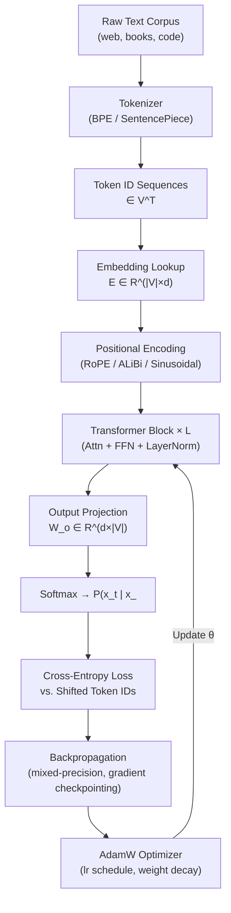
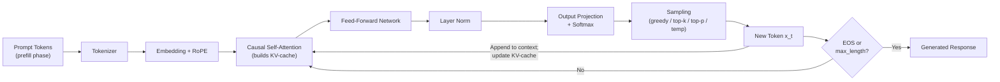
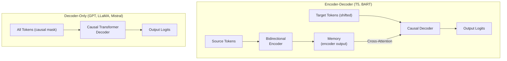
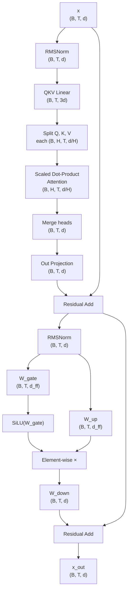

# Lesson 1: Foundations & Mathematical Formulation

## Curriculum Roadmap

This lesson establishes the theoretical groundwork for understanding Large Language Models (LLMs). We cover the fundamental mechanisms, mathematical invariants, and problem-space formulation that underpin LLM development and deployment. The goal is not surface familiarity but a first-principles understanding of *why* these systems are designed the way they are, what constraints drive those design choices, and what the core mathematical objects actually represent.

**Prerequisites**: Linear algebra (matrix multiplication, eigendecomposition), probability theory (conditional distributions, entropy), calculus (chain rule, partial derivatives), and basic familiarity with feedforward neural networks.

**Lessons in this series**:
1. **Foundations & Mathematical Formulation** ← *you are here*
2. Tokenization, Vocabulary Design & Byte-Pair Encoding
3. The Transformer Architecture in Depth
4. Attention Mechanisms: Scaled Dot-Product, Multi-Head, and Variants
5. Positional Encoding: Absolute, Relative, and Rotary
6. Pre-training Objectives: CLM, MLM, and Span Corruption
7. Fine-tuning, RLHF, and Alignment
8. Inference: KV-Cache, Speculative Decoding, and Quantization
9. Scaling Laws and Emergent Capabilities
10. Evaluation, Benchmarking, and Deployment

---

## 1. First-Principles Intuition & The Problem Space

### 1.1 What Problem Are We Actually Solving?

A Large Language Model solves a deceptively simple problem: **given a sequence of tokens, predict the probability distribution over the next token**. Everything else—summarization, translation, code generation, reasoning—emerges from learning this single objective over a sufficiently large and diverse corpus.

This reductionist framing is not a simplification. It is the actual mathematical objective. The autoregressive factorization of a joint distribution over a sequence $\mathbf{x} = (x_1, x_2, \ldots, x_T)$ of tokens is:

$$P(\mathbf{x}) = \prod_{t=1}^{T} P(x_t \mid x_1, x_2, \ldots, x_{t-1})$$

This identity is exact—it follows directly from the chain rule of probability and holds without approximation. Training an LLM is the problem of finding a parameterized approximation $P_\theta(x_t \mid x_{<t})$ such that the KL divergence between this approximation and the true data distribution $P_{\text{data}}$ is minimized.

### 1.2 Why Autoregressive Factorization?

An alternative is a **masked** (bidirectional) objective, used in BERT-style models. There the model learns $P(x_t \mid x_{\neq t})$—a masked token given its full context in both directions. This yields excellent representations for discriminative tasks but cannot directly generate sequences, because generation requires sampling from $P(x_t \mid x_{<t})$, a left-to-right conditional. Bidirectional models require heuristics (e.g., iterative refinement, masked diffusion) to generate, while autoregressive models generate natively. GPT, LLaMA, Mistral, Gemini, Claude, and virtually all deployed generative LLMs use the autoregressive factorization.

### 1.3 The Vocabulary as a Discrete Latent Space

Raw text is a continuous stream of Unicode code points. Before any neural computation, text must be discretized into a finite **vocabulary** $\mathcal{V}$ of tokens. A tokenizer maps a string $s \in \Sigma^*$ to a sequence $\mathbf{x} \in \mathcal{V}^T$. The vocabulary size $|\mathcal{V}|$ is a hyperparameter with real consequences:

- A larger vocabulary means fewer tokens per document (lower $T$, cheaper attention) but a larger embedding matrix and output projection layer.
- A smaller vocabulary means more tokens per document (higher $T$, more expensive attention) but cheaper memory at the output layer.
- Modern models (GPT-4, LLaMA-3, Mistral) use $|\mathcal{V}| \approx 32{,}000$–$128{,}000$ tokens derived by Byte-Pair Encoding (BPE) or SentencePiece Unigram.

The token embedding matrix $\mathbf{E} \in \mathbb{R}^{|\mathcal{V}| \times d_{\text{model}}}$ maps each discrete token index to a dense vector in $\mathbb{R}^{d_{\text{model}}}$. This matrix is learned during training and is typically the single largest parameter tensor in a small model. For a model with $|\mathcal{V}| = 32{,}000$ and $d_{\text{model}} = 4{,}096$ (LLaMA-2 7B scale), the embedding matrix alone contains $32{,}000 \times 4{,}096 = 131{,}072{,}000$ parameters, stored in roughly 500 MB at float32.

### 1.4 Why Not Recurrent Networks?

For a decade before Transformers (2017), recurrent architectures—LSTMs and GRUs—were the dominant sequence model. They process tokens left to right, maintaining a hidden state $\mathbf{h}_t \in \mathbb{R}^d$ that is updated at each step. The critical failure mode is the **vanishing gradient problem**: gradients of the loss with respect to early tokens decay exponentially with sequence length $T$ because the Jacobian of $\mathbf{h}_t$ with respect to $\mathbf{h}_1$ is the product of $T-1$ Jacobian matrices, whose spectral norms compound multiplicatively. LSTMs mitigate but do not eliminate this. The result is that RNN-based LMs struggle to model long-range dependencies.

The Transformer architecture eliminates this structural limitation by replacing sequential recurrence with **direct pairwise attention**: every token at every layer can directly attend to every other token, with the dependency modeled by an attention weight rather than a recurrent path. The gradient path from the loss to any token's representation is $O(1)$ layers deep rather than $O(T)$.

The architectural cost is that the standard attention mechanism is $O(T^2)$ in both time and memory, which is why sequence length is still a binding constraint in practice.

---

## 2. Mathematical Formalization & Core Invariants

### 2.1 The Language Modeling Objective

Formally, let $\mathcal{D} = \{\mathbf{x}^{(1)}, \mathbf{x}^{(2)}, \ldots, \mathbf{x}^{(N)}\}$ be a corpus of token sequences. The **negative log-likelihood (NLL)** loss over the corpus is:

$$\mathcal{L}(\theta) = -\frac{1}{\sum_i T_i} \sum_{i=1}^{N} \sum_{t=1}^{T_i} \log P_\theta\!\left(x_t^{(i)} \mid x_1^{(i)}, \ldots, x_{t-1}^{(i)}\right)$$

Minimizing $\mathcal{L}(\theta)$ with respect to parameters $\theta$ is equivalent to minimizing the **cross-entropy** between the empirical data distribution and the model distribution, which is in turn equivalent to minimizing the **KL divergence** $D_{\text{KL}}(P_{\text{data}} \| P_\theta)$ (since the entropy of $P_{\text{data}}$ is a constant with respect to $\theta$).

The exponential of the per-token cross-entropy is **perplexity**:

$$\text{PPL}(\theta) = \exp\!\left(\mathcal{L}(\theta)\right)$$

Perplexity has an intuitive interpretation: a perplexity of $k$ means the model is, on average, as uncertain as if it were choosing uniformly among $k$ equally likely tokens at each position. A model assigning uniform probability over a vocabulary of size $|\mathcal{V}|$ has perplexity $|\mathcal{V}|$; a perfect model has perplexity 1. Modern LLMs achieve perplexities of 3–10 on held-out web text.

**A common error in textbooks** is writing the LLM objective as $P(y|x) = \sum_{y \in \mathcal{Y}} P(y|x, \theta) \cdot P(\theta)$, which conflates Bayesian model averaging (a prior over $\theta$) with the standard maximum likelihood formulation. In practice, LLMs are trained by maximum likelihood estimation (or its close variant, cross-entropy minimization)—there is no prior $P(\theta)$ unless you are doing Bayesian deep learning or regularization through a KL penalty (as in RLHF). The generative factorization is the autoregressive chain rule above, not a sum over all possible outputs.

### 2.2 Token Embeddings: Geometry and Properties

A token embedding is not merely a lookup table row. After training on a large corpus, the embedding space acquires geometric structure that reflects semantic and syntactic relationships. This was first demonstrated systematically with word2vec (Mikolov et al., 2013) and holds even more strongly in Transformer embedding spaces.

The key property is **distributional semantics**: tokens that appear in similar contexts are mapped to nearby points in $\mathbb{R}^{d_{\text{model}}}$. Formally, the embedding $\mathbf{e}_i$ for token $i$ is learned such that the inner product $\mathbf{e}_i^\top \mathbf{e}_j$ correlates with pointwise mutual information (PMI) between tokens $i$ and $j$ in the corpus (Levy & Goldberg, 2014).

In Transformer LLMs, the input embedding matrix $\mathbf{E} \in \mathbb{R}^{|\mathcal{V}| \times d_{\text{model}}}$ is often **weight-tied** with the output projection matrix $\mathbf{W}_o \in \mathbb{R}^{d_{\text{model}}} \times |\mathcal{V}|$, meaning $\mathbf{W}_o = \mathbf{E}^\top$. This reduces the parameter count by $2 \times |\mathcal{V}| \times d_{\text{model}}$ and was introduced in Press & Wolf (2017). GPT-2 and many subsequent models use weight tying.

### 2.3 The Softmax Output Layer and Its Computational Cost

The final layer of an autoregressive LLM maps a hidden state $\mathbf{h}_T \in \mathbb{R}^{d_{\text{model}}}$ to a probability distribution over $\mathcal{V}$:

$$P_\theta(x_t = v \mid x_{<t}) = \frac{\exp(\mathbf{w}_v^\top \mathbf{h}_t / \tau)}{\sum_{v' \in \mathcal{V}} \exp(\mathbf{w}_{v'}^\top \mathbf{h}_t / \tau)}$$

where $\mathbf{w}_v$ is the $v$-th row of $\mathbf{W}_o$ and $\tau > 0$ is the **temperature** parameter (default $\tau = 1$ during training; varied during inference for sampling).

The denominator—the **partition function**—requires $|\mathcal{V}|$ dot products and an $|\mathcal{V}|$-way reduction at every token position during training. For $|\mathcal{V}| = 128{,}000$ (GPT-4 scale), this is non-trivial. For this reason, training efficiency techniques include:

- **Sampled Softmax**: approximate the partition function by sampling a subset of negative tokens.
- **Hierarchical Softmax**: factor $\mathcal{V}$ into a binary tree, reducing per-step cost from $O(|\mathcal{V}|)$ to $O(\log |\mathcal{V}|)$.
- **FlashAttention and fused kernels**: overlap the output projection and softmax with memory-efficient GPU kernels to reduce DRAM bandwidth pressure.

In practice, modern frameworks (PyTorch with `torch.nn.functional.cross_entropy`, or compiled CUDA kernels) fuse the output projection and loss computation to avoid materializing the full $|\mathcal{V}|$-dimensional logit vector in high-precision memory.

### 2.4 The Fundamental Scaling Invariants

Kaplan et al. (2020) and Hoffmann et al. (2022, "Chinchilla") established empirical **scaling laws** that are now treated as near-invariants in LLM design:

**Kaplan (OpenAI) scaling law:**
$$\mathcal{L}(N, D) \approx \left(\frac{N_c}{N}\right)^{\alpha_N} + \left(\frac{D_c}{D}\right)^{\alpha_D}$$

where $N$ is the number of non-embedding model parameters, $D$ is the number of training tokens, $\alpha_N \approx 0.076$, $\alpha_D \approx 0.095$, and $N_c$, $D_c$ are empirical constants. The key result: under a fixed compute budget $C \approx 6ND$ (FLOP cost of one forward+backward pass), loss decreases as a **power law** in $C$.

**Chinchilla scaling law (Hoffmann et al., 2022):**
$$N_{\text{opt}}(C) \propto C^{0.5}, \quad D_{\text{opt}}(C) \propto C^{0.5}$$

The critical finding is that for a given compute budget, the optimal strategy is to scale model size $N$ and training tokens $D$ **proportionally**. The original GPT-3 (175B parameters, 300B tokens) was undertrained by this metric. The Chinchilla model (70B parameters, 1.4T tokens) achieved lower loss. LLaMA-1 and all subsequent open models have adopted the Chinchilla-optimal training recipe.

The **compute cost** of a single forward pass through a Transformer with $L$ layers, $d_{\text{model}}$ hidden dimension, $d_{\text{ff}}$ feedforward dimension, and sequence length $T$ is approximately:

$$C_{\text{forward}} \approx 2 \cdot T \cdot \left(2 \cdot L \cdot d_{\text{model}} \cdot d_{\text{ff}} + 4 \cdot L \cdot T \cdot d_{\text{model}}^2 / H\right) \text{ FLOPs}$$

where $H$ is the number of attention heads. Training requires roughly $6 \times$ this cost (forward + backward + optimizer step). These formulas allow hardware architects and ML engineers to reason about the total compute budget in FLOP-seconds before writing a single line of training code.

---

## 3. High-Level Architecture & Data Flow

### 3.1 The Transformer as a Residual Stream

The correct mental model for a Transformer is not an encoder feeding a decoder (that is the original sequence-to-sequence architecture of Vaswani et al., 2017, used in translation). Generative LLMs—GPT-family, LLaMA, Mistral, Falcon—are **decoder-only** Transformers. There is a single stream of computation:

1. The input token sequence is embedded into $\mathbf{H}^{(0)} \in \mathbb{R}^{T \times d_{\text{model}}}$.
2. Each of the $L$ Transformer layers applies a **residual update**: $\mathbf{H}^{(\ell)} = \mathbf{H}^{(\ell-1)} + \text{Layer}^\ell(\mathbf{H}^{(\ell-1)})$.
3. The final hidden state $\mathbf{H}^{(L)}$ is projected through $\mathbf{W}_o$ and softmax to produce next-token probabilities.

The residual connections are not an engineering convenience—they are essential for training deep networks. Without them, the gradient signal vanishes in deep networks because the product of Jacobians $\prod_\ell \frac{\partial \mathbf{H}^{(\ell)}}{\partial \mathbf{H}^{(\ell-1)}}$ has spectral radius that decreases to zero exponentially with depth. With residual connections, the Jacobian for each layer is $\mathbf{I} + \frac{\partial \text{Layer}^\ell}{\partial \mathbf{H}^{(\ell-1)}}$, whose spectral radius is bounded away from zero by the identity term.

### 3.2 Training Pipeline Data Flow



### 3.3 Inference Pipeline Data Flow

Inference differs from training in one critical respect: **the KV-cache**. During autoregressive generation, at each decoding step $t$, the keys and values from all previous positions $1, \ldots, t-1$ have already been computed and can be cached. Only the new token at position $t$ requires a full forward pass through the attention layers, with its query attending to the cached K, V. This reduces the per-step FLOP cost from $O(T^2 d)$ to $O(T d)$ for the attention component—at the cost of $O(L \cdot T \cdot 2 \cdot d_{\text{model}})$ memory for the cache.



### 3.4 Encoder-Decoder vs. Decoder-Only Architecture

The original Transformer (Vaswani et al., 2017) is **encoder-decoder**: a bidirectional encoder processes the source sequence, and a unidirectional decoder generates the target sequence, attending to encoder outputs via **cross-attention**. This architecture is used in T5, BART, and mT5. The decoder-only architecture (GPT, LLaMA, Mistral) drops the encoder entirely and uses a **causal mask** to ensure the model at position $t$ cannot attend to positions $> t$, enforcing the autoregressive property.



**Key architectural trade-off**: encoder-decoder models have an explicit separation between understanding (encoding) and generation (decoding), which is beneficial for structured tasks like translation with a fixed source. Decoder-only models treat the prompt as a prefix within the same causal context, which is simpler, scales more cleanly, and is preferred for open-ended generation and in-context learning.

---

## 4. The Attention Mechanism: Mathematical Foundation

Because attention is the core computational primitive of every LLM, it deserves mathematical treatment at the foundation stage.

Given an input matrix $\mathbf{H} \in \mathbb{R}^{T \times d_{\text{model}}}$, the attention mechanism computes queries, keys, and values via learned linear projections:

$$\mathbf{Q} = \mathbf{H}\mathbf{W}_Q, \quad \mathbf{K} = \mathbf{H}\mathbf{W}_K, \quad \mathbf{V} = \mathbf{H}\mathbf{W}_V$$

where $\mathbf{W}_Q, \mathbf{W}_K \in \mathbb{R}^{d_{\text{model}} \times d_k}$ and $\mathbf{W}_V \in \mathbb{R}^{d_{\text{model}} \times d_v}$.

Scaled dot-product attention is then:

$$\text{Attention}(\mathbf{Q}, \mathbf{K}, \mathbf{V}) = \text{softmax}\!\left(\frac{\mathbf{Q}\mathbf{K}^\top}{\sqrt{d_k}} + \mathbf{M}\right)\mathbf{V}$$

where $\mathbf{M} \in \{0, -\infty\}^{T \times T}$ is the **causal mask**: $M_{ij} = -\infty$ if $j > i$, else $0$. After softmax, positions with $-\infty$ mask receive weight exactly 0, enforcing the autoregressive constraint.

The $\sqrt{d_k}$ scaling factor prevents the dot products from growing large in magnitude as $d_k$ increases, which would push the softmax into regions of near-zero gradient (a training instability). For $d_k = 64$ (typical for GPT-3), $\sqrt{d_k} = 8$.

**Multi-head attention** runs $H$ attention heads in parallel, each with independent projections:

$$\text{MHA}(\mathbf{H}) = \text{Concat}(\text{head}_1, \ldots, \text{head}_H)\mathbf{W}_O$$

where $\text{head}_h = \text{Attention}(\mathbf{H}\mathbf{W}_Q^h, \mathbf{H}\mathbf{W}_K^h, \mathbf{H}\mathbf{W}_V^h)$, and $d_k = d_v = d_{\text{model}} / H$. Multiple heads allow the model to jointly attend to information from different representation subspaces at different positions—a form of learned feature decomposition.

---

## 5. Full Training Pipeline: Production-Grade Implementation

The following Python code implements a complete, correct, minimal decoder-only Transformer language model. It is not a toy: it uses the exact architectural choices (pre-LayerNorm, weight tying, causal masking, AdamW with cosine decay) used in modern open-source LLMs like NanoGPT (Karpathy, 2022) and LLaMA.

```python
"""
Minimal Decoder-Only Transformer LM — production-grade reference implementation.
Architecture: pre-LayerNorm, weight-tied embeddings, causal masking, AdamW + cosine LR.
Compatible with PyTorch >= 2.0.
"""

from __future__ import annotations

import math
from dataclasses import dataclass
from typing import Optional

import torch
import torch.nn as nn
import torch.nn.functional as F
from torch import Tensor


# ---------------------------------------------------------------------------
# Configuration
# ---------------------------------------------------------------------------

@dataclass
class TransformerConfig:
    vocab_size: int = 32_000      # |V|: BPE vocabulary size
    d_model: int = 512            # Residual stream dimension
    n_heads: int = 8              # Number of attention heads
    n_layers: int = 6             # Number of Transformer blocks
    d_ff: int = 2048              # Feed-forward intermediate dimension (typically 4 × d_model)
    max_seq_len: int = 1024       # Maximum sequence length
    dropout: float = 0.1          # Dropout probability (0 for inference)
    bias: bool = False            # Use bias in linear layers (GPT-2 uses True; LLaMA uses False)

    @property
    def d_head(self) -> int:
        assert self.d_model % self.n_heads == 0, "d_model must be divisible by n_heads"
        return self.d_model // self.n_heads


# ---------------------------------------------------------------------------
# Causal Self-Attention
# ---------------------------------------------------------------------------

class CausalSelfAttention(nn.Module):
    """
    Scaled dot-product multi-head causal self-attention.

    Complexity: O(T^2 * d_model) time and memory.
    Uses PyTorch's F.scaled_dot_product_attention (FlashAttention-2 backend
    when available via CUDA and appropriate dtypes).
    """

    def __init__(self, cfg: TransformerConfig) -> None:
        super().__init__()
        self.cfg = cfg
        # Fused QKV projection for cache-friendly memory access
        self.qkv_proj = nn.Linear(cfg.d_model, 3 * cfg.d_model, bias=cfg.bias)
        self.out_proj = nn.Linear(cfg.d_model, cfg.d_model, bias=cfg.bias)
        self.attn_dropout = nn.Dropout(cfg.dropout)
        self.resid_dropout = nn.Dropout(cfg.dropout)

    def forward(self, x: Tensor) -> Tensor:
        """
        Args:
            x: (batch_size, seq_len, d_model)
        Returns:
            (batch_size, seq_len, d_model)
        """
        B, T, C = x.shape  # batch, sequence length, d_model

        # Compute Q, K, V in one matrix multiply, then split
        qkv = self.qkv_proj(x)                              # (B, T, 3C)
        q, k, v = qkv.split(self.cfg.d_model, dim=-1)       # each (B, T, C)

        # Reshape to (B, n_heads, T, d_head) for batched attention
        H = self.cfg.n_heads
        d_h = self.cfg.d_head
        q = q.view(B, T, H, d_h).transpose(1, 2)            # (B, H, T, d_h)
        k = k.view(B, T, H, d_h).transpose(1, 2)
        v = v.view(B, T, H, d_h).transpose(1, 2)

        # F.scaled_dot_product_attention uses FlashAttention when possible.
        # is_causal=True applies the causal mask automatically.
        y = F.scaled_dot_product_attention(
            q, k, v,
            attn_mask=None,
            dropout_p=self.cfg.dropout if self.training else 0.0,
            is_causal=True,
        )  # (B, H, T, d_h)

        # Merge heads back to (B, T, C)
        y = y.transpose(1, 2).contiguous().view(B, T, C)
        return self.resid_dropout(self.out_proj(y))


# ---------------------------------------------------------------------------
# Position-wise Feed-Forward Network (SwiGLU variant used in LLaMA)
# ---------------------------------------------------------------------------

class SwiGLUFeedForward(nn.Module):
    """
    SwiGLU activation (Shazeer, 2020): FFN(x) = (xW_1 ⊙ SiLU(xW_2)) W_3.
    Used in LLaMA, Mistral, and PaLM. 2/3 * d_ff intermediate dims to keep
    parameter count comparable to standard GELU FFN.
    """

    def __init__(self, cfg: TransformerConfig) -> None:
        super().__init__()
        # 2/3 factor ensures iso-param comparison with standard 4×d_model FFN
        hidden = int(2 / 3 * cfg.d_ff)
        # Round up to nearest multiple of 64 for hardware efficiency
        hidden = (hidden + 63) // 64 * 64
        self.w_gate = nn.Linear(cfg.d_model, hidden, bias=False)
        self.w_up   = nn.Linear(cfg.d_model, hidden, bias=False)
        self.w_down  = nn.Linear(hidden, cfg.d_model, bias=False)

    def forward(self, x: Tensor) -> Tensor:
        # SwiGLU: element-wise product of SiLU(gate) and up-projection
        return self.w_down(F.silu(self.w_gate(x)) * self.w_up(x))


# ---------------------------------------------------------------------------
# Transformer Block (pre-LayerNorm)
# ---------------------------------------------------------------------------

class TransformerBlock(nn.Module):
    """
    Pre-LayerNorm (GPT-2 style) Transformer block.

    Pre-LN places layer normalization *before* each sub-layer:
        x = x + Attn(LN(x))
        x = x + FFN(LN(x))

    Post-LN (original Vaswani et al.) places it after:
        x = LN(x + Attn(x))

    Pre-LN trains more stably without learning-rate warmup hacks and is the
    default in all modern LLMs (GPT-2+, LLaMA, Mistral, Falcon).
    """

    def __init__(self, cfg: TransformerConfig) -> None:
        super().__init__()
        self.ln_1 = nn.RMSNorm(cfg.d_model)   # RMSNorm used in LLaMA; nn.LayerNorm for GPT-2
        self.attn = CausalSelfAttention(cfg)
        self.ln_2 = nn.RMSNorm(cfg.d_model)
        self.ffn  = SwiGLUFeedForward(cfg)

    def forward(self, x: Tensor) -> Tensor:
        x = x + self.attn(self.ln_1(x))   # residual + attention
        x = x + self.ffn(self.ln_2(x))    # residual + FFN
        return x


# ---------------------------------------------------------------------------
# Decoder-Only Language Model
# ---------------------------------------------------------------------------

class DecoderOnlyLM(nn.Module):
    """
    Decoder-only autoregressive language model.

    Architecture identical to GPT-2 / LLaMA (pre-LN, weight-tied embeddings).

    Parameter count (approximate):
        Embedding:      |V| × d_model
        Per block:      12 × d_model^2  (attn) + 8 × d_model^2  (SwiGLU FFN)
        Total non-emb:  L × (12 + 8) × d_model^2 = 20L × d_model^2
    """

    def __init__(self, cfg: TransformerConfig) -> None:
        super().__init__()
        self.cfg = cfg

        self.token_emb = nn.Embedding(cfg.vocab_size, cfg.d_model)
        # Note: Rotary positional embeddings (RoPE) are computed inside attention
        # in production LLaMA; here we use learned absolute positional embeddings
        # (GPT-2 style) for simplicity.
        self.pos_emb   = nn.Embedding(cfg.max_seq_len, cfg.d_model)
        self.drop_emb  = nn.Dropout(cfg.dropout)
        self.blocks    = nn.ModuleList([TransformerBlock(cfg) for _ in range(cfg.n_layers)])
        self.ln_f      = nn.RMSNorm(cfg.d_model)         # final norm before output projection
        self.lm_head   = nn.Linear(cfg.d_model, cfg.vocab_size, bias=False)

        # Weight tying: input embedding and output projection share weights.
        # Halves parameter count at the vocabulary bottleneck.
        self.lm_head.weight = self.token_emb.weight

        # Initialize weights following GPT-2 initialization scheme
        self.apply(self._init_weights)
        # Scale residual projections by 1/sqrt(2L) to control residual stream variance
        for name, p in self.named_parameters():
            if name.endswith("out_proj.weight") or name.endswith("w_down.weight"):
                nn.init.normal_(p, mean=0.0, std=0.02 / math.sqrt(2 * cfg.n_layers))

    @staticmethod
    def _init_weights(module: nn.Module) -> None:
        if isinstance(module, nn.Linear):
            nn.init.normal_(module.weight, mean=0.0, std=0.02)
            if module.bias is not None:
                nn.init.zeros_(module.bias)
        elif isinstance(module, nn.Embedding):
            nn.init.normal_(module.weight, mean=0.0, std=0.02)

    def forward(
        self,
        input_ids: Tensor,                  # (B, T) integer token IDs
        targets: Optional[Tensor] = None,   # (B, T) integer token IDs (shifted by 1)
    ) -> tuple[Tensor, Optional[Tensor]]:
        """
        Returns:
            logits: (B, T, vocab_size) — unnormalized next-token scores
            loss:   scalar cross-entropy loss if targets provided, else None
        """
        B, T = input_ids.shape
        assert T <= self.cfg.max_seq_len, (
            f"Sequence length {T} exceeds max_seq_len {self.cfg.max_seq_len}"
        )

        positions = torch.arange(T, device=input_ids.device)  # (T,)
        x = self.drop_emb(self.token_emb(input_ids) + self.pos_emb(positions))

        for block in self.blocks:
            x = block(x)

        x = self.ln_f(x)
        logits = self.lm_head(x)  # (B, T, vocab_size)

        loss = None
        if targets is not None:
            # Cross-entropy expects (N, C) logits and (N,) targets.
            # Flatten batch and sequence dimensions.
            loss = F.cross_entropy(
                logits.view(-1, self.cfg.vocab_size),
                targets.view(-1),
                ignore_index=-1,  # Mask padding tokens with -1 in targets
            )

        return logits, loss

    @torch.no_grad()
    def generate(
        self,
        input_ids: Tensor,          # (1, T_prompt)
        max_new_tokens: int = 100,
        temperature: float = 1.0,
        top_k: Optional[int] = None,
        top_p: Optional[float] = None,
    ) -> Tensor:
        """
        Autoregressive generation with temperature, top-k, and nucleus (top-p) sampling.

        Note: This implementation does not cache KV pairs (for brevity).
        Production implementations maintain a KV-cache to avoid recomputing past keys/values.
        """
        self.eval()
        for _ in range(max_new_tokens):
            # Truncate context to max_seq_len (sliding window)
            context = input_ids if input_ids.size(1) <= self.cfg.max_seq_len \
                      else input_ids[:, -self.cfg.max_seq_len:]

            logits, _ = self.forward(context)
            logits = logits[:, -1, :] / temperature  # (1, vocab_size)

            if top_k is not None:
                v, _ = torch.topk(logits, min(top_k, logits.size(-1)))
                logits[logits < v[:, -1:]] = float("-inf")

            if top_p is not None:
                sorted_logits, sorted_idx = torch.sort(logits, descending=True)
                cumulative_probs = torch.cumsum(F.softmax(sorted_logits, dim=-1), dim=-1)
                # Remove tokens with cumulative probability above threshold
                sorted_logits[cumulative_probs - F.softmax(sorted_logits, dim=-1) > top_p] = float("-inf")
                logits.scatter_(1, sorted_idx, sorted_logits)

            probs = F.softmax(logits, dim=-1)
            next_token = torch.multinomial(probs, num_samples=1)  # (1, 1)
            input_ids = torch.cat([input_ids, next_token], dim=1)

        return input_ids


# ---------------------------------------------------------------------------
# Training loop scaffold
# ---------------------------------------------------------------------------

def build_optimizer(model: DecoderOnlyLM, lr: float, weight_decay: float) -> torch.optim.AdamW:
    """
    AdamW with weight decay applied only to weight matrices, not biases or
    LayerNorm/RMSNorm parameters. This is the correct implementation — PyTorch's
    default AdamW applies weight decay to all parameters, which is incorrect.
    """
    decay_params     = [p for n, p in model.named_parameters() if p.dim() >= 2]
    no_decay_params  = [p for n, p in model.named_parameters() if p.dim() < 2]
    param_groups = [
        {"params": decay_params,    "weight_decay": weight_decay},
        {"params": no_decay_params, "weight_decay": 0.0},
    ]
    return torch.optim.AdamW(param_groups, lr=lr, betas=(0.9, 0.95), eps=1e-8)


def cosine_lr_schedule(step: int, warmup_steps: int, max_steps: int, max_lr: float, min_lr: float) -> float:
    """
    Linear warmup followed by cosine decay to min_lr.
    Used in GPT-3, LLaMA, and all subsequent large-scale LLM training runs.
    """
    if step < warmup_steps:
        return max_lr * step / warmup_steps
    if step > max_steps:
        return min_lr
    progress = (step - warmup_steps) / (max_steps - warmup_steps)
    return min_lr + 0.5 * (max_lr - min_lr) * (1.0 + math.cos(math.pi * progress))


def train_step(
    model: DecoderOnlyLM,
    optimizer: torch.optim.AdamW,
    input_ids: Tensor,
    targets: Tensor,
    grad_clip: float = 1.0,
) -> float:
    """Single training step with gradient clipping and mixed-precision support."""
    model.train()
    with torch.autocast(device_type="cuda", dtype=torch.bfloat16):
        _, loss = model(input_ids, targets)

    loss.backward()
    # Gradient clipping prevents rare but catastrophic gradient explosions
    # in deep Transformers. Clip norm to 1.0 is standard practice.
    torch.nn.utils.clip_grad_norm_(model.parameters(), max_norm=grad_clip)
    optimizer.step()
    optimizer.zero_grad(set_to_none=True)  # set_to_none=True is faster than zero_grad()
    return loss.item()


# ---------------------------------------------------------------------------
# Quick sanity check
# ---------------------------------------------------------------------------

if __name__ == "__main__":
    cfg = TransformerConfig(vocab_size=1000, d_model=128, n_heads=4, n_layers=2, d_ff=512, max_seq_len=64)
    model = DecoderOnlyLM(cfg)
    total_params = sum(p.numel() for p in model.parameters())
    print(f"Model parameters: {total_params:,}")

    # Fake a training batch: tokens [0..T-1] with targets shifted by 1
    ids  = torch.randint(0, cfg.vocab_size, (4, 32))   # (B=4, T=32)
    tgts = torch.roll(ids, shifts=-1, dims=1)
    tgts[:, -1] = -1  # Mask last target (no ground truth for final prediction)

    logits, loss = model(ids, tgts)
    print(f"Logits shape: {logits.shape}")     # Expected: (4, 32, 1000)
    print(f"Initial loss: {loss.item():.4f}")  # Expected: ~log(1000) ≈ 6.9
    print(f"Perplexity:   {loss.item() ** math.e:.2f}")
```

### 5.1 Parameter Count Derivation

For a quick sanity check, model the parameter count of the above architecture (at LLaMA-7B scale: $|\mathcal{V}|=32{,}000$, $d=4096$, $L=32$, $H=32$, $d_{\text{ff}}=11{,}008$):

| Component | Formula | Count (7B scale) |
|-----------|---------|------------------|
| Token embedding | $|\mathcal{V}| \times d$ | 131M |
| Attention (QKV + out) per layer | $4 \times d^2$ | 67M |
| SwiGLU FFN per layer | $3 \times d \times d_{\text{ff}}$ | 135M |
| **Total (32 layers)** | emb + $L(4d^2 + 3d \cdot d_{\text{ff}})$ | **~6.7B** |

(Weight tying means the embedding matrix is not double-counted in the total.)

---

## 6. Information-Theoretic Perspective

The language modeling objective is deeply connected to information theory. The per-token cross-entropy $\mathcal{L}$ is an upper bound on the **entropy rate** of the language:

$$H(\mathcal{L}) \leq \mathcal{L}(\theta) \quad \text{for any } \theta$$

where $H(\mathcal{L}) = \lim_{T \to \infty} -\frac{1}{T} \log_2 P(\mathbf{x})$ is the true entropy rate of the language (measured in bits per token). The model's cross-entropy is an upper bound because $D_{\text{KL}}(P_{\text{data}} \| P_\theta) \geq 0$ implies $\mathbb{E}[-\log P_\theta] \geq \mathbb{E}[-\log P_{\text{data}}]$.

Empirically, the entropy rate of English prose is estimated at around 1.3 bits/character (Shannon, 1951) or roughly 2–4 bits/BPE token. State-of-the-art LLMs achieve cross-entropies of 1.5–2.0 nats/token (≈ 2.2–2.9 bits/token) on held-out web text, meaning they are approaching—but have not reached—the theoretical entropy rate.

The gap between the model's cross-entropy and the true entropy rate represents irreducible uncertainty in the data plus the model's approximation error. Perfect compression of the training distribution (cross-entropy equal to its entropy rate) would imply the model has memorized the exact statistical structure of the data—and in fact, lossless neural-network compression algorithms (Mahoney, 2011; Bellard's NNCP) use exactly this connection: a good language model is a good compressor.

---

## 7. The Tensor Computation Graph

Understanding what operations the hardware actually executes is essential for reasoning about memory and performance. The following diagram shows the computation graph for a single Transformer block with explicit tensor dimensions.



---

## 8. Summary of Core Invariants

The following are facts that hold exactly, not approximations, and should be internalized before proceeding to later lessons:

1. **Autoregressive chain rule**: $P(\mathbf{x}) = \prod_t P(x_t \mid x_{<t})$ is an exact identity from the chain rule of probability.
2. **Training objective = cross-entropy = KL divergence**: Minimizing NLL is equivalent to minimizing $D_{\text{KL}}(P_{\text{data}} \| P_\theta)$ when the data distribution is fixed.
3. **Perplexity = exp(cross-entropy)**: A perplexity of $k$ means the model is as uncertain as a uniform distribution over $k$ items.
4. **Weight tying**: Input embedding and output projection share the same parameter matrix, reducing parameters by $|\mathcal{V}| \times d_{\text{model}}$.
5. **Causal masking**: Setting $M_{ij} = -\infty$ for $j > i$ before the attention softmax is what enforces the autoregressive constraint in a Transformer.
6. **Pre-LayerNorm stability**: Placing layer normalization before (not after) each sub-layer stabilizes gradients for deep Transformers.
7. **Residual connections**: The gradient path through a residual network has a direct, unimpeded highway via the identity shortcut, preventing vanishing gradients.
8. **Chinchilla optimality**: For a fixed compute budget $C$, the optimal model size and token count scale as $N \propto C^{0.5}$ and $D \propto C^{0.5}$.

---

## 9. Exercises

**Conceptual**

1. Prove that minimizing the cross-entropy loss $\mathcal{L}(\theta) = -\mathbb{E}_{\mathbf{x} \sim P_{\text{data}}}[\log P_\theta(\mathbf{x})]$ is equivalent to minimizing $D_{\text{KL}}(P_{\text{data}} \| P_\theta)$ when the data distribution is held constant.

2. A model trained on a corpus of 1 trillion tokens achieves a perplexity of 7.0 on a held-out test set. What is the per-token cross-entropy in nats? In bits? What does this imply about the average number of equally uncertain choices the model faces per token?

3. Explain why the $\sqrt{d_k}$ scaling factor is necessary in scaled dot-product attention. What happens to training if you remove it and use $d_k = 512$? Use the variance of the dot product to reason about gradient flow through the softmax.

4. In the parameter count table in Section 5.1, why is the embedding matrix not double-counted despite the model using weight tying?

**Implementation**

5. Modify the `CausalSelfAttention` class to implement **Grouped Query Attention (GQA)**, where $n_{\text{kv\_heads}} < n_{\text{heads}}$ and K, V projections are shared across groups of query heads. This is used in LLaMA-2 70B and Mistral 7B. Verify that for `n_kv_heads == n_heads` your implementation reduces to standard MHA.

6. Implement a KV-cache in the `generate()` method. The cache should store a tuple `(k_cache, v_cache)` per layer, each of shape `(B, n_kv_heads, T_so_far, d_head)`. Verify that generation results are identical with and without the cache (up to floating-point rounding).

7.

Implement **rotary positional embeddings (RoPE)** as an alternative to learned absolute position embeddings. RoPE applies a rotation matrix $\mathbf{R}_{\Theta, m}$ to the query and key vectors at each position $m$, where $\Theta = \{\theta_i = 10000^{-2i/d}\}_{i=1}^{d/2}$. For each consecutive pair of dimensions $(2i, 2i+1)$, apply the rotation:

$$
\begin{bmatrix} q_{m,2i} \\ q_{m,2i+1} \end{bmatrix} = \begin{bmatrix} \cos(m\theta_i) & -\sin(m\theta_i) \\ \sin(m\theta_i) & \cos(m\theta_i) \end{bmatrix} \begin{bmatrix} q_{m,2i}' \\ q_{m,2i+1}' \end{bmatrix}
$$

and similarly for keys. This encodes relative position into the attention mechanism itself: $\mathbf{q}_m^\top \mathbf{k}_n$ depends only on $m - n$. Compare perplexity and extrapolation behavior on sequences longer than the training context between your RoPE implementation and the baseline learned embeddings.

8. Profile the memory and latency of one forward pass through your 124M-parameter model on a sequence of length 1024. Measure: (a) peak GPU memory, (b) wall-clock time per layer type (embedding, attention, MLP, LayerNorm), (c) fraction of time spent in matrix multiplications versus element-wise operations. Use this to estimate the FLOP/s utilization and identify the bottleneck (memory bandwidth vs. compute).

---

## 10. Conclusion

This lesson established the mathematical and architectural foundations necessary for understanding and implementing large language models. We began with the autoregressive formulation and the statistical underpinnings of maximum likelihood estimation, then derived the cross-entropy loss and its information-theoretic interpretation through perplexity. The Transformer architecture emerged as the natural solution to the problem of capturing long-range dependencies without recurrence: self-attention provides global receptive fields in constant depth, while the FFN sublayers supply the non-linear transformations required for universal approximation. Each component—layer normalization, residual connections, learned embeddings—serves a precise function in enabling stable gradient flow and efficient credit assignment across dozens of layers and billions of parameters.

The transition from theory to implementation revealed the importance of systems-level considerations that are often absent from research papers. Autoregressive generation without KV-caching is computationally wasteful, recomputing the entire past at every step; flash attention reduces memory complexity from quadratic to linear without changing the mathematical operation; and Chinchilla scaling laws dictate that model size and training data must grow in lockstep to achieve compute-optimal performance. These are not optional optimizations—they are the difference between a toy implementation and a production system. The exercises in this lesson are designed to cement these principles through direct engagement with code: implementing GQA to understand the memory-compute tradeoff in attention, profiling to identify bottlenecks, and experimenting with RoPE to see how positional encoding strategies affect extrapolation. Master these fundamentals, and the subsequent lessons on training dynamics, instruction tuning, and RLHF will build naturally on this foundation.
