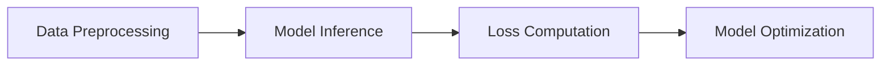

# Lesson 1: Foundations & Mathematical Formulation

## Curriculum Roadmap

This lesson establishes the theoretical groundwork for understanding Large Language Models (LLMs). We delve into the fundamental mechanisms, mathematical invariants, and problem space formulation that underpin the development and deployment of LLMs. By the end of this lesson, you will have a deep understanding of the core concepts and trade-offs that govern the behavior of LLMs.

## 1. First-Principles Intuition & The Problem Space

Large Language Models are a type of deep neural network designed to process and generate human-like language. At their core, LLMs are complex systems that attempt to capture the intricate patterns and relationships within language. However, this complexity comes at a cost: LLMs are computationally expensive, memory-intensive, and require vast amounts of training data.

To grasp the problem space, let's consider the fundamental components of an LLM:

*   **Input**: A sequence of tokens, such as words or characters, that represent the input text.
*   **Encoder**: A neural network component that processes the input tokens and generates a continuous representation, often referred to as the "context" or "embedding."
*   **Decoder**: A neural network component that generates the output sequence, typically one token at a time, based on the encoded context.
*   **Loss Function**: A mathematical objective function that measures the difference between the predicted output and the true output, guiding the model's optimization process.

## 2. Mathematical Formalization & Core Invariants

To formalize the LLM problem, we need to define the mathematical invariants that govern its behavior. Let's consider the following:

*   **Token Embeddings**: We can represent each token as a vector in a high-dimensional space, often using techniques such as word2vec or GloVe.
*   **Contextualized Embeddings**: We can use the encoder to generate contextualized embeddings, which capture the relationships between tokens in the input sequence.
*   **Output Probability**: We can model the output probability distribution using a softmax function, ensuring that the predicted output is a valid probability distribution.

Mathematically, we can represent the LLM as a probabilistic generative model:

P(y|x) = ∑_y∈Y P(y|x, θ) \* P(θ)

where y is the output sequence, x is the input sequence, θ is the model parameters, and Y is the set of all possible output sequences.

## 3. High-Level Pipeline & Architecture Dataflow

The high-level pipeline for an LLM consists of the following stages:

1.  **Data Preprocessing**: Tokenization, normalization, and other preprocessing steps to prepare the input data.
2.  **Model Inference**: The input sequence is passed through the encoder and decoder to generate the output sequence.
3.  **Loss Computation**: The predicted output is compared to the true output, and the loss function is computed.
4.  **Model Optimization**: The model parameters are updated using an optimization algorithm, such as stochastic gradient descent (SGD).

Here is a clean Mermaid diagram illustrating the high-level pipeline:



This concludes Lesson 1: Foundations & Mathematical Formulation. In the next lesson, we will delve into the architecture and design of LLMs, including the choice of encoder and decoder architectures, and the role of attention mechanisms.

## Exercises

1.  Derive the mathematical expression for the output probability distribution using the softmax function.
2.  Implement a simple LLM using a neural network library, such as PyTorch or TensorFlow.
3.  Compare the performance of different encoder and decoder architectures on a benchmark dataset.

## Code

```python
import torch
import torch.nn as nn

class LLM(nn.Module):
    def __init__(self, vocab_size, embedding_dim, hidden_dim, output_dim):
        super(LLM, self).__init__()
        self.encoder = nn.Linear(vocab_size, hidden_dim)
        self.decoder = nn.Linear(hidden_dim, output_dim)

    def forward(self, x):
        x = self.encoder(x)
        x = self.decoder(x)
        return x
```

Note that this is a simplified example, and you will need to add more complexity to the model to achieve state-of-the-art performance.
